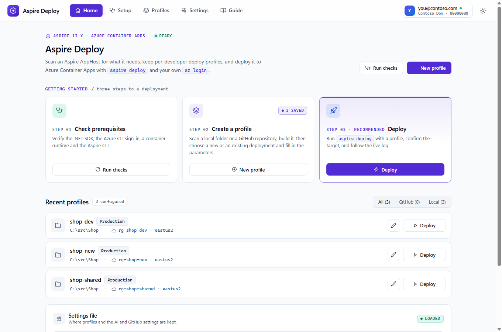
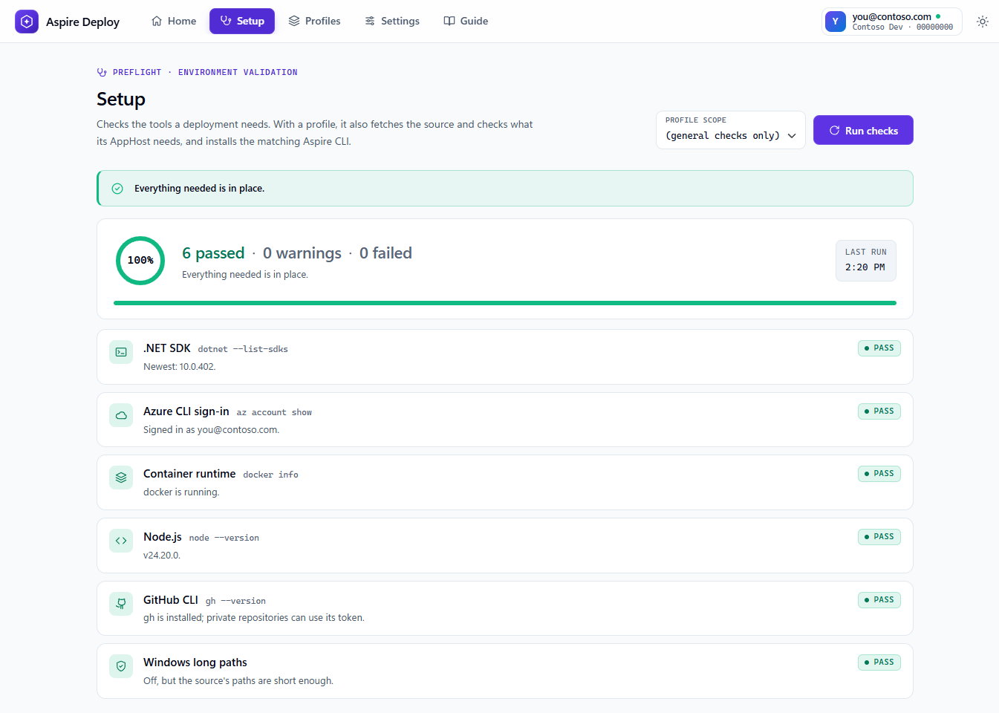
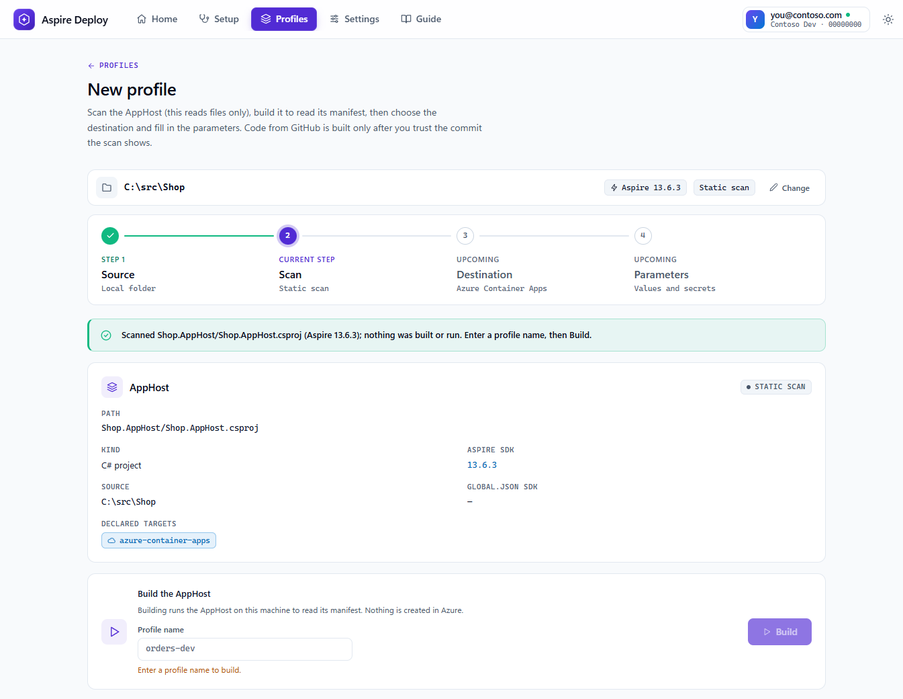
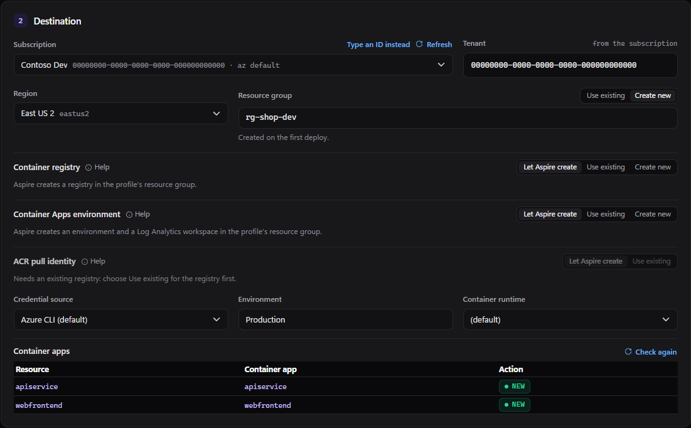
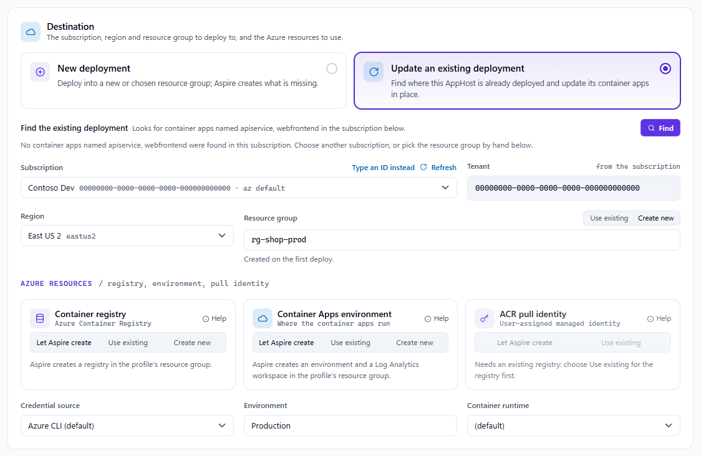
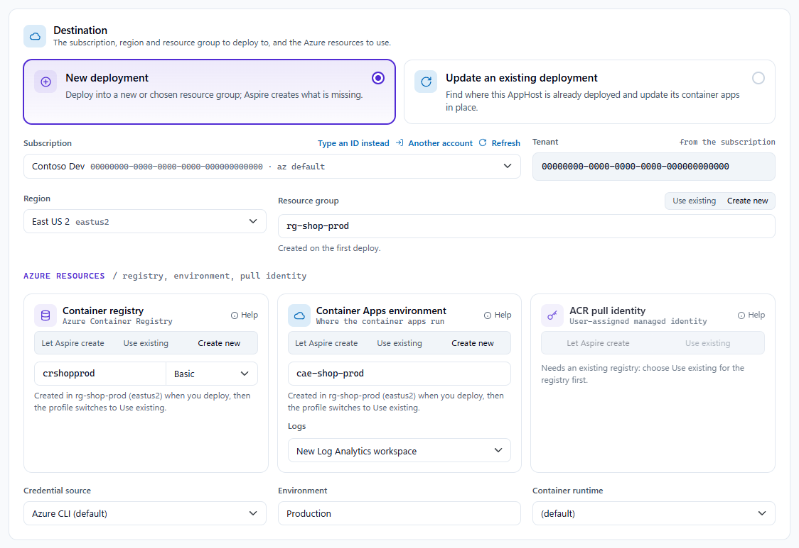
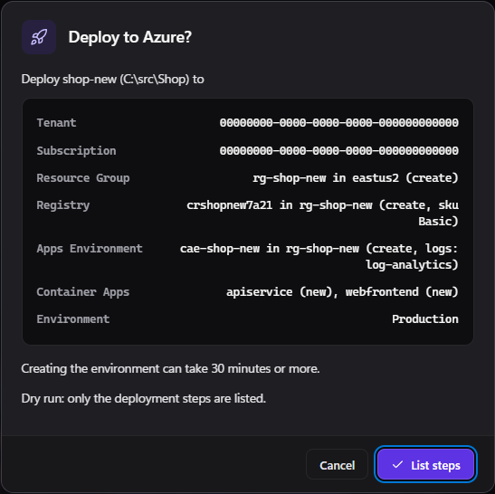
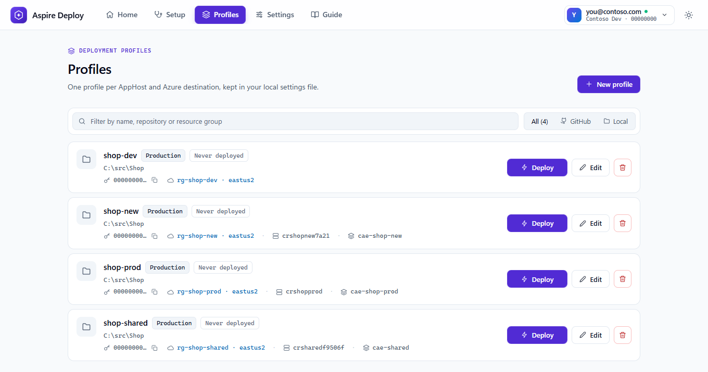
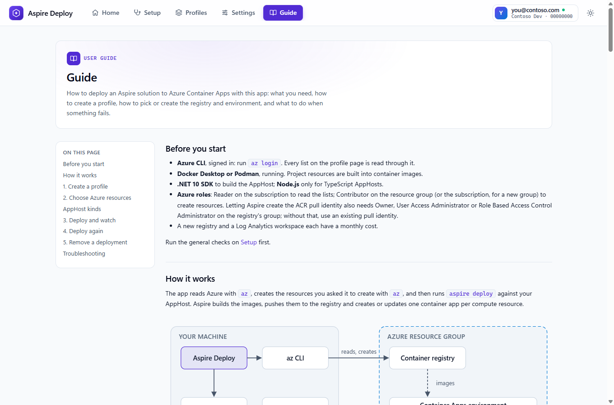
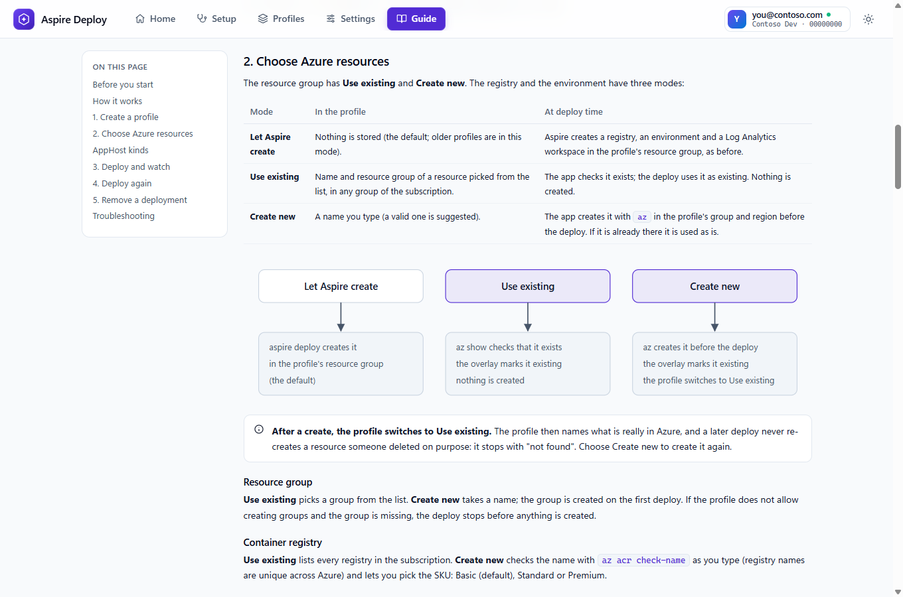

# Aspire Deploy


## ⬇️ [Get it from the Microsoft Store](https://apps.microsoft.com/detail/9P2TFLHH3RM2)

<a href="https://apps.microsoft.com/detail/9P2TFLHH3RM2"></a>

Windows 10 (1809) or later, x64 or Arm64. The Store version installs and updates itself; you still need the [prerequisites](#prerequisites) and `az login`. [Privacy policy](docs/PRIVACY.md).

## ▶️ [Watch the video walk-thru](https://www.youtube.com/watch?v=zO7WvLdigsk)

[](https://www.youtube.com/watch?v=zO7WvLdigsk)

A short narrated tour of the app. The same walk-thru, with screenshots, is on the [Blazor Help Website](https://blazorhelpwebsite.com/ViewBlogPost/20096).




A Windows desktop app (.NET MAUI Blazor Hybrid) that deploys **any Aspire 13.x solution**, from a local folder or a GitHub repository, to an Azure subscription with `aspire deploy`, using your own `az login`.

It **scans** the AppHost first for what it needs (AppHost kind, Aspire version, parameters, resources, deployment targets) and keeps per-developer **deploy profiles** in a git-ignored `appsettings.Local.json`.

Design: [docs/AspireDeployService-Implementation-Plan.md](docs/AspireDeployService-Implementation-Plan.md), which builds on [docs/Aspire-Project-Deployer-Plan.md](docs/Aspire-Project-Deployer-Plan.md).

## How to use it

The full walkthrough is the **[user guide](docs/User-Guide.md)**, which is also the **Guide** tab inside the app. The short version:

### 1. Start the app and check your tools

1. Install the [prerequisites](#prerequisites), then run `az login`.
2. Start the app: install it from the [Microsoft Store](https://apps.microsoft.com/detail/9P2TFLHH3RM2), or open `AspireDeployService.slnx` in Visual Studio and run the **Windows Machine** profile, or run `aspire run` and start the `aspiredeployservice-windows` resource from the dashboard.
3. Open **Setup** and run the general checks. Each tool shows Pass, Warn or Fail with the fix.



Your AppHost needs an Azure compute environment, for example `builder.AddAzureContainerAppEnvironment("env");` with the `Aspire.Hosting.Azure.AppContainers` package.

### 2. Create a profile

**Profiles → New profile**: pick the solution folder (or `<owner>/<repo>` on GitHub) and click **Scan**. The scan reads files only and shows the AppHost summary. Type a profile name and click **Build** (or **Trust and build `<commit>`** for GitHub, which builds exactly the commit the summary shows); a local folder with a name is scanned and built in one click. The app runs `aspire do publish-manifest`, and then shows the **Destination** and **Parameters** steps.





- **Subscription, region and resource group** are read from your `az login`. A resource group is either an existing one or a new name that is created on the first deploy. If `az` is not signed in, **Sign in to Azure** runs `az login` from the app.
- **Update an existing deployment** finds resource groups that already hold this AppHost's container apps (for example deployed from another machine). **Use this** fills the destination so the first deploy updates them in place.

  

- **Container apps** (bottom of the card) previews each compute resource of the AppHost as **New**, **Updates existing** or **Conflict**, by comparing it with what is already in Azure. A conflict (for example an app with that name already running in another environment) blocks the deploy.
- Fill in the **Parameters** step and **Save profile**.

### 3. Choose the Azure resources (optional)

By default Aspire creates its own container registry, Container Apps environment and Log Analytics workspace in the profile's resource group. Each of the three sections on the profile page lets you change that:

| Mode | What happens on deploy |
|---|---|
| **Let Aspire create** | As before: Aspire creates it in the profile's resource group. |
| **Use existing** | Pick a registry, environment or pull identity from any resource group in the subscription. The app checks it exists, and the deploy uses it as is. |
| **Create new** | Type a name (a valid one is suggested; registry names are checked for availability as you type). The app creates it with `az` before the deploy, then switches the profile to **Use existing**. |

**Create new** registry (with its SKU) and environment (with where its logs go):



- The lists come from `az`. If `az` cannot list something (or the subscription has none), type the name and resource group instead.
- **ACR pull identity** is only available with an existing registry. Pick a user-assigned identity that already has `AcrPull` on it, and the deploy creates no identity and no role assignment.
- A new environment can send its logs to a new Log Analytics workspace, an **existing** workspace, or nowhere.
- Your AppHost files are never edited. The app adds the "use existing" calls through a temporary overlay at deploy time (see [What the tooling writes into a local folder](#what-the-tooling-writes-into-a-local-folder)). If your AppHost already chooses its own environment or registry, that section is locked and you set its parameters instead.

### 4. Deploy

**Profiles → Deploy**. Tick **Dry run** the first time: it lists the deployment steps and creates nothing. Every deploy asks first and shows exactly what will happen in Azure:



- What will be **created** (resource group, registry, environment) and what is **existing**.
- Each container app as **new** or **update**.
- Creating an environment can take 30 minutes or more. The log streams while it runs, and **Cancel** works.

When it finishes, the endpoints are in the log. A second deploy creates nothing and updates the apps.

The profile list shows each profile's resource group, and the registry and environment when they are not left to Aspire:



### 5. Get help

The **Guide** tab has the same content as [docs/User-Guide.md](docs/User-Guide.md): diagrams, every mode, naming rules, and a troubleshooting table that quotes each error message. Each resource section on the profile page has a **Help** link into it, and AI Help (below) can read it too.





### Removing a deployment

Delete the profile's resource group in Azure. Deleting a profile never touches Azure. Existing resources a profile picked from **other** resource groups (registry, environment, pull identity, logs workspace) are never deleted by the app and are not in that group, but an existing resource that lives in the profile's own group goes with it.

## Prerequisites

| Tool | Why |
|---|---|
| Windows 10 1809 or later | The app is Windows-only. |
| .NET 10 SDK (`global.json` pins 10.0.402, roll forward to later feature bands) with the MAUI workload | Builds this app; also builds the AppHosts you deploy. |
| Azure CLI, signed in (`az login`) | Deploys use your sign-in (`Azure__CredentialSource=AzureCli`). |
| Docker Desktop or Podman, running | Project resources are built into container images. |
| Node.js 20.19+, 22.13+ or 24+ | Only for TypeScript AppHosts. |
| GitHub CLI (`gh`), optional | Supplies a token for private repositories when none is configured. |

The Aspire CLI does **not** need to be installed: if the `aspire` on your PATH has a different version from the AppHost's SDK, the app installs the matching one under `%LOCALAPPDATA%\ads\tools\aspire\<version>`.

## Settings file

Profiles live in `appsettings.Local.json`, found in this order (shown on the **Settings** page):

1. the `ADS_SETTINGS` environment variable;
2. `AspireDeployService/appsettings.Local.json` next to the project file, when running from the source tree (Visual Studio or `aspire run`);
3. `%LOCALAPPDATA%\AspireDeployService\appsettings.Local.json` for a published copy. The Microsoft Store version is packaged, so Windows keeps its `%LOCALAPPDATA%` files under `%LOCALAPPDATA%\Packages\41860Defwebs.com.AspireDeploy_vnfg3yn7dyp0w\LocalCache\Local` instead, and removes them when the app is uninstalled.

`.gitignore` excludes it everywhere. [appsettings.Local.example.json](AspireDeployService/appsettings.Local.example.json) shows the shape with placeholders. Values, including secrets, are **plain text**, like Aspire's own `~/.aspire/deployments` cache. If you edit the file by hand and break the JSON, the app turns read-only and never overwrites it. Comments are read, but they are not kept when the app saves.

An empty parameter value (`""`) means "the AppHost's own configuration supplies it", so nothing is passed. A missing parameter stops a deploy.

## GitHub sources

- Downloads are pinned to a commit SHA and extracted into `%LOCALAPPDATA%\ads\w\<profile>\src`. A repository is never cloned or changed.
- **Private repositories** need a fine-grained token with **Contents: read** on the selected repositories only. The token comes from the profile, then the **Settings** page (`AspireDeploy:GitHub:Token`), then `gh auth token`. It is sent only to `api.github.com`.
- Before code from a commit is built for the first time, the app asks you to trust it. Your answers are recorded in `%LOCALAPPDATA%\ads\w\trust.jsonl`.
- Repositories that use **submodules or Git LFS** cannot be deployed from GitHub (archives leave that content out). Clone them and use a local folder.

## AI Help

Optional. When an AI provider is set up, an **AI Help** button (sparkle icon) appears on failed result banners, failing and warning **Setup** rows, warning and error callouts, and the log toolbar. It opens a chat panel beside the page; a running log keeps streaming and **Cancel** still works while it is open. Design: [docs/AI-Help-Plan.md](docs/AI-Help-Plan.md).

**Set it up** on the **Settings** page, **AI assistant** card:

1. Pick a provider: OpenAI, Azure OpenAI, Azure AI Foundry, Anthropic or Google AI. Each provider keeps its own values, so switching does not lose the others.
2. **Enter key**, then the endpoint (Azure OpenAI and Foundry only; Foundry shows the URL requests will go to), and a model. For Azure OpenAI and Foundry the model is the **deployment name**. The model list loads from the provider once the key is entered; you can also type a name.
3. **Test connection**, then **Save**. The first provider saved becomes the active one; use **Make active** to switch. AI Help turns on as soon as the active provider has a key, a model and (where needed) an endpoint, without a restart.

The values live under `AspireDeploy:AI` in `appsettings.Local.json` (see the example file). Keys are **plain text** there, like the GitHub token, and are never shown back in the app. If you change a saved Azure OpenAI or Foundry endpoint, type the key again: a saved key is only sent to the endpoint it was saved with.

**What is sent, and to whom.** Nothing is sent until you send a message. Then the chat sends, to the active provider only: a short context (the message, result code, category, page, source folder path and the last `AI:MaxLogTailLines` log lines, default 200), your messages, and the replies so far. Open **Context sent** in the panel to see exactly what that context is. Before anything leaves the machine, every secret in the settings file (GitHub tokens, profile secret parameters, AI keys) and anything that looks like a key or token is replaced with `[REDACTED]`. Chats are kept in memory only.

**File tools.** With OpenAI, Azure OpenAI and Foundry (not when Foundry uses the Anthropic Messages protocol), the AI can **read** files under the run's source folder and the run's own log: list, read (400 lines at a time) and search. It cannot write, run anything or call Azure. It never reads `bin`, `obj`, `.git`, `.vs`, `node_modules`, `.aspire` or `.azure`, symbolic links or junctions, files over 1 MB or binary files, this app's settings file, or files that usually hold secrets (`appsettings.*.json` other than `appsettings.json`, `local.settings.json`, `secrets.json`, `launchSettings.json`, `*.user`, `.env*`, `*.publishsettings`, `*.pfx`, `*.pem`, `*.key`, `*.snk`). Everything it reads is scrubbed too. Turn the tools off with the checkbox on the card (`AI:EnableFileTools`). Anthropic and Google AI chat without tools.

## What the tooling writes into a local folder

The app itself never writes into your source, but the Aspire tooling it runs does: `bin/` and `obj/` from the build, and for TypeScript AppHosts `.aspire/modules/` and `node_modules/`, and possibly `aspire.config.json`. Deploy output goes to the work folder, not your source.

When a profile uses an existing or new registry, environment or pull identity, a **file-based C# or TypeScript AppHost** gets a temporary `.ads-deploy` folder next to its entry file, holding a patched copy (`.ads-deploy/apphost.cs`, `.ads-deploy/apphost.mts`) whose first line says it was written by Aspire Deploy. It is removed after the deploy, and after a crash by the next deploy, scan or app start. Do not commit it (`*.ads-deploy*` / `.ads-deploy/` in `.gitignore` is fine). A project AppHost gets its patched copy in the work folder instead, so nothing is written into the source.

## Shared code

These files are copied, not referenced, from the BlazorDataDeploymentWebsite repository (plan D2). Each one starts with a comment naming its origin. Review them when the originals change:

`ProcessRunner`, `SecretRedactor`, `DeploymentLogSink`, `SafeZip`, `FileLock`, `AspireLauncher.FindAspire`, `ErrorClassifier`, `ErrorCategory`, plus their tests under `AspireDeployService.Tests/Copied`.

The AI provider code under `AspireDeployService.Core/AI/Models`, `AI/Providers` and `AI/ModelCatalog` is copied the same way from the Blazor-Data-Orchestrator repository (AI Help plan D1); each file's first line names its origin.

## Development

```bash
dotnet build AspireDeployService.slnx
```

```bash
dotnet test AspireDeployService.Tests/AspireDeployService.Tests.csproj
```

### Microsoft Store package

F5 and `aspire run` use the unpackaged app. The Store build is an unsigned MSIX (the Store signs it), one per architecture, made with the publish profiles in `AspireDeployService/Properties/PublishProfiles`:

```bash
dotnet publish AspireDeployService/AspireDeployService.csproj -f net10.0-windows10.0.19041.0 -p:PublishProfile=MSIX-Store-x64
```

```bash
dotnet publish AspireDeployService/AspireDeployService.csproj -f net10.0-windows10.0.19041.0 -p:PublishProfile=MSIX-Store-arm64
```

The packages land in `AspireDeployService/bin/AppPackages/<arch>/`. Upload both to the **Aspire Deploy** product (Store ID `9P2TFLHH3RM2`) in Partner Center. For each update, raise `ApplicationDisplayVersion` in both profiles (for example `1.0.1`); `ApplicationVersion` stays `0` because the Store requires the last part of the package version to be 0. The package identity is in `Platforms/Windows/Package.appxmanifest`.

The debug-only page `/debug/runs` (not in the menu) runs the infrastructure checks: a 5-minute `ping`, a 20,000-line flood, and two dialogs at once.

## Manual checklist

Run this before a release. Rows marked **(Azure)** create real resources; delete the resource groups afterwards.

| # | Check | Expected |
|---|---|---|
| 1 | Setup, general checks | Each tool shows Pass, Warn or Fail with a fix. |
| 2 | New profile, this repository's folder, no name, **Scan** | The AppHost summary shows 13.6.3, a refusal callout says there is no Azure compute environment, and no build starts. |
| 3 | New profile from this repository with a name, **Scan** | The same refusal with the line to add; nothing is built. |
| 4 | New profile, `aspire-starter` folder that has `AddAzureContainerAppEnvironment`, name typed, **Scan** | One run scans and builds. **AppHost details** lists parameters and resources, and Copy JSON copies. |
| 5 | New profile for that app, then **Dry run** | The confirmation names the tenant, subscription and resource group; the steps are listed; no secret appears in the log. |
| 6 | Start a dry run, open Settings, come back | The log re-attaches. |
| 7 | Start `/debug/runs` → ping, close the window | Asks first; after "Stop and close", no `ping` process is left. |
| 8 | Start `/debug/runs` → ping, kill the app in Task Manager | No `ping` process is left. |
| 9 | **(Azure)** Deploy the starter app from a local folder | Success; endpoints in the log; Profiles shows the deployed Aspire version. |
| 10 | **(Azure)** Deploy it again with no changes | Success; no new resource group. |
| 11 | **(Azure)** Deploy from a private GitHub repository with a fine-grained token | The trust prompt shows the SHA; deploy succeeds. |
| 12 | **(Azure)** Deploy a TypeScript starter (`aspire-ts-starter`) | Success. |
| 13 | Search the log file, `history.jsonl` and `trust.jsonl` for each secret value | Not found. |
| 14 | With no AI settings, visit every page | No AI Help button anywhere. |
| 15 | Settings → AI assistant: save, test and make active each provider you have a key for; switch between them | Test succeeds; each keeps its values; buttons appear after Save without a restart. |
| 16 | Change a saved Foundry or Azure OpenAI endpoint without typing the key | Test, model list and Save are refused with "Type the API key again". |
| 17 | Fail a build in New profile (for example the NU1605 package downgrade), click **AI Help** on the banner, ask "How do I fix it?" | The panel opens beside the page; the reply streams; it names the `.csproj` and the package version. |
| 18 | Start a long run, open AI Help, ask something | The log keeps streaming beside the panel; Cancel works; the window never freezes. |
| 19 | In the panel: Enter, Shift+Enter, Stop, a code block's Copy, Escape, Tab | Sends; new line; stops with "(stopped)"; copies; closes; Tab stays usable. |
| 20 | Open AI Help, then start a deploy of a GitHub profile whose branch moved | The trust dialog takes focus over the panel. |
| 21 | AI Help on a failing Setup row, a scan warning in New profile, an error callout and the log toolbar | Each opens with the right title ("New profile" for the scan warning); **Context sent** shows no profile secret, GitHub token or AI key (search for each value). |
| 22 | With Anthropic or Google AI active | Chat works; the panel says file tools are not available. |
| 23 | Profile page: registry and environment sections, each in **Let Aspire create**, **Use existing** and **Create new** | Lists load (and refresh); a typed name is checked after a short pause; an environment in another region shows **Other region** and cannot be picked; the pull-identity section is disabled until the registry is Use existing; `existing-workspace` shows a workspace picker. |
| 24 | Profile page with `az` signed out | Each section shows the error with **Retry** and a box to type the name. |
| 25 | New profile for an AppHost that already calls `PublishAsExisting` on its environment | The environment section is locked with the reason and a guide link. |
| 26 | Guide tab, in light and dark themes and with the window under 900 px wide | Every section, diagrams switch to the stacked drawing; the help link on a profile section lands on **Choose Azure resources**. |
| 27 | AI Help from a plain error callout: "How do I use an existing registry?" | The panel shows "Read the guide: 2. Choose Azure resources" and the reply follows the guide. |
| 28 | **(Azure)** Starter AppHost with an existing registry and a **Create new** environment | The confirmation lists the create and each app as new; deploy succeeds; the profile page then shows the environment as **Use existing**. |
| 29 | **(Azure)** Deploy it again | Every app shows **update**; nothing is created; `git status` in the source folder is clean. |
| 30 | New profile, public GitHub repo, **Scan** | No dialog. The summary shows the SHA, and **Trust and build** is disabled until a name is typed. |
| 31 | Push a commit to the branch between **Scan** and **Trust and build** | The log names the scanned SHA as the one built. The saved profile's `Ref` is the branch. |
| 32 | Navigate to Settings during a scan, a build and after a failed build, then come back | The page shows the same state, including the summary during and after a failed build. |
| 33 | Change the location after a scan | The summary and the build button disappear. |
| 34 | `az logout`, open New profile, build, reach Destination | The subscription error shows with **Retry** and **Sign in to Azure**. Sign-in opens the browser, and the subscriptions load afterwards. |
| 35 | Sign in, then **Cancel** before finishing in the browser | The run stops, and no `az` process is left. |
| 36 | Sign in with **Use a device code** | The code line appears in the log, and signing in on another device completes it. |
| 37 | Uninstall or rename `az`, open New profile | The error shows with no sign-in button. |
| 38 | **(Azure)** On a second machine (or after deleting `~/.aspire/deployments`), adopt the starter deployment with **Update an existing deployment** and deploy | The candidate shows all apps found and origin aspire deploy. The preview shows every app as **Updates existing**. The deploy succeeds, and the `az resource list -g <rg>` count is unchanged. |
| 39 | **(Azure)** Adopt, then delete the group in the portal, then deploy | Refused before the confirmation with "Resource group `<rg>` does not exist and the profile does not allow creating it."; no group is created. |
| 40 | Visit `/discover` | The NotFound page shows. Nav has no Discover tab, and Home shows three steps. |
| 30 | **(Azure)** Existing registry plus an existing identity with `AcrPull` | Deploy succeeds; the registry's access control shows no new role assignment. |
| 31 | **(Azure)** New environment with logs to an existing workspace | Logs arrive in that workspace's `ContainerAppConsoleLogs` table. |
| 32 | **(Azure)** File-based C# and TypeScript AppHosts with an existing environment and registry; also kill the app mid-deploy and restart it | Deploy succeeds; no `.ads-deploy` folder remains afterwards. |
