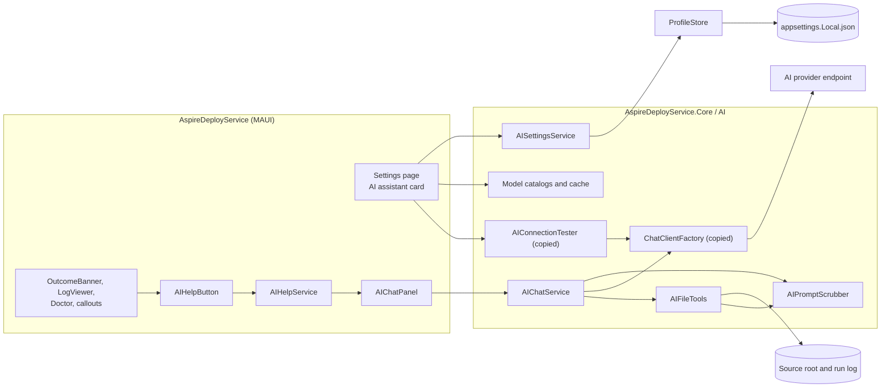
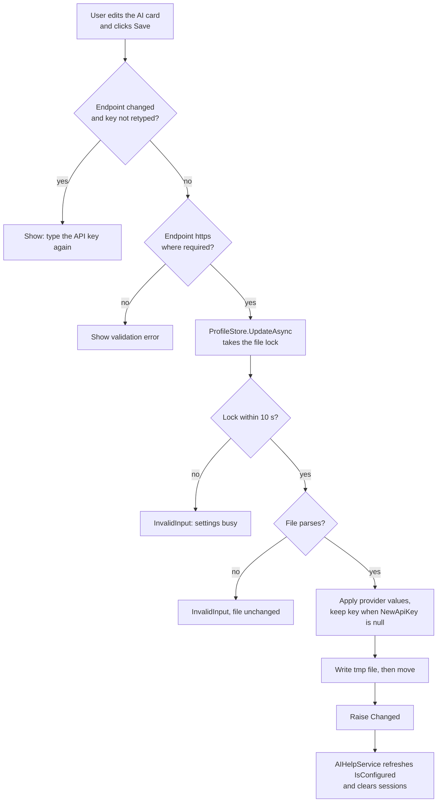
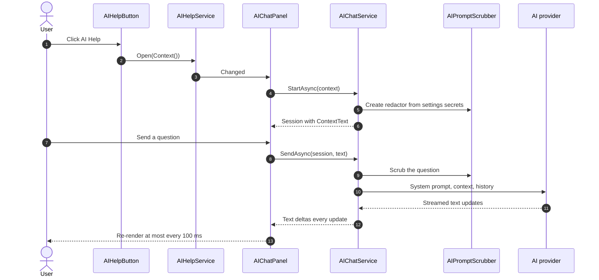
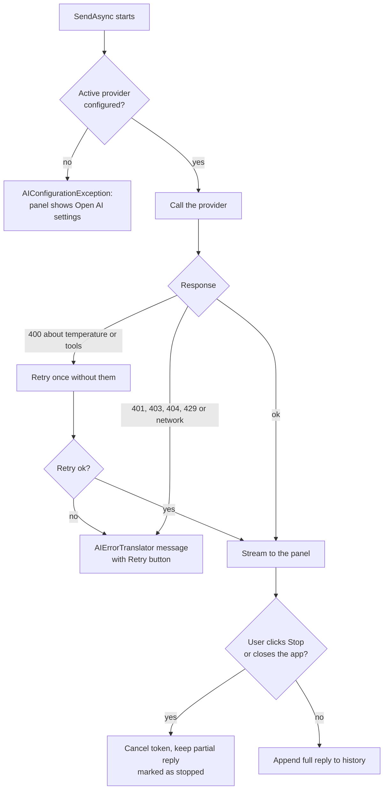
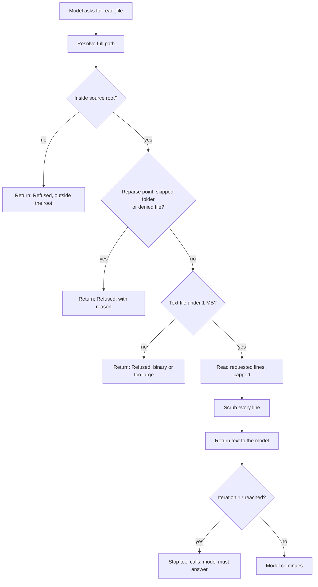

# AspireDeployService: AI Settings and AI Help Plan

> **Reference code:** `<ref>` means a sibling checkout of the Blazor-Data-Orchestrator repository at `../Blazor-Data-Orchestrator/BlazorDataOrchestrator/`, relative to this repository's root. Links into `<ref>` work only when that checkout exists. Code is **copied** from it (D1), the same way [AspireDeployService-Implementation-Plan.md](AspireDeployService-Implementation-Plan.md) D2 copied the deploy worker code. This repository never references `<ref>` at build time.
> **Estimate:** 11 to 13 working days (10 PRs).
> **Owner inputs needed before T8:** an API key and model for at least one provider (OpenAI, Azure OpenAI or Azure AI Foundry) to run the manual checks.

All paths are relative to the repository root unless they start with `<ref>/`. Line numbers are as of commit `f40e494`.

---

## 1. Summary

| # | Feature | In one line |
|---|---|---|
| F1 | AI settings | A new **AI assistant** card on the Settings page picks a provider (OpenAI, Azure OpenAI, Azure AI Foundry, Anthropic or Google AI), its key, endpoint and model, and tests the connection. The provider logic is copied from `<ref>`; the values are stored under `AspireDeploy:AI` in `appsettings.Local.json`. |
| F2 | AI Help | When AI is configured, an **AI Help** button with the Copilot glyph appears on failed result banners, failing Doctor rows, warning and error callouts, and the log viewer toolbar. It opens a non-modal chat side panel that already holds a scrubbed summary of what the button belongs to: message, result code, category, log tail, and for runs with a source folder, read-only file tools limited to that folder. |

**Motivating example.** Discover failed on a local solution with `aspire do publish-manifest exited with 6` and two `NU1605` "Detected package downgrade: Microsoft.Extensions.AI from 10.11.0 to 10.10.0" errors. With AI Help, the user clicks the button on the red banner and the AI can open the failing `.csproj` through `read_file`, see the pinned `10.10.0` beside a floating `Radzen.Blazor Version="*"`, and say which line to change.

## 2. Goals and Non-goals

**Goals**
- One active AI provider, configured once on the Settings page, with a working **Test connection** for every provider.
- Each provider keeps its own values, so switching the active provider does not lose the others (same as `<ref>`).
- AI Help never sends a known secret: profile secret parameters, GitHub tokens and AI keys are masked before anything leaves the machine (§9).
- The user can always see exactly what context is sent (a "Context sent" section in the panel).
- The chat panel never freezes the page: a live log keeps streaming and **Cancel** still works while it is open.
- Replies stream token by token.
- All new logic lives in `AspireDeployService.Core` and has unit tests.

**Non-goals (v1)**
- Encrypting the AI key. Secrets in this app are plain text in the git-ignored settings file by design ([README.md](../README.md), [Settings.razor](../AspireDeployService/Components/Pages/Settings.razor)); the AI key follows that rule (D4).
- Embeddings. `<ref>`'s `EmbeddingModel` is stored but never used there (§4), so it is dropped.
- Ollama, GitHub Models or GitHub Copilot as providers. `<ref>`'s factory has none of them.
- Tools that write files, run commands or call Azure. The AI can only read (D7).
- Tool calls with the Anthropic and Google providers. `<ref>`'s hand-written adapters do not map tools (Q2).
- Saving chat history to disk. Sessions live in memory and end when the app closes.
- MCP servers, SKILL.md instructions, and `<ref>`'s "apply code to editor" flow.

## 3. Decisions

Decisions D1, D2, D6 and D7 were made with the repository owner for this plan.

| # | Decision | Rejected alternative | Why |
|---|---|---|---|
| D1 | **Copy only the logic** from `<ref>` into `AspireDeployService.Core/AI/`: the provider model and enum, `ChatClientFactory`, `FoundryEndpointResolver`, the Anthropic and Google adapters, `ModelCapabilities`, `AIErrorTranslator`, `AIConnectionTester`, the model catalogs and `AIKeyEndpointGuard`. Change namespaces to `AspireDeployService.Core.AI.*`. Each copied file starts with a comment that names its origin. Rebuild the settings editor and the chat panel in this app's `ads-*` style. | (a) Also add Radzen.Blazor and copy `AIServiceSettingsEditor.razor` almost unchanged. (b) Copy only OpenAI, Azure OpenAI and Foundry. | Owner's choice. This app uses Bootstrap CSS plus its own `ads-*` classes and no component library (see the `PackageReference`s in [AspireDeployService.csproj](../AspireDeployService/AspireDeployService.csproj)). (a) would bring in a second theme, and `<ref>` pins Radzen as `Version="*"`, the floating version that caused the motivating NU1605 error. (b) loses providers the owner already uses. |
| D2 | The chat is a **non-modal side panel** (`AIChatPanel`), mounted once in `MainLayout` **outside** the `ads-shell` element and **not** using the `ads-dialog` class. | Reuse `DialogHost` / `DialogService`, or a centered modal. | Owner's choice. `MainLayout` makes the whole shell `inert` whenever a dialog is open ([MainLayout.razor:5](../AspireDeployService/Components/Layout/MainLayout.razor#L5)), and `index.html` blocks Tab whenever an `.ads-dialog` exists ([index.html:60](../AspireDeployService/wwwroot/index.html#L60)). A modal chat would freeze the live log and the Cancel button and break Tab inside the chat. `DialogService` also answers only yes or no (`ConfirmAsync` returns `bool`, [DialogService.cs:26](../AspireDeployService/Services/DialogService.cs#L26)) and Core uses its queue for deploy confirmations. |
| D3 | **Store AI settings in `appsettings.Local.json`** under `AspireDeploy:AI`, through the existing `ProfileStore.UpdateAsync` (locked read, change, atomic write). Replace `<ref>`'s Table Storage `AISettingsService` with `AISettingsService` over `ProfileStore`, and `<ref>`'s Table cache `AIModelCacheService` with an in-memory cache. | Keep Azure Table Storage, as `<ref>` does. | This app has one settings file and no storage account. `ProfileStore` already gives the lock, the temp-file write and "never overwrite a file that does not parse" ([AspireDeployService-Implementation-Plan.md](AspireDeployService-Implementation-Plan.md) D16). Every model level has a `[JsonExtensionData]` bag, so adding a section keeps unknown keys ([SettingsModel.cs:31-32](../AspireDeployService.Core/Settings/SettingsModel.cs#L31)). |
| D4 | The **AI key is plain text** in the settings file, like the GitHub token. The UI never loads a saved key into an input; it shows "(set)" with Replace and Clear, the same as the GitHub token card. | DPAPI or Windows Credential Manager for this one key. | One mechanism for every secret in the app. A separate store only for the AI key would be the first of its kind here and the README would have to explain two rules. |
| D5 | **Two readiness rules.** The copied `IsConfigured` keeps `<ref>`'s key-only rule ([`<ref>` AISettings.cs:37](../../Blazor-Data-Orchestrator/BlazorDataOrchestrator/src/BlazorDataOrchestrator.Core/Models/AISettings.cs#L37)), because the copied catalogs, `AIConnectionTester` and `ChatClientFactory` all gate on it ([`<ref>` OpenAIModelCatalog.cs:24](../../Blazor-Data-Orchestrator/BlazorDataOrchestrator/src/BlazorDataOrchestrator.Core/Services/ModelCatalog/OpenAIModelCatalog.cs#L24), [`<ref>` AIConnectionTester.cs:42](../../Blazor-Data-Orchestrator/BlazorDataOrchestrator/src/BlazorDataOrchestrator.Core/Services/AIConnectionTester.cs#L42)). A new `IsReadyForChat` adds a model, and an endpoint for Azure OpenAI and Foundry. Only `AIHelpService.IsConfigured` and `AIChatService.StartAsync` use `IsReadyForChat`. | Make `IsConfigured` itself stricter. | A stricter `IsConfigured` would stop the model list from loading until a model is already chosen. With a key but no model every chat would fail, so the button needs the stricter rule. |
| D6 | The button appears in **four places**: failed `OutcomeBanner`s, Doctor rows in `Fail` or `Warn` state, warning and error callouts, and the `LogViewer` toolbar (§6.5). | Only on result banners. | Owner's choice. |
| D7 | **Read-only file tools** (`list_files`, `read_file`, `search_files`, `read_run_log`), limited to the run's source root and its own log file, with secret scrubbing, a deny list and size caps (§6.4). They are offered only when the provider and model support tools. | No tools: the user pastes files. | Owner's choice. Most build failures (like the motivating NU1605 error) need a look at a `.csproj` or `global.json`. |
| D8 | **One scrubber for everything that leaves the machine.** `AIPromptScrubber.CreateAsync` builds a `DeploySecretRedactor` (masks every registered value regardless of length, longest first, [DeploySecretRedactor.cs:9](../AspireDeployService.Core/Logging/DeploySecretRedactor.cs#L9)), registers every secret in the settings file (both the raw and the trimmed value, skipping values shorter than 4 characters), and runs line by line. It is **rebuilt on every `SendAsync`**, so a secret changed after a session started is still masked. It is applied to the context, to each user message, and to every tool result. | Rely on the run logs being redacted already. | The run's own redactor is gone once the run ends, error callouts are not redacted, and the user may paste a secret into the chat. A 1-character secret parameter such as `1` would wipe the whole context, hence the 4-character floor; values of 4 to 7 characters may still over-mask ordinary words, and safety wins over readability there. |
| D9 | **Add key and token patterns to `SecretRedactor`**: `sk-` style keys, `api-key`, `x-api-key` and `Ocp-Apim-Subscription-Key` headers, a JSON `"apiKey"` property, the `OPENAI_API_KEY`, `AZURE_OPENAI_API_KEY`, `ANTHROPIC_API_KEY`, `GEMINI_API_KEY` and `GOOGLE_API_KEY` variables, GitHub tokens (`\bgh[pousr]_[A-Za-z0-9]{36,}`, `\bgithub_pat_[A-Za-z0-9_]{22,}`) and Google API keys (`\bAIza[0-9A-Za-z_-]{35}`). | Register only the saved key values. | The user's own projects and logs may hold other keys that are not in this app's settings. A token from `gh auth token` is never in the settings file, so only a pattern can catch it. These patterns also protect the run logs. |
| D10 | **True streaming.** `AIChatService` yields each text update as it arrives. The panel re-renders at most every 100 ms. | Copy `<ref>`'s `CodeAssistantChatService`, which collects every chunk into a list before yielding ([`<ref>` CodeAssistantChatService.cs:310](../../Blazor-Data-Orchestrator/BlazorDataOrchestrator/src/BlazorDataOrchestrator.Core/Services/CodeAssistantChatService.cs#L310)). | A reply that appears all at once after 30 seconds looks broken. 100 ms batching matches `LogViewer` ([AspireDeployService-Implementation-Plan.md](AspireDeployService-Implementation-Plan.md) D11). |
| D11 | **The source root reaches the UI through `IRunObserver`.** Add a default interface method `OnSourceReady(string rootFolder)`. `DiscoveryPipeline.RunAsync` calls it right after `MaterializeAsync` ([DiscoveryPipeline.cs:59](../AspireDeployService.Core/Services/DiscoveryPipeline.cs#L59)). `ActiveRun` stores it as `SourceRoot`; a repeat call overwrites it. `RunContext` gets an `Observer` property so the pipeline can reach it. | Work the root out on the UI side from `Tag` or `Value`. | Deploy runs have `Value == null`, and a GitHub source's root is an extracted folder under the work key that the page never sees. `DiscoveryPipeline.RunAsync` is the one place the source is materialized. Its callers are [DiscoveryService.cs:34](../AspireDeployService.Core/Services/DiscoveryService.cs#L34) (Discover and the new-profile wizard), [DoctorService.cs:44](../AspireDeployService.Core/Services/DoctorService.cs#L44), and [DeployService.cs:93](../AspireDeployService.Core/Services/DeployService.cs#L93) and [:121](../AspireDeployService.Core/Services/DeployService.cs#L121), so a deploy calls `OnSourceReady` twice. |
| D12 | **Context is built lazily on click.** Each `AIHelpButton` takes a `Func<AIHelpContext>`, not a context object. | Build the context on every render. | Building it reads the log buffer; doing that on each re-render of a page with a live log is wasted work. |
| D13 | **Icon:** add a monochrome `copilot` entry to the `Icon` map, drawn from the Copilot glyph in Microsoft's Fluent UI System Icons (MIT licensed) **(assumed: the glyph exists in that set; T8 checks and records the source)**. | The full-colour Copilot brand logo. | `Icon` always renders with `currentColor` ([Icon.razor:2-3](../AspireDeployService/Components/Shared/Icon.razor#L2)), so it follows the light and dark themes. The wrapper sets `fill="none"`, and Fluent glyphs are filled paths, so the entry's paths need `fill='currentColor' stroke='none'`, as the `logo` entry has ([Icon.razor:13](../AspireDeployService/Components/Shared/Icon.razor#L13)). A full-colour brand mark brings trademark guidelines. Q1 keeps the colour logo open. |
| D14 | **`AIKeyEndpointGuard` moves to Core** and keeps `<ref>`'s rule: a saved key is sent only to the endpoint it was saved with, unless the user types the key again. It applies to Azure OpenAI and Foundry. `AISettingsEditSession` owns one guard: it calls `TrustSaved` when it loads a provider and `TrustUserEnteredKey` when a key is typed. **Test connection, model listing and Save** all call `CanSendKey` first, so the saved key never reaches a newly typed endpoint before Save either. `AISettingsService.SaveProviderAsync` compares endpoints with the guard's `Normalize` (ignores case and a trailing slash). | Drop it. | It stops someone from editing the endpoint and leaking the saved key to another host. `<ref>` added it as a security fix ([`<ref>` AIKeyEndpointGuard.cs](../../Blazor-Data-Orchestrator/BlazorDataOrchestrator/src/BlazorOrchestrator.Web/Services/AIKeyEndpointGuard.cs)). |
| D15 | **Do not add AI variables to `ProcessRunner`'s strip list.** | Strip `OPENAI_*` and `AZURE_OPENAI_*` from child processes. | This app's keys live in the JSON file, never in environment variables, and `AspireDeploy__` is already stripped ([ProcessRunner.cs:70-77](../AspireDeployService.Core/Processes/ProcessRunner.cs#L70)). A user's AppHost may legitimately need its own `OPENAI_API_KEY`. |
| D16 | **`IChatClientProvider` wraps the static `ChatClientFactory`.** `AIChatService` and `AIConnectionTester` get it from DI; tests swap in `FakeChatClient`. | Call `ChatClientFactory.Create` directly. | `ChatClientFactory` is a static class ([`<ref>` ChatClientFactory.cs:17](../../Blazor-Data-Orchestrator/BlazorDataOrchestrator/src/BlazorDataOrchestrator.Core/Services/ChatClientFactory.cs#L17)), so nothing could be faked. |
| D17 | **Chat work runs on the thread pool.** The panel runs the `SendAsync` enumeration inside `Task.Run`, appends updates to a buffer, and a 100 ms `Timer` calls `InvokeAsync(StateHasChanged)` while the buffer changed, the same as `LogViewer` ([LogViewer.razor:65](../AspireDeployService/Components/Shared/LogViewer.razor#L65)). | `await foreach` directly in the component. | The app's rule is that work never runs on the UI dispatcher ([RunCoordinator.cs:8](../AspireDeployService/Services/RunCoordinator.cs#L8)). File tools do synchronous I/O inside function invocation and would freeze the window. |
| D18 | **Package versions are raised together.** Every direct `Microsoft.Extensions.*` reference in Core, Tests and MAUI moves to at least the highest version the new packages need transitively (for example `Microsoft.Extensions.AI` 10.10.0 needs the 10.0.12 abstractions **(assumed from the nuspec; T1 confirms)**). | Leave the existing references at 10.0.0. | Otherwise the first restore fails with exactly the motivating NU1605 "package downgrade" error. |

## 4. Current State

**This repository**

| Area | Where | Today |
|---|---|---|
| Settings model | [SettingsModel.cs:19-33](../AspireDeployService.Core/Settings/SettingsModel.cs#L19) | `AspireDeploySection` holds roots, timeouts, `GitHubSection? GitHub`, `Profiles` and an `Extra` bag. There is no AI section and no schema version. |
| Settings writes | `ProfileStore.UpdateAsync` in [ProfileStore.cs](../AspireDeployService.Core/Settings/ProfileStore.cs) | Locked read-modify-write with a temp file and `File.Move`. Fails with `InvalidInput` when the file does not parse. |
| Global secret pattern | [ProfileService.cs:36](../AspireDeployService.Core/Services/ProfileService.cs#L36), [:134](../AspireDeployService.Core/Services/ProfileService.cs#L134) | `SetGlobalGitHubTokenAsync` is one `UpdateAsync` lambda. It is the template for the AI writes. |
| Settings page | [Settings.razor](../AspireDeployService/Components/Pages/Settings.razor) | Injects only `IProfileService`. A Locations card, then a GitHub token card (Set/Not set pill, Replace, Clear), shown only when the file parses. Saves through `SetGlobalGitHubTokenAsync` ([Settings.razor:132](../AspireDeployService/Components/Pages/Settings.razor#L132)). |
| Secret UI | [SecretInput.razor](../AspireDeployService/Components/Shared/SecretInput.razor), [SecretField.razor](../AspireDeployService/Components/Shared/SecretField.razor) | A password input with a short-value warning, and a masked field with Reveal, Replace, Keep, Clear and Undo. |
| DI | [ServiceCollectionExtensions.cs:21-41](../AspireDeployService.Core/ServiceCollectionExtensions.cs#L21), [MauiProgram.cs:24-26](../AspireDeployService/MauiProgram.cs#L24) | Core services are `TryAddSingleton`. One named `HttpClient` for GitHub (line 25). MAUI adds `DialogService` and `RunCoordinator`. |
| Packages | [AspireDeployService.Core.csproj:12-14](../AspireDeployService.Core/AspireDeployService.Core.csproj#L12) | DI abstractions, Http and Logging 10.0.0. No `Microsoft.Extensions.AI`. |
| Redaction | [SecretRedactor.cs](../AspireDeployService.Core/Logging/SecretRedactor.cs), [DeploySecretRedactor.cs](../AspireDeployService.Core/Logging/DeploySecretRedactor.cs) | Pattern rules for JWTs, PEM, connection strings, Bearer tokens, CLI flags, JSON secrets and env dumps. `SecretRedactor.AddSecret` ignores values under 8 characters ([SecretRedactor.cs:61](../AspireDeployService.Core/Logging/SecretRedactor.cs#L61)); `DeploySecretRedactor` masks every registered value. No AI-key patterns. |
| Runs | [RunCoordinator.cs:117-182](../AspireDeployService/Services/RunCoordinator.cs#L117), [Runs.cs:8-16](../AspireDeployService.Core/Runs/Runs.cs#L8) | `ActiveRun` holds `Key`, `Title`, `LogFile` (line 135), `Result`, `Value`, `Tag` (line 149), and a 5,000-line buffer (`MaxLines`, line 119) read by `Snapshot()` (line 157). `IRunObserver` has `OnLine` and `OnRunStarted` only. `LogLine(Utc, Stream, Text)`. |
| Unredacted error text | [RunCoordinator.cs:86](../AspireDeployService/Services/RunCoordinator.cs#L86) | An unexpected exception becomes `"Unexpected error: {ex.Message}"` with no redaction. |
| Result banner | [OutcomeBanner.razor:41-44](../AspireDeployService/Components/Shared/OutcomeBanner.razor#L41) | Parameters `ActiveRun? Run` and `string? ExtraLine`. Shows `Result.Message`, the code and the category. Used on Discover ([:39](../AspireDeployService/Components/Pages/Discover.razor#L39)), Doctor ([:37](../AspireDeployService/Components/Pages/Doctor.razor#L37)), Deploy, ProfileNew and DebugRuns. |
| Log viewer | [LogViewer.razor:19](../AspireDeployService/Components/Shared/LogViewer.razor#L19), [:48-51](../AspireDeployService/Components/Shared/LogViewer.razor#L48) | Toolbar with Copy, Wrap and Follow. Parameters `Run` and `StartCollapsed`. |
| Doctor rows | [Doctor.razor:61](../AspireDeployService/Components/Pages/Doctor.razor#L61), [PrerequisiteChecker.cs:9-11](../AspireDeployService.Core/Prerequisites/PrerequisiteChecker.cs#L9) | Rows get `ads-row-warn` / `ads-row-fail`. `PrerequisiteCheck(Name, State, Detail, Fix)`. |
| Discover warnings | [Discover.razor:76](../AspireDeployService/Components/Pages/Discover.razor#L76) | Each `DiscoveryResult.Warnings` entry is an `ads-callout-warn`. `DiscoveryResult.Source.RootFolder` is the source root ([DiscoveryRecords.cs:43-45](../AspireDeployService.Core/Discovery/DiscoveryRecords.cs#L43), [SourceRecords.cs:19](../AspireDeployService.Core/Sources/SourceRecords.cs#L19)). |
| Icons | [Icon.razor:11-13](../AspireDeployService/Components/Shared/Icon.razor#L11) | A static map of name to inner SVG markup on a 24×24 grid, rendered with `currentColor`. |
| JS | [index.html](../AspireDeployService/wwwroot/index.html) | Small inline helpers (`adsFocus`, `adsTheme`). No markdown renderer. |

**`<ref>` code to copy (D1)**

| `<ref>` file | Types | Change when copying |
|---|---|---|
| [Models/AIServiceType.cs](../../Blazor-Data-Orchestrator/BlazorDataOrchestrator/src/BlazorDataOrchestrator.Core/Models/AIServiceType.cs), [AIServiceTypes.cs](../../Blazor-Data-Orchestrator/BlazorDataOrchestrator/src/BlazorDataOrchestrator.Core/Models/AIServiceTypes.cs), [FoundryApiProtocol.cs](../../Blazor-Data-Orchestrator/BlazorDataOrchestrator/src/BlazorDataOrchestrator.Core/Models/FoundryApiProtocol.cs) | `AIServiceType`, `AIServiceTypes`, `FoundryApiProtocol` | Namespace only. |
| [Models/AISettings.cs](../../Blazor-Data-Orchestrator/BlazorDataOrchestrator/src/BlazorDataOrchestrator.Core/Models/AISettings.cs) | `AIProviderSettings`, `AISettings` | Drop `EmbeddingModel` and the `[Obsolete]` pass-through properties. Keep `IsConfigured`; add `IsReadyForChat` (D5). Make both `sealed`. |
| [Services/ChatClientFactory.cs](../../Blazor-Data-Orchestrator/BlazorDataOrchestrator/src/BlazorDataOrchestrator.Core/Services/ChatClientFactory.cs) | `ChatClientFactory` | Namespace only. Keep the `OPENAI001` suppression for the Responses path. |
| [Services/Foundry/FoundryEndpointResolver.cs](../../Blazor-Data-Orchestrator/BlazorDataOrchestrator/src/BlazorDataOrchestrator.Core/Services/Foundry/FoundryEndpointResolver.cs) | `FoundryEndpointResolver`, `FoundryEndpointResolution` | Namespace only. |
| [AnthropicChatClientAdapter.cs](../../Blazor-Data-Orchestrator/BlazorDataOrchestrator/src/BlazorDataOrchestrator.Core/Services/AnthropicChatClientAdapter.cs), [AnthropicBaseAddressHandler.cs](../../Blazor-Data-Orchestrator/BlazorDataOrchestrator/src/BlazorDataOrchestrator.Core/Services/AnthropicBaseAddressHandler.cs), [GoogleAIChatClientAdapter.cs](../../Blazor-Data-Orchestrator/BlazorDataOrchestrator/src/BlazorDataOrchestrator.Core/Services/GoogleAIChatClientAdapter.cs) | Provider adapters | Namespace only. Note in a comment that they do not map tools (Q2). The Google adapter calls `GenerateContentStream(request)` without the token: pass `cancellationToken` if Mscc.GenerativeAI 3.1.0 accepts one, otherwise call `ct.ThrowIfCancellationRequested()` in the stream loop so Stop works. |
| [ModelCapabilities.cs](../../Blazor-Data-Orchestrator/BlazorDataOrchestrator/src/BlazorDataOrchestrator.Core/Services/ModelCapabilities.cs), [AIErrorTranslator.cs](../../Blazor-Data-Orchestrator/BlazorDataOrchestrator/src/BlazorDataOrchestrator.Core/Services/AIErrorTranslator.cs), [AIConfigurationException.cs](../../Blazor-Data-Orchestrator/BlazorDataOrchestrator/src/BlazorDataOrchestrator.Core/Services/AIConfigurationException.cs), [AIConnectionTester.cs](../../Blazor-Data-Orchestrator/BlazorDataOrchestrator/src/BlazorDataOrchestrator.Core/Services/AIConnectionTester.cs) | `SupportsTemperature`, `SupportsTools`, `Translate`, `ExtractStatus`, `TestAsync` | Namespace only. |
| [Services/ModelCatalog/*](../../Blazor-Data-Orchestrator/BlazorDataOrchestrator/src/BlazorDataOrchestrator.Core/Services/ModelCatalog) | `IAIModelCatalog`, `ModelListResult`, `HttpModelCatalogBase`, five catalogs, `AIProviderRegistry` | Namespace only. They use the named `HttpClient` `"AIModelCatalog"`. |
| [Web/Services/AIKeyEndpointGuard.cs](../../Blazor-Data-Orchestrator/BlazorDataOrchestrator/src/BlazorOrchestrator.Web/Services/AIKeyEndpointGuard.cs) | `AIKeyEndpointGuard` | Moves to Core (D14). |
| Tests: [FoundryEndpointResolverTests.cs](../../Blazor-Data-Orchestrator/BlazorDataOrchestrator/tests/BlazorDataOrchestrator.Core.Tests/FoundryEndpointResolverTests.cs), [AIDiagnosticsTests.cs](../../Blazor-Data-Orchestrator/BlazorDataOrchestrator/tests/BlazorDataOrchestrator.Core.Tests/AIDiagnosticsTests.cs), the `AIKeyEndpointGuard` cases in [SecurityReviewFixTests.cs](../../Blazor-Data-Orchestrator/BlazorDataOrchestrator/tests/BlazorOrchestrator.Web.Tests/SecurityReviewFixTests.cs) | | Copy into `AspireDeployService.Tests/Copied/`. Drop cases that need Table Storage, Radzen or the Web project. |

**Namespaces.** "Namespace only" also means updating the `using` lines and the `using ServiceKind = BlazorDataOrchestrator.Core.Models.AIServiceType;` aliases. Target namespaces: `Models/*` → `AspireDeployService.Core.AI.Models`; providers, the Foundry resolver, `ModelCapabilities`, `AIErrorTranslator`, `AIConfigurationException`, `AIConnectionTester`, `AIKeyEndpointGuard` → `AspireDeployService.Core.AI.Providers`; `ModelCatalog/*` → `AspireDeployService.Core.AI.ModelCatalog`; new chat, context and scrubber types → `AspireDeployService.Core.AI`.

**Not copied:** `AISettingsService` and `AIModelCacheService` (Table Storage, D3); `CodeAssistantChatService`, `IAIChatService`, `ConversationSession` and the `Services/AI/*` prompt composers (tied to `<ref>`'s code editor and to `Radzen.Blazor.ChatMessage`); `AIServiceSettingsEditor.razor`, `ConfigureAIDialog.razor` and `AIChatDialog.razor` (Radzen UI, D1). Their **behaviour** is reused where §6 says so: masked key display, 750 ms debounced model loading, free-text model fallback, the Foundry URL preview, and the one-retry-without-temperature-or-tools rule (`StreamWithCapabilityRetryAsync`, [`<ref>` CodeAssistantChatService.cs:341](../../Blazor-Data-Orchestrator/BlazorDataOrchestrator/src/BlazorDataOrchestrator.Core/Services/CodeAssistantChatService.cs#L341)).

## 5. Design

### 5.1 Structure



### 5.2 New and changed components

| Component | Project | Responsibility |
|---|---|---|
| `AI/Models/*` (copied) | Core | Provider enum, provider settings, Foundry protocol (§4). |
| `AI/Providers/*` (copied) | Core | `ChatClientFactory`, Foundry resolver, adapters, `ModelCapabilities`, `AIErrorTranslator`, `AIConnectionTester`, `AIKeyEndpointGuard`. |
| `AI/ModelCatalog/*` (copied) and `AIModelListCache` (new) | Core | Live model lists; the cache keeps each list in memory for 24 hours, keyed by provider, endpoint and the first 16 hex characters of SHA-256 of the key. |
| `Settings/SettingsModel.cs` (`AISection`, `AIProviderSection`) | Core | The stored shape (§6.1). |
| `AI/AISettingsService` | Core | Reads fresh from `ProfileStore` on each call; maps `AISection` to `AISettings`; saves one provider at a time with keep-key semantics; enforces D14. Raises `Changed` after a save. |
| `AI/AISettingsEditSession` | Core | Form state for the Settings card, testable without Razor (like `ProfileEditSession`): the provider being edited, its fields, `NewApiKey` (null means keep), validation messages. |
| `AI/AIPromptScrubber`, `IPromptRedactor` | Core | D8. |
| `AI/AIHelpContext`, `AIContextFormatter` | Core | The context record and its text form with caps (§6.3). |
| `AI/AIChatService`, `AIChatSession` | Core | Builds the client, the system prompt and the tool list; streams replies; retries once without temperature or tools on a matching 400 (D10). |
| `AI/AIFileTools` | Core | D7, §6.4. |
| `Runs/Runs.cs` | Core | `IRunObserver.OnSourceReady` (default no-op) and `RunContext.Observer` (D11). |
| `Logging/SecretRedactor.cs` | Core | D9 patterns. |
| `Services/AIHelpService` | MAUI | Singleton: `bool IsConfigured` (a cached copy of the active provider's `IsReadyForChat`), the open context, the session cache, `Changed` event. `InitializeAsync()` reads settings once and is called from `MainLayout.OnInitializedAsync`; `RefreshAsync()` re-reads and runs on `IAISettingsService.Changed` and whenever the Settings page loads (that covers hand edits of the file). `Changed` may fire on any thread, so every handler uses `InvokeAsync`, as [RunCoordinator.cs:16](../AspireDeployService/Services/RunCoordinator.cs#L16) and [DialogService.cs:14](../AspireDeployService/Services/DialogService.cs#L14) already document. |
| `AI/IChatClientProvider`, `ChatClientProvider` | Core | D16. |
| `Services/AIHelpContexts` | MAUI | Builds an `AIHelpContext` from an `ActiveRun`, a `PrerequisiteCheck`, a warning or an error string (§6.5). |
| `Services/RunCoordinator.cs` (`ActiveRun`) | MAUI | Stores `SourceRoot` from `OnSourceReady`. |
| `Components/Shared/AIHelpButton.razor` | MAUI | Renders nothing unless `AIHelpService.IsConfigured`. |
| `Components/Shared/AIChatPanel.razor` | MAUI | The side panel (§6.6). |
| `Components/Shared/AISettingsCard.razor` | MAUI | The Settings card (§6.2). |
| `Components/Shared/Icon.razor` | MAUI | `copilot` entry (D13). |

## 6. Contracts

### 6.1 Settings (`appsettings.Local.json`)

New keys under `AspireDeploy:AI`. Provider names are the `AIServiceType` names. Empty or absent strings mean "not set".

| Key | Type | Default | Meaning |
|---|---|---|---|
| `AI:ActiveServiceType` | string (`OpenAI`, `AzureOpenAI`, `AzureAIFoundry`, `Anthropic`, `GoogleAI`) | `OpenAI` | The provider AI Help uses. Parsed with `AIServiceTypes.ParseOrDefault`, so `<ref>`'s aliases (`azure`, `foundry`, `claude`, `gemini`) also work. |
| `AI:Providers:<type>:ApiKey` | string, secret | none | Sent only to that provider's endpoint (D14). |
| `AI:Providers:<type>:AIModel` | string | none | A model name, or the deployment name for Azure OpenAI and Foundry. |
| `AI:Providers:<type>:Endpoint` | string (https URL) | none | Required for Azure OpenAI and Foundry; ignored for the others. |
| `AI:Providers:<type>:ApiVersion` | string | `""` | Azure OpenAI only, for example `2024-10-21`. |
| `AI:Providers:<type>:DeploymentPath` | string | `""` | Azure OpenAI only. |
| `AI:Providers:<type>:ApiProtocol` | string (`""`, `ChatCompletions`, `Responses`, `AnthropicMessages`) | `""` (Auto) | Foundry only. |
| `AI:EnableFileTools` | bool | `true` | Turns D7's tools off for every chat. |
| `AI:MaxLogTailLines` | int, 20 to 1000 | `200` | Lines of log tail put in the context (§6.3). |

```json
{
  "AspireDeploy": {
    "AI": {
      "ActiveServiceType": "AzureAIFoundry",
      "Providers": {
        "AzureAIFoundry": {
          "ApiKey": "<foundry-key>",
          "Endpoint": "https://<resource>.services.ai.azure.com/",
          "AIModel": "<deployment-name>",
          "ApiProtocol": ""
        },
        "OpenAI": { "ApiKey": "<openai-key>", "AIModel": "<model>" }
      },
      "EnableFileTools": true,
      "MaxLogTailLines": 200
    }
  }
}
```

```csharp
namespace AspireDeployService.Core.Settings;

public sealed class AISection
{
    public string? ActiveServiceType { get; set; }
    // System.Text.Json replaces this dictionary on read, so the comparer is lost. AISettingsService maps each key
    // with AIServiceTypes.TryParse and skips (but keeps on save) keys that do not parse.
    public Dictionary<string, AIProviderSection> Providers { get; set; } = new(StringComparer.OrdinalIgnoreCase);
    public bool? EnableFileTools { get; set; }
    public int? MaxLogTailLines { get; set; }
    [JsonExtensionData] public Dictionary<string, JsonElement>? Extra { get; set; }
}

public sealed class AIProviderSection
{
    public string? ApiKey { get; set; }
    public string? AIModel { get; set; }
    public string? Endpoint { get; set; }
    public string? ApiVersion { get; set; }
    public string? DeploymentPath { get; set; }
    public string? ApiProtocol { get; set; }
    [JsonExtensionData] public Dictionary<string, JsonElement>? Extra { get; set; }
}
// AspireDeploySection gains: public AISection? AI { get; set; }
```

```csharp
namespace AspireDeployService.Core.AI;

/// <param name="NewApiKey">null keeps the saved key; "" clears it; any other value replaces it.</param>
public sealed record AIProviderEdit(AIServiceType Type, string AIModel, string Endpoint, string ApiVersion,
    string DeploymentPath, string ApiProtocol, string? NewApiKey);

public interface IAISettingsService
{
    event Action? Changed;                                                   // raised after every successful write, on any thread
    Task<AISettings> GetAsync(CancellationToken ct);                         // fresh read, never cached
    Task<AIOptions> GetOptionsAsync(CancellationToken ct);                   // EnableFileTools, MaxLogTailLines (clamped)
    Task SetOptionsAsync(AIOptions options, CancellationToken ct);
    Task SaveProviderAsync(AIProviderEdit edit, bool makeActive, CancellationToken ct);
    Task SetActiveAsync(AIServiceType type, CancellationToken ct);
    Task ClearProviderAsync(AIServiceType type, CancellationToken ct);       // removes the whole provider entry
}

public sealed record AIOptions(bool EnableFileTools, int MaxLogTailLines);

public interface IChatClientProvider { IChatClient Create(AIProviderSettings settings); }  // D16; default calls ChatClientFactory.Create
```

**Errors.** Every write uses `ProfileStore.UpdateAsync`, so an unparseable file gives `DeployerException(InvalidInput)` and the file is unchanged. `SaveProviderAsync` throws `DeployerException(InvalidInput, "Type the API key again to use it with the new endpoint.")` when `AIKeyEndpointGuard.Normalize` of the new endpoint differs from the saved one and `NewApiKey` is null (D14), and `InvalidInput` for an endpoint that is not `https`.

### 6.2 Settings card (`AISettingsCard.razor`)

Shown on `/settings` below the GitHub token card, only when the settings file parses (same rule as the token card).

| Field | Shown for | Control | Notes |
|---|---|---|---|
| Provider | all | `<select>` of `AIServiceTypes.All` with display names | Changing it loads that provider's saved values. |
| Active | all | Pill "Active" or button **Make active** | |
| API key | all | "(set)" / "(not set)" pill, **Replace** opens `SecretInput`, **Clear** | A saved key is never put in an input (D4). **Clear** saves `NewApiKey = ""` and keeps the other fields; **Clear provider** removes everything. |
| Endpoint | Azure OpenAI, Foundry | text | Foundry shows `FoundryEndpointResolver.Describe` as a live preview of the resolved URL. |
| API version, Deployment path | Azure OpenAI | text | |
| Protocol | Foundry | `<select>` Auto / Chat Completions / Responses / Anthropic Messages | |
| Model | all | `<select>` from the catalog, or free text when the list cannot be fetched | Loads 750 ms after the key or endpoint stop changing; a newer load cancels an older one. Skipped, with the message "Type the API key again to list models for this endpoint", when `CanSendKey` is false (D14). Shows `ModelListStatus` (for example "Key rejected") under the field. |
| File tools | global | checkbox, saved at once through `SetOptionsAsync` | |
| Buttons | | **Test connection**, **Save**, **Clear provider** | Test uses the values in the form, including a key typed but not saved, and is refused when `CanSendKey` is false (D14). It shows `AIConnectionTestResult.Message` (scrubbed) and the elapsed time, and is offered for **every** provider (`<ref>` shows it only for Azure OpenAI and Foundry). When the key is set but `IsReadyForChat` is false, the card names the missing field ("Choose a model to turn on AI Help"). |

### 6.3 Context

```csharp
namespace AspireDeployService.Core.AI;

public enum AIContextKind { RunResult, DoctorCheck, Warning, Error, Log }

/// <param name="Id">Stable per thing helped with, e.g. "run:discover:LocalFolder:<path>:<startedUtc>" or "doctor:general:dotnet".
/// Re-opening the same Id resumes the chat.</param>
/// <param name="Facts">Short non-secret pairs: page, result code, category, AppHost path, Aspire version, profile name.</param>
/// <param name="SourceRoot">Folder the file tools may read; null disables list_files, read_file and search_files.</param>
/// <param name="LogFile">This run's log file; null disables read_run_log.</param>
public sealed record AIHelpContext(
    string Id, string Title, AIContextKind Kind, string Summary,
    IReadOnlyList<KeyValuePair<string, string>> Facts,
    IReadOnlyList<LogLine> LogTail,
    string? SourceRoot, string? LogFile);

public static class AIContextFormatter
{
    public const int MaxContextChars = 24_000;
    public const int MaxSummaryChars = 8_000;   // a longer Summary keeps its first and last 4,000 characters
    /// Markdown-ish text: title, facts list, summary, then log tail in a fenced block.
    /// Log tail = last N lines, plus up to 50 earlier lines that match "error|fail|warn" (in order), then truncated
    /// from the oldest line until the whole text fits MaxContextChars.
    public static string Format(AIHelpContext context, int maxLogTailLines);
}
```

Sample formatted context (after scrubbing):

```text
# Discovery failed
- Page: Discover
- Result: DiscoveryFailed (4)
- Source: <solution-folder>
- File tools: available (root is the source folder)

aspire do publish-manifest exited with 6. The end of its output:
...error NU1605: Warning As Error: Detected package downgrade: Microsoft.Extensions.AI from 10.11.0 to 10.10.0...

## Log tail (last 200 lines)
11:44:20.459 [stderr] ...BlazorOrchestrator.Agent.csproj : error NU1605: ...
```

### 6.4 Chat service and tools

```csharp
namespace AspireDeployService.Core.AI;

public enum AIChatRole { User, Assistant }

/// <param name="Stopped">The user pressed Stop; Text is the partial reply.</param>
/// <param name="Failed">The reply failed; Text is empty and the panel shows the error with Retry.</param>
public sealed record AIChatTurn(AIChatRole Role, string Text, bool Stopped = false, bool Failed = false);

/// <summary>One streamed item: a text delta, or one line describing a tool call ("Read src/App/App.csproj lines 1-60").</summary>
public sealed record AIChatUpdate(string? Text, string? ToolActivity);

public sealed class AIChatSession
{
    public AIHelpContext Context { get; }
    public string ContextText { get; }                 // exactly what was sent, already scrubbed; shown in "Context sent"
    public IReadOnlyList<AIChatTurn> Turns { get; }    // mapped to Microsoft.Extensions.AI ChatMessage only when sending
    public bool IsBusy { get; }                        // one send at a time; a second SendAsync throws InvalidOperationException
    public bool ToolsEnabled { get; }
    public string? ToolsUnavailableReason { get; }     // e.g. "File tools aren't available with Anthropic."
    public AIServiceType Provider { get; }
    public string Model { get; }
}

public interface IAIChatService
{
    /// Throws AIConfigurationException when the active provider is not IsReadyForChat (D5).
    Task<AIChatSession> StartAsync(AIHelpContext context, CancellationToken ct);
    /// Scrubs userText, appends a User turn, streams updates, then appends the Assistant turn
    /// (Stopped on cancellation, Failed on error). On error throws AIChatException with AIErrorTranslator's message (scrubbed).
    IAsyncEnumerable<AIChatUpdate> SendAsync(AIChatSession session, string userText, CancellationToken ct);
    /// Removes the last Failed or Stopped Assistant turn and re-sends the last User turn without appending it again.
    IAsyncEnumerable<AIChatUpdate> RetryAsync(AIChatSession session, CancellationToken ct);
}

public sealed class AIChatException(string message, Exception inner) : Exception(message, inner);
```

**Message list sent per turn:** system prompt, then one user message holding `ContextText`, then the last 20 turns that are not `Failed`. Options: `MaxOutputTokens = 4096`; `Temperature = 0.2` only when `SupportsTemperature`; tools only when `ToolsEnabled`. Each `SendAsync` re-reads settings with `AISettingsService.GetAsync` (they may change between turns), rebuilds the scrubber (D8), builds the client through `IChatClientProvider` (D16), and wraps it with `UseFunctionInvocation()` when tools are on, with `MaximumIterationsPerRequest = 12`. Tool calls become `ToolActivity` updates by reading the `FunctionCallContent` items in each `ChatResponseUpdate`.

**System prompt (outline, not final text):** you help a developer deploy .NET Aspire apps to Azure with Aspire Deploy; the first user message is context captured from the app; be concrete and short; quote the file and line to change; say when the cause is in the user's project rather than in Aspire Deploy; never ask for secrets; values shown as `[REDACTED]` were hidden on purpose; you can only read files, never change them.

**Effective protocol.** For Foundry, and for Azure OpenAI when its endpoint uses Foundry routing (the same test `AIConnectionTester` uses), call `ChatClientFactory.ResolveFoundry(settings)` and use `resolution.Protocol`. Otherwise use `ParsedApiProtocol`. This matters because Foundry's Auto mode can resolve to Anthropic Messages, from the URL or a `claude*` model name, and that path uses `AnthropicChatClientAdapter`, which silently drops tools.

**`ToolsEnabled`** is true when all of these hold: `AIOptions.EnableFileTools`; the provider is OpenAI, Azure OpenAI or Foundry; the effective protocol is not `AnthropicMessages`; `ModelCapabilities.SupportsTools(model, effectiveProtocol)`; and `SourceRoot` or `LogFile` is set. Otherwise `ToolsUnavailableReason` says which rule failed. `SupportsTemperature` also gets the effective protocol.

```csharp
/// <param name="deniedFullPaths">ProfileStore.Location.Path plus its .lock and .tmp, so the settings file is refused
/// even when ADS_SETTINGS points somewhere unusual.</param>
public sealed class AIFileTools(string? sourceRoot, string? runLogFile, IReadOnlyCollection<string> deniedFullPaths,
    IPromptRedactor redactor)
{
    public const int RequestBudgetChars = 120_000;   // total output across all tool calls in one SendAsync
    [Description("List files and folders under a path relative to the source root.")]
    public string ListFiles(string relativePath = ".", string? pattern = null);

    [Description("Read lines of a text file relative to the source root.")]
    public string ReadFile(string relativePath, int startLine = 1, int maxLines = 400);

    [Description("Find lines containing text in files under the source root.")]
    public string SearchFiles(string text, string? glob = null);

    [Description("Read lines of this run's full log file.")]
    public string ReadRunLog(int startLine = 1, int maxLines = 400);

    /// AIFunctionFactory.Create for each method whose root is set, with AIFunctionFactoryOptions.Name set to
    /// list_files, read_file, search_files and read_run_log. Parameters carry [Description] attributes too.
    /// A new instance is made per SendAsync, so the budget resets per request.
    public IList<AITool> AsTools();
}
```

| Rule | Value |
|---|---|
| Path check | `Path.GetFullPath(Path.Combine(root, relativePath))` must equal the root or start with root plus a separator (case-insensitive). Any path segment that is a reparse point (symlink or junction) is refused. |
| Walking folders | `ListFiles` and `SearchFiles` enumerate with `new EnumerationOptions { RecurseSubdirectories = true, AttributesToSkip = FileAttributes.ReparsePoint, IgnoreInaccessible = true }`, so a junction is never followed. |
| Skipped folders | `bin`, `obj`, `.git`, `.vs`, `node_modules`, `.aspire`, `.azure` |
| Denied files | Every path in `deniedFullPaths`; by name: `appsettings.*.json` except `appsettings.json` itself, `local.settings.json`, `secrets.json`, `launchSettings.json`, `*.user`, `.env*`, `*.publishsettings`, `*.pfx`, `*.pem`, `*.key`, `*.snk` |
| Patterns | `pattern` and `glob` are simple wildcards (`*`, `?`) on the file name only; no `**`. |
| Budget | Once the outputs reach `RequestBudgetChars`, each tool returns "Budget used; answer with what you have." |
| Text only | Refuse files over 1 MB, or with a NUL byte in the first 8 KB |
| Caps | `ListFiles`: 200 entries; `ReadFile` / `ReadRunLog`: `maxLines` clamped to 1..400, and 32,000 characters; `SearchFiles`: 100 hits, 2,000 files scanned |
| Output | Every result passes through the scrubber. Errors are returned as text (for example `"Refused: outside the source root."`), never thrown, so the model can recover. |
| Live log | `ReadRunLog` opens the file with `FileShare.ReadWrite`, because `RunLogSink` holds it open during a run. |

### 6.5 Button placements

```csharp
// AIHelpButton.razor
[Parameter, EditorRequired] public Func<AIHelpContext> GetContext { get; set; } = default!;  // not "Context": Razor reserves it for templates
[Parameter] public string Label { get; set; } = "AI Help";
[Parameter] public bool Compact { get; set; }      // icon only, for table rows and the log toolbar
```

`OutcomeBanner` and `LogViewer` gain `[Parameter] public string? Page { get; set; }`, which each page sets ("Discover", "Doctor", "Deploy", "New profile"), and which becomes the `Page` fact.

| Place | File | Shown when | `AIHelpContexts` builder | Context |
|---|---|---|---|---|
| Result banner | `OutcomeBanner.razor`, after `ads-banner-body` | `Run.Result` is set and not `Succeeded`, and the code is not `Declined` and the category is not `Canceled` | `FromRun(ActiveRun, string? page)` | `Result.Message`, code, category, `ExtraLine`, title, page, log tail from `Snapshot()`, `SourceRoot`, `LogFile`. A failed run has `Value == null` ([RunCoordinator.cs:78](../AspireDeployService/Services/RunCoordinator.cs#L78)), so no `DiscoveryResult` facts are added; the log tail already holds the AppHost line. |
| Doctor row | `Doctor.razor`, the "Fix / action" column ([Doctor.razor:57](../AspireDeployService/Components/Pages/Doctor.razor#L57)), after the fix text | `State` is `Fail` or `Warn` | `FromCheck(PrerequisiteCheck, ActiveRun?)` | Name, state, detail, fix; no log tail. |
| Discover and wizard warnings | `Discover.razor:76`, `ProfileNew.razor` warning callouts | always | `FromWarning(string page, string text, ActiveRun?)` | The warning text plus the run's facts and `SourceRoot`. |
| Error callouts | `ProfileNew` (`_saveError`), `ProfileEdit` (`_error`), `Profiles`, the Settings token callout (`_message` when it failed), `Deploy` (`_error`) | when the callout shows | `FromError(string page, string message)` | The message and the page name only. **Never** the profile or settings objects, which hold secrets. |
| Log toolbar | `LogViewer.razor:19`, after Copy | `Run` is set and has lines | `FromLog(ActiveRun, string? page)` | As `FromRun`, with `Kind = Log`, even for a successful run. |

**Not placed:** the settings parse-error callouts on Home and Settings. They show only when the file does not parse, and then AI settings cannot be read either, so the button could never appear.

The callout locations in `ProfileEdit`, `ProfileNew`, `Profiles`, `Settings` and `Deploy` come from research and must be re-checked by the developer in T9 **(assumed)**.

### 6.6 Chat panel (`AIChatPanel.razor`)

- Mounted once in `MainLayout`, after `<DialogHost />`, outside `ads-shell` (D2), inside **its own** `ErrorBoundary` that shows "AI Help hit an error" with a Close button. A render error in the panel then never takes down the page or a run (the existing boundary wraps only `@Body`, [MainLayout.razor:10-25](../AspireDeployService/Components/Layout/MainLayout.razor#L10)).
- Class `ads-ai-panel`: fixed to the right edge, `28rem` wide, full height, `--ads-panel` background, `--ads-shadow`, `z-index` **below** the dialog backdrop's 1050 ([app.css:1473](../AspireDeployService/wwwroot/app.css#L1473)). While the panel is open, `ads-shell` gets the class `ads-shell-ai-open`, which adds `padding-right: 28rem`, so the banner, Cancel button and log stay visible beside it. Below a 900px window width the panel overlays the page instead, at `100vw`.
- It gets `inert` while a `DialogHost` dialog is open, so the deploy confirm dialog still takes focus.
- **Threading:** D17. The panel owns one `CancellationTokenSource` per send (Stop cancels it), and disposes it and the timer in `Dispose`.
- **Header:** Copilot icon, "AI Help", the context title, the provider and model, **New chat** (drops the session for this `Id`), **Close** (keeps the session).
- **"Context sent"** expander, collapsed: `ContextText` in a `<pre>`, plus a line about tools ("Can read files under `<root>`" or `ToolsUnavailableReason`).
- **Messages:** user and assistant bubbles. Assistant text is split into text and fenced-code segments by a small parser in Core (`AIReplyFormatter.Split(string) -> IReadOnlyList<ReplySegment(bool IsCode, string? Language, string Text)>`), and each segment is rendered as a Razor element, never as a `MarkupString`, so Blazor encodes it and each code block gets a real **Copy** button (reusing `LogViewer`'s `Clipboard.Default.SetTextAsync`). Inline code in text segments is styled. No other markdown and no raw HTML. `ToolActivity` updates show as one muted line each. A `Stopped` turn ends with "(stopped)".
- **Input:** `<textarea>` with `@bind:event="oninput"`. Enter sends and Shift+Enter is a new line through a new JS helper in `index.html`, `adsChat.enterToSend(textarea, dotNetRef)`, which calls `preventDefault` on a plain Enter and invokes a `[JSInvokable] SendFromKeyboard()` method. Blazor cannot decide `preventDefault` per key on its own. **Stop** cancels the stream while a reply is coming. Send is disabled while `IsBusy`. The first open sends no message: it shows three suggestion chips ("What went wrong?", "How do I fix it?", "Explain this log"), and clicking one sends it.
- **Escape** closes the panel when focus is inside it.
- **Errors:** an `AIChatException` shows its message under the last bubble with **Retry** (calls `RetryAsync`) and a link "Open AI settings" to `/settings`.
- Sessions are cached in `AIHelpService` by `Id`, at most 20 (least recently used is dropped). Changing the active provider or model in Settings clears the cache.

## 7. Flows

### 7.1 Save AI settings



### 7.2 Open AI Help and chat



### 7.3 Chat failure paths



### 7.4 Tool call



## 8. File-by-file Changes

| File | New/Modified | Change |
|---|---|---|
| `AspireDeployService.Core/AspireDeployService.Core.csproj` | Modified | Add `Microsoft.Extensions.AI`, `Microsoft.Extensions.AI.OpenAI`, `OpenAI`, `Azure.AI.OpenAI`, `Anthropic.SDK` and `Mscc.GenerativeAI`, each with an **exact** version. Start from `<ref>`'s versions (10.10.0, 10.10.0, 2.14.0, 2.1.0, 5.10.0, 3.1.0); T1 may move to newer stable versions, but the two `Microsoft.Extensions.AI*` packages must use the same version. No floating versions. Raise the existing `Microsoft.Extensions.*` references (lines 12-14) per D18. |
| `AspireDeployService.Tests/AspireDeployService.Tests.csproj`, `AspireDeployService/AspireDeployService.csproj` | Modified | D18: raise `Microsoft.Extensions.Logging.Abstractions` (Tests) and `Microsoft.Extensions.Logging.Debug` (MAUI) to match. |
| `AspireDeployService.Core/AI/{IChatClientProvider,ChatClientProvider}.cs` | New | D16. |
| `AspireDeployService.Core/AI/AIReplyFormatter.cs` | New | §6.6 reply segments. |
| `AspireDeployService.Core/AI/Models/{AIServiceType,AIServiceTypes,AISettings,FoundryApiProtocol}.cs` | New (copied) | §4. |
| `AspireDeployService.Core/AI/Providers/{ChatClientFactory,FoundryEndpointResolver,AnthropicChatClientAdapter,AnthropicBaseAddressHandler,GoogleAIChatClientAdapter,ModelCapabilities,AIErrorTranslator,AIConfigurationException,AIConnectionTester,AIKeyEndpointGuard}.cs` | New (copied) | §4, D14. |
| `AspireDeployService.Core/AI/ModelCatalog/*.cs` | New (copied) | §4. |
| `AspireDeployService.Core/AI/ModelCatalog/AIModelListCache.cs` | New | §5.2. |
| `AspireDeployService.Core/AI/{AISettingsService,AISettingsEditSession,AIOptions,AIProviderEdit}.cs` | New | §6.1, §6.2. |
| `AspireDeployService.Core/AI/{AIPromptScrubber,IPromptRedactor}.cs` | New | D8. |
| `AspireDeployService.Core/AI/{AIHelpContext,AIContextFormatter}.cs` | New | §6.3. |
| `AspireDeployService.Core/AI/{AIChatService,AIChatSession,AIChatTurn,AIChatUpdate,AIChatException,AIFileTools}.cs` | New | §6.4. |
| `AspireDeployService.Core/AI/Providers/GoogleAIChatClientAdapter.cs` | New (copied, changed) | Cancellation fix (§4). |
| `AspireDeployService.Core/Settings/SettingsModel.cs` | Modified | `AISection`, `AIProviderSection`; `AspireDeploySection.AI`. |
| `AspireDeployService.Core/Logging/SecretRedactor.cs` | Modified | D9 patterns. |
| `AspireDeployService.Core/Runs/Runs.cs` | Modified | `IRunObserver.OnSourceReady` default method; `RunContext.Observer`; `RunContextFactory.Create` passes the observer in (D11). |
| `AspireDeployService.Core/Services/DiscoveryPipeline.cs` | Modified | Call `run.Observer.OnSourceReady(identity.RootFolder)` after line 59. |
| `AspireDeployService.Core/ServiceCollectionExtensions.cs` | Modified | Named `HttpClient` `"AIModelCatalog"` (10 s timeout). The five catalogs with `services.TryAddEnumerable(ServiceDescriptor.Singleton<IAIModelCatalog, X>())` each, because `TryAddSingleton` would keep only the first and `AIProviderRegistry` takes `IEnumerable<IAIModelCatalog>`. Then `AIProviderRegistry`, `AIModelListCache`, `IChatClientProvider`, `AIConnectionTester`, `IAISettingsService`, `AIPromptScrubber`, `IAIChatService`, all `TryAddSingleton`. |
| `AspireDeployService.Tests/Support/Fakes.cs` | Modified | `FakeRunContextFactory` calls the `RunContext` constructor directly (line 44); pass the observer to the new parameter (D11). |
| `AspireDeployService/MauiProgram.cs` | Modified | `AIHelpService` singleton. |
| `AspireDeployService/Services/RunCoordinator.cs` | Modified | `ActiveRun.SourceRoot` and `OnSourceReady`. |
| `AspireDeployService/Services/{AIHelpService,AIHelpContexts}.cs` | New | §5.2, §6.5. |
| `AspireDeployService/Components/Shared/{AIHelpButton,AIChatPanel,AISettingsCard}.razor` | New | §6.2, §6.5, §6.6. |
| `AspireDeployService/Components/Shared/Icon.razor` | Modified | `copilot` entry (D13). |
| `AspireDeployService/Components/Shared/{OutcomeBanner,LogViewer}.razor` | Modified | Buttons and the `Page` parameter (§6.5). |
| `AspireDeployService/Components/Pages/{Doctor,Discover,Deploy,ProfileNew,ProfileEdit,Profiles,Settings}.razor` | Modified | Buttons and `Page` values (§6.5); Settings also hosts `AISettingsCard` and calls `AIHelpService.RefreshAsync` on load. |
| `AspireDeployService/Components/Layout/MainLayout.razor` | Modified | `<ErrorBoundary><AIChatPanel /></ErrorBoundary>` after `<DialogHost />`; `ads-shell-ai-open` class on the shell; `AIHelpService.InitializeAsync` in `OnInitializedAsync`. |
| `AspireDeployService/wwwroot/index.html` | Modified | `adsChat.enterToSend` helper (§6.6). |
| `AspireDeployService/wwwroot/app.css` | Modified | `ads-ai-panel`, `ads-shell-ai-open`, bubbles, chips, the button. Use the existing tokens only. |
| `AspireDeployService/appsettings.Local.example.json` | Modified | The §6.1 sample with placeholders. |
| `AspireDeployService.Tests/Copied/{FoundryEndpointResolverTests,AIDiagnosticsTests,AIKeyEndpointGuardTests}.cs` | New (copied) | §4. |
| `AspireDeployService.Tests/AI/*Tests.cs` | New | §11. |
| `AspireDeployService.Tests/Support/FakeChatClient.cs` | New | An `IChatClient` that returns scripted updates and records the messages it got. |
| `README.md` | Modified | AI setup, what is sent and to whom, the file-tools limits, and that the key is plain text in the settings file. |

## 9. Security and Privacy

| Concern | Control |
|---|---|
| Data leaves the machine | Everything AI Help sends goes to the provider the user chose. The panel shows the exact context text before the first question, and the README says so. Nothing is sent until the user sends a message. |
| Known secrets in context | D8: the scrubber registers the global GitHub token, every profile's `Source:GitHubToken` and `SecretParameters` values, and every saved AI key, then runs on context, messages and tool results. |
| Unknown secrets | `SecretRedactor` patterns, plus D9's AI-key patterns. |
| Profile and settings objects | Never serialized into context (§6.5 error callouts). Only named, non-secret facts are added. |
| Unredacted exception text | `RunCoordinator.cs:86` builds `Unexpected error: {ex.Message}` raw; the scrubber covers it before sending. |
| Files outside the project | §6.4 path check, reparse-point refusal and deny list. The settings file is always denied, even when the source root is this repository. |
| Large or binary files | §6.4 size caps and the NUL-byte check. |
| Key sent to the wrong host | D14 guard. Keys are sent only by the provider SDKs to the configured endpoint, over https. |
| Key in logs | The AI client gets no logging middleware. `AIConnectionTester` and `AIErrorTranslator` messages are run through the scrubber before display. |
| Key at rest | Plain text in the git-ignored settings file (D4), never loaded into an input, shown as "(set)". |
| Prompt injection from files | Tools are read-only; the model cannot write, run or call anything. A file that tells the model to do something can at most change its answer. |
| Personal data | Local paths and Azure subscription and resource group names can appear in context. They are visible in "Context sent". |

## 10. Deployment Notes

Nothing is deployed. The new packages are restored with the solution. No new environment variables.

## 11. Test Plan

| Test | Type | File |
|---|---|---|
| Copied tests pass after the namespace change: Foundry resolver, `AIErrorTranslator` / diagnostics, `AIKeyEndpointGuard` | Unit | `Copied/*Tests.cs` |
| `AISettingsService`: first save creates `AspireDeploy:AI`; `NewApiKey = null` keeps the key; a changed endpoint without a key throws `InvalidInput` and changes nothing; `ClearProviderAsync` removes only that provider; unknown keys under `AI` survive; a broken file is never overwritten; `ParseOrDefault` reads aliases | Unit | `AI/AISettingsServiceTests.cs` |
| D5: `IsConfigured` is true with a key alone; `IsReadyForChat` is false with a key alone, true with key and model for OpenAI, and also needs an endpoint for Foundry and Azure OpenAI. Unknown provider names under `Providers` are skipped on read and kept on save | Unit | `AI/AISettingsTests.cs` |
| `AISettingsEditSession`: switching provider loads its values; Save produces the expected `AIProviderEdit`; Clear key gives `NewApiKey = ""`; validation messages; **D14**: after the endpoint changes with no key typed, Test, model listing and Save are all refused, and typing the key allows them; an endpoint differing only by case or a trailing slash is not a change | Unit | `AI/AISettingsEditSessionTests.cs` |
| DI: resolving `AIProviderRegistry` gives all five catalogs | Unit | `AI/AIRegistrationTests.cs` |
| `AIModelListCache`: a second call within 24 h does not call the catalog; a different key or endpoint misses | Unit | `AI/AIModelListCacheTests.cs` |
| D9 patterns mask `sk-` keys, `api-key:` and `Ocp-Apim-Subscription-Key:` headers, `"apiKey": "..."`, `OPENAI_API_KEY=...`, `ghp_` and `github_pat_` tokens and `AIza` keys. Build the fake keys at run time, as [SecretRedactorTests.cs](../AspireDeployService.Tests/Copied/SecretRedactorTests.cs) does with `J(...)` | Unit | `AI/AIRedactionTests.cs` |
| `AIPromptScrubber`: a profile secret parameter, a profile GitHub token, the global token and every AI key are masked in context, user text and tool output; a value with surrounding spaces is masked in its trimmed form; a 1-character secret is not registered; a secret changed after `StartAsync` is masked on the next `SendAsync` | Unit | `AI/AIPromptScrubberTests.cs` |
| `AIContextFormatter`: tail length follows `MaxLogTailLines`; earlier error lines are kept; a 30,000-character summary is cut to head and tail; output never exceeds `MaxContextChars` | Unit | `AI/AIContextFormatterTests.cs` |
| `AIReplyFormatter.Split`: text, one and two fenced blocks, an unclosed fence, a language tag | Unit | `AI/AIReplyFormatterTests.cs` |
| `AIFileTools`: `..\`, absolute paths and a junction out of the root are refused, and a junction inside the root is not followed by `ListFiles` or `SearchFiles`; `bin`, `obj` and `.git` are skipped; `appsettings.Development.json`, `local.settings.json` and `*.pfx` are refused while `appsettings.json` is allowed; the settings file is refused by full path when it sits inside the root; a 2 MB file and a binary are refused; `maxLines` is clamped; the per-request budget stops further output; tool names are `list_files`, `read_file`, `search_files`, `read_run_log`; `ReadRunLog` reads a file another stream holds open for writing | Unit (junction tests Windows only) | `AI/AIFileToolsTests.cs` |
| `AIChatService` with `FakeChatClient` through `IChatClientProvider`: updates are yielded as they arrive; tool calls produce `ToolActivity`; history is capped at 20 and skips `Failed` turns; the user text is scrubbed before the client sees it; tools are off for Anthropic, for Google, and for a Foundry endpoint that resolves to Anthropic Messages, each with a reason; a 400 mentioning temperature retries once without it; cancel mid-stream ends with a `Stopped` turn; `RetryAsync` re-sends without duplicating the user turn; a second concurrent send throws | Unit | `AI/AIChatServiceTests.cs` |
| D11: `DiscoveryPipeline` calls `OnSourceReady` with the materialized root for a local and a GitHub source | Unit | `AI/SourceReadyTests.cs` (uses `Support/Harness.cs`) |
| UI: the button is hidden when AI is not configured and appears after Save without restart, and after a hand edit once the Settings page is opened; each §6.5 placement opens the panel with the right title; the log keeps streaming, stays visible beside the panel, and Cancel works with the panel open; a file-tool call on a large solution does not freeze the window; Enter sends and Shift+Enter adds a line; code-block Copy works; a forced render error inside the panel shows the panel's own error state and the page keeps working; Stop works with each provider, including Google; a deploy confirm dialog takes focus over the panel; Tab moves inside the panel; Escape closes it; "Context sent" shows no secret (search for a known secret parameter value); Test connection works for each provider the owner has keys for | Manual | README checklist |
| End to end: reproduce the motivating NU1605 Discover failure, ask "How do I fix it?", and the answer names the `.csproj` and the package version | Manual, needs a key | README checklist |

Run all tests with `dotnet test AspireDeployService.Tests/AspireDeployService.Tests.csproj`.

## 12. Implementation Tasks

Each task is one PR. Before every PR, run `dotnet build AspireDeployService.slnx` and the test command in §11.

- [ ] **T1: Packages and copied provider code.** Add the packages and raise the existing `Microsoft.Extensions.*` references (§8, D18). Copy the `<ref>` models, providers, catalogs and `AIKeyEndpointGuard` with their tests (§4), with the namespaces in §4, the Google cancellation fix, `IsReadyForChat` (D5), and `IChatClientProvider` (D16). Drop `EmbeddingModel` and the obsolete properties.
  *Done when:* the copied tests pass; `grep -r BlazorDataOrchestrator AspireDeployService.Core` finds only origin comments; `dotnet build AspireDeployService.slnx` from a clean `obj` reports **no** NU1605, NU1608 or NU1603 warning.
- [ ] **T2: Settings storage.** `AISection`, `AIProviderSection`, `AISettingsService` (including `SetOptionsAsync` and the D14 save check), `AIOptions`, `AIModelListCache`, DI registration (with `TryAddEnumerable` for catalogs), the example JSON.
  *Done when:* `AISettingsServiceTests`, `AISettingsTests`, `AIModelListCacheTests` and `AIRegistrationTests` pass.
- [ ] **T3: Settings card.** `AISettingsEditSession` (owning the guard, D14) and `AISettingsCard` on `/settings`, with model loading and Test connection.
  *Done when:* `AISettingsEditSessionTests` pass; a provider can be saved, made active, tested, have its key cleared, and be cleared from the page; after Save the file on disk matches §6.1 and the key never appears in the DOM unless typed.
- [ ] **T4: Scrubbing.** D9 patterns in `SecretRedactor`; `AIPromptScrubber` (reads secrets through `IAISettingsService` and `ProfileStore`); `AIContextFormatter`; `AIHelpContext`; `AIReplyFormatter`.
  *Done when:* `AIRedactionTests`, `AIPromptScrubberTests`, `AIContextFormatterTests` and `AIReplyFormatterTests` pass, and the existing redactor tests still pass.
- [ ] **T5: Source root plumbing.** `OnSourceReady`, `RunContext.Observer`, the `DiscoveryPipeline` call, `ActiveRun.SourceRoot`, the `Fakes.cs` update.
  *Done when:* `SourceReadyTests` pass and the existing `DeployServiceTests` and `DiscoveryTests` still pass.
- [ ] **T6: File tools.** `AIFileTools` with every §6.4 rule.
  *Done when:* `AIFileToolsTests` pass.
- [ ] **T7: Chat service.** `AIChatService`, `AIChatSession`, `AIChatTurn`, `AIChatUpdate`, `AIChatException`, the effective-protocol rule, `FakeChatClient`, the system prompt.
  *Done when:* `AIChatServiceTests` pass.
- [ ] **T8: Panel and the result banner.** `AIHelpService`, `AIHelpContexts`, `AIHelpButton`, `AIChatPanel` with its `ErrorBoundary`, the `adsChat` JS helper, the `MainLayout` changes, CSS, the `copilot` icon (confirm its source first, D13), and the `OutcomeBanner` placement with `Page` on Discover, Doctor, Deploy and ProfileNew.
  *Done when:* the §11 UI rows that do not depend on other placements pass by hand, including streaming beside a live log and the panel's error state.
- [ ] **T9: Remaining placements.** Doctor rows, warning callouts, error callouts and the `LogViewer` toolbar (§6.5).
  *Done when:* each placement opens the panel with the expected title and "Context sent", and no secret appears in it (search for a known secret value).
- [ ] **T10: End to end and docs.** README section and checklist; run the end-to-end row with a real key.
  *Done when:* the end-to-end row passes and someone who has not read this plan can configure AI from the README alone.

**Order.** T1 → T2 → T3. T5 needs only T1. T4 needs T2. T6 needs T4. T7 needs T2, T4 and T6. T8 needs T3, T5 and T7. T9 needs T8. T10 comes last.

## 13. Risks and Mitigations

| # | Risk | Mitigation |
|---|---|---|
| R1 | Package conflicts like the motivating NU1605 error, between `Microsoft.Extensions.AI*`, `OpenAI` and `Azure.AI.OpenAI`. | Exact versions, both `Microsoft.Extensions.AI*` packages on one version, and T1's `dotnet list package` check. |
| R2 | The copied adapters break when `Anthropic.SDK` or `Mscc.GenerativeAI` change major version. | Exact versions; the origin comments name the `<ref>` files to re-sync from. |
| R3 | A secret slips through the scrubber, for example a value the app never saw. | D9 patterns, "Context sent" visible to the user, and the scrubber on every tool result. |
| R4 | Short secrets over-mask normal words and confuse the model. | Accepted (D8). The system prompt explains `[REDACTED]`. |
| R5 | Prompt and tool output exceed the model's context window on long logs. | `MaxContextChars`, `MaxSummaryChars`, tool caps, the 120,000-character tool budget per request, 20-turn history, 12 tool iterations. |
| R10 | Foundry's Auto protocol picks Anthropic Messages and tools are silently dropped. | The effective-protocol rule in §6.4 and its test. |
| R6 | The panel and `DialogHost` fight over focus. | The panel goes `inert` while a dialog is open (§6.6); manual test in §11. |
| R7 | A Foundry or Azure deployment rejects tools or temperature. | `ModelCapabilities` up front, then one retry without them (copied behaviour). |
| R8 | Cost: tool loops make many calls. | 12 iterations per request, `MaxOutputTokens = 4096`, and a visible Stop button. |
| R9 | The Copilot glyph's licence or availability differs from what D13 assumes. | T8 checks it; otherwise use a generic sparkle icon and keep the label "AI Help". |

## 14. Acceptance Criteria

- [ ] With no AI settings, no AI Help button appears anywhere.
- [ ] Each of the five providers can be saved, made active and tested from Settings; switching providers keeps each one's values.
- [ ] Editing a saved Azure OpenAI or Foundry endpoint without re-typing the key is refused.
- [ ] After Save, AI Help buttons appear without restarting the app.
- [ ] A failed Discover, Deploy, Doctor or New-profile run shows AI Help on its banner; failing and warning Doctor rows, warning callouts, error callouts and the log toolbar show it too.
- [ ] The panel opens beside the page; the log keeps streaming and Cancel works while it is open.
- [ ] Replies stream; Stop cancels a reply.
- [ ] With OpenAI, Azure OpenAI or Foundry, the AI can read files under the run's source folder and its log, and cannot read outside it or read `appsettings.Local.json`.
- [ ] With Anthropic or Google, chat works and the panel says file tools are not available.
- [ ] No profile secret, GitHub token or AI key appears in "Context sent", checked by searching for each value.
- [ ] Every unit test passes.

## 15. Open Questions

| # | Question | Default if unanswered |
|---|---|---|
| Q1 | Use the full-colour Copilot brand logo instead of the monochrome glyph (D13)? | Monochrome glyph. |
| Q2 | Add tool mapping to the Anthropic and Google adapters so file tools work with them too? | No in v1; Foundry's Anthropic path via the OpenAI-compatible routes is not attempted either. |
| Q3 | Should "Context sent" be editable, so the user can remove lines before the first message? | Read-only in v1. |
| Q4 | Should chat sessions survive an app restart? | No; memory only. |
| Q5 | Should `AI:MaxLogTailLines` and `AI:EnableFileTools` be on the Settings card, or file-only? | `EnableFileTools` on the card; `MaxLogTailLines` file-only. |
