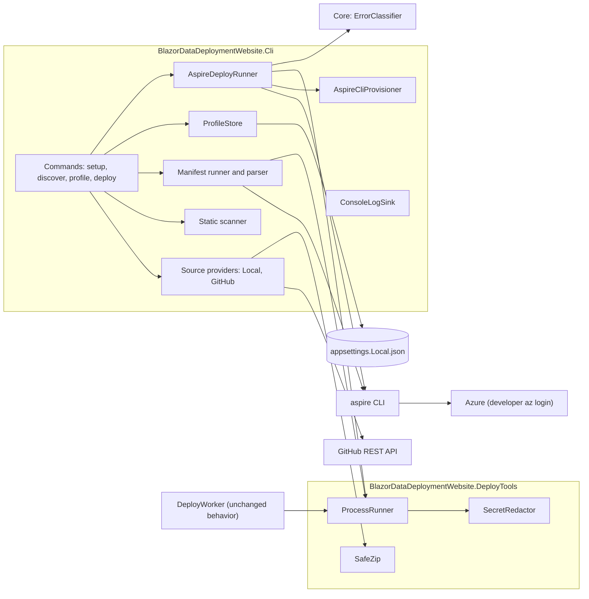
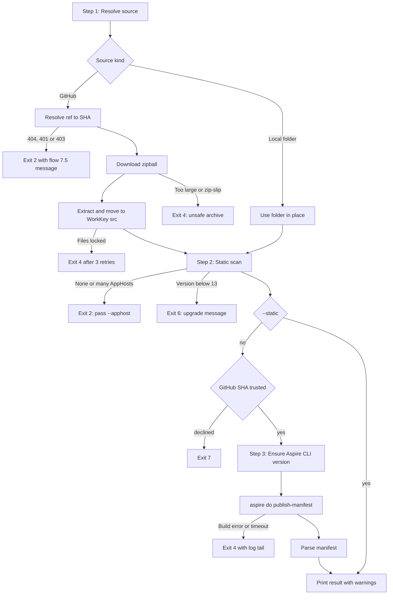
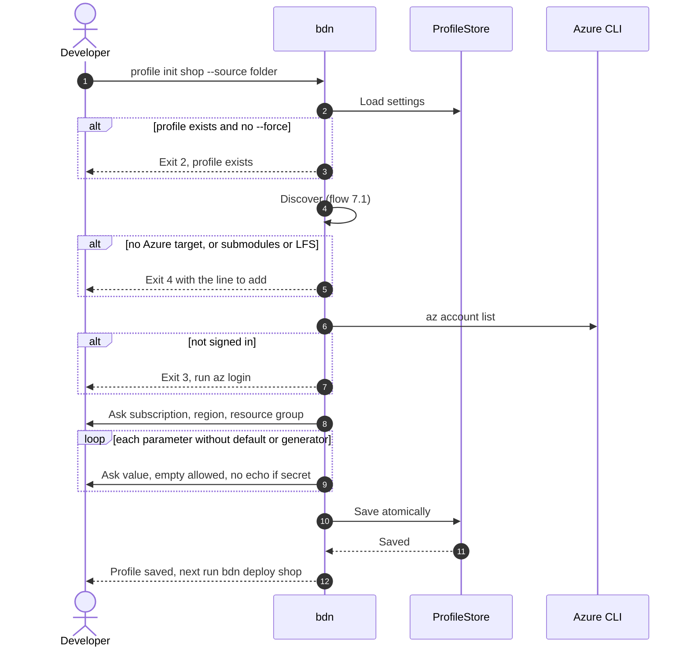
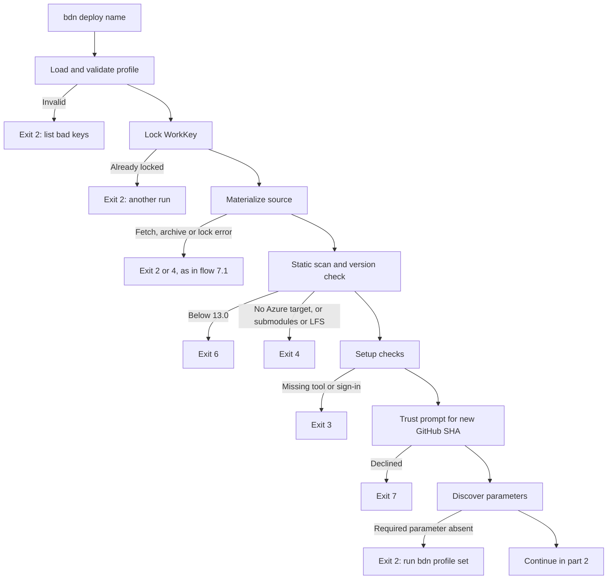
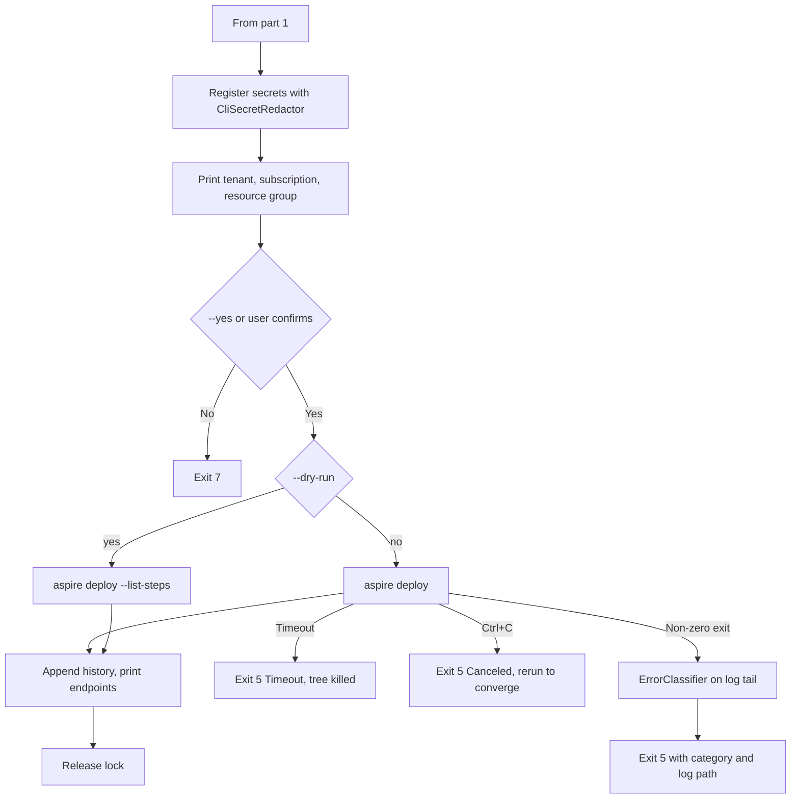
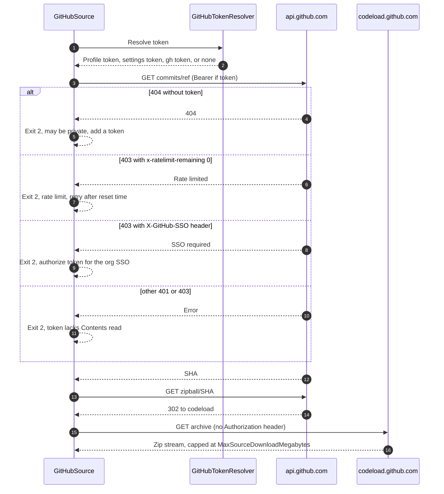

# Aspire Project Deployer (`bdn` CLI)
reference the code at: C:\Users\webma\Source\Repos\BlazorDataDeploymentWebsite\BlazorDataDeploymentWebsite
> **Parent plan:** [BlazorData-Deployment-Service-Plan.md](BlazorData-Deployment-Service-Plan.md) §11.5 (engine abstraction; the "aspire" engine is reserved there)
> **Depends on:** [Phase 5](Phase-5-Deployment-Worker.md) (deploy worker), which has shipped. This plan reuses the worker's process, redaction and zip code.
> **Estimate:** 13 to 16 working days (2 spikes, 12 PRs)
> **Owner inputs needed before T0b:** the repository owner provides:
> - a test Azure subscription where you can create resource groups;
> - a private test repository (`<owner>/<private-test-repo>`) holding an Aspire 13.x starter app;
> - a fine-grained GitHub token with Contents: read on that repository.
>
> **Goal:** A developer can point a local command-line tool at **any Aspire 13.x solution**, either a local folder or a public or private GitHub repository. The tool **discovers** what the AppHost needs: AppHost type, Aspire version, parameters, compute resources, Azure resources and deployment target. It then **deploys** the solution to an Azure subscription with `aspire deploy`. Per-developer settings are kept in a `.gitignore`d `appsettings.Local.json`.

All paths are relative to the repository root. Line numbers are as of commit `c9a8893`.

---

## 1. Summary

| # | Feature | In one line |
|---|---|---|
| F1 | Source: local folder or GitHub repository | `--source <folder>`, or `--source github:<owner>/<repo>` with `--ref <branch\|tag\|sha>`. GitHub sources are downloaded as a zipball pinned to a commit SHA and extracted with the existing `SafeZip`. Private repos use a token from `gh auth token` or the local settings file. |
| F2 | Discovery | Stage 1 is a static scan that runs no code. It finds the AppHost, its kind (project, file-based `apphost.cs`, TypeScript), its Aspire version and its declared deployment targets, and refuses anything before 13.0. Stage 2 runs `aspire do publish-manifest` and parses the result into a `DiscoveryResult`: parameters, secrets, compute resources and Azure resources. |
| F3 | Local settings | Named **deploy profiles** in `BlazorDataDeploymentWebsite.Cli/appsettings.Local.json`, which `.gitignore` already covers. A profile holds the source, the destination (subscription, region, resource group) and the parameter values. A committed `appsettings.Local.example.json` shows the shape with placeholders. |
| F4 | Deploy | `bdn deploy <profile>` installs or picks the Aspire CLI that matches the AppHost's SDK version. It then runs `aspire deploy --non-interactive` with the Azure settings and parameters as environment variables, using the developer's own Azure CLI sign-in. |

**Does it need different configurations for different Aspire versions?** Yes, a little. Only 13.x is supported (D2), but three things change between 13.x versions:

1. Where the AppHost settings live: `.aspire/settings.json` before 13.2, `aspire.config.json` from 13.2 on.
2. The TypeScript AppHost file name: `apphost.ts` before 13.4, `apphost.mts` from 13.4 on.
3. The Aspire CLI version must match the AppHost SDK version.

One small table, `AspireVersionRules` (§6.4), handles all three, with no separate code paths.

Versions 8.x and 9.x would need a second discovery path (`dotnet run -- --publisher manifest`) and a second deploy engine (azd). They are refused with an upgrade message instead.

## 2. Goals and Non-goals

**Goals**
- Any Aspire 13.x AppHost that declares an Azure compute environment can be deployed with one command once a profile exists, from a folder or a GitHub repo. Supported environments: Container Apps (`AddAzureContainerAppEnvironment`), App Service (`AddAzureAppServiceEnvironment`) and AKS.
- Discovery shows the developer what a deployment needs **before** anything is created in Azure.
- No secret value is printed to the console, written to the run log or written to history. `profile show` masks profile secrets.
- `bdn` itself never writes into the target source.
  - For a **local folder** source, the Aspire tooling it runs does write there: `bin/` and `obj/` from the build; for TypeScript AppHosts, `.aspire/modules/` and `node_modules/`; and possibly `aspire.config.json` or `.aspire/settings.json`. The README says so.
  - GitHub sources are extracted into the work folder and never touch a repository.
- Worker behavior is unchanged. Moving the shared code (T1) is a refactor only.

**Non-goals (v1)**
- Changes to the hosted site (BlazorData.net), the web wizard, the SQL schema or billing. The hosted site keeps deploying BDO only. A later hosted mode is §15 Q1.
- Aspire 8.x and 9.x (D2). azd as an engine.
- Reusing existing Azure resources such as an existing ACR or SQL server. Only an existing **resource group** can be reused (D4).
- Deployment targets other than Azure: Docker Compose, and Kubernetes outside AKS.
- Editing the user's AppHost, for example to add a missing compute environment.
- `destroy` or teardown. The tool prints the resource group name instead (§15 Q3).
- A GUI, or packaging as a `dotnet tool`. v1 runs with `dotnet run --project`, or from a `dotnet publish` folder.
- Sandboxing the AppHost. It runs on the developer's machine as the developer (D7).

## 3. Decisions

| # | Decision | Rejected alternative | Why |
|---|---|---|---|
| D1 | Build a **local CLI** (`BlazorDataDeploymentWebsite.Cli`, command name `bdn`), not a hosted-site feature. | Extend the hosted wizard and worker. | User's choice. The worker runs in an Azure Container Apps Job and downloads only from one pinned repo ([ReleaseDownloader.cs:84-91](../BlazorDataDeploymentWebsite.DeployWorker/Releases/ReleaseDownloader.cs#L84)), so it cannot read a local folder. Running a stranger's AppHost there would also need a sandbox, per-user GitHub tokens, and a dynamic resource model in place of the closed `ResourceKind` enum ([Enums.cs:60-72](../BlazorDataDeploymentWebsite.Core/Domain/Enums.cs#L60)). |
| D2 | Support **Aspire 13.x only**. Detect the version statically and refuse anything below 13.0 with exit 6 and an upgrade link. | (a) 9.x and 13.x, with an azd adapter for 9.x. (b) 8.x as well. | User's choice. 13.x has one discovery command (`aspire do publish-manifest`) and one deploy command (`aspire deploy`) that cover project, file-based and TypeScript AppHosts. azd does not support TypeScript AppHosts (azd changelog 1.30.0), and Aspire no longer recommends azd as the default path ([aspire.dev: azd](https://aspire.dev/deployment/azure/azure-developer-cli/)). |
| D3 | Settings live in **tool-side named profiles** in `BlazorDataDeploymentWebsite.Cli/appsettings.Local.json`, which [.gitignore:12](../.gitignore#L12) already ignores. | (a) A settings file inside the target project. (b) `%APPDATA%`. | User's choice. The target repo is never touched, and the file sits next to the tool where it is easy to edit. The repo's [secrets-in-repo skill](../.github/skills/secrets-in-repo/SKILL.md) puts *this site's own* secrets in committed `appsettings.json`. Profiles are different: they are per developer, point at *other* projects' subscriptions, and the user asked for them to stay out of source control. Values are plain text, as in Aspire's own deploy cache (§9). |
| D4 | One profile deploys into **one resource group**, new or existing. The AppHost creates everything it declares, and the user only supplies the discovered parameters. | Map discovered resources to existing Azure resources. | User's choice. Reusing resources needs `PublishAsExisting` in the user's AppHost, the way BDO declares `existing*` parameters ([AzdParameterMapper.cs:43-57](../BlazorDataDeploymentWebsite.DeployWorker/Engine/AzdParameterMapper.cs#L43)). A generic AppHost has no such parameters. |
| D5 | Move the shared worker code (`ProcessRunner`, `SecretRedactor`, `IDeploymentLogSink`/`LogStreams`, `SafeZip`) into a new class library, `BlazorDataDeploymentWebsite.DeployTools`, **keeping the namespaces**. The worker and the CLI both reference it. The CLI also references Core, for `ErrorClassifier` and `ErrorCategory`. | (a) Link the `.cs` files into the CLI with `<Compile Include=... Link=...>`. (b) Reference the DeployWorker project from the CLI. | (a) The test project references both projects, so it would see two `ProcessRunner` types in one namespace and fail with error CS0433. (b) DeployWorker is a Worker SDK executable; the CLI would pull in its `appsettings.json`, hosted-service registration and Aspire storage clients. Unchanged namespaces mean the worker and its tests need no `using` changes. The Core reference brings in EF Core and `Azure.Data.Tables` assemblies that are never loaded. That cost is accepted instead of moving `ErrorCategory`, which all of Core uses. |
| D6 | Discovery runs in **two stages**. Stage 1 is a static scan that runs no code; it finds the version, AppHost kind, packages and declared targets. Stage 2 runs `aspire do publish-manifest`, which builds and runs the AppHost, and returns the parameters and resources. `bdn discover --static` stops after stage 1. | Use only the manifest, or parse the AppHost with Roslyn. | Stage 1 is enough to pick the CLI version and refuse unsupported projects before running anything. The manifest is the only machine-readable inventory; it is "a deprecated compatibility format" but 13.x still produces it ([aspire.dev: manifest format](https://aspire.dev/deployment/azure/manifest-format/)), so R1 plans a fallback. Roslyn cannot evaluate parameter names built in code, or TypeScript. |
| D7 | Before code from a GitHub source runs for the first time at a given commit, `bdn` asks: "This builds and runs code from `<owner>/<repo>` at `<sha>` on this machine. Continue?" `--yes` skips the prompt. Confirmed `(repo, sha)` pairs are stored in a **global** `<WorkRoot>/trust.jsonl`, so trust works with or without a profile (§6.8). Local folders are always trusted. | Sandbox the build in a container. | The developer is running code they chose, just as with `aspire deploy` itself. A container sandbox would need Docker-in-Docker to build images. |
| D8 | Deploy uses the developer's **own Azure CLI sign-in** (`az login`). `bdn` sets `Azure__CredentialSource=AzureCli` (a profile can override it) and `Azure__TenantId` when the profile has a tenant. It never installs az or azd, and never points them at per-job config folders. | Reuse `ToolInstaller.EnsureAsync`. | `ToolInstaller.BuildEnvironment` points `AZURE_CONFIG_DIR` and `AZD_CONFIG_DIR` at a per-job folder ([ToolInstaller.cs:116-117](../BlazorDataDeploymentWebsite.DeployWorker/Tools/ToolInstaller.cs#L116)), which would hide the developer's sign-in. `EnsureAsync` also always installs the .NET SDK and azd ([ToolInstaller.cs:61-87](../BlazorDataDeploymentWebsite.DeployWorker/Tools/ToolInstaller.cs#L61)). `Azure:CredentialSource` and `Azure:TenantId` are documented settings ([aspire.dev: Deploy to Azure](https://aspire.dev/deployment/azure/)). |
| D9 | The Aspire CLI version **equals the AppHost SDK version**. If `aspire --version` on PATH matches, `bdn` uses that CLI. Otherwise it runs `dotnet tool install aspire.cli --version <v> --tool-path <ToolsRoot>/aspire/<v>`, the same command the worker uses ([ToolInstaller.cs:197-204](../BlazorDataDeploymentWebsite.DeployWorker/Tools/ToolInstaller.cs#L197)). If the install fails, `bdn` exits 3. | Always use the CLI on PATH. | TypeScript code generation needs the CLI and SDK versions to match ([aspire.dev: TypeScript AppHost](https://aspire.dev/app-host/typescript-apphost/)). Pinning also makes deploys reproducible, which is why the worker pins its tools. |
| D10 | GitHub sources are fetched with `GET /repos/{owner}/{repo}/zipball/{sha}`, after `GET /repos/{owner}/{repo}/commits/{ref}` resolves the ref to a SHA. Each run then: (1) extracts into `<WorkKey>/extract`; (2) finds the archive's single top-level folder, named `<owner>-<repo>-<sha7>`, with `SafeZip.GetSingleTopLevelFolder`; (3) deletes the old `<WorkKey>/src`, retrying 3 times 1 second apart if files are locked; (4) **moves that inner folder to `<WorkKey>/src`**. `<WorkKey>` is `<WorkRoot>/<profile>`. Without a profile it is `<WorkRoot>/adhoc-<first 12 hex characters of SHA-256 of "github:<owner>/<repo>">`. | `git clone`, or a new folder per SHA. | The zipball needs no git install, and `SafeZip` already requires exactly one top-level folder ([SafeZip.cs:64-71](../BlazorDataDeploymentWebsite.DeployWorker/Releases/SafeZip.cs#L64)). That folder's name changes with every commit, so step 4 moves it to a fixed path. A fixed path matters because Aspire caches deploy state under `~/.aspire/deployments/{AppHostSha}/` ([aspire.dev: deployment state caching](https://aspire.dev/deployment/deployment-state-caching/)). Whether that hash includes the path is **(assumed)** and is checked in T0b. |
| D11 | Every Azure setting and parameter value reaches `aspire deploy` as an **environment variable**, never as a command-line argument. Every secret value is registered with `CliSecretRedactor` (§6.7) before the process starts. | Store values with `aspire secret set` in the AppHost's user secrets. | Environment variables are the documented non-interactive input ([aspire.dev: Deploy to Azure, CI/CD settings](https://aspire.dev/deployment/azure/)), and the AppHost's user-secrets store stays untouched. `ProcessRunner` applies `spec.Environment` after it strips inherited variables ([ProcessRunner.cs:86-97](../BlazorDataDeploymentWebsite.DeployWorker/Processes/ProcessRunner.cs#L86)). None of the stripped prefixes match `Azure__`, `Parameters__` or `ConnectionStrings__` ([ProcessRunner.cs:62-67](../BlazorDataDeploymentWebsite.DeployWorker/Processes/ProcessRunner.cs#L62)). |
| D12 | Each parameter has a **configuration key**. Its environment variable is that key with `:` replaced by `__`. The default key is `Parameters:<name>`, with `-` in the name replaced by `_`. A connection-string parameter (`AddConnectionString`, which the manifest marks with a `connectionString` property) uses `ConnectionStrings:<name>`. A parameter read from a custom key (`AddParameterFromConfiguration`) cannot be recognised in the manifest, so a profile can set the key with `ParameterConfigKeys:<name>`. | Always use `Parameters__<name>`. | Dashes become `_` ([aspire.dev: external parameters](https://aspire.dev/fundamentals/external-parameters/)). Connection strings resolve from `ConnectionStrings:*`, so `Parameters__x` alone would leave common AppHosts without a value. **(assumed: the manifest shape for connection strings; T0a captures a fixture.)** |
| D13 | Stage 1 records every deployment target it finds, as "declared". Targets never make discovery fail: `discover`, including `--static`, reports them and warns if none is Azure. `profile init` and `deploy` exit 4 when there is **no Azure target** (Container Apps, App Service or AKS), even if non-Azure targets exist, and print the line to add. Several Azure targets are allowed; all are listed, and `aspire deploy` handles them. | Inject `AddAzureContainerAppEnvironment` into the AppHost. | `aspire deploy` to Azure needs the compute environment declared in the AppHost ([aspire.dev: Container Apps](https://aspire.dev/deployment/azure/container-apps/)), and editing user code is a non-goal. Text matching cannot evaluate conditionals. For example, this repo's own AppHost declares two environments, both inside `if (isPublish)` ([AppHost.cs:67-71](../BlazorDataDeploymentWebsite.AppHost/AppHost.cs#L67)). |
| D14 | Parse the command line with `System.CommandLine` 2.0.x (stable), version pinned in T2. | Hand-written parsing. | Help text, validation and tab completion for free. **(assumed: 2.0 is GA on NuGet; T0a checks.)** |

## 4. Current State

| Area | Where | Today |
|---|---|---|
| Pinned source repo | [StorageNames.cs:29-39](../BlazorDataDeploymentWebsite.Core/Domain/StorageNames.cs#L29) | `BdoRepository` hard-codes the owner, repo name, manifest asset, GHCR prefix and the three services `webapp`/`scheduler`/`agent`. |
| Source download | [ReleaseDownloader.cs:73-257](../BlazorDataDeploymentWebsite.DeployWorker/Releases/ReleaseDownloader.cs#L73) | Downloads a release tag and its `deploy-manifest.json` asset from the pinned repo only, and checks the SHA-256. `GitHub:Token` is optional and only raises rate limits. No support for private repos, branches or folders. |
| Deploy engine | [DeployContext.cs:78-105](../BlazorDataDeploymentWebsite.DeployWorker/Engine/DeployContext.cs#L78), [FakeEngine.cs:121-137](../BlazorDataDeploymentWebsite.DeployWorker/Engine/FakeEngine.cs#L121) | `IDeploymentEngine` has 8 steps shaped around azd and BDO. The factory throws for `"aspire"` ("does not support yet", lines 131-133). |
| azd engine | [AzdEngine.cs](../BlazorDataDeploymentWebsite.DeployWorker/Engine/AzdEngine.cs) | Runs `azd infra gen` and `azd provision`, then imports prebuilt GHCR images. The verify step calls `/alive` on `webapp`. All BDO-specific. |
| Process runner | [ProcessRunner.cs:44-97](../BlazorDataDeploymentWebsite.DeployWorker/Processes/ProcessRunner.cs#L44) | Generic. Passes arguments one by one, streams redacted output, kills the whole process tree on timeout, and strips inherited worker, Azure-credential and `ASPIRE_` variables. |
| Redaction | [SecretRedactor.cs:7-65](../BlazorDataDeploymentWebsite.DeployWorker/Logging/SecretRedactor.cs#L7) | Generic: JWT and PEM patterns, plus `AddSecret` for runtime values. `AddSecret` ignores values shorter than 8 characters (line 63). |
| Log sink | [DeploymentLogSink.cs:14-35](../BlazorDataDeploymentWebsite.DeployWorker/Logging/DeploymentLogSink.cs#L14) | The interfaces are generic. The worker's Table-storage implementation is `DeploymentLogWriter` ([DeploymentLogWriter.cs:82](../BlazorDataDeploymentWebsite.DeployWorker/Logging/DeploymentLogWriter.cs#L82)), and it stays in the worker. |
| Zip | [SafeZip.cs:10-73](../BlazorDataDeploymentWebsite.DeployWorker/Releases/SafeZip.cs#L10) | Generic: zip-slip guard, 2 GB extraction cap, single top-level folder check, SHA-256. |
| Tool installs | [ToolInstaller.cs:61-123](../BlazorDataDeploymentWebsite.DeployWorker/Tools/ToolInstaller.cs#L61) | Always installs dotnet, azd and aspire, and moves the az and azd config folders per job (D8). `FindAspire` (line 93) and `FileLock` (line 242) are reusable ideas. |
| Error classification | [ErrorClassifier.cs:72-110](../BlazorDataDeploymentWebsite.Core/Deployments/ErrorClassifier.cs#L72) | Generic ARM error regexes that return an `ErrorCategory` ([Enums.cs:108-121](../BlazorDataDeploymentWebsite.Core/Domain/Enums.cs#L108)). |
| Value guard | [ResourceNameRules.cs:110-126](../BlazorDataDeploymentWebsite.Core/Deployments/ResourceNameRules.cs#L110) | `IsSafeEnvAssignment` allows at most 128 characters of `[A-Za-z0-9-_.()]`. The CLI does **not** use it: URLs and secrets would fail it, and D11 passes values through the environment, not a shell. |
| Local-settings ignore | [.gitignore:11-15](../.gitignore#L11) | `appsettings.Local.json`, `*.pfx`, `*.pem` and `.env` are ignored at every depth. No code loads `appsettings.Local.json` today **(per the research pass: there is no `AddJsonFile` in either `Program.cs`)**. |
| Solution and CI | [BlazorDataDeploymentWebsite.slnx](../BlazorDataDeploymentWebsite.slnx), [build.yml:24-33](../.github/workflows/build.yml#L24) | CI restores and builds the `.slnx`, and runs tests only in `BlazorDataDeploymentWebsite.Tests`. New projects go in the `.slnx` and are referenced by the test project. |
| Test project | [BlazorDataDeploymentWebsite.Tests.csproj](../BlazorDataDeploymentWebsite.Tests/BlazorDataDeploymentWebsite.Tests.csproj) | xUnit 2.9.3. References Core, Web and DeployWorker. Worker tests live in `Tests/Worker/` (for example `ProcessRunnerTests.cs` and `SecretRedactorTests.cs`). |
| SDK | [global.json](../global.json) | .NET SDK 10.0.401 with `latestFeature`. The CLI targets `net10.0` like the other projects. |

## 5. Design

### 5.1 Structure



### 5.2 New and changed components

| Component | Kind | Responsibility |
|---|---|---|
| `BlazorDataDeploymentWebsite.DeployTools` (class library) | New | `ProcessRunner`, `SecretRedactor`, `DeploymentLogSink.cs` (the interfaces and `LogStreams`) and `SafeZip`, moved from DeployWorker with their namespaces unchanged (D5). |
| `BlazorDataDeploymentWebsite.Cli` (console app, `AssemblyName` = `bdn`) | New | The commands in §6.1. |
| `Sources/ISourceProvider`, `LocalFolderSource`, `GitHubSource` | New | Turn a `SourceSpec` into a local folder plus a `SourceIdentity`. |
| `GitHub/GitHubTokenResolver` | New | Picks the token: profile `Source:GitHubToken`, then `AspireDeploy:GitHub:Token`, then `gh auth token`, then none. |
| `Discovery/AppHostScanner` | New | Stage 1, no code execution: AppHost, kind, version, packages, declared targets, warnings about submodules and LFS. |
| `Discovery/AspireVersionRules` | New | The per-version table in §6.4. |
| `Discovery/ManifestRunner`, `ManifestParser` | New | Stage 2. |
| `Profiles/ProfileStore` | New | Loads, validates and saves profiles. Saves atomically: writes a temp file, then replaces the original. |
| `Settings/SettingsLocator` | New | Finds the settings file (§6.3). |
| `Infrastructure/WorkKeyLock`, `TrustStore` | New | Allows one run per work key (§6.1). Reads and writes `trust.jsonl` (§6.8). |
| `Tools/AspireCliProvisioner` | New | D9. |
| `Prerequisites/PrerequisiteChecker` | New | §6.6. |
| `Deploy/AspireDeployRunner`, `DeployHistory` | New | Builds the environment (§6.7), runs `aspire deploy`, classifies failures, appends to history. |
| `Logging/ConsoleLogSink : IDeploymentLogSink` | New | Writes redacted lines to the console and to `<WorkKey>/logs/<utc>-<runId>.log`. |
| `Logging/CliSecretRedactor : ISecretRedactor` | New | A decorator around `SecretRedactor` that also masks short secrets (§6.7). |

## 6. Contracts

### 6.1 Commands

Run as `dotnet run --project BlazorDataDeploymentWebsite.Cli -- <command>`, or as `bdn <command>` from a publish folder.

| Command | Options (type, default) | Does |
|---|---|---|
| `bdn setup` | `--profile <string>` (none) | Checks the prerequisites in §6.6. With a profile, also materializes that profile's source and checks what its AppHost needs. |
| `bdn discover` | `--source <string>` (required unless `--profile` is given), `--ref <string>` (default branch), `--apphost <relative path>` (auto), `--static` (bool, false), `--json` (bool, false), `--yes` (bool, false), `--profile <string>` | Runs stage 1, then stage 2 unless `--static` is set. Prints a table, or the `DiscoveryResult` as JSON. Without a profile it uses an ad-hoc work key (D10). |
| `bdn profile init <name>` | `--source`, `--ref`, `--apphost`, `--subscription <guid>`, `--tenant <guid>`, `--location <string>`, `--resource-group <string>` (default `rg-<name>`), `--environment <string>` (`Production`), `--force` (bool, false), `--yes` (bool, false) | Runs discovery, asks for any missing destination values and for every parameter that has no default and no generator (secrets are read without echo), then saves the profile. Refuses with exit 2 if the profile already exists and `--force` is not set. |
| `bdn profile list` | none | Lists profile names, sources and destinations. |
| `bdn profile show <name>` | `--reveal` (bool, false) | Prints the profile with secrets shown as `********` unless `--reveal` is set. |
| `bdn profile set <name> <key> [<value>]` | `--secret` (bool, false) | Sets one key. Settable keys: `Source:Ref`, `Source:AppHostPath`, `Source:GitHubToken`, any `Destination:*` key, `Environment`, `ContainerRuntime`, `Parameters:<name>`, `ParameterConfigKeys:<name>`. Any other key exits 2. With `--secret`, omit `<value>`: it is read from the console without echo, and `<name>` is added to `SecretParameters`. An empty value means "deliberately not supplied" (§6.3). |
| `bdn deploy <name>` | `--ref <string>` (the profile's ref), `--dry-run` (bool, false), `--clear-cache` (bool, false), `--yes` (bool, false) | Flows §7.3 and §7.4. `--dry-run` runs `aspire deploy --list-steps` instead of a real deploy. |

Every command also accepts `--settings <path>` (§6.3) and `--verbose`. `--verbose` passes `--log-level Debug` to `aspire`.

Every `aspire deploy` option used here is in the [`aspire deploy` command reference](https://aspire.dev/reference/cli/commands/aspire-deploy/): `--apphost`, `-o`, `-e`, `--non-interactive`, `--nologo`, `--clear-cache`, `--list-steps` and `--log-level`. `aspire do` takes the same options except `--clear-cache` ([reference](https://aspire.dev/reference/cli/commands/aspire-do/)).

**Ctrl+C.** `Console.CancelKeyPress` sets `e.Cancel = true` and cancels the command's `CancellationToken`, and `ProcessRunner` then kills the process tree. During a deploy, `bdn` prints "Deployment stopped. Resources may be partly created in `<resource group>`; run `bdn deploy <name>` again to converge." and exits 5 with category `Canceled`.

**One run per work key.** Before any command uses a `<WorkKey>`, it takes an exclusive lock on `<WorkKey>/.lock`. The lock is a `FileStream` opened with `FileShare.None` and `FileOptions.DeleteOnClose`, the same idea as the worker's `FileLock` ([ToolInstaller.cs:242](../BlazorDataDeploymentWebsite.DeployWorker/Tools/ToolInstaller.cs#L242)). If the lock is already held, the command exits 2 with "Another bdn run is using `<name>`".

**Exit codes**

| Code | Meaning |
|---|---|
| 0 | Success |
| 1 | Unexpected error |
| 2 | Invalid arguments or profile; no AppHost found, or more than one; work key locked; a required parameter is absent; a GitHub repo or ref was not found, or a token problem |
| 3 | Missing prerequisite: .NET SDK, Azure CLI sign-in, container runtime, Node, or an Aspire CLI that cannot be installed |
| 4 | Discovery failed or the archive is unsafe; `profile init` or `deploy` found no Azure target, or the source uses submodules or Git LFS; files are locked during source replacement |
| 5 | `aspire deploy` failed, timed out or was canceled. The message includes the `ErrorCategory` |
| 6 | Unsupported Aspire version (below 13.0) |
| 7 | The user declined the trust prompt (D7) or the deploy confirmation |

### 6.2 Core records (`BlazorDataDeploymentWebsite.Cli`)

```csharp
public enum SourceKind { LocalFolder, GitHub }
public sealed record SourceSpec(SourceKind Kind, string Location, string? Ref, string? AppHostPath);
// Location: an absolute folder path, or "<owner>/<repo>"
public sealed record SourceIdentity(string RootFolder, string Display, string? CommitSha);

public interface ISourceProvider
{
    Task<SourceIdentity> MaterializeAsync(SourceSpec spec, string workKeyDir, IDeploymentLogSink log, CancellationToken ct);
}

public enum AppHostKind { ProjectCsproj, FileBasedCs, TypeScript }
public enum DeploymentTarget { AzureContainerApps, AzureAppService, AzureKubernetes, DockerCompose, Kubernetes }
public sealed record AppHostInfo(
    string AppHostPath,                       // relative to the source root
    AppHostKind Kind,
    string AspireSdkVersion,                  // e.g. "13.6.1"
    IReadOnlyList<string> HostingPackages,    // e.g. "Aspire.Hosting.Azure.AppContainers"
    IReadOnlyList<DeploymentTarget> DeclaredTargets,
    string? DotnetSdkFromGlobalJson);

public sealed record DiscoveredParameter(
    string Name, bool Secret, bool HasDefault, bool Generated,
    string ConfigKey);                        // "Parameters:<name>" or "ConnectionStrings:<name>" (D12)
public sealed record DiscoveredResource(string Name, string Type, string? Image, string? ProjectPath, bool IsAzure, bool NeedsContainerRuntime);
public sealed record DiscoveryResult(
    AppHostInfo AppHost,
    SourceIdentity Source,
    IReadOnlyList<DiscoveredParameter> Parameters,   // empty when ManifestRan is false
    IReadOnlyList<DiscoveredResource> Resources,     // empty when ManifestRan is false
    IReadOnlyList<string> Warnings,
    bool ManifestRan);
```

`IDeploymentLogSink` requires a `Guid DeploymentId` ([DeploymentLogSink.cs:16](../BlazorDataDeploymentWebsite.DeployWorker/Logging/DeploymentLogSink.cs#L16)). `ConsoleLogSink` generates a new `Guid` for each run and uses it as `<runId>` in the log file name.

### 6.3 Settings (`appsettings.Local.json`)

**Where the file is found.** The first match wins:

1. `--settings <path>`.
2. The `BDN_SETTINGS` environment variable.
3. `appsettings.Local.json` in the nearest folder at or above `AppContext.BaseDirectory` that contains `BlazorDataDeploymentWebsite.Cli.csproj`. This is the project folder when the tool runs with `dotnet run`.
4. `AppContext.BaseDirectory`, which is the publish folder.

The CLI has **no committed `appsettings.json`**. Defaults live in the `AspireDeployOptions` property initializers. A CLI `appsettings.json` copied to output would collide with the Web project's `appsettings.json` in the test project's output folder, because the test project references both. `appsettings.Local.json` is **not** copied to output either; it is read where the rules above find it. The first `profile init` creates it.

| Key | Type | Default | Notes |
|---|---|---|---|
| `AspireDeploy:WorkRoot` | string | `%LOCALAPPDATA%/bdn/w` (`Environment.SpecialFolder.LocalApplicationData`) | Sources, logs, locks, history and `trust.jsonl`. The path is short on purpose because of Windows path limits (R10). |
| `AspireDeploy:ToolsRoot` | string | `%LOCALAPPDATA%/bdn/tools` | Pinned Aspire CLIs (D9). |
| `AspireDeploy:MinimumAspireVersion` | string | `13.0.0` | D2. |
| `AspireDeploy:MaxTestedAspireMajor` | int | `13` | A higher major version prints the warning "not tested with Aspire <v>" and continues (R1). |
| `AspireDeploy:DiscoveryTimeoutMinutes` | int | `10` | For `aspire do publish-manifest`. |
| `AspireDeploy:DeployTimeoutMinutes` | int | `60` | For `aspire deploy`. |
| `AspireDeploy:MaxSourceDownloadMegabytes` | int | `512` | The same cap the worker uses. |
| `AspireDeploy:GitHub:Token` | string? | null | Fallback token for private repos. |
| `AspireDeploy:Profiles:<name>` | object | none | Profile names must match `^[a-z0-9][a-z0-9-]{1,39}$`. |

**Profile object**

| Key | Type | Required | Notes |
|---|---|---|---|
| `Source:Kind` | `LocalFolder` \| `GitHub` | Yes | |
| `Source:Location` | string | Yes | An absolute folder, or `<owner>/<repo>`. |
| `Source:Ref` | string? | No | A branch, tag or SHA. The default is the repo's default branch. |
| `Source:AppHostPath` | string? | No | Relative to the source root. Saved after discovery so later runs skip the search. |
| `Source:GitHubToken` | string? | No | Overrides the global token. |
| `Destination:TenantId` | guid? | No | Sent as `Azure__TenantId`. |
| `Destination:SubscriptionId` | guid | Yes | Sent as `Azure__SubscriptionId`. |
| `Destination:Location` | string | Yes | Sent as `Azure__Location`, for example `eastus2`. |
| `Destination:ResourceGroup` | string | Yes | Sent as `Azure__ResourceGroup`. 1 to 90 characters, following Azure resource group naming rules. |
| `Destination:AllowResourceGroupCreation` | bool | No (`true`) | Sent as `Azure__AllowResourceGroupCreation`. |
| `Destination:CredentialSource` | string | No (`AzureCli`) | Sent as `Azure__CredentialSource` (D8). |
| `Environment` | string | No (`Production`) | Passed to `aspire deploy -e`. |
| `ContainerRuntime` | `docker` \| `podman` \| null | No | Sent as `ASPIRE_CONTAINER_RUNTIME` (§6.7). |
| `Parameters:<name>` | string | Per discovery | Sent under the parameter's config key (D12). **Present with value `""`** means "deliberately not supplied; the AppHost's own configuration provides it", so nothing is passed. **Absent** for a parameter with no default and no generator means missing, and `deploy` exits 2. |
| `ParameterConfigKeys:<name>` | string | No | Overrides the configuration key, for example `MyApp:ApiKey` (D12). |
| `SecretParameters` | string[] | No | Names whose values are masked. Filled from discovery and by `profile set --secret`. |

**Sample.** `appsettings.Local.example.json` is committed and holds placeholders only:

```json
{
  "AspireDeploy": {
    "GitHub": { "Token": "<github-token-or-empty>" },
    "Profiles": {
      "orders-dev": {
        "Source": { "Kind": "GitHub", "Location": "<owner>/<repo>", "Ref": "main", "AppHostPath": "src/Orders.AppHost/Orders.AppHost.csproj" },
        "Destination": { "TenantId": "<tenant-guid>", "SubscriptionId": "<subscription-guid>", "Location": "eastus2", "ResourceGroup": "rg-orders-dev" },
        "Environment": "Production",
        "Parameters": { "apiKey": "<secret>", "region-name": "west", "db": "<connection-string>" },
        "SecretParameters": [ "apiKey", "db" ]
      },
      "local-shop": {
        "Source": { "Kind": "LocalFolder", "Location": "<absolute-path-to-solution>" },
        "Destination": { "SubscriptionId": "<subscription-guid>", "Location": "westus3", "ResourceGroup": "rg-shop" },
        "ContainerRuntime": "podman"
      }
    }
  }
}
```

### 6.4 `AspireVersionRules` and static scan

```csharp
public static class AspireVersionRules
{
    public static bool IsSupported(Version v, Version minimum);   // v >= minimum (default 13.0.0)
    public static bool IsBeyondTested(Version v, int maxMajor);   // v.Major > maxMajor -> warning
    public static string SettingsFileFor(Version v);              // below 13.2: ".aspire/settings.json"; otherwise "aspire.config.json"
    public static string[] TypeScriptAppHostNames(Version v);     // below 13.4: ["apphost.ts"]; otherwise ["apphost.mts", "apphost.ts"]
    public static string UnsupportedMessage(Version found);       // includes the upgrade-to-13 link
}
```

**Detection order.** Stage 1 runs no code, and the first rule that matches wins.

| # | Signal | Kind | Version source |
|---|---|---|---|
| 1 | `--apphost`, or the profile's `Source:AppHostPath` | From the file name | As in rows 3 to 6 |
| 2 | `aspire.config.json` (13.2+) or `.aspire/settings.json`, searched from the root down | From `appHost.language` and `appHost.path` | `sdk.version` for non-C# AppHosts; for C#, the file that `appHost.path` points to |
| 3 | `apphost.cs` with `#:sdk Aspire.AppHost.Sdk@<v>` in its first lines | FileBasedCs | `<v>` |
| 4 | `apphost.mts` or `apphost.ts` next to `package.json` | TypeScript | `sdk.version` in `aspire.config.json` |
| 5 | A `*.csproj` with `Sdk="Aspire.AppHost.Sdk/<v>"` | ProjectCsproj | `<v>` |
| 6 | A `*.csproj` with `<Sdk Name="Aspire.AppHost.Sdk" Version="<v>"/>`, `<IsAspireHost>true</IsAspireHost>`, or a bare `Sdk="Aspire.AppHost.Sdk"` whose version is pinned in `global.json` `msbuild-sdks` | ProjectCsproj | `<v>`, the `msbuild-sdks` entry, or the `Aspire.Hosting.AppHost` package version (from `Directory.Packages.props` under Central Package Management) |

**The version decides, not the project file's form.** A 9.x project is refused with exit 6. A 13.x project that uses the row-6 form is accepted. If no version can be found, the scan exits 2 with "could not find the Aspire SDK version; pass `--apphost`".

- **More than one AppHost, or none:** exit 2. With several, the list is printed so the user can pass `--apphost`.
- **Skipped folders:** `bin`, `obj`, `node_modules`, `.git` and `.aspire/modules`.
- **Declared targets:** found from package references and method names:

  | Found | Target |
  |---|---|
  | `Aspire.Hosting.Azure.AppContainers` or `AddAzureContainerAppEnvironment` | AzureContainerApps |
  | `Aspire.Hosting.Azure.AppService` or `AddAzureAppServiceEnvironment` | AzureAppService |
  | `AddAzureKubernetesEnvironment` | AzureKubernetes |
  | `AddDockerComposeEnvironment` | DockerCompose |
  | `AddKubernetesEnvironment` | Kubernetes |

  **(assumed: these names come from the aspire.dev deployment pages; T0a confirms them on 13.6.)**
- **Incomplete GitHub archives:** zipballs leave out submodule contents and hold only pointer files for Git LFS objects. The scan adds a warning when there is a `.gitmodules` file, or any file under 1 KB that starts with `version https://git-lfs`. `profile init` and `deploy` then exit 4 with "This repository uses submodules or Git LFS; clone it and use a LocalFolder source".

### 6.5 Manifest mapping (stage 2)

The command, run from the source root through `ProcessRunner`:

```
aspire do publish-manifest --apphost <AppHostPath> --output-path <WorkKey>/discovery/aspire-manifest.json --non-interactive --nologo
```

The environment is `DOTNET_ENVIRONMENT=<profile environment or Production>` and `ASPIRE_CLI_TELEMETRY_OPTOUT=1`. No `Azure__*` variables and no parameter values are passed, so discovery never touches Azure. **(assumed: `publish-manifest` does not prompt for parameters under `--non-interactive`; T0a checks this.)**

| Manifest `type` | Maps to |
|---|---|
| `parameter.v0` | A `DiscoveredParameter`: `Secret = inputs.value.secret == true`; `HasDefault = inputs.value.default.value != null`; `Generated = inputs.value.default.generate != null` (generated parameters are never asked for); `ConfigKey = "ConnectionStrings:<name>"` when the entry has a `connectionString` property, otherwise `"Parameters:<name>"` (D12). |
| `project.v0` / `project.v1` | A resource with `ProjectPath = path` and `NeedsContainerRuntime = true` **(assumed; T0b (d))**. |
| `container.v0` / `container.v1` | A resource with `Image`. `NeedsContainerRuntime = true` when it has `build`. |
| `dockerfile.v0` | A resource with `NeedsContainerRuntime = true`. |
| `azure.bicep.v0` / `azure.bicep.v1` | A resource with `IsAzure = true`. |
| `value.v0`, `annotated.string`, `executable.v0` | Kept with its `Type` only. `executable.v0` adds the warning "executables are not deployed". |
| Any other type | Kept with its `Type` only, plus the warning "unknown resource type". Never fatal, because the schema allows extension types. |

Sample `bdn discover --json` output (shortened):

```json
{
  "appHost": { "appHostPath": "src/Shop.AppHost/Shop.AppHost.csproj", "kind": "ProjectCsproj",
               "aspireSdkVersion": "13.6.1", "declaredTargets": [ "AzureContainerApps" ] },
  "source": { "display": "<owner>/<repo>@main", "commitSha": "<40-hex>" },
  "parameters": [ { "name": "apiKey", "secret": true, "hasDefault": false, "generated": false, "configKey": "Parameters:apiKey" },
                  { "name": "db", "secret": true, "hasDefault": false, "generated": false, "configKey": "ConnectionStrings:db" } ],
  "resources": [ { "name": "api", "type": "project.v1", "projectPath": "../Shop.Api/Shop.Api.csproj", "isAzure": false, "needsContainerRuntime": true },
                 { "name": "env", "type": "azure.bicep.v1", "isAzure": true, "needsContainerRuntime": false } ],
  "warnings": [],
  "manifestRan": true
}
```

### 6.6 Prerequisites (`bdn setup`)

| Check | How | If missing |
|---|---|---|
| A .NET SDK of at least 10.0 that satisfies the source's `global.json`, if it has one | `dotnet --list-sdks` | Exit 3 |
| Azure CLI signed in, with the profile's subscription visible | `az account show --output json`, then `az account list` | Exit 3, printing `az login --tenant <tenant>` |
| A container runtime, when any resource has `NeedsContainerRuntime` | `docker info`, or `podman info` when `ContainerRuntime` or `ASPIRE_CONTAINER_RUNTIME` says podman | Exit 3 |
| Node 20.19+, 22.13+ or 24+, for TypeScript AppHosts | `node --version` | Exit 3 |
| The Aspire CLI at the AppHost's version | D9 (installs it if missing) | The install error, then exit 3 |
| `gh`, only when a private repo needs a token and none is configured | `gh auth token` | Exit 3 with "add `AspireDeploy:GitHub:Token`" |
| Windows long paths, when `WorkRoot` plus the longest source path is over 240 characters | Read the registry value `HKLM\SYSTEM\CurrentControlSet\Control\FileSystem\LongPathsEnabled` | A warning that suggests a shorter `WorkRoot` |

### 6.7 Environment passed to `aspire deploy`

```
aspire deploy --apphost <AppHostPath> -e <Environment> -o <WorkKey>/aspire-output --non-interactive --nologo [--clear-cache] [--list-steps] [--log-level Debug]
```

| Variable | Value |
|---|---|
| `Azure__SubscriptionId`, `Azure__Location`, `Azure__ResourceGroup` | From the profile |
| `Azure__TenantId` | From the profile, if set |
| `Azure__CredentialSource` | From the profile, or `AzureCli` |
| `Azure__AllowResourceGroupCreation` | From the profile, or `true` |
| The parameter's config key, with `:` replaced by `__` | Every non-empty profile parameter (D12), for example `Parameters__apiKey` or `ConnectionStrings__db` |
| `ASPIRE_CONTAINER_RUNTIME` | The profile's `ContainerRuntime`, or else the developer's own value from the parent environment. It must be set explicitly, because `ProcessRunner` strips every inherited `ASPIRE_*` variable |
| `DOTNET_ENVIRONMENT` | The profile's environment |
| `ASPIRE_CLI_TELEMETRY_OPTOUT` | `1` |
| `PATH` | `<ToolsRoot>/aspire/<v>` first, when a pinned CLI was installed |

`ProcessRunner` already strips inherited `ASPIRE_`, `DCP_` and Azure client-secret variables ([ProcessRunner.cs:62-67](../BlazorDataDeploymentWebsite.DeployWorker/Processes/ProcessRunner.cs#L62)). For Azure that is correct, because it stops a stray `AZURE_CLIENT_SECRET` from overriding the az sign-in. The `ASPIRE_CONTAINER_RUNTIME` row puts back the one `ASPIRE_` setting a developer needs.

**Short secrets.** `SecretRedactor.AddSecret` ignores values shorter than 8 characters ([SecretRedactor.cs:60-65](../BlazorDataDeploymentWebsite.DeployWorker/Logging/SecretRedactor.cs#L60)). So the CLI wraps it in `CliSecretRedactor : ISecretRedactor`, leaving the worker unchanged. The wrapper masks every registered parameter secret of any length with an ordinal string replace, and also masks the GitHub token. `profile init` and `profile set --secret` warn when a secret is shorter than 8 characters: "short secrets may also mask ordinary words in the log".

### 6.8 History and trust

- `<WorkKey>/history.jsonl` gets one line per run: `{ "utc", "command", "source", "commitSha", "aspireVersion", "exitCode", "errorCategory", "logFile" }`. It never contains parameter values.
- `<WorkRoot>/trust.jsonl` gets one line per confirmed commit: `{ "utc", "repository", "commitSha" }`. D7 reads this file, so trust works for profile runs and ad-hoc runs. Writes hold an exclusive lock on `<WorkRoot>/trust.lock`.

## 7. Flows

### 7.1 Discover



A missing Azure target, submodules and LFS pointers are **warnings** in this flow (D13). They block only `profile init` and `deploy`.

### 7.2 Profile init



### 7.3 Deploy, part 1: prepare



### 7.4 Deploy, part 2: run



The endpoints printed at the end are the lines that `aspire deploy` prints itself; `bdn` does not query Azure for them in v1. The lock is released on every exit path, including failures, because it lives in a `using` scope.

### 7.5 GitHub source with a private repo



.NET `HttpClient` removes the `Authorization` header when it follows a redirect, so the token never reaches `codeload` **(assumed: standard `HttpClientHandler` behavior; a unit test with a fake handler covers it in T9)**. The 302 URL carries its own short-lived token, and `bdn` never logs that URL.

## 8. File-by-file Changes

| File | New/Modified | Change |
|---|---|---|
| `BlazorDataDeploymentWebsite.DeployTools/BlazorDataDeploymentWebsite.DeployTools.csproj` | New | A `net10.0` class library on `Microsoft.NET.Sdk`. Adds the `Microsoft.Extensions.Logging.Abstractions` package and `<Using Include="Microsoft.Extensions.Logging" />`, because `ProcessRunner` uses `ILogger<ProcessRunner>` ([ProcessRunner.cs:54](../BlazorDataDeploymentWebsite.DeployWorker/Processes/ProcessRunner.cs#L54)) without a `using` and relied on the Worker SDK's implicit usings. Adds `InternalsVisibleTo` for the test project. Before merging, check the moved files for any other implicit-using dependency. |
| `BlazorDataDeploymentWebsite.DeployTools/Processes/ProcessRunner.cs` | New (moved) | From `DeployWorker/Processes/`, namespace unchanged. |
| `BlazorDataDeploymentWebsite.DeployTools/Logging/SecretRedactor.cs` | New (moved) | From `DeployWorker/Logging/`. |
| `BlazorDataDeploymentWebsite.DeployTools/Logging/DeploymentLogSink.cs` | New (moved) | `LogStreams`, `IDeploymentLogSink`, its extensions and `IDeploymentLogSinkFactory`. |
| `BlazorDataDeploymentWebsite.DeployTools/Releases/SafeZip.cs` | New (moved) | From `DeployWorker/Releases/`. |
| `BlazorDataDeploymentWebsite.DeployWorker/BlazorDataDeploymentWebsite.DeployWorker.csproj` | Modified | Adds a `ProjectReference` to DeployTools. |
| `BlazorDataDeploymentWebsite.DeployWorker/{Processes/ProcessRunner.cs, Logging/SecretRedactor.cs, Logging/DeploymentLogSink.cs, Releases/SafeZip.cs}` | Deleted | Moved to DeployTools (above). |
| `BlazorDataDeploymentWebsite.DeployWorker/Dockerfile` | Modified | The Dockerfile copies each project's `.csproj` and then its folder, one project at a time ([Dockerfile:14-20](../BlazorDataDeploymentWebsite.DeployWorker/Dockerfile#L14)). Add the same two `COPY` lines for `BlazorDataDeploymentWebsite.DeployTools`, or the restore fails. |
| `BlazorDataDeploymentWebsite.Cli/BlazorDataDeploymentWebsite.Cli.csproj` | New | `Exe`, `net10.0`, `AssemblyName=bdn`. References DeployTools and Core. Packages: `System.CommandLine` and `Microsoft.Extensions.Hosting`. No `appsettings*.json` is copied to output (§6.3). |
| `BlazorDataDeploymentWebsite.Cli/Program.cs` | New | Builds the host, binds and validates options, registers services (`ISecretRedactor` → `CliSecretRedactor`), wires Ctrl+C, and builds the command tree. |
| `BlazorDataDeploymentWebsite.Cli/Commands/{Setup,Discover,Profile,Deploy}Command.cs` | New | §6.1. |
| `BlazorDataDeploymentWebsite.Cli/Options/AspireDeployOptions.cs` | New | The §6.3 keys and their defaults, with `ValidateOnStart`. |
| `BlazorDataDeploymentWebsite.Cli/Settings/SettingsLocator.cs` | New | The lookup order in §6.3. |
| `BlazorDataDeploymentWebsite.Cli/Infrastructure/{WorkKeyLock,TrustStore,WorkKeys}.cs` | New | §6.1 lock, §6.8 trust, and the D10 work key derivation. |
| `BlazorDataDeploymentWebsite.Cli/Logging/{ConsoleLogSink,CliSecretRedactor}.cs` | New | §5.2 and §6.7. |
| `BlazorDataDeploymentWebsite.Cli/Prerequisites/PrerequisiteChecker.cs` | New | §6.6. |
| `BlazorDataDeploymentWebsite.Cli/Profiles/{ProfileStore,DeployProfile}.cs` | New | §6.3, with the atomic save. |
| `BlazorDataDeploymentWebsite.Cli/Sources/{ISourceProvider,LocalFolderSource,SourceRecords}.cs` | New | §6.2. |
| `BlazorDataDeploymentWebsite.Cli/Sources/GitHubSource.cs`, `GitHub/GitHubTokenResolver.cs` | New | D10 and §7.5. |
| `BlazorDataDeploymentWebsite.Cli/Discovery/{AppHostScanner,AspireVersionRules,DiscoveryRecords}.cs` | New | §6.4. |
| `BlazorDataDeploymentWebsite.Cli/Discovery/{ManifestRunner,ManifestParser}.cs` | New | §6.5. |
| `BlazorDataDeploymentWebsite.Cli/Tools/AspireCliProvisioner.cs` | New | D9. Copies the five-line `FindAspire` logic from `ToolInstaller.cs:93`, because `ToolInstaller` stays in the worker. |
| `BlazorDataDeploymentWebsite.Cli/Deploy/{AspireDeployRunner,DeployHistory}.cs` | New | §6.7 and §6.8. |
| `BlazorDataDeploymentWebsite.Cli/appsettings.Local.example.json` | New | The §6.3 sample, with placeholders only. |
| `BlazorDataDeploymentWebsite.Cli/README.md` | New | Quick start, prerequisites, the token scope, what Aspire writes into local folders, and the manual end-to-end checklist from §11. |
| `BlazorDataDeploymentWebsite.slnx` | Modified | Adds the two projects, and this plan under `/docs/`. |
| `BlazorDataDeploymentWebsite.Tests/BlazorDataDeploymentWebsite.Tests.csproj` | Modified | Adds a `ProjectReference` to the CLI, and copies `Cli/Fixtures/**` to output. |
| `BlazorDataDeploymentWebsite.Tests/Cli/*.cs`, `Tests/Cli/Fixtures/**` | New | §11. |
| `docs/BlazorData-Deployment-Service-Plan.md` | Modified | A one-line pointer to this plan in §11.5. |

## 9. Security and Privacy

| Concern | Control |
|---|---|
| Running untrusted AppHost code | A trust prompt for each new GitHub commit (D7), recorded in `trust.jsonl`. Stage 1 runs no code, so `--static` lets a developer inspect a source before anything runs. |
| Secrets on the console or in logs | Every secret parameter and the GitHub token are registered with `CliSecretRedactor` before any process starts, whatever their length (§6.7). Values travel only in environment variables, never in arguments. `ProcessRunner` echoes only the command line ([ProcessRunner.cs:99](../BlazorDataDeploymentWebsite.DeployWorker/Processes/ProcessRunner.cs#L99)), so values are never echoed. `profile show` masks secrets unless `--reveal` is used. History stores no values. |
| Secrets at rest | `appsettings.Local.json` is plain text and ignored by git ([.gitignore:12](../.gitignore#L12)); the README says so. Aspire's own `~/.aspire/deployments/` cache is also plain text ([aspire.dev: deployment state caching](https://aspire.dev/deployment/deployment-state-caching/)). Both follow the user's choice of local settings (D3). |
| Settings file committed by accident | The `.gitignore` pattern applies at every depth, and only the placeholder example file is committed. gitleaks reports secrets but never blocks a build: it runs with `continue-on-error: true` under owner policy. So it is a hint, not a control. |
| GitHub token scope | The README asks for a fine-grained token with **Contents: read** on the selected repos only. The token is sent only to `api.github.com` (§7.5). |
| Deploying to the wrong subscription | Every deploy prints the tenant, subscription and resource group and asks for confirmation unless `--yes` is used (flow 7.4). `setup` checks that the subscription is visible to the signed-in account. |
| Zip bombs and zip slip in GitHub archives | `SafeZip` caps size and checks paths ([SafeZip.cs:10-44](../BlazorDataDeploymentWebsite.DeployWorker/Releases/SafeZip.cs#L10)), and the download itself is capped. |
| Stray credentials in the developer's environment | `ProcessRunner` strips `AZURE_CLIENT_SECRET`, `AZURE_CLIENT_CERTIFICATE` and similar variables ([ProcessRunner.cs:62-67](../BlazorDataDeploymentWebsite.DeployWorker/Processes/ProcessRunner.cs#L62)), so the explicit `Azure__CredentialSource` decides which credential is used. |
| Personal data | None is collected. History and trust files hold repo names and SHAs only. |

## 10. Deployment Notes

- The CLI is not deployed anywhere. CI builds it as part of the `.slnx` ([build.yml:27](../.github/workflows/build.yml#L27)).
- T1 changes the worker image's build inputs. Rebuild the worker image (`docker build -f BlazorDataDeploymentWebsite.DeployWorker/Dockerfile .` from the repo root) and smoke-test it before merging T1. The worker's runtime behavior must not change.

## 11. Test Plan

| Test | Type | File |
|---|---|---|
| Existing `ProcessRunnerTests`, `SecretRedactorTests` and `ReleaseDownloaderTests` pass unchanged after the move | Unit | `Tests/Worker/*` |
| Settings lookup order (§6.3): `--settings`, then `BDN_SETTINGS`, then the csproj folder, then the base directory | Unit | `Tests/Cli/SettingsLocatorTests.cs` |
| Scanner detection, one fixture per §6.4 row: csproj with `Sdk="Aspire.AppHost.Sdk/13.6.1"`; 9.x csproj (refused); 8.x csproj (refused); a 13.x csproj using the row-6 form (accepted); bare `Sdk` with `global.json` `msbuild-sdks`; `apphost.cs` with `#:sdk`; `apphost.mts` with `aspire.config.json`; 13.1 `.aspire/settings.json`; two AppHosts (exit 2); none (exit 2); Central Package Management | Unit | `Tests/Cli/AppHostScannerTests.cs`, `Tests/Cli/Fixtures/apphosts/**` |
| The scanner skips `bin`, `obj`, `node_modules`, `.git` and `.aspire/modules`. It warns on `.gitmodules` and LFS pointer files | Unit | `AppHostScannerTests.cs` |
| Declared targets are found from package and method names, including several Azure targets. "No Azure target" is a warning in `discover` and exit 4 in `deploy` | Unit | `AppHostScannerTests.cs`, `AspireDeployRunnerTests.cs` |
| `AspireVersionRules` boundaries: 12.9 refused; 13.0, 13.1, 13.2 and 13.4 behave as in the table; 14.0 gives the "not tested" warning | Unit | `AspireVersionRulesTests.cs` |
| Manifest parser: a `parameter.v0` that is secret, has a default, or is generated; a `connectionString` entry maps to `ConnectionStrings:<name>`; each mapped type; an unknown type is a warning, not an error; malformed JSON exits 4 | Unit | `ManifestParserTests.cs`, `Fixtures/manifests/*.json` (captured in T0a) |
| `ProfileStore`: round trip; an atomic save leaves the old file intact when the write throws; bad names and GUIDs are rejected; `""` versus absent parameters; `profile set` rejects unknown keys; `--secret` adds the name to `SecretParameters`; `show` masks secrets | Unit | `ProfileStoreTests.cs` |
| Deploy environment: the exact `Azure__*` keys; `Parameters__region_name` for `region-name`; `ConnectionStrings__db`; `ParameterConfigKeys` override; empty parameters not passed; `ASPIRE_CONTAINER_RUNTIME` taken from the profile or the parent environment; no parameter value in `ProcessSpec.Arguments` | Unit (fake `IProcessRunner`) | `AspireDeployRunnerTests.cs` |
| Deploy failures: a non-zero exit gives exit 5 with the `ErrorClassifier` category; a timeout gives exit 5 Timeout; cancellation gives exit 5 Canceled; an absent required parameter gives exit 2 before any process starts; a declined confirmation gives exit 7 | Unit | `AspireDeployRunnerTests.cs` |
| `CliSecretRedactor` masks a 5-character secret and the GitHub token, and still masks JWTs through the inner redactor | Unit | `CliSecretRedactorTests.cs` |
| Work key lock: a second lock on the same key fails with exit 2; the lock is released after an exception | Unit | `WorkKeyLockTests.cs` |
| GitHub source: ref resolves to a SHA; 404 without a token gives "may be private"; rate-limit 403, SSO 403 and other 401/403 each give their own message; the inner folder moves to `src` and the old `src` is replaced; the `Authorization` header is not sent to the redirect host; the download cap is enforced | Unit (fake `HttpMessageHandler`) | `GitHubSourceTests.cs` |
| Token resolver order, including when `gh` is missing or fails | Unit (fake runner) | `GitHubTokenResolverTests.cs` |
| Trust: a new SHA prompts; a SHA already in `trust.jsonl` does not; `--yes` skips; declining exits 7; ad-hoc runs share the same file | Unit | `TrustStoreTests.cs` |
| Aspire CLI provisioner: when the CLI on PATH matches, nothing is installed; on a mismatch it runs `dotnet tool install aspire.cli --version <v> --tool-path ...`; an install failure exits 3 | Unit (fake runner) | `AspireCliProvisionerTests.cs` |
| End to end: a 13.6 `aspire-starter` with `AddAzureContainerAppEnvironment` added, deployed from a local folder to the test subscription; the same from the private test repo; a second deploy is idempotent; a TypeScript starter | Manual (needs Azure), once per CLI release | `BlazorDataDeploymentWebsite.Cli/README.md` checklist |

## 12. Implementation Tasks

Each task is one PR, except the spikes. Before every PR, run `dotnet test BlazorDataDeploymentWebsite.Tests/BlazorDataDeploymentWebsite.Tests.csproj`.

- [ ] **T0a: Discovery spike (no Azure, no product code).** Use Aspire 13.0, 13.2 and 13.6 starter apps: a C# project AppHost, `apphost.cs`, and a TypeScript AppHost. For each, record:
  - (a) the `aspire do publish-manifest` output, and that it does not prompt under `--non-interactive`;
  - (b) the manifest shape of `AddConnectionString` and of a generated secret;
  - (c) `dotnet tool install aspire.cli --version <v>` for each version;
  - (d) the target method names in §6.4;
  - (e) the `System.CommandLine` 2.0.x version to pin.
  
  Save three manifests as test fixtures.
  *Done when:* the answers are in §15 Q6, and any wrong assumption in §3 or §6 is fixed in this plan.
- [ ] **T0b: Deploy spike (needs the owner inputs).** On the test subscription, using one 13.6 C# starter and one TypeScript starter, record:
  - (a) whether `aspire deploy --non-interactive` works with only environment variables, both the first time and with an existing cache;
  - (b) whether `AppHostSha` changes when the same source is in another folder;
  - (c) whether `Azure__CredentialSource=AzureCli` is honored;
  - (d) whether project resources need Docker or Podman.
  
  Delete the resource groups afterwards.
  *Done when:* the answers are in §15 Q6, and D10, §6.5 and §6.6 are corrected if needed.
- [ ] **T1: Extract DeployTools.** Create the new library, move the four files, and update the worker csproj, Dockerfile and `.slnx`.
  *Done when:* the solution builds; every existing test passes unchanged; and the worker image builds and runs the `FakeEngine` loop locally with `Worker:UseFakeEngine=true`.
- [ ] **T2: CLI skeleton.** Add the project, `Program.cs`, `System.CommandLine`, `AspireDeployOptions`, `SettingsLocator`, `ConsoleLogSink`, `CliSecretRedactor`, `WorkKeyLock`, the Ctrl+C wiring, the example settings file and a README stub. The only command is `bdn --version`.
  *Done when:* the `SettingsLocatorTests`, `CliSecretRedactorTests` and `WorkKeyLockTests` pass, and `dotnet run --project BlazorDataDeploymentWebsite.Cli -- --help` lists the command tree.
- [ ] **T3: Setup.** Add `PrerequisiteChecker` and `bdn setup` without `--profile`.
  *Done when:* on a dev machine every check in §6.6 reports its state, and the exit codes match §6.1.
- [ ] **T4: Profiles.** Add `ProfileStore` and the `profile list`, `show` and `set` commands.
  *Done when:* the `ProfileStoreTests` pass, and `profile set --secret` reads its value without echo.
- [ ] **T5: Local source and static scan.** Add `LocalFolderSource`, `AppHostScanner`, `AspireVersionRules` and `bdn discover --static`.
  *Done when:* the scanner and version tests pass, and `--static` on this repo reports its AppHost (13.6.1) with two declared targets.
- [ ] **T6: Aspire CLI provisioner.** Implement D9 and `bdn setup --profile`.
  *Done when:* the provisioner tests pass, and on a machine without a matching CLI, `setup --profile` installs one under `ToolsRoot`.
- [ ] **T7: Manifest discovery.** Add `ManifestRunner`, `ManifestParser`, and full `bdn discover` with table and `--json` output, using the T0a fixtures.
  *Done when:* the parser tests pass, and `bdn discover --source <starter-app-folder>` lists the app's parameters and resources.
- [ ] **T8: Trust and history.** Add `TrustStore`, `DeployHistory`, the trust prompt and the ad-hoc work keys.
  *Done when:* the `TrustStoreTests` pass.
- [ ] **T9: GitHub source.** Add `GitHubSource` and `GitHubTokenResolver`.
  *Done when:* the GitHub and token tests pass, and discovery works against a public repo and against the private test repo with a fine-grained token.
- [ ] **T10: Profile init.** Implement flow §7.2, saving `AppHostPath` and `SecretParameters`.
  *Done when:* `bdn profile init` creates a valid profile for a starter app in one pass, and overwriting requires `--force`.
- [ ] **T11: Deploy.** Add `AspireDeployRunner`, the confirmation step, `--dry-run`, `--clear-cache` and error classification.
  *Done when:* the `AspireDeployRunnerTests` pass, and a 13.6 C# starter deploys from a local folder to the test subscription.
- [ ] **T12: End to end and docs.** Run the full manual checklist: local folder, private repo, idempotent redeploy, TypeScript. Write the full README and add the pointer in the parent plan. This task includes fixing small defects the checklist finds; anything larger becomes a new task.
  *Done when:* every row of the manual checklist passes, and someone who has not read this plan can deploy a starter app by following the README alone.

**Order.** T0a and T1 can run in parallel at the start. T0b needs the owner inputs and can run alongside T2 to T7. After that:

- T2 → T3 → T4.
- T5 needs T2. T6 needs T3 and T5. T7 needs T0a and T6.
- T8 needs T2. T9 needs T5 and T8.
- T10 needs T4 and T7.
- T11 needs T0b, T9 and T10.
- T12 comes last.

## 13. Risks and Mitigations

| # | Risk | Mitigation |
|---|---|---|
| R1 | Aspire removes `publish-manifest` in a later 13.x or in 14.0. | `ManifestRunner` isolates the parser. The fallback is stage 1 alone, with parameters entered by hand: `aspire deploy` errors name the missing parameters. `MaxTestedAspireMajor` warns on untested major versions. |
| R2 | `aspire deploy --non-interactive` stops at the cached-settings confirmation. | Checked in T0b (a). If it blocks, `bdn` always passes every value through the environment and uses `--clear-cache` on a profile's first deploy. |
| R3 | `AppHostSha` depends on the folder path. | D10 keeps the source in a fixed folder per profile, and T0b (b) confirms the behavior. Even if the path does matter, Azure resources are idempotent per resource group, so the cost is re-prompting, not duplicate resources. |
| R4 | No `aspire.cli` package exists for the AppHost's SDK version (preview or daily builds). | Exit 3 with the install error (D9). §15 Q4 proposes a `--aspire-cli <path>` override. |
| R5 | Code from a hostile repo runs on the developer's machine. | The trust prompt (D7), static-only mode, and README guidance. |
| R6 | Moving the shared files breaks the worker build or image. | T1 is a refactor only, and its done-when check runs the worker image with the fake engine. |
| R7 | Large monorepos scan slowly, or contain several AppHosts. | The scan skips heavy folders. With several AppHosts the user picks one with `--apphost`, and the profile saves it. |
| R8 | The developer's az token expires during a long deploy. | `setup` runs first. The README documents `Azure__CredentialProcessTimeoutSeconds`. The deploy timeout defaults to 60 minutes. |
| R9 | A parameter that the AppHost's own `appsettings.json` supplies looks required in discovery. | `profile init` accepts an empty answer, stored as `""`, and nothing is passed for it (§6.3). |
| R10 | Windows path length limits break builds of deep source trees. | `WorkRoot` is short by default (`bdn/w`), the inner archive folder is flattened (D10), and `setup` checks for long paths (§6.6). |
| R11 | Static target detection is wrong for conditional code. | Targets are reported as "declared". `aspire deploy` is the final authority, and a failure there exits 5 with its log. |
| R12 | Submodules and Git LFS content are missing from zipballs. | Detected during the scan; `deploy` exits 4 and tells the user to use a local clone (§6.4). |

## 14. Acceptance Criteria

- [ ] `bdn discover --source <folder>` on an Aspire 13.x C# AppHost lists its parameters (secrets marked, connection strings keyed correctly), resources and declared targets, without contacting Azure.
- [ ] The same works for `apphost.cs` and TypeScript AppHosts.
- [ ] An Aspire 9.x or 8.x AppHost is refused with exit 6 and an upgrade link, and nothing is built.
- [ ] `bdn discover --static` reports an AppHost that has no Azure target, with a warning. `bdn deploy` refuses the same AppHost with exit 4 and shows the line to add.
- [ ] `bdn profile init` saves a profile to `appsettings.Local.json`, and `git status` in this repository shows nothing new except ignored files.
- [ ] `bdn deploy <profile>` deploys a starter app into the profile's resource group, from a local folder and from a private GitHub repo, using only the developer's `az login`.
- [ ] A second `bdn deploy` with no changes succeeds and creates no new resource group.
- [ ] No secret parameter value, including one shorter than 8 characters, and no token appears in the console output, the log file, `history.jsonl` or `trust.jsonl`. Checked by searching each for the value.
- [ ] Two `bdn deploy` runs on the same profile at once: the second exits 2 immediately.
- [ ] After T1, the worker's existing tests pass and its runtime behavior is unchanged.

## 15. Open Questions

| # | Question | Default if unanswered |
|---|---|---|
| Q1 | Should a later phase let the hosted site (BlazorData.net) deploy arbitrary GitHub repos? That needs a sandboxed build, per-user GitHub tokens (a GitHub App), a dynamic resource model in SQL, and wizard changes. | Out of scope. Reconsider once the CLI has users. |
| Q2 | Should `bdn` be packaged as a `dotnet tool` (`dotnet tool install -g bdn`)? The settings lookup (§6.3) would then need a `%APPDATA%` default, because the tool store is not a place for user files. | No for v1. |
| Q3 | Should there be a `bdn destroy <profile>` command that wraps `aspire destroy`? That deletes the **whole** resource group, so it would need a typed confirmation. | No for v1. Print the resource group name instead. |
| Q4 | Should there be a `--aspire-cli <path>` option to force a specific CLI, for preview builds? | Add it in T6 if T0a shows that preview SDKs are common. |
| Q5 | One profile per destination, or one profile with several environments (dev, test, prod)? | One profile per destination. The `Environment` setting covers Aspire's environment-scoped parameters. |
| Q6 | Spike results for T0a (a) to (e) and T0b (a) to (d). | T0a and T0b fill these in. |
