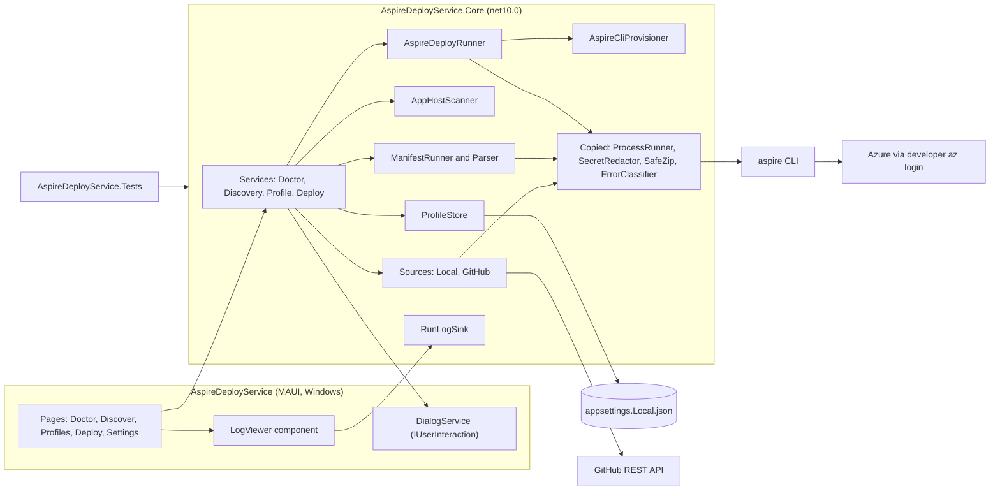
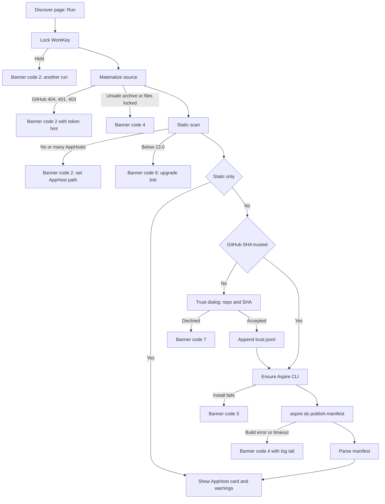
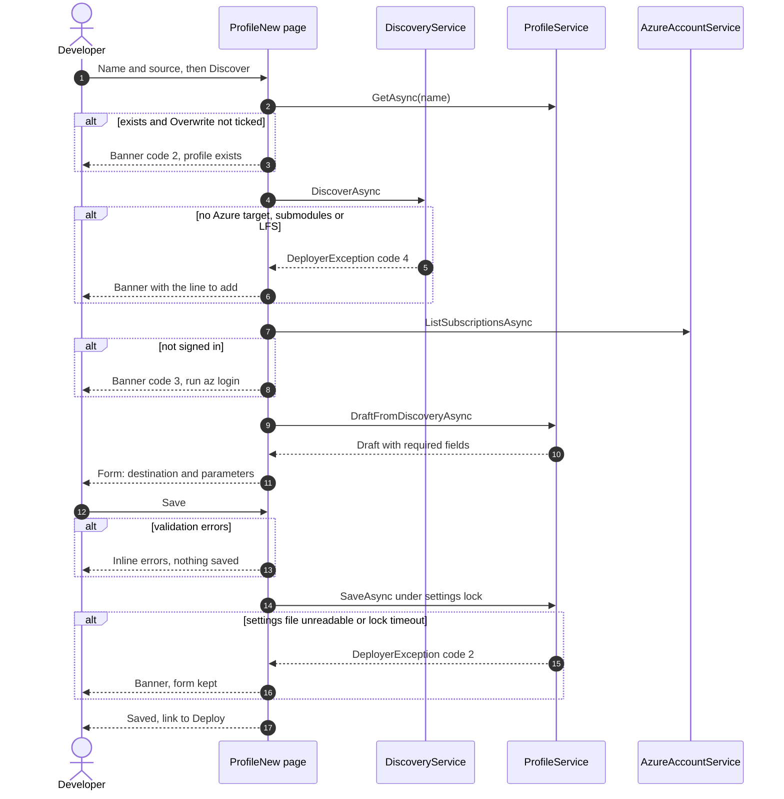
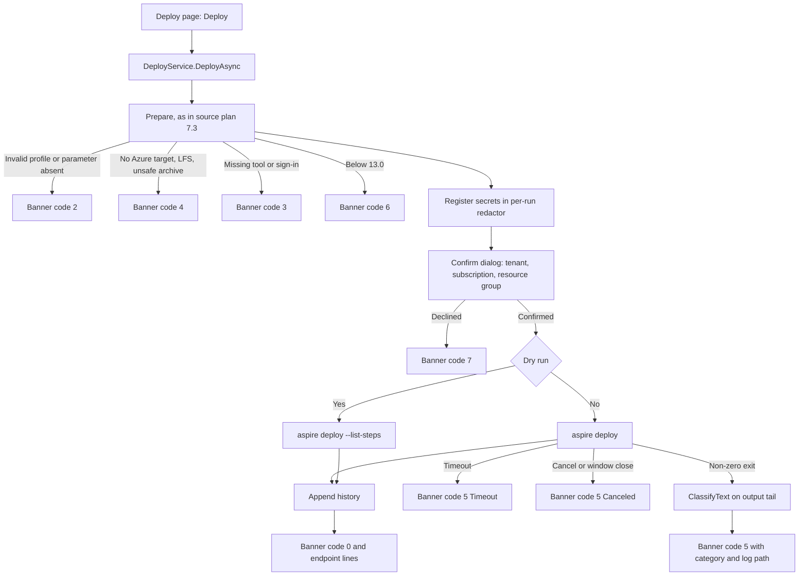
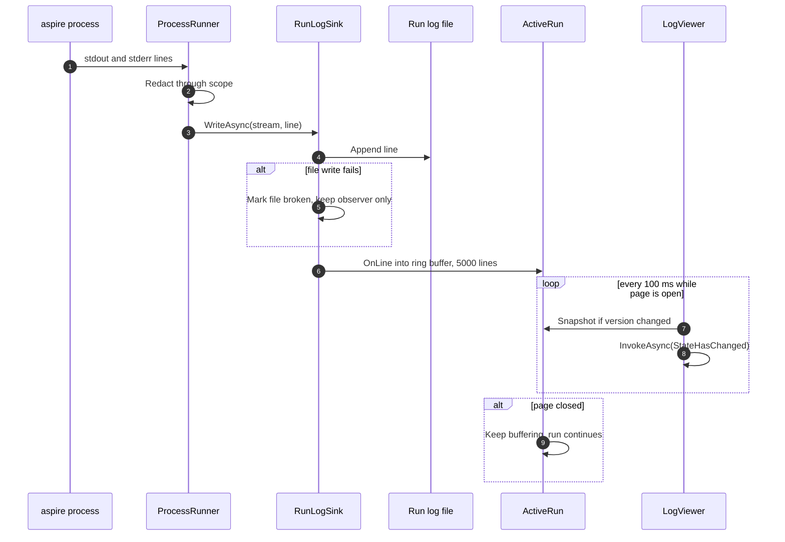

# AspireDeployService: Aspire Project Deployer Implementation Plan

> **Design source:** [Aspire-Project-Deployer-Plan.md](Aspire-Project-Deployer-Plan.md), called "the source plan" below. It designs a `bdn` command-line tool inside the BlazorDataDeploymentWebsite repository. This plan builds the **same feature in this repository** as a Windows desktop app (.NET MAUI Blazor Hybrid). It keeps the source plan's discovery, profile and deploy rules, and replaces its command line with pages.
> **Reference code:** `<ref>` means a sibling checkout of the BlazorDataDeploymentWebsite repository at `../BlazorDataDeploymentWebsite/BlazorDataDeploymentWebsite/`, relative to this repository's root. Links into `<ref>` work only when that checkout exists. Code is **copied** from it (D2). This repository never references it at build time.
> **Estimate:** 19 to 22 working days (2 spikes, 16 PRs).
> **Owner inputs needed before T0b:**
> - a test Azure subscription where resource groups can be created;
> - a private test repository (`<owner>/<private-test-repo>`) that holds an Aspire 13.x starter app;
> - a fine-grained GitHub token with Contents: read on that repository.

All paths are relative to the repository root unless they start with `<ref>/`. This folder is **not a git repository** yet, so there is no commit to pin line numbers to. Line numbers are as of 2026-10-18.

---

## 1. Summary

| # | Feature | In one line |
|---|---|---|
| F1 | Source: local folder or GitHub repository | Pick a folder, or enter `<owner>/<repo>` plus a branch, tag or SHA. GitHub sources are downloaded as a zipball pinned to a commit SHA and extracted with a copied `SafeZip`. Private repos use a token from the profile, the settings file, or `gh auth token`. |
| F2 | Discovery | Stage 1 is a static scan that runs no code. It finds the AppHost, its kind, its Aspire version and its declared deployment targets, and refuses versions below 13.0. Stage 2 runs `aspire do publish-manifest` and turns the manifest into parameters and resources. |
| F3 | Local settings | Named **deploy profiles** in `appsettings.Local.json`, which a new `.gitignore` excludes. A profile holds the source, the Azure destination and the parameter values. A committed `appsettings.Local.example.json` shows the shape with placeholders. |
| F4 | Deploy | Uses the Aspire CLI version that matches the AppHost SDK, installing it if needed, then runs `aspire deploy --non-interactive` with every value passed as an environment variable. Signs in with the developer's own `az login`. Output streams live into the page. |
| F5 | Desktop UI | Windows-only MAUI Blazor Hybrid pages: **Doctor**, **Discover**, **Profiles** (list, edit, new-profile wizard) and **Deploy**. These replace the template's Counter and Weather pages. |

Every piece of logic lives in a new `net10.0` class library, `AspireDeployService.Core`, so it can be unit-tested without MAUI. The MAUI project only holds pages, dialogs and DI wiring.

## 2. Goals and Non-goals

**Goals**
- Any Aspire 13.x AppHost that declares an Azure compute environment (Container Apps, App Service or AKS) can be deployed, from a folder or a GitHub repo, with one click once a profile exists.
- Discovery shows what a deployment needs **before** anything is created in Azure.
- No secret value appears in the UI log, the run log file or the history file. The profile page masks secrets until **Reveal** is clicked.
- The app itself never writes into the target source. For a local folder, the Aspire tooling it runs does write there (`bin/`, `obj/`; for TypeScript AppHosts, `.aspire/modules/` and `node_modules/`; possibly `aspire.config.json`). The README says so.
- All logic is covered by unit tests in a new test project.

**Non-goals (v1)**
- A command-line front end. The source plan's `bdn` commands become pages (D1). A CLI over the same Core library can be added later (§15 Q1).
- Android, iOS and MacCatalyst. The MAUI app becomes Windows-only (D3).
- Aspire 8.x and 9.x, and azd as an engine (source plan D2).
- Reusing existing Azure resources other than a resource group (source plan D4).
- Non-Azure targets: Docker Compose, and Kubernetes outside AKS.
- Editing the user's AppHost.
- `destroy` or teardown. The Deploy page shows the resource group name instead.
- Sandboxing the AppHost. It runs on the developer's machine as the developer (source plan D7).
- Running this app as a resource under this repo's own Aspire AppHost (§15 Q3).
- An installer or MSIX package. The app runs from Visual Studio or from a `dotnet publish` folder.

## 3. Decisions

Decisions D1 to D4 were made with the repository owner for this plan. The source plan's decisions still apply unless a row below replaces them; "SP-Dn" means source plan decision n.

| # | Decision | Rejected alternative | Why |
|---|---|---|---|
| D1 | Build a **Core class library plus the MAUI UI**. There is no CLI. | (a) Only the CLI from the source plan. (b) Both a CLI and the MAUI UI. | Owner's choice. This repository already is a MAUI Blazor Hybrid app ([AspireDeployService.csproj:1](../AspireDeployService/AspireDeployService.csproj#L1), [MainPage.xaml](../AspireDeployService/MainPage.xaml)). A Core library keeps the logic testable and leaves a CLI open for later. (b) adds about three PRs for no v1 need. |
| D2 | **Copy** the reusable files from `<ref>` into `AspireDeployService.Core`, change their namespaces to `AspireDeployService.Core.*`, and remove their dependencies on the worker and on Core. Each copied file starts with a comment that names its origin. | (a) A `ProjectReference` across repositories. (b) Rewrite from scratch. | Owner's choice. (a) breaks on any machine that lacks the sibling checkout, and it pulls in EF Core, Azure Tables and the Worker SDK. (b) throws away tested code: `ProcessRunner` has tests for tree-kill, timeout and redaction ([`<ref>` ProcessRunnerTests.cs](../../BlazorDataDeploymentWebsite/BlazorDataDeploymentWebsite/BlazorDataDeploymentWebsite.Tests/Worker/ProcessRunnerTests.cs)). Drift between the two copies is accepted. |
| D3 | The MAUI project targets **only `net10.0-windows10.0.19041.0`**. | (a) Keep every target framework and hide the feature on mobile. (b) Windows plus MacCatalyst. | Owner's choice. Each deploy step starts `dotnet`, `aspire`, `az` and `docker` processes. `Process.Start` does not work on Android or iOS, and MacCatalyst runs sandboxed ([Entitlements.plist:7-8](../AspireDeployService/Platforms/MacCatalyst/Entitlements.plist#L7)). Today the project always targets Android ([AspireDeployService.csproj:4](../AspireDeployService/AspireDeployService.csproj#L4)), so every build needs the Android workload. |
| D4 | This plan is a **new file**. The source plan stays unchanged as the design reference. | Overwrite the source plan. | Owner's choice. |
| D5 | **Commands become Core services**, and console prompts become an `IUserInteraction` interface (§6.2). Exit codes become an `OutcomeCode` enum with the same numbers and meanings as the source plan's exit codes. | Put the logic in Razor components. | Pages cannot be unit-tested without bUnit, and bUnit cannot easily load a WinUI-targeted project. Keeping the source plan's codes means its failure tables and tests carry over unchanged. |
| D6 | Profile ask-flows become **forms**. The new-profile wizard runs discovery first, then shows one form with the destination fields and one input per parameter. `IUserInteraction` is used only for yes/no confirmations: the trust prompt and the deploy confirmation. | Ask one question at a time, as the console did. | A form shows every missing value at once and can be validated before saving. |
| D7 | **Settings file lookup** order: (1) the `ADS_SETTINGS` environment variable; (2) `appsettings.Local.json` in the nearest folder at or above `AppContext.BaseDirectory` that contains `AspireDeployService.csproj`; (3) `%LOCALAPPDATA%/AspireDeployService/appsettings.Local.json`. The Settings page shows which file is in use. | Use the source plan's rule 4, `AppContext.BaseDirectory`. | For a MAUI app the base directory is under `bin/.../win10-x64/` and is wiped by a clean build. Rule (2) matches SP-D3 when running from Visual Studio: the file sits in the project folder. Rule (3) suits a published copy. |
| D8 | Settings are read and written with **System.Text.Json into a typed model** (`SettingsDocument`), not through `IConfiguration`. | Load with `IConfiguration` and `Bind`. | The app must save profiles. Also, SP §6.3 gives `"Parameters:x": ""` ("deliberately empty") a different meaning from an absent key, and that distinction must survive a round trip. |
| D9 | The copied `ProcessRunner` strips a **revised** list of inherited variable prefixes.<br/>**Still stripped** (from `<ref>`): `ConnectionStrings__`, `GitHub__`, `IDENTITY_`, `MSI_`, `AZURE_TOKEN_CREDENTIALS`, `AZURE_CLIENT_SECRET`, `AZURE_CLIENT_CERTIFICATE`, `AZURE_FEDERATED_TOKEN`, `AZURE_OIDC_`, `OTEL_`, `APPLICATIONINSIGHTS_`, `ASPIRE_`, `DCP_`.<br/>**No longer stripped** (worker-only): `Deployer__`, `Job__`, `Worker__`, `Tools__`.<br/>**Newly stripped:** `AspireDeploy__`, `Azure__`, `Parameters__`, `GITHUB_TOKEN`, `GH_TOKEN`, and the MSBuild variables a Visual Studio-launched app inherits: `MSBuildSDKsPath`, `MSBuildExtensionsPath`, `MSBUILD_EXE_PATH`, `DOTNET_HOST_PATH`. | Copy the list unchanged ([`<ref>` ProcessRunner.cs:62-67](../../BlazorDataDeploymentWebsite/BlazorDataDeploymentWebsite/BlazorDataDeploymentWebsite.DeployWorker/Processes/ProcessRunner.cs#L62)). | The worker's own sections do not exist here. `ASPIRE_`, `DCP_` and `OTEL_` must stay stripped, because a developer may start this app under an Aspire AppHost, which injects them. Inherited `Azure__` and `Parameters__` values would silently replace a profile value of `""` ("AppHost supplies it"). The MSBuild variables point at Visual Studio's MSBuild, and they can break `aspire` builds of a target that has its own `global.json` **(assumed; seen with nested `dotnet build` under VS)**. Explicit `spec.Environment` values are applied after stripping and still win (same file, lines 86-97). |
| D10 | **Copy `ErrorClassifier`** without the `Azure.RequestFailedException` and `DeployManifestException` cases, and copy `ErrorCategory` without `NotEntitled` (billing only) and with `Release` renamed to `Source`. | Keep the Azure.Core dependency. | The deployer only classifies text from `aspire deploy` output, through `ClassifyText` ([`<ref>` ErrorClassifier.cs:110](../../BlazorDataDeploymentWebsite/BlazorDataDeploymentWebsite/BlazorDataDeploymentWebsite.Core/Deployments/ErrorClassifier.cs#L110)). It never sees Azure SDK exceptions, because it makes no Azure SDK calls. |
| D11 | **Runs are owned by `RunCoordinator`, not by pages.** A page starts work with `RunCoordinator.Start(runKey, work)`. That creates an `ActiveRun`, which holds the `CancellationTokenSource`, a ring buffer of the last 5,000 `LogLine`s, the result `Task`, and any pending confirmation. `RunLogSink` writes each redacted line to the run log file and into the `ActiveRun` through `IRunObserver`. `LogViewer` takes a snapshot of the buffer every 100 ms, while a version counter shows change, and calls `InvokeAsync(StateHasChanged)`. A page that is opened again re-attaches with `RunCoordinator.TryGet(runKey)`. | (a) Pages own the run and a `Channel`. (b) Call `StateHasChanged` once per line. | (a) Leaving the page would orphan the run, and an unread channel grows without bound. (b) `aspire deploy` can print thousands of lines, and re-rendering per line would stall the WebView. |
| D14 | **No Core work runs on the UI dispatcher.** `RunCoordinator.Start` runs `work` with `Task.Run`, and Core uses `ConfigureAwait(false)`. Any exception other than `DeployerException` becomes code 1 with the log path. `MainLayout` wraps `@Body` in an `ErrorBoundary`, so a rendering error never shows the template's "Reload" bar while processes are running. | Await services directly in event handlers. | Blazor Hybrid handlers run on the UI thread. `SafeZip.ExtractToDirectory` is synchronous ([`<ref>` SafeZip.cs:16](../../BlazorDataDeploymentWebsite/BlazorDataDeploymentWebsite/BlazorDataDeploymentWebsite.DeployWorker/Releases/SafeZip.cs#L16)), and so are directory walks and JSON parsing; they would freeze the window. |
| D15 | **Child processes cannot outlive the app.** (1) On Windows, every started process is assigned to one app-wide **Job Object** created with `JOB_OBJECT_LIMIT_KILL_ON_JOB_CLOSE`, so Windows kills the whole tree when the app exits for any reason, including a crash, Task Manager or "Stop Debugging". (2) A graceful close is intercepted through `ConfigureLifecycleEvents` → `OnWindowCreated` → `AppWindow.Closing`. While runs are active it sets `args.Cancel = true`, asks "Stop the running deployment?", cancels the runs, waits up to 15 seconds, then closes the window. | Rely on `Window.Destroying` plus `ProcessRunner`'s tree-kill. | `Destroying` cannot stop the close, and the app may exit before an async wait finishes. Tree-kill only runs while the app is alive. A deploy that keeps running unobserved is the worst outcome. Nested Job Objects are supported on Windows 8 and later, so this works even when Visual Studio already puts the app in a job **(assumed; T4b verifies)**. |
| D16 | **Settings file safety.** Each change loads the file fresh, applies one change and saves, all inside a `FileLock` on `<settings folder>/appsettings.Local.json.lock`. That lock waits up to 10 seconds; on timeout the change fails with code 2. A save writes `appsettings.Local.json.tmp` in the same folder, then calls `File.Move(tmp, path, overwrite: true)`. If the file cannot be parsed, the app shows the path and the JSON error, switches to read-only, and **never** overwrites the file. Reads allow comments and trailing commas. Every model level has a `[JsonExtensionData]` bag, so unknown keys survive a round trip; comments do not survive, and the README says so. | `File.Replace`, and no lock. | `File.Replace` throws when the target does not exist yet, which happens on the first save. Two app windows (acceptance criterion §14) would otherwise lose each other's changes. |
| D17 | **Two lock types, two purposes.** `WorkKeyLock` keeps SP §6.1's semantics: `FileShare.None`, `DeleteOnClose`, and it **fails at once** with code 2. The copied `FileLock` (it retries, never deletes its file, and has a timeout) is used only for the settings file (D16) and the Aspire CLI install (SP-D9). | One lock class for everything. | A second deploy must fail fast, while a settings save or a tool install should wait briefly. |
| D12 | Add a **Delete profile** action, with a confirmation. | No delete, as in the source plan. | A GUI with no delete is a trap. It edits only the local settings file and never touches Azure. |
| D13 | Pin tooling. Add a `global.json` with SDK `10.0.402` and `rollForward: latestFeature`. The **test project** uses xUnit 2.9.3, xunit.runner.visualstudio 3.1.5 and Microsoft.NET.Test.Sdk 18.0.1, the same versions as `<ref>` ([`<ref>` Tests.csproj:15-19](../../BlazorDataDeploymentWebsite/BlazorDataDeploymentWebsite/BlazorDataDeploymentWebsite.Tests/BlazorDataDeploymentWebsite.Tests.csproj#L15)). | No `global.json`. | The copied tests then run unchanged. `10.0.402` is the SDK installed on the development machine; `<ref>` pins `10.0.401`. |

Source-plan decisions that carry over unchanged: SP-D2 (13.x only), SP-D4 (one resource group per profile), SP-D6 (two-stage discovery), SP-D7 (trust prompt per GitHub commit), SP-D8 (developer's own `az login`), SP-D9 (CLI version equals SDK version), SP-D10 (zipball moved to a fixed folder), SP-D11 (values only in environment variables), SP-D12 (configuration keys) and SP-D13 (an Azure target is required for init and deploy). SP-D1, SP-D3, SP-D5 and SP-D14 are replaced by D1, D7, D2 and D5.

**Corrections to the source plan, from research for this plan:**

| Source plan says | Finding | Effect here |
|---|---|---|
| SP-D10: whether the deploy cache hash depends on the folder is **(assumed)** | Aspire hashes the AppHost **path**: the project directory for a `.csproj`, or the full file path for `apphost.cs` and TypeScript AppHosts ([aspire.dev: deployment state caching](https://aspire.dev/deployment/deployment-state-caching/), plus the Aspire source). | The fixed `<WorkKey>/src` folder is **required**, not just nice to have. T0b (b) becomes a confirmation only. |
| SP-D8: `Azure__CredentialSource=AzureCli` | The docs list the `CredentialSource` setting with default `Default`, but they do not list the value `AzureCli` ([aspire.dev: Deploy to Azure](https://aspire.dev/deployment/azure/)). | Still **(assumed)**. T0b (c) checks it against the Aspire source and a real deploy. |
| SP §6.5: the manifest | The docs call it a deprecated compatibility format, kept for azd ([aspire.dev: manifest format](https://aspire.dev/deployment/azure/manifest-format/)). | R1 is more likely. The fallback stays as written. |
| SP-D12: `-` becomes `_` | True only in the **environment variable** form of **`Parameters:`** keys (`Parameters__region_name`). The configuration key keeps the dash (`Parameters:region-name`) ([aspire.dev: external parameters](https://aspire.dev/fundamentals/external-parameters/)). Connection strings resolve from `ConnectionStrings:<name>` with no underscore fallback. | Profiles store parameter names as the manifest spells them. The `_` replacement applies only to `Parameters:` keys, and only when the environment block is built (§6.6). |
| SP-D10: ad-hoc work keys exist only for GitHub sources | A local-folder Discover, and the New-profile wizard, run before any profile exists, so they need a work key too. | Ad-hoc keys are extended to local folders (§6.2 `WorkKeys`). |
| SP-D14: `System.CommandLine` | Not needed here (D1). | Dropped. |
| Latest Aspire | Aspire.Cli 13.6.1 is the latest stable on NuGet. This repo's own AppHost uses 13.5.4 ([AspireDeployService.AppHost.csproj:1](../AspireDeployService.AppHost/AspireDeployService.AppHost.csproj#L1)). | The spikes use 13.0, 13.2 and 13.6. |

## 4. Current State

| Area | Where | Today |
|---|---|---|
| Solution | [AspireDeployService.slnx](../AspireDeployService.slnx) | Three projects: the AppHost, ServiceDefaults, and the MAUI app. There is no test project. |
| MAUI app | [AspireDeployService.csproj](../AspireDeployService/AspireDeployService.csproj) | `Microsoft.NET.Sdk.Razor` with `UseMaui`. Target frameworks: Android always, iOS and MacCatalyst when not on Linux, and Windows when on Windows (lines 4-6). Unpackaged on Windows: `WindowsPackageType=None` (line 42). Packages: MAUI Controls, WebView.Maui, Logging.Debug (lines 70-72). |
| MAUI startup | [MauiProgram.cs:7-25](../AspireDeployService/MauiProgram.cs#L7) | Registers only `AddMauiBlazorWebView`, plus dev tools and debug logging in DEBUG builds. There is no configuration loading and no app services. |
| Window | [App.xaml.cs:10-13](../AspireDeployService/App.xaml.cs#L10) | One `Window` titled "AspireDeployService" that hosts `MainPage`, whose `BlazorWebView` renders [Routes.razor](../AspireDeployService/Components/Routes.razor). |
| Pages | [Components/Pages](../AspireDeployService/Components/Pages) | Template boilerplate only: `Home` ("Hello, world!"), `Counter`, `Weather`, `NotFound`. |
| Navigation | [NavMenu.razor:11-25](../AspireDeployService/Components/Layout/NavMenu.razor#L11) | Links to Home, Counter and Weather. |
| Styling | [wwwroot/index.html](../AspireDeployService/wwwroot/index.html), `wwwroot/lib/bootstrap/dist/css/bootstrap.min.css` | Bootstrap 5.3.3 **CSS only**. There is no Bootstrap JS, so modals must be pure Blazor. |
| Long paths | [app.manifest:14](../AspireDeployService/Platforms/Windows/app.manifest#L14) | `longPathAware` is already `true`. It takes effect only when the OS `LongPathsEnabled` setting is on. |
| AppHost | [AppHost.cs](../AspireDeployService.AppHost/AppHost.cs), [AppHost.csproj:13-15](../AspireDeployService.AppHost/AspireDeployService.AppHost.csproj#L13) | `AddProject<Projects.AspireDeployService>`, referenced with `SetTargetFramework` `net10.0`, a framework the MAUI project does not declare. Running the MAUI app through this AppHost probably fails today **(assumed; not built during research)**. There is no Azure compute environment. |
| ServiceDefaults | [Extensions.cs](../AspireDeployService.ServiceDefaults/Extensions.cs) | The standard web template (OpenTelemetry, health checks, `MapDefaultEndpoints`). It depends on ASP.NET Core, and the MAUI app does not reference it. |
| Repo hygiene | repository root | There is **no** `.gitignore`, `global.json`, `Directory.Build.props`, README, CI workflow or `.git` folder. Nothing would keep `appsettings.Local.json` out of source control. |
| Agent rules | [.github/copilot-instructions.md](../.github/copilot-instructions.md) | Three Azure rules: use Azure tools and get Azure best practices before Azure work. They apply to agents that deploy, not to this plan's code. |
| Code to copy | `<ref>` DeployWorker and Core | See the table below. |

**Reference code to copy (D2)**

| `<ref>` file | Types | Dependencies to cut |
|---|---|---|
| [ProcessRunner.cs](../../BlazorDataDeploymentWebsite/BlazorDataDeploymentWebsite/BlazorDataDeploymentWebsite.DeployWorker/Processes/ProcessRunner.cs#L54) | `ProcessSpec`, `ProcessResult`, `ProcessFailedException`, `IProcessRunner`, `ProcessRunner`, `ProcessResultExtensions` | `ILogger<T>` relies on the Worker SDK's implicit usings. Add `using Microsoft.Extensions.Logging;` and the `Microsoft.Extensions.Logging.Abstractions` package. Revise the stripped prefixes (D9). |
| [SecretRedactor.cs](../../BlazorDataDeploymentWebsite/BlazorDataDeploymentWebsite/BlazorDataDeploymentWebsite.DeployWorker/Logging/SecretRedactor.cs#L19) | `ISecretRedactor`, `SecretRedactor`, `RedactionScope` | None. `AddSecret` ignores values shorter than 8 characters (line 63). `RedactionScope` uses `internal` regexes, so it must stay in the same assembly. Replace `Deployer__ClientSecret` in the env-var regex with `AspireDeploy__GitHub__Token`. |
| [DeploymentLogSink.cs](../../BlazorDataDeploymentWebsite/BlazorDataDeploymentWebsite/BlazorDataDeploymentWebsite.DeployWorker/Logging/DeploymentLogSink.cs#L14) | `LogStreams`, `IDeploymentLogSink`, `DeploymentLogSinkExtensions` | None. Drop `IDeploymentLogSinkFactory`. Keep `DeploymentId` and use it as the run id. |
| [SafeZip.cs](../../BlazorDataDeploymentWebsite/BlazorDataDeploymentWebsite/BlazorDataDeploymentWebsite.DeployWorker/Releases/SafeZip.cs#L7) | `SafeZip` | None. Change "release archive" in messages to "source archive". |
| [ToolInstaller.cs:93-97](../../BlazorDataDeploymentWebsite/BlazorDataDeploymentWebsite/BlazorDataDeploymentWebsite.DeployWorker/Tools/ToolInstaller.cs#L93) and [:242-266](../../BlazorDataDeploymentWebsite/BlazorDataDeploymentWebsite/BlazorDataDeploymentWebsite.DeployWorker/Tools/ToolInstaller.cs#L242) | `FindAspire` and `FileLock` only | None. `FileLock` never deletes its lock file. The rest of `ToolInstaller` is **not** copied, because it redirects `AZURE_CONFIG_DIR` (SP-D8). |
| [ErrorClassifier.cs](../../BlazorDataDeploymentWebsite/BlazorDataDeploymentWebsite/BlazorDataDeploymentWebsite.Core/Deployments/ErrorClassifier.cs#L72), [Enums.cs:108](../../BlazorDataDeploymentWebsite/BlazorDataDeploymentWebsite/BlazorDataDeploymentWebsite.Core/Domain/Enums.cs#L108) | `ErrorClassification`, `DeploymentFailureException`, `ErrorClassifier`, `ErrorCategory` | D10. Also remove the `RequestFailedException` branch in `ExtractPolicyName`'s helper (ErrorClassifier.cs:150). |
| [WorkerTestSupport.cs:46](../../BlazorDataDeploymentWebsite/BlazorDataDeploymentWebsite/BlazorDataDeploymentWebsite.Tests/Worker/WorkerTestSupport.cs#L46) | `ListLogSink` (test helper) | None. |
| Tests: `ProcessRunnerTests`, `SecretRedactorTests` (minus `Log_writer_redacts_before_storing`), `ToolInstallerTests` (the `FindAspire` tests), `ErrorClassifierTests` (minus the `RequestFailedException` cases), and the SafeZip tests in [ReleaseDownloaderTests.cs:223-260](../../BlazorDataDeploymentWebsite/BlazorDataDeploymentWebsite/BlazorDataDeploymentWebsite.Tests/Worker/ReleaseDownloaderTests.cs#L223) | | Copy as new files. The SafeZip tests also need the `Zipball` helper (ReleaseDownloaderTests.cs:59) and the `_work` temp folder (line 24); copy both into `Support/`. In `ErrorClassifierTests`, delete the rows that use `DeployManifestException` or `NotEntitled`, and rename `Release` to `Source`. |

`<ref>`'s `ReleaseDownloader` is **not** copied: it is tied to one pinned repository. Only its header pattern is reused: `X-GitHub-Api-Version: 2022-11-28`, a User-Agent, and `Authorization: Bearer` set per request rather than on the client defaults.

## 5. Design

### 5.1 Structure



`Svc --> Dialog` means Core calls the `IUserInteraction` interface, which the MAUI project implements. Core does not reference MAUI.

### 5.2 New and changed components

| Component | Project | Responsibility |
|---|---|---|
| `Processes/ProcessRunner.cs` (copied) | Core | Runs a process with arguments passed one by one, redacted streaming output, tree-kill on timeout or cancel, and stripped inherited variables (D9). |
| `Logging/SecretRedactor.cs`, `Logging/DeploymentLogSink.cs` (copied) | Core | Redaction and the log sink interface. |
| `Logging/DeploySecretRedactor : ISecretRedactor` | Core | Wraps `SecretRedactor` and also masks secrets shorter than 8 characters (SP §6.7; the source plan calls it `CliSecretRedactor`). It is **scoped per run**, so one run's secrets never mask another run's output. |
| `Logging/RunLogSink : IDeploymentLogSink` | Core | Writes redacted lines to `<WorkKey>/logs/<utc>-<runId>.log` and to a `Channel<LogLine>` (D11). |
| `Archives/SafeZip.cs` (copied), `Infrastructure/FileLock.cs` (copied) | Core | Zip safety; a cross-process file lock. |
| `Errors/ErrorClassifier.cs`, `Errors/ErrorCategory.cs` (copied, trimmed) | Core | D10. |
| `Outcomes/OutcomeCode`, `OperationResult`, `DeployerException` | Core | D5. |
| `Interaction/IUserInteraction` | Core | Confirmations (D6). |
| `Settings/SettingsLocator`, `Settings/SettingsDocument`, `Settings/AspireDeployOptions` | Core | D7 and D8. |
| `Profiles/ProfileStore`, `Profiles/DeployProfile`, `Profiles/ProfileKeys` | Core | Load, validate, set, delete and save under D16's rules. |
| `Infrastructure/WorkKeys`, `WorkKeyLock`, `TrustStore` | Core | Work keys (SP-D10, extended in §6.2), SP §6.1 single-run lock (D17), SP §6.8 trust. |
| `Processes/ChildProcessJob` | Core | The Windows Job Object from D15. `ProcessRunner` assigns each started process to it. On other platforms it does nothing. |
| `Azure/AzureAccountService` | Core | Runs `az account show` and `az account list --output json` for Doctor and for the wizard's subscription list. |
| `Runs/IRunObserver`, `Runs/RunContext`, `Runs/RunContextFactory` | Core | One `RunContext` per run: run id, per-run `DeploySecretRedactor`, a `ProcessRunner` built with that redactor, and the `RunLogSink`. Services create it after they compute the work key. |
| `Sources/ISourceProvider`, `LocalFolderSource`, `GitHubSource`, `GitHub/GitHubTokenResolver` | Core | SP F1 and SP §7.5. |
| `Discovery/AppHostScanner`, `AspireVersionRules`, `ManifestRunner`, `ManifestParser` | Core | SP §6.4 and §6.5. |
| `Prerequisites/PrerequisiteChecker` | Core | SP §6.6. |
| `Tools/AspireCliProvisioner` | Core | SP-D9. |
| `Deploy/AspireDeployRunner`, `Deploy/DeployHistory` | Core | SP §6.7 and §6.8. |
| `Services/DoctorService`, `DiscoveryService`, `ProfileService`, `DeployService` | Core | One service per former command (§6.2). Each returns its result type (§6.2) or throws `DeployerException`. `RunCoordinator` turns either one into an `OperationResult` for the banner. |
| `ServiceCollectionExtensions.AddAspireDeployerCore()` | Core | DI registration. |
| `Services/DialogService : IUserInteraction`, `Components/Shared/DialogHost.razor` | MAUI | A pure-Blazor modal, because there is no Bootstrap JS. `DialogHost` is placed once in `MainLayout`. Requests go into a FIFO queue, so two runs that both ask are shown one at a time. Each request is a `TaskCompletionSource<bool>` that is cancelled when its `ct` fires; the dialog then closes as "declined". The host updates through `InvokeAsync`, because Core calls in from background threads. |
| `Services/RunCoordinator`, `Services/ActiveRun : IRunObserver` | MAUI | D11 and D14: owns every active run, its token, its log ring buffer and its result. `CancelAllAsync` is used by the D15 close handler. |
| `Components/Shared/LogViewer.razor`, `SecretInput.razor`, `OutcomeBanner.razor` | MAUI | Live log of an `ActiveRun`, password-style input, result banner. |
| `Platforms/Windows/WindowCloseGuard.cs` | MAUI | D15 (2), registered from `MauiProgram` with `ConfigureLifecycleEvents`. |
| `Components/Pages/{Doctor,Discover,Profiles,ProfileEdit,ProfileNew,Deploy,Settings}.razor` | MAUI | §6.1. |

## 6. Contracts

### 6.1 Pages (replace the source plan's commands)

| Route | Replaces | Inputs (type, default) | Does |
|---|---|---|---|
| `/` | Template Home | none | A dashboard: the settings file in use, the profile count, and links to Doctor and New profile. |
| `/doctor` | `bdn doctor [--profile]` | Profile picker (string?, none) | Runs SP §6.6 checks and shows a table of name, state (Pass, Warn or Fail), detail and fix. With a profile selected, it also materializes the source and checks what the AppHost needs (container runtime, Node, Aspire CLI). |
| `/discover` | `bdn discover` | Source kind (LocalFolder or GitHub, LocalFolder); folder (folder picker, required for LocalFolder); repo `<owner>/<repo>` (required for GitHub); ref (string?, default branch); AppHost path (string?, auto); Static only (bool, false); profile (string?, none) | Stage 1, then stage 2 unless Static only is set. Shows the AppHost card, the parameters table, the resources table and the warnings. **Copy JSON** puts the `DiscoveryResult` JSON (SP §6.5 sample) on the clipboard. **Create profile from this** opens `/profiles/new` prefilled. |
| `/profiles` | `profile list` | none | A table of name, source and destination, with Edit, Deploy and Delete (D12) actions. Delete takes the profile's work key lock (code 2 while a run is active) and offers "Also delete the work folder `<WorkRoot>/<name>`" (default on), so a later profile with the same name starts clean. Aspire's own `~/.aspire/deployments` cache is not touched. |
| `/profiles/new` | `profile init` | Name (`^[a-z0-9][a-z0-9-]{1,39}$`); source fields as on `/discover`; then subscription (guid), tenant (guid?), location, resource group (default `rg-<name>`), environment (`Production`), and one input for each parameter that has **no default and no generator** | Flow §7.2. The inputs appear after discovery; parameters with a default or a generator are listed read-only, and can be overridden later on `/profiles/{name}`. Secret parameters use `SecretInput`. Every input has a "Leave empty (AppHost supplies it)" checkbox, which stores `""`. Save also stores `Source:AppHostPath` and `SecretParameters` (SP T10). Save fails with code 2 if the name exists, unless "Overwrite" is ticked. If another profile has the same local `Source:Location` and `AppHostPath` **and** the same `Environment`, the page warns that the two share Aspire's deploy cache (§3 corrections) and suggests a different Environment name. |
| `/profiles/{name}` | `profile show` and `profile set` | Edits the settable keys from SP §6.1: `Source:Ref`, `Source:AppHostPath`, `Source:GitHubToken`, `Destination:*`, `Environment`, `ContainerRuntime`, `Parameters:<name>`, `ParameterConfigKeys:<name>`. Each parameter row has a "Secret" toggle. | A secret's value is **never loaded into an input**. The row shows "(set)" or "(empty)", a **Reveal** button (read-only text, which is not persisted across navigation) and a **Replace** button that opens an empty `SecretInput`. Save writes only the fields that changed; an untouched secret is never rewritten. Each change goes through `SetAsync` (D16). A new secret shorter than 8 characters shows the SP §6.7 warning. |
| `/deploy/{name}` | `bdn deploy <name>` | Ref override (string?, the profile's ref); Dry run (bool, false); Clear cache (bool, false) | Flows §7.3 and §7.4. Shows the live log, a **Cancel** button, and then the `OutcomeBanner` with the code, `ErrorCategory`, log file path and resource group. |
| `/settings` | none | Global GitHub token (`AspireDeploy:GitHub:Token`, secret, optional) | Shows the resolved settings file path and its lookup rule (D7), plus `WorkRoot` and `ToolsRoot`, with **Open folder** buttons. Edits the global token like a secret parameter (see `/profiles/{name}`). If the settings file cannot be parsed (D16), this page shows the path and the JSON error. |

**Cancel** replaces Ctrl+C. It cancels the run's token, and `ProcessRunner` kills the process tree. Any canceled run ends with code 5 and category `Canceled`; this widens SP's code 5 from "`aspire deploy` failed" to "a run failed in a process, timed out or was canceled". During a deploy, the banner reads "Deployment stopped. Resources may be partly created in `<resource group>`; deploy again to converge."

**Leaving a page** does not stop its run. The nav menu shows a spinner next to pages that have an active run. Going back re-attaches to the `ActiveRun` (D11), including any confirmation dialog that is still waiting.

**Closing the window** while a run is active follows D15: confirm, cancel, wait up to 15 seconds, then close. If the app dies instead, the Job Object kills the children.

**One run per work key** (SP §6.1): a `WorkKeyLock` on `<WorkKey>/.lock`. A held lock gives code 2, "Another run is using `<name>`". This also covers a second copy of the app. While a run is active, the page disables its Run buttons.

### 6.2 Core API

```csharp
namespace AspireDeployService.Core;

public enum OutcomeCode { Success = 0, Unexpected = 1, InvalidInput = 2, MissingPrerequisite = 3,
                          DiscoveryFailed = 4, DeployFailed = 5, UnsupportedVersion = 6, Declined = 7 }
// Meanings are exactly the source plan's §6.1 exit-code table.

public sealed record OperationResult(OutcomeCode Code, string Message,
    ErrorCategory Category = ErrorCategory.None, string? LogFile = null);

public sealed class DeployerException(OutcomeCode code, string message,
    ErrorCategory category = ErrorCategory.None, Exception? inner = null) : Exception(message, inner)
{
    public OutcomeCode Code { get; } = code;
    public ErrorCategory Category { get; } = category;
}

public interface IUserInteraction
{
    // Returns false when declined; services then end with OutcomeCode.Declined.
    Task<bool> ConfirmAsync(string title, string message, string confirmLabel, CancellationToken ct);
}

public interface IRunObserver                    // implemented by the MAUI ActiveRun
{
    void OnLine(LogLine line);                   // called from background threads; must not block
    void OnRunStarted(string runId, string logFile);
}
public sealed record LogLine(DateTimeOffset Utc, string Stream, string Text);

public static class WorkKeys
{
    // "<WorkRoot>/<profile>"; or "<WorkRoot>/adhoc-<12 hex of SHA-256>" of "github:<owner>/<repo>",
    // or of "local:" + full folder path without trailing separator, lower-cased; or "<WorkRoot>/doctor".
    public static string For(string workRoot, string? profileName, SourceSpec? source);
}

public interface IDoctorService
{
    Task<IReadOnlyList<PrerequisiteCheck>> CheckAsync(string? profileName, IRunObserver observer, CancellationToken ct);
}
public enum CheckState { Pass, Warn, Fail }
public sealed record PrerequisiteCheck(string Name, CheckState State, string Detail, string? Fix);

public sealed record DiscoverRequest(SourceSpec Source, string? ProfileName, bool StaticOnly, bool AssumeTrusted = false);
public interface IDiscoveryService
{
    Task<DiscoveryResult> DiscoverAsync(DiscoverRequest request, IRunObserver observer, CancellationToken ct);
}

public sealed record AzureSubscription(string Id, string Name, string TenantId, bool IsDefault);
public interface IAzureAccountService
{
    Task<IReadOnlyList<AzureSubscription>> ListSubscriptionsAsync(CancellationToken ct);  // code 3 when not signed in
}

public enum SettingsRule { EnvironmentVariable, ProjectFolder, LocalAppData }
public sealed record SettingsLocation(string Path, SettingsRule Rule, bool Exists, string? ParseError); // ParseError set => read-only (D16)
public sealed record ProfileSummary(string Name, SourceKind SourceKind, string SourceDisplay, string SubscriptionId, string ResourceGroup);
public sealed record ProfileDraft(string Name, DeployProfile Profile,
    IReadOnlyList<DiscoveredParameter> ToAsk,     // no default and no generator
    IReadOnlyList<DiscoveredParameter> Optional,  // shown read-only
    IReadOnlyList<string> Warnings);              // e.g. shared deploy cache

public interface IProfileService
{
    SettingsLocation Location { get; }                           // re-resolved on every call
    Task<IReadOnlyList<ProfileSummary>> ListAsync(CancellationToken ct);
    Task<DeployProfile?> GetAsync(string name, CancellationToken ct);
    Task<ProfileDraft> DraftFromDiscoveryAsync(string name, DiscoveryResult discovery, CancellationToken ct);
    Task SaveAsync(string name, DeployProfile profile, bool overwrite, CancellationToken ct);   // code 2 if exists and !overwrite
    Task SetAsync(string name, string key, string? value, bool secret, CancellationToken ct);  // code 2 on unknown key
    Task DeleteAsync(string name, bool deleteWorkFolder, CancellationToken ct);              // code 2 if locked or missing
}

public sealed record DeployRequest(string ProfileName, string? RefOverride, bool DryRun, bool ClearCache, bool SkipConfirm = false);
public interface IDeployService
{
    Task<OperationResult> DeployAsync(DeployRequest request, IRunObserver observer, CancellationToken ct);
}

public interface IRunContextFactory
{
    // Called by a service once it knows the work key. Creates the per-run redactor, a ProcessRunner
    // built with it, and a RunLogSink (file <workKeyDir>/logs/<utc>-<runId>.log) that redacts with it.
    RunContext Create(string workKeyDir, IRunObserver observer);
}
public sealed class RunContext : IAsyncDisposable
{
    public Guid RunId { get; }
    public ISecretRedactor Redactor { get; }      // DeploySecretRedactor
    public IProcessRunner Runner { get; }
    public IDeploymentLogSink Log { get; }        // RunLogSink
    public string LogFile { get; }
}
```

`SourceSpec`, `SourceIdentity`, `ISourceProvider`, `AppHostKind`, `DeploymentTarget`, `AppHostInfo`, `DiscoveredParameter`, `DiscoveredResource` and `DiscoveryResult` are exactly as in SP §6.2. They move to the namespace `AspireDeployService.Core.Discovery` (or `.Sources` for the source types).

**DI** (in [MauiProgram.cs](../AspireDeployService/MauiProgram.cs), after `AddMauiBlazorWebView`):

```csharp
builder.Services.AddAspireDeployerCore();   // stateless singletons; the redactor and ProcessRunner are per run, via IRunContextFactory
builder.Services.AddSingleton<IUserInteraction, DialogService>();
builder.Services.AddSingleton<RunCoordinator>();
builder.ConfigureLifecycleEvents(e => e.AddWindows(w => w.OnWindowCreated(WindowCloseGuard.Attach)));
builder.Services.AddHttpClient(GitHubSource.HttpClientName, c => c.Timeout = TimeSpan.FromMinutes(10));
```

Pages never call Core services directly. They call `RunCoordinator.Start(runKey, (observer, ct) => service.XAsync(..., observer, ct))`, where `runKey` is, for example, `deploy:<name>` or `discover:<work key>`. `GitHubSource` registers the token with `RunContext.Redactor` before its first request, so Discover gets a per-run redactor too.

**PATH freshness.** The app's PATH is captured at start-up, so a tool installed afterwards would not be found. `PrerequisiteChecker` and every `ProcessSpec` build PATH from the current Machine and User PATH values (`Environment.GetEnvironmentVariable("PATH", EnvironmentVariableTarget.Machine)` and `...User`), with the pinned Aspire folder first.

`AddHttpClient` needs the `Microsoft.Extensions.Http` package in Core. ServiceDefaults is **not** referenced: it needs ASP.NET Core ([Extensions.cs](../AspireDeployService.ServiceDefaults/Extensions.cs)).

### 6.3 Settings (`appsettings.Local.json`)

The keys, profile object, validation and sample are **SP §6.3 unchanged**, with these exceptions:

| Key | Change |
|---|---|
| File location | D7 replaces SP rules 1 to 4. There is no `--settings` option. `BDN_SETTINGS` becomes `ADS_SETTINGS`. |
| `AspireDeploy:WorkRoot` | Default `%LOCALAPPDATA%/ads/w`. Kept short for path limits (SP R10). |
| `AspireDeploy:ToolsRoot` | Default `%LOCALAPPDATA%/ads/tools`. |
| `AspireDeploy:MaxTestedAspireMajor` | `13`, unchanged. |
| `Parameters:<name>` | `<name>` is stored as the manifest spells it, dashes included. The `_` replacement happens only for the environment variable (§3 corrections). |

`appsettings.Local.example.json` is committed at `AspireDeployService/appsettings.Local.example.json`, holds the SP §6.3 sample with placeholders, and has `<None Update ... CopyToOutputDirectory="Never">`. D7 rule (2) matches when the folder containing `AspireDeployService.csproj` is found, **whether or not** the settings file exists there yet. When no settings file exists at the resolved path, the first save creates it. A file that fails to parse is never replaced (D16).

### 6.4 Version rules, static scan and manifest mapping

SP §6.4 (the `AspireVersionRules` signatures, the detection order table, skipped folders, declared-target table, submodule and LFS warnings) and SP §6.5 (the command, environment, type mapping table and JSON sample) apply **unchanged**. Two notes:
- The target method names and packages in SP §6.4 are confirmed by the aspire.dev deployment pages: `AddAzureContainerAppEnvironment` (Aspire.Hosting.Azure.AppContainers), `AddAzureAppServiceEnvironment` (Aspire.Hosting.Azure.AppService), `AddAzureKubernetesEnvironment` (Aspire.Hosting.Azure.Kubernetes), `AddDockerComposeEnvironment` (Aspire.Hosting.Docker), `AddKubernetesEnvironment` (Aspire.Hosting.Kubernetes). Add the `Aspire.Hosting.Azure.Kubernetes` package name to the AzureKubernetes row.
- The `parameter.v0` shape is confirmed from the Aspire source: `inputs.value.secret`, `inputs.value.default.generate` and `inputs.value.default.value`, with connection strings marked by a top-level `connectionString` property. T0a still captures real fixtures.

**Scanner rule for SP §6.4 row 2:** use the shallowest `aspire.config.json` or `.aspire/settings.json`. When it names an `appHost.path`, the scan uses that AppHost and stops searching, so test fixtures deeper in the tree cannot make a scan of this repository ambiguous.

Sample scan of **this repository**, which serves as a test fixture: AppHost `AspireDeployService.AppHost/AspireDeployService.AppHost.csproj`, kind ProjectCsproj, version `13.5.4`, no declared targets. The result is a "no Azure target" warning in Discover, and code 4 in New profile and Deploy.

### 6.5 Prerequisites

SP §6.6 unchanged, except:
- **Long paths:** read `HKLM\SYSTEM\CurrentControlSet\Control\FileSystem\LongPathsEnabled` with `Microsoft.Win32.Registry` (available in `net10.0` on Windows; guard the call with `OperatingSystem.IsWindows()`). The app manifest already opts in ([app.manifest:14](../AspireDeployService/Platforms/Windows/app.manifest#L14)).
- **`gh` missing:** the fix text says "add `AspireDeploy:GitHub:Token` on the Settings page or in the settings file".

### 6.6 Environment passed to `aspire deploy`

SP §6.7 unchanged. Every option it uses is confirmed in the [`aspire deploy` reference](https://aspire.dev/reference/cli/commands/aspire-deploy/). Building the variables:

```csharp
internal static class DeployEnvironment
{
    // "Parameters:region-name" -> "Parameters__region_name"; "ConnectionStrings:db" -> "ConnectionStrings__db"
    public static string ToEnvironmentVariable(string configKey);
    public static IReadOnlyDictionary<string, string?> Build(DeployProfile profile, DiscoveryResult discovery,
        string? aspireCliDir, IReadOnlyDictionary<string, string?> parentEnvironment);
}
```

`ToEnvironmentVariable` replaces `:` with `__`. Only for keys that start with `Parameters:` does it also replace `-` with `_` in the name. `ConnectionStrings:my-db` becomes `ConnectionStrings__my-db`, a valid Windows environment variable name. A `ParameterConfigKeys` override, such as `MyApp:ApiKey`, gets only the `:` replacement.

Sample, for profile `orders-dev` with parameters `apiKey` (secret), `region-name` and `db` (a connection string):

```
Azure__SubscriptionId=<subscription-guid>
Azure__Location=eastus2
Azure__ResourceGroup=rg-orders-dev
Azure__TenantId=<tenant-guid>
Azure__CredentialSource=AzureCli
Azure__AllowResourceGroupCreation=true
Parameters__apiKey=<secret>            (registered with DeploySecretRedactor)
Parameters__region_name=west
ConnectionStrings__db=<connection-string>   (registered)
DOTNET_ENVIRONMENT=Production
ASPIRE_CLI_TELEMETRY_OPTOUT=1
PATH=<ToolsRoot>/aspire/13.6.1;<inherited PATH>
```

### 6.7 History and trust

SP §6.8 unchanged. `history.jsonl` adds a field, `"origin": "ui"`, so a later CLI can share the file.

## 7. Flows

The source plan's flows SP §7.1 (discover), §7.3 and §7.4 (deploy) and §7.5 (private GitHub repo) apply with "exit N" read as "`OutcomeCode` N shown in the banner". The diagrams below cover what changes in a GUI.

### 7.1 Discover from the page



Local folders are always trusted, so they take the "Yes" branch. The work key comes from `WorkKeys.For` (§6.2): the profile, or an ad-hoc key for the GitHub repo or the local folder. The **Cancel** button is enabled from "Materialize source" onward. It produces code 5, category `Canceled`, and the lock is released. A local-folder discovery takes the folder's ad-hoc work key, so two discoveries of the same folder cannot run at once.

### 7.2 New-profile wizard



The subscription field is a drop-down filled from `az account list --output json`, with a free-text fallback. Wizard discovery uses the folder's or repo's ad-hoc work key, because the profile does not exist yet.

### 7.3 Deploy from the page



The work key lock is released on every path, because it lives in an `await using` scope inside `DeployAsync`. An unexpected exception becomes code 1 in `RunCoordinator` (D14). If the confirm dialog is still open when the run is canceled, it closes as declined.

### 7.4 Live log and UI thread



The file is opened with `FileShare.Read`, so a developer can tail it while a run is active. A broken log file adds one warning line to the UI and never fails the run. The ring buffer bounds memory whether or not a page is watching.

## 8. File-by-file Changes

| File | New/Modified | Change |
|---|---|---|
| `.gitignore` | New | The standard Visual Studio ignores (`bin/`, `obj/`, `.vs/`, `*.user`) plus `appsettings.Local.json`, `appsettings.Local.json.lock`, `appsettings.Local.json.tmp`, `*.pfx`, `*.pem` and `.env`, matching `<ref>` [.gitignore:11-12](../../BlazorDataDeploymentWebsite/BlazorDataDeploymentWebsite/.gitignore#L11). |
| `global.json` | New | D13. |
| `AspireDeployService.slnx` | Modified | Adds `AspireDeployService.Core` and `AspireDeployService.Tests`, plus a `/docs/` folder holding both plan files. |
| `AspireDeployService/AspireDeployService.csproj` | Modified | `TargetFrameworks` becomes `net10.0-windows10.0.19041.0` only (D3). Remove the iOS, MacCatalyst and Android `SupportedOSPlatformVersion` lines. Add a `ProjectReference` to Core. Add `<None Update="appsettings.Local.example.json" CopyToOutputDirectory="Never" />`. |
| `AspireDeployService/AspireDeployService.csproj.user` | Modified (local file) | Its ActiveDebugProfile is "Android Emulator". Change it to "Windows Machine", or delete the file. It is per-user and becomes git-ignored. |
| `AspireDeployService/Platforms/{Android,iOS,MacCatalyst}/**` | Deleted | Not built after D3. `Platforms/Windows` stays. |
| `AspireDeployService.AppHost/AspireDeployService.AppHost.csproj` | Modified | Fix the reference so the solution builds (§15 Q3): change `SetTargetFramework` to `TargetFramework=net10.0-windows10.0.19041.0` **(assumed to build; T1 checks)**. If the AppHost still cannot build or launch it, remove the `ProjectReference` and the `AddProject` line instead, and record that in T1's PR. |
| `AspireDeployService.AppHost/AppHost.cs` | Modified only in the fallback above | |
| `AspireDeployService/MauiProgram.cs` | Modified | §6.2 DI registrations. |
| `AspireDeployService/App.xaml.cs` | Modified | Sets the window title to "Aspire Deploy". |
| `AspireDeployService/Platforms/Windows/WindowCloseGuard.cs` | New | D15 (2). |
| `AspireDeployService/Components/_Imports.razor` | Modified | Adds `AspireDeployService.Core.*` namespaces and `AspireDeployService.Components.Shared`. |
| `AspireDeployService/Components/Layout/NavMenu.razor` | Modified | The links become Home, Doctor, Discover, Profiles, Settings, with an active-run spinner (§6.1). |
| `AspireDeployService/Components/Layout/MainLayout.razor` | Modified | Removes the "About" link to learn.microsoft.com. Wraps `@Body` in an `ErrorBoundary` (D14). Adds `<DialogHost />` once. |
| `AspireDeployService/Components/Pages/{Counter,Weather}.razor` | Deleted | Template pages. |
| `AspireDeployService/Components/Pages/Home.razor` | Modified | The dashboard in §6.1. |
| `AspireDeployService/Components/Pages/{Doctor,Discover,Profiles,ProfileEdit,ProfileNew,Deploy,Settings}.razor` | New | §6.1. |
| `AspireDeployService/Components/Shared/{LogViewer,DialogHost,SecretInput,OutcomeBanner,SourcePicker}.razor` | New | `SourcePicker` is the shared source block used by Discover and ProfileNew. The folder button uses `CommunityToolkit.Maui`'s `FolderPicker` **(assumed; T7 picks between it and a text box with a "folder exists" check)**. |
| `AspireDeployService/Services/{DialogService,RunCoordinator,ActiveRun}.cs` | New | §5.2, D11, D14. |
| `AspireDeployService/wwwroot/app.css` | Modified | Log viewer (monospace, fixed height, scroll) and modal backdrop styles. |
| `AspireDeployService/appsettings.Local.example.json` | New | SP §6.3 sample, placeholders only. |
| `AspireDeployService.Core/AspireDeployService.Core.csproj` | New | `net10.0` class library. Packages: `Microsoft.Extensions.Logging.Abstractions`, `Microsoft.Extensions.DependencyInjection.Abstractions`, `Microsoft.Extensions.Http`. `InternalsVisibleTo` for the test project. `ImplicitUsings` and `Nullable` enabled. |
| `AspireDeployService.Core/Processes/ProcessRunner.cs` | New (copied) | D2, D9. After `process.Start()`, assigns the process to `ChildProcessJob` (D15). Builds PATH as in §6.2. |
| `AspireDeployService.Core/Processes/ChildProcessJob.cs` | New | D15 (1): `CreateJobObject`, `SetInformationJobObject` with `JOB_OBJECT_LIMIT_KILL_ON_JOB_CLOSE`, and `AssignProcessToJobObject` through P/Invoke. The handle is held for the app's lifetime. |
| `AspireDeployService.Core/Azure/AzureAccountService.cs` | New | §6.2. |
| `AspireDeployService.Core/Runs/{IRunObserver,RunContext,RunContextFactory}.cs` | New | §6.2. |
| `AspireDeployService.Core/Logging/{SecretRedactor,DeploymentLogSink}.cs` | New (copied) | D2. |
| `AspireDeployService.Core/Logging/{DeploySecretRedactor,RunLogSink}.cs` | New | §5.2, D11. |
| `AspireDeployService.Core/Archives/SafeZip.cs`, `Infrastructure/FileLock.cs` | New (copied) | D2. |
| `AspireDeployService.Core/Errors/{ErrorClassifier,ErrorCategory}.cs` | New (copied, trimmed) | D10. |
| `AspireDeployService.Core/Outcomes/{OutcomeCode,OperationResult,DeployerException}.cs` | New | §6.2. |
| `AspireDeployService.Core/Interaction/IUserInteraction.cs` | New | §6.2. |
| `AspireDeployService.Core/Settings/{SettingsLocator,SettingsDocument,AspireDeployOptions}.cs` | New | D7, D8. |
| `AspireDeployService.Core/Profiles/{ProfileStore,DeployProfile,ProfileKeys,ProfileDraft}.cs` | New | §6.3. |
| `AspireDeployService.Core/Infrastructure/{WorkKeys,WorkKeyLock,TrustStore}.cs` | New | SP-D10, SP §6.1, SP §6.8. |
| `AspireDeployService.Core/Sources/{SourceRecords,ISourceProvider,LocalFolderSource,GitHubSource}.cs`, `GitHub/GitHubTokenResolver.cs` | New | SP F1 and §7.5. |
| `AspireDeployService.Core/Discovery/{DiscoveryRecords,AppHostScanner,AspireVersionRules,ManifestRunner,ManifestParser}.cs` | New | §6.4. |
| `AspireDeployService.Core/Prerequisites/PrerequisiteChecker.cs` | New | §6.5. |
| `AspireDeployService.Core/Tools/AspireCliProvisioner.cs` | New | SP-D9, using the copied `FindAspire`. |
| `AspireDeployService.Core/Deploy/{AspireDeployRunner,DeployEnvironment,DeployHistory}.cs` | New | §6.6, §6.7. |
| `AspireDeployService.Core/Services/{DoctorService,DiscoveryService,ProfileService,DeployService}.cs`, `ServiceCollectionExtensions.cs` | New | §6.2. |
| `AspireDeployService.Tests/AspireDeployService.Tests.csproj` | New | `net10.0`, xUnit (D13), `<Using Include="Xunit" />`, `Microsoft.Extensions.Logging.Abstractions`. References Core only. `<Compile Remove="Fixtures/**" />`, so fixture `apphost.cs` and `AppHost.cs` files are not compiled, and `<None Include="Fixtures/**" CopyToOutputDirectory="PreserveNewest" />`. Fixtures never contain folders named `bin`, `obj`, `node_modules` or `.git`, because `.gitignore` would drop them; the skip-folder tests create those folders in a temp copy at run time. |
| `AspireDeployService.Tests/Support/{ListLogSink,ListRunObserver,FakeProcessRunner,FakeUserInteraction,StubHttpHandler,TempDir,Zipball}.cs` | New | Test helpers. `ListLogSink` and `Zipball` are copied (§4). |
| `AspireDeployService.Tests/Copied/*Tests.cs` | New (copied) | The tests listed in §4. |
| `AspireDeployService.Tests/*Tests.cs`, `Fixtures/**` | New | §11. |
| `README.md` | New | Quick start, prerequisites, token scope, the settings file location (D7), what Aspire writes into local folders, and the manual checklist (§11). |

## 9. Security and Privacy

SP §9 applies, with "console" read as "UI log". Additional or changed controls:

| Concern | Control |
|---|---|
| Settings file committed by accident | There is **no `.gitignore` today**. T1 adds one before any code reads or writes `appsettings.Local.json`. The example file holds placeholders only. |
| Settings file corrupted or lost | D16: locked read-modify-write, temp file plus move, and never overwrite a file that fails to parse. |
| Deploy continuing after the app dies | D15: Job Object kill-on-close. |
| Secrets in the UI | Saved secrets are never loaded into inputs (§6.1 `/profiles/{name}`). A value being typed into `SecretInput` (`type="password"`) does exist in the WebView DOM until it is saved; that is accepted. **Copy JSON** on Discover contains no values, because discovery never reads profile values. |
| One run's secrets leaking into another run's log | `DeploySecretRedactor` is created per run, not as a singleton (§5.2). Every value it masks is registered before the first process starts. |
| Secrets in the WebView | Saved values are rendered only on Reveal. `AddBlazorWebViewDeveloperTools` is enabled only in DEBUG ([MauiProgram.cs:19-22](../AspireDeployService/MauiProgram.cs#L19)), so release builds have no dev tools. |
| Untrusted AppHost code | The trust dialog (SP-D7), with the repository and the full SHA shown. Static only (stage 1) runs nothing. |
| Inherited credentials | The D9 strip list. `AZURE_CLIENT_SECRET` and similar variables never reach `aspire`, so `Azure__CredentialSource` decides which credential is used. |
| GitHub token | Sent only to `api.github.com`. Registered with the redactor. .NET drops `Authorization` on cross-host redirects (the `<ref>` comment in `ReleaseDownloader.AddHeaders`); a T11 test proves it with a fake handler. |
| Wrong subscription | The confirm dialog shows the tenant, subscription and resource group. It has no "don't ask again" option. |
| Personal data | None is collected. History and trust files hold repository names and SHAs only. |

## 10. Deployment Notes

- Nothing is deployed. The app runs from Visual Studio ("Windows Machine" profile, [launchSettings.json](../AspireDeployService/Properties/launchSettings.json)) or from `dotnet publish -f net10.0-windows10.0.19041.0 -c Release` as an unpackaged folder.
- There is no CI. A GitHub Actions workflow is §15 Q2.

## 11. Test Plan

Every SP §11 unit test row carries over, retargeted at `AspireDeployService.Tests` and at Core types. Here "exit N" means `OutcomeCode` N, and "console prompt" means `FakeUserInteraction`. The rows that are new or changed:

| Test | Type | File |
|---|---|---|
| The copied tests pass after the namespace change: ProcessRunner (tree-kill, timeout, redaction, stripped env, `FormatCommand`), SecretRedactor, SafeZip (zip slip, single top folder, SHA-256), `FindAspire`, and ErrorClassifier text cases | Unit | `Copied/*Tests.cs` |
| The D9 strip list: inherited `OTEL_EXPORTER_OTLP_ENDPOINT`, `ASPIRE_DASHBOARD_URL`, `GITHUB_TOKEN`, `GH_TOKEN`, `Parameters__x`, `Azure__Location` and `MSBuildSDKsPath` are removed; inherited `Worker__X` now **passes through**; an explicit `ASPIRE_CONTAINER_RUNTIME` in `spec.Environment` is passed | Unit | `ProcessRunnerStripListTests.cs` |
| `ChildProcessJob`: start `ping -n 300 127.0.0.1` through `ProcessRunner`, dispose the job handle, and the ping process is gone | Unit (Windows only) | `ChildProcessJobTests.cs` |
| Settings lookup (D7): `ADS_SETTINGS` wins; then the csproj folder, found by walking up from a fake base directory, **even when the settings file does not exist yet**; then `%LOCALAPPDATA%` (injected root); the reported rule matches | Unit | `SettingsLocatorTests.cs` |
| Settings safety (D16): the first save creates the file; an unparseable file sets `ParseError`, and every write then fails with code 2 and leaves the bytes unchanged; two concurrent `SetAsync` calls on different keys both persist; comments and trailing commas are read | Unit | `ProfileStoreTests.cs` |
| `WorkKeys.For`: profile key; GitHub ad-hoc key; local-folder ad-hoc key is the same for `C:\X\` and `c:\x`; doctor key | Unit | `WorkKeysTests.cs` |
| `SettingsDocument` round trip keeps `""` distinct from an absent parameter, and keeps unknown keys | Unit | `ProfileStoreTests.cs` |
| `ProfileService.DeleteAsync` removes only that profile, and deletes the work folder only when asked; deleting a missing profile, or one whose work key is locked, gives code 2 | Unit | `ProfileStoreTests.cs` |
| `DraftFromDiscoveryAsync`: `ToAsk` holds only parameters with no default and no generator; the shared-cache warning appears for the same folder, AppHost and Environment | Unit | `ProfileServiceTests.cs` |
| `DeployEnvironment.ToEnvironmentVariable`: `Parameters:region-name` → `Parameters__region_name`; `ConnectionStrings:my-db` → `ConnectionStrings__my-db`; `MyApp:Api-Key` override → `MyApp__Api-Key`; an empty `""` parameter is not passed | Unit | `DeployEnvironmentTests.cs` |
| `DeploySecretRedactor` is per run: a secret registered in run A is not masked in run B's redactor | Unit | `DeploySecretRedactorTests.cs` |
| `RunLogSink`: lines are redacted with the run's redactor and reach both the observer and the file; a file write failure keeps the observer working and adds one warning | Unit | `RunLogSinkTests.cs` |
| `RunContextFactory`: the `ProcessRunner` it builds uses the per-run redactor (a secret registered on the context is masked in process output) | Unit | `RunContextFactoryTests.cs` |
| Services through fakes: discover declined trust gives `Declined`; deploy declined confirm gives `Declined` and no process runs; cancel mid-deploy gives code 5 `Canceled` and releases the lock; cancel while the confirm is pending gives code 5 and releases the lock | Unit | `DeployServiceTests.cs`, `DiscoveryServiceTests.cs` |
| Scanner on a copy of this repository's own AppHost: version 13.5.4, ProjectCsproj, no targets, and a "no Azure target" warning. A root `aspire.config.json` stops the search even when deeper fixtures contain other AppHosts | Unit | `AppHostScannerTests.cs`, `Fixtures/apphosts/self/**` |
| UI: every page renders; Cancel stops a long Discover; leaving the Deploy page and coming back re-attaches to the live log; closing the window during a deploy asks first, then leaves no `aspire` or `dotnet` child; killing the app from Task Manager during a deploy leaves no child either; a 20,000-line dry run keeps the UI responsive; a hand-broken settings file shows the error and stays unchanged | Manual | README checklist |
| End to end, as in SP §11's last row: a local 13.6 starter, the private repo, an idempotent redeploy, a TypeScript starter | Manual, needs Azure | README checklist |

Run all tests with `dotnet test AspireDeployService.Tests/AspireDeployService.Tests.csproj`.

## 12. Implementation Tasks

Each task is one PR, except the spikes. Before every PR, run `dotnet build AspireDeployService.slnx` and the test command in §11. The repository is not under git yet; T1 assumes the owner runs `git init` first (§15 Q4).

- [ ] **T0a: Discovery spike (no Azure, no product code).** Same as SP T0a (a) to (d), skipping (e), on Aspire 13.0, 13.2 and 13.6. Save three manifests under `AspireDeployService.Tests/Fixtures/manifests/` (added to the repo in T9).
  *Done when:* the answers are in §15 Q5, and any wrong assumption in this plan or in SP §6.4 and §6.5 is fixed here.
- [ ] **T0b: Deploy spike (needs the owner inputs).** Same as SP T0b (a) to (d). For (c), also find the accepted `CredentialSource` values in the Aspire source. Delete the resource groups afterwards.
  *Done when:* the answers are in §15 Q5, and §6.6 is corrected if needed.
- [ ] **T1: Repo groundwork.** Add `.gitignore` and `global.json`. Make the MAUI project Windows-only and delete the unused `Platforms/*` folders (D3). Fix or remove the AppHost reference (§8); if `SetTargetFramework` fails, also try Aspire's MAUI hosting integration **(assumed to exist for 13.x)** before removing it. Create empty `AspireDeployService.Core` and `AspireDeployService.Tests` projects, with one placeholder test, and add both to the `.slnx`.
  *Done when:* `dotnet build AspireDeployService.slnx` succeeds on a machine **without** the Android workload; `dotnet test` runs one test; and the template app still starts from Visual Studio.
- [ ] **T2: Copy shared code.** Copy the files and tests in the §4 reference table into Core and Tests. Apply D9 and D10. Add `ChildProcessJob` (D15 part 1) and the D9 strip-list and Job Object tests.
  *Done when:* every copied test passes; the new tests pass; and `grep -r BlazorDataDeploymentWebsite AspireDeployService.Core` finds only the origin comments.
- [ ] **T3: Settings, profiles and run plumbing (Core only).** Add `SettingsLocator`, `SettingsDocument`, `AspireDeployOptions`, `ProfileStore`, `ProfileService` (without `DraftFromDiscoveryAsync`), `WorkKeys` (including ad-hoc keys for GitHub and local folders), `WorkKeyLock`, `DeploySecretRedactor`, `RunLogSink`, `IRunObserver`, `RunContext`, `RunContextFactory`, the outcome types, `IUserInteraction` and `AddAspireDeployerCore`.
  *Done when:* the `SettingsLocatorTests`, `ProfileStoreTests` (including D16), `WorkKeysTests`, `DeploySecretRedactorTests`, `RunLogSinkTests`, `RunContextFactoryTests` and `WorkKeyLockTests` pass.
- [ ] **T4a: UI shell.** Wire DI in `MauiProgram`; update the nav menu; delete Counter and Weather; add the `ErrorBoundary` in `MainLayout`; add the Home page and the Settings page (read-only, plus the parse-error view).
  *Done when:* the app starts; Settings shows the resolved file and its rule; and a hand-broken settings file shows its error on Settings without changing the file.
- [ ] **T4b: Run infrastructure.** Add `RunCoordinator`, `ActiveRun`, `LogViewer`, `OutcomeBanner`, `DialogService`, `DialogHost`, `SecretInput` and `WindowCloseGuard` (D11, D14, D15 part 2).
  *Done when:* a debug-only page runs `ping -n 300 127.0.0.1` through `RunCoordinator` and shows its output; another debug-only run streams 20,000 lines with the window responsive; leaving and re-opening that page re-attaches; two simultaneous debug confirmations are shown one after the other; closing the window asks, then leaves no `ping` process; and stopping the debugger (or killing the app in Task Manager) also leaves no `ping` process.
- [ ] **T5: Doctor.** Add `PrerequisiteChecker`, `AzureAccountService`, `DoctorService` (without a profile) and the Doctor page.
  *Done when:* on a dev machine each check in SP §6.6 shows its state; a missing tool shows Fail with its fix text; and installing a tool while the app is open is detected on the next run (PATH freshness, §6.2).
- [ ] **T6: Profile pages.** Add the Profiles list, ProfileEdit (secret "(set)", Reveal and Replace) and Delete (with the work folder option), plus the global token on the Settings page. The Profiles list has no Deploy action yet; T13b adds it.
  *Done when:* a hand-written profile in the settings file can be viewed, edited and deleted; an untouched secret is unchanged on disk after Save; and the file on disk changes as expected.
- [ ] **T7: Local source and static scan.** Add `LocalFolderSource`, `AppHostScanner`, `AspireVersionRules`, `SourcePicker` (decide the folder-picker approach, §8), and the Discover page in Static-only mode.
  *Done when:* the scanner and version tests pass, and Static only on this repository's folder shows AppHost 13.5.4 with the "no Azure target" warning.
- [ ] **T8: Aspire CLI provisioner.** Add `AspireCliProvisioner`, and Doctor with a profile.
  *Done when:* the provisioner tests pass, and on a machine without the matching CLI, Doctor with a profile installs it under `ToolsRoot`.
- [ ] **T9: Manifest discovery.** Add `ManifestRunner`, `ManifestParser`, full Discover with the tables and Copy JSON, and the T0a fixtures.
  *Done when:* the parser tests pass, and Discover on a local starter app lists its parameters and resources.
- [ ] **T10: Trust and history.** Add `TrustStore`, `DeployHistory`, and the trust dialog in `DiscoveryService`.
  *Done when:* the `TrustStoreTests` and `DiscoveryServiceTests` pass.
- [ ] **T11: GitHub source.** Add `GitHubSource` and `GitHubTokenResolver`, and the GitHub fields in `SourcePicker`.
  *Done when:* the GitHub and token tests pass, and Discover works against a public repo and against the private test repo with a fine-grained token.
- [ ] **T12: New-profile wizard.** Add `DraftFromDiscoveryAsync`, the ProfileNew page (flow §7.2), and "Create profile from this" on Discover.
  *Done when:* the `ProfileServiceTests` pass; a valid profile for a starter app is created in one pass, with `AppHostPath` and `SecretParameters` saved; overwriting needs the Overwrite box; and a validation error saves nothing.
- [ ] **T13a: Deploy core.** Add `AspireDeployRunner`, `DeployEnvironment` and `DeployService`, with dry run, clear cache, cancellation and error classification. No page.
  *Done when:* the `DeployEnvironmentTests` and `DeployServiceTests` pass, all with `FakeProcessRunner` and `FakeUserInteraction`.
- [ ] **T13b: Deploy page.** Add the Deploy page (flows §7.3 and §7.4), and the Deploy action on the Profiles list.
  *Done when:* a 13.6 C# starter deploys from a local folder to the test subscription with a hand-written or wizard-made profile; and Cancel during the deploy shows code 5 `Canceled`.
- [ ] **T14: End to end and docs.** Run the full manual checklist and write the README. Fix small defects; anything larger becomes a new task.
  *Done when:* every checklist row passes, and someone who has not read this plan can deploy a starter app by following the README alone.

**Order.** T0a and T1 can start in parallel. T0b needs the owner inputs and can run alongside T2 to T9. Then:
- T1 → T2 → T3 → T4a → T4b.
- T6 needs T4a. T5 and T7 need T4b. T8 needs T5 and T7.
- T9 needs T0a and T8. T10 needs T7. T11 needs T10.
- T12 needs T6, T9 and T11.
- T13a needs T9 and T10. T13b needs T0b, T6 and T13a.
- T14 needs T11, T12 and T13b, and comes last.

## 13. Risks and Mitigations

SP R1 to R12 apply. SP R3 (the cache path) is now known to be true, and the fixed folder from SP-D10 handles it. Additional risks:

| # | Risk | Mitigation |
|---|---|---|
| R13 | Removing the AppHost's MAUI reference, or changing it, breaks the developer's habit of launching through Aspire. | T1 tries to keep it working first. If it is removed, the README says to launch the app from Visual Studio. Launching under Aspire is a non-goal. |
| R14 | Background output floods the WebView. | D11 batches updates and caps the buffer at 5,000 lines. T4b verifies with 20,000 lines. |
| R15 | Closing or killing the app leaves `aspire` or `dotnet` processes running, which keep deploying. | D15: a close guard plus a kill-on-close Job Object. Unit test plus the manual checks in §11. |
| R16 | The two copies of the shared code drift, and fixes in `<ref>` do not reach this repository. | Origin comments name the source file. The README lists the copied files. Re-syncing is a manual review step, done when `<ref>` changes those files. |
| R17 | A per-run redactor misses a secret that was added after the run started, such as a value typed into a dialog. | Every value comes from the profile, and is registered before the first process. Dialogs ask only yes/no (D6). |
| R18 | The folder picker package adds weight, or does not fit WinUI. | T7 may fall back to a text box with a "folder exists" check. |
| R19 | Deleting `Platforms/Android` and the other mobile folders is hard to undo. | They are template files. `dotnet new maui-blazor` regenerates them. |
| R20 | Two profiles deploy the same local AppHost with the same Environment, and share Aspire's deploy cache. | The wizard warns (§6.1). The README explains that the cache is keyed by AppHost path and environment. |
| R21 | A Job Object cannot be assigned, for example under a debugger's restrictive job. | `ChildProcessJob` logs one warning and continues; the close guard still applies. T4b checks this under Visual Studio. |

## 14. Acceptance Criteria

- [ ] `dotnet build AspireDeployService.slnx` succeeds on a Windows machine without the Android, iOS or MacCatalyst workloads.
- [ ] Discover on a local Aspire 13.x C# AppHost lists its parameters (secrets marked, connection strings keyed correctly), resources and declared targets, without contacting Azure. The same works for `apphost.cs` and TypeScript AppHosts.
- [ ] An Aspire 9.x or 8.x AppHost is refused with code 6 and an upgrade link, and nothing is built.
- [ ] Discover on this repository's own folder shows AppHost 13.5.4 and the "no Azure target" warning. New profile and Deploy refuse it with code 4.
- [ ] The New-profile wizard saves a profile to `appsettings.Local.json`, and `git status` shows nothing new except ignored files.
- [ ] Deploy deploys a starter app into the profile's resource group, from a local folder and from a private GitHub repo, using only the developer's `az login`.
- [ ] A second Deploy with no changes succeeds and creates no new resource group.
- [ ] No secret parameter value, including one shorter than 8 characters, and no token appears in the UI log, the log file, `history.jsonl` or `trust.jsonl`. Checked by searching each for the value.
- [ ] Two app windows deploying the same profile at once: the second shows code 2 immediately.
- [ ] Cancel, closing the window, or killing the app from Task Manager during a deploy leaves no `aspire` process running.
- [ ] Every unit test passes.

## 15. Open Questions

| # | Question | Default if unanswered |
|---|---|---|
| Q1 | Should a CLI over `AspireDeployService.Core` follow, as in the source plan? | No for v1. Core's API (§6.2) is shaped so that one could be added without changes. |
| Q2 | Should there be a GitHub Actions workflow that builds the solution and runs the tests on `windows-latest`? | Add it after T1, once the repository is on GitHub. |
| Q3 | Should this repository's AppHost keep launching the MAUI app, or be removed? It has no Azure target, so it is not itself deployable. | T1 tries to fix the reference. If that fails, the reference is removed and the AppHost is kept only as a discovery test fixture. |
| Q4 | Who runs `git init` and creates the remote? | The owner, before T1. |
| Q5 | Spike results for T0a (a) to (d) and T0b (a) to (d), including the accepted `CredentialSource` values. | T0a and T0b fill these in. |
| Q6 | Should a profile record which Aspire CLI version last deployed it, and warn when the AppHost's version changes? | No for v1. `history.jsonl` already records `aspireVersion`. |
