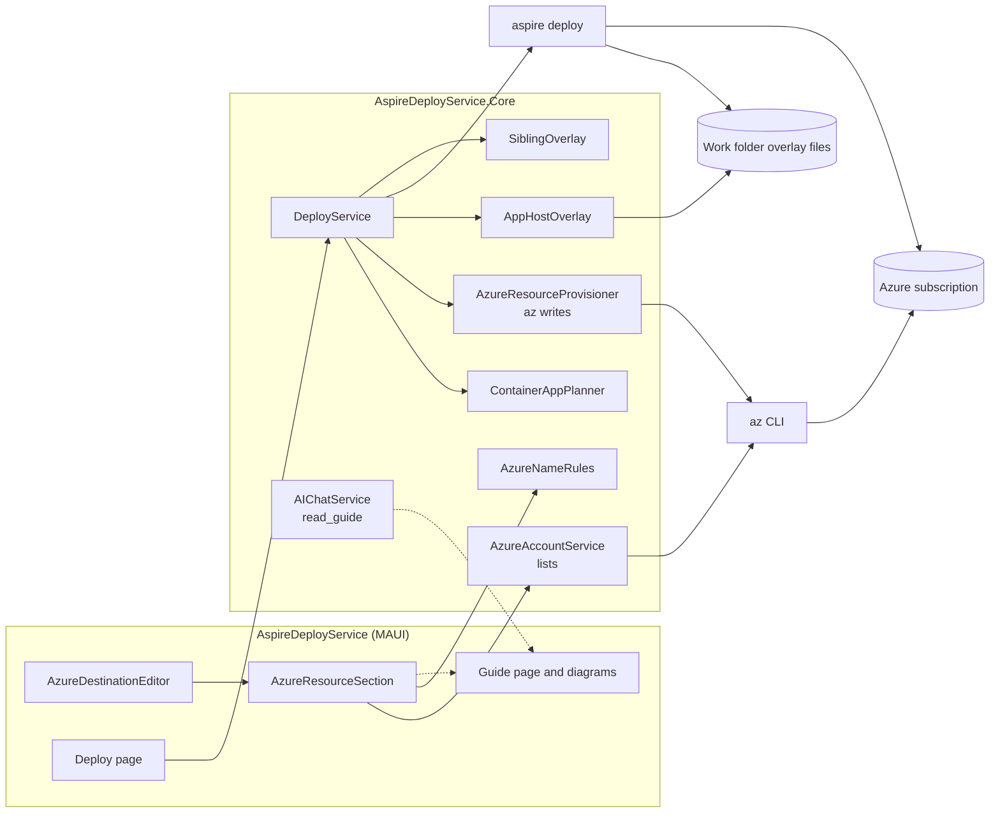
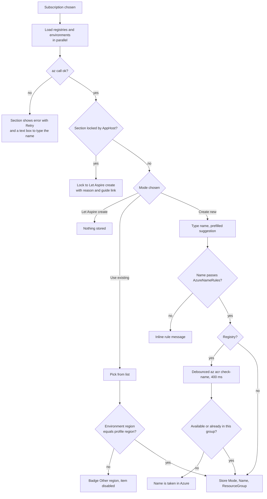
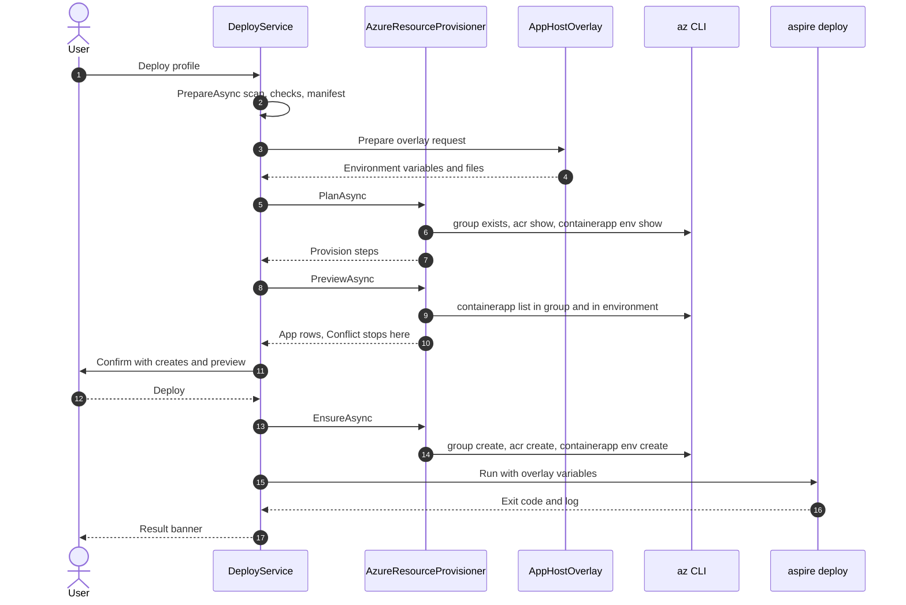
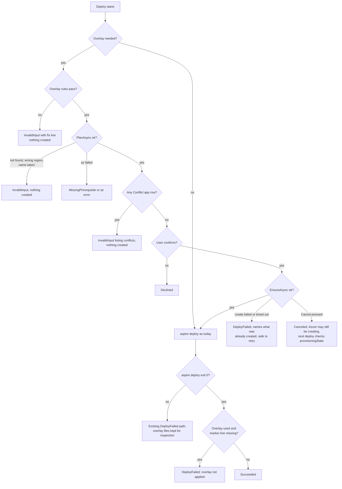
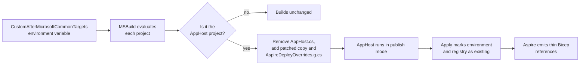
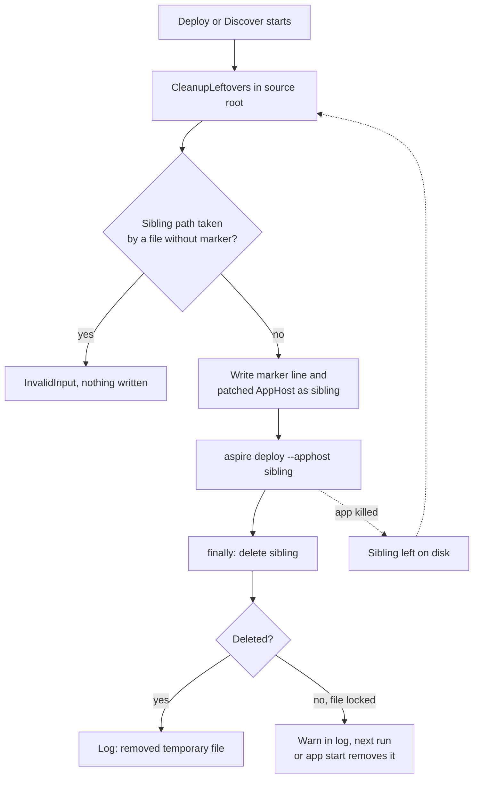

# AspireDeployService: Azure Resource Pickers and User Guide Plan

> **Reference code:** `<bdw>` means a sibling checkout of the BlazorDataDeploymentWebsite repository at `../BlazorDataDeploymentWebsite/BlazorDataDeploymentWebsite/`, relative to this repository's root. Links into `<bdw>` work only when that checkout exists. Patterns and rules are **copied** from it, the same way [AI-Help-Plan.md](AI-Help-Plan.md) D1 copied code from its reference. This repository never references `<bdw>` at build time.
> **Estimate:** 19 to 22 working days (17 PRs, including the T0 spike).
> **Owner inputs needed before T0:** an Azure subscription where you may create a resource group, a container registry and a Container Apps environment, plus Owner or User Access Administrator on that resource group (§9).

All paths are relative to the repository root unless they start with `<bdw>/`. Line numbers are as of commit `b580f50`.

---

## 1. Summary

| # | Feature | In one line |
|---|---|---|
| F1 | Resource pickers | The profile's **Destination** card gets two new sections, **Container registry** and **Container Apps environment**. Each has three modes: **Let Aspire create** (today's behaviour), **Use existing** (picked from a list read through `az`), and **Create new** (a name the app creates with `az` before the deploy). The resource group keeps its **Use existing / Create new** control. |
| F1b | Pull identity and logs workspace | A third section, **ACR pull identity**, lets the user pick an existing user-assigned identity that already has `AcrPull` on an existing registry, so no role assignment is created (D13). A **Create new** environment can send its logs to an **existing Log Analytics workspace** (D14). |
| F2 | AppHost overlay | When a registry, environment or pull identity is not **Let Aspire create**, the deploy runs the user's AppHost with a **patched copy** of its entry file that marks them existing. For a project AppHost the copy lives in the work folder and is swapped in through MSBuild (D2). For a file-based C# or TypeScript AppHost the copy is written **next to** the user's file for the length of the deploy and removed afterwards (D3). |
| F2b | Switch after create | After the app creates a registry or environment, the profile switches that section to **Use existing** with the new name (D15). |
| F3 | Container apps preview | The deploy confirmation (and the new-profile wizard) lists each compute resource of the AppHost as **new** or **updates existing**, by comparing the discovered resources with the apps already in Azure. Names still come from the AppHost. |
| F4 | User guide | A new in-app **Guide** page (`/guide`) with inline SVG diagrams and annotated screenshots, modelled on `<bdw>`'s `/guide` and `/operation` pages, plus `docs/User-Guide.md` with Mermaid diagrams for readers on GitHub. |
| F5 | Guide in AI Help | `docs/User-Guide.md` is embedded in Core. AI Help gets a `read_guide` tool, the guide's section list in its system prompt, and, for providers without tools, the guide's Troubleshooting section in the context (D16). |

**Motivating example.** A team already has a container registry `<registry>` and a Container Apps environment `<environment>` in resource group `<shared-rg>`. Today every profile deploy makes Aspire create a **new** registry, environment and Log Analytics workspace in the profile's resource group, because the profile can only name a subscription, region and resource group ([SettingsModel.cs:116-127](../AspireDeployService.Core/Settings/SettingsModel.cs#L116)). After this plan, the user picks `<registry>` and `<environment>` from two lists, and the deploy puts the container apps into that environment and pushes the images to that registry.

## 2. Goals and Non-goals

**Goals**
- The user can pick an existing resource group, container registry, Container Apps environment and ACR pull identity from lists, or create a new resource group, registry or environment, without leaving the app.
- Project, file-based C# and TypeScript AppHosts are all supported (D2, D3).
- Lists are read with the user's own `az login`, the same way subscriptions, regions and resource groups are read today ([AzureAccountService.cs:26-36](../AspireDeployService.Core/Azure/AzureAccountService.cs#L26)).
- A profile that keeps every new section on **Let Aspire create** deploys exactly as today: no overlay, no new environment variables, no `az` writes.
- The user's AppHost source and project files are never changed. A file-based or TypeScript AppHost gets one temporary sibling file during a deploy, which is always removed, also after a crash (D3); the Git working tree is clean again when the deploy ends.
- Before a deploy, the user sees what will be created in Azure and which container apps will be new or updated.
- A user who has never seen the app can deploy from the Guide page alone.
- AI Help can answer "how do I…" questions from the guide (D16).
- All new logic lives in `AspireDeployService.Core` and has unit tests.

**Non-goals (v1)**
- Picking or renaming individual container apps. Their names are the AppHost's resource names (D7).
- Choosing a registry or environment in a different subscription. Aspire does not support cross-subscription references ([aspire.dev: Use existing Azure resources](https://aspire.dev/integrations/cloud/azure/overview/#use-existing-azure-resources)).
- **Creating** a pull identity or any role assignment. Only an existing identity that already has `AcrPull` can be picked (D13).
- Virtual networks, custom domains and workload profiles on the created environment.
- Deleting anything in Azure. The app never deletes a resource group, registry, environment or app.
- Azure App Service and AKS targets. Only Azure Container Apps gets the new sections.
- Rendering Markdown inside the app. The in-app guide is Razor.

## 3. Decisions

Decisions D2, D3, D5, D7, D10, D13, D14, D15 and D16 were made with the repository owner for this plan.

| # | Decision | Rejected alternative | Why |
|---|---|---|---|
| D1 | Each of registry and environment has **three modes**: `AspireDefault` (absent or null in the file), `Existing`, `New`. | The two modes of `<bdw>`'s picker (`ResourceMode { Existing, New }`, [`<bdw>` Enums.cs:60-78](../../BlazorDataDeploymentWebsite/BlazorDataDeploymentWebsite/BlazorDataDeploymentWebsite.Core/Domain/Enums.cs#L60)). | In `<bdw>` the AppHost is always the same project, which declares the `existing*` parameters ([`<bdw>` AzdParameterMapper.cs:43-57](../../BlazorDataDeploymentWebsite/BlazorDataDeploymentWebsite/BlazorDataDeploymentWebsite.DeployWorker/Engine/AzdParameterMapper.cs#L43)). Here the AppHost is any user project, and some lock a section because they already choose their own resources (D4). `AspireDefault` keeps today's behaviour for them and for every existing profile, with no migration. |
| D2 | **Inject `PublishAsExisting` through an MSBuild overlay, not by editing files.** For a project AppHost, the deploy sets the environment variable `CustomAfterMicrosoftCommonTargets` to a generated `ads.overlay.targets` file in the work folder. That file, only for the AppHost project, swaps the entry `.cs` file for a patched copy and adds a generated `AspireDeployOverrides.g.cs` (§6.4). | (a) Map pickers onto parameters the AppHost already declares (no injection). (b) Edit the AppHost file in place and restore it afterwards. (c) Copy the whole solution to the work folder. | Owner chose injection over (a). (b) leaves the user's file changed if the app crashes or is killed mid-deploy, and shows up in `git status` during the deploy. (c) is slow for big solutions and changes the AppHost path, which Aspire's deploy-state cache may key on ([Aspire-Project-Deployer-Plan.md](Aspire-Project-Deployer-Plan.md) D10). MSBuild reads environment variables as properties and `Microsoft.Common.targets` imports `$(CustomAfterMicrosoftCommonTargets)` **(assumed; T0 proves it with `aspire deploy` on a 13.x starter)**. A local folder is used in place today ([LocalFolderSource.cs:6](../AspireDeployService.Core/Sources/LocalFolderSource.cs#L6)), so only an approach that writes nothing into it is safe. |
| D3 | **File-based C# and TypeScript AppHosts get a temporary sibling copy.** For `FileBasedCs` and `TypeScript` ([DiscoveryRecords.cs:8](../AspireDeployService.Core/Discovery/DiscoveryRecords.cs#L8)) the deploy writes the patched AppHost as `<name>.ads-deploy.<ext>` in the **same folder** (for example `apphost.ads-deploy.cs`, `apphost.ads-deploy.mts`), runs `aspire deploy --apphost <that file>`, and deletes it in a `finally`. The file's first line is a marker comment so leftovers can be found and removed (§6.4). | (a) Project AppHosts only. (b) Edit the user's file in place and restore it. (c) Copy the folder to the work folder. | Owner's choice (a was the earlier default). A file-based AppHost *is* its project, so an MSBuild overlay cannot swap its entry file, and TypeScript AppHosts are not built by MSBuild. A sibling keeps relative `#:project` paths and the TypeScript `.aspire/modules` imports working, which (c) would break, and unlike (b) the user's own file is never touched. Whether `aspire deploy --apphost` accepts a TypeScript entry file that is not named `apphost.ts`/`.mts` is **(assumed; T0 checks)**; R12 has the fallback. |
| D4 | **Per-target lock.** The environment section is locked when the AppHost already marks its Container Apps environment as existing, and the registry section is locked when the AppHost already wires a registry. Two text checks over every `.cs` file of the AppHost project (the same file set `AppHostSource` reads, [AppHostScanner.cs:320-335](../AspireDeployService.Core/Discovery/AppHostScanner.cs#L320)): `EnvironmentLocked` = `AddAzureContainerAppEnvironment\([^;]*?\)\s*\.\s*(Run\|Publish)?AsExisting\(` (singleline); `RegistryLocked` = `WithAzureContainerRegistry\(` or `AddAzureContainerRegistry\(`. A locked section points the user at the **Parameters** step. | (a) Inject on top. (b) One flag for any `AsExisting(`. | Two `PublishAsExisting` calls on one resource, or two `WithAzureContainerRegistry` calls, would fight. (b) would also lock AppHosts that only reuse an existing Key Vault or Storage account, which is common. |
| D4b | A locked AppHost is filled through its own parameters. | Lock it with no way forward. | `<bdw>`'s own target AppHost is this case: it reads `existingAcrName` and `existingAcaEnvName` parameters ([`<bdw>` AzdParameterMapper.cs:43-50](../../BlazorDataDeploymentWebsite/BlazorDataDeploymentWebsite/BlazorDataDeploymentWebsite.DeployWorker/Engine/AzdParameterMapper.cs#L43)), which the existing Parameters step already fills. |
| D5 | **Create new means the app creates the resource with `az` before `aspire deploy`**, then deploys with it as existing (the overlay). If a resource with that name already exists in the target resource group it is used as is. | Record the choice and let `aspire deploy` create it. | Owner's choice. The user controls the name, SKU and logs setting, and a failed create stops before any Aspire work starts. |
| D6 | **Created resources go into the profile's resource group and region.** Use existing may pick from any resource group in the subscription. | Let the user choose a resource group per new resource. | One resource group per deployment is the rule today ([Aspire-Project-Deployer-Plan.md](Aspire-Project-Deployer-Plan.md) D4), and the README's clean-up advice "delete its resource group" ([README.md:22](../README.md#L22)) stays true for everything the app creates. |
| D7 | **Container apps are previewed, not picked.** The preview compares the AppHost's compute resources with the apps in the target environment and marks each **New**, **Update** or **Conflict**. | Let the user choose an existing app per resource. | Owner's choice. Aspire names each container app after its AppHost resource **(assumed; T0 records the actual names)**, so a pick could not change where it deploys. |
| D8 | **Read lists with `az`, not the Azure SDK.** `az acr list`, `az containerapp env list`, `az containerapp list`, `az identity list` and `az monitor log-analytics workspace list`, all core `az` commands, run through the shared `AzCli` helper (§6.3, extracted from today's `RunAzAsync`) and its cache ([AzureAccountService.cs:169-204](../AspireDeployService.Core/Azure/AzureAccountService.cs#L169)). | Port `<bdw>`'s Resource Graph `ResourcePickerService` ([`<bdw>` ResourcePickerService.cs:117-144](../../BlazorDataDeploymentWebsite/BlazorDataDeploymentWebsite/BlazorDataDeploymentWebsite.Web/Services/Azure/ResourcePickerService.cs#L117)). | Core has no Azure SDK package and authenticates only through `az` ([AspireDeployService.Core.csproj](../AspireDeployService.Core/AspireDeployService.Core.csproj)). `az graph query` needs an `az` extension. `az containerapp env create` and `list` are in core `az` ([Microsoft Learn: az containerapp env](https://learn.microsoft.com/cli/azure/containerapp/env)). |
| D9 | **Copy `<bdw>`'s naming rules**, with one change: registry names must be lowercase. | Accept uppercase like `<bdw>` (`^[a-zA-Z0-9]{5,50}$`, [`<bdw>` ResourceNameRules.cs:15-73](../../BlazorDataDeploymentWebsite/BlazorDataDeploymentWebsite/BlazorDataDeploymentWebsite.Core/Deployments/ResourceNameRules.cs#L15)). | Azure stores registry names in lowercase, so an uppercase name would not match on later lookups. |
| D10 | **In-app Guide page plus `docs/User-Guide.md`.** The page is static Razor with inline SVG diagram components and annotated screenshots, like `<bdw>`'s `PublicGuide.razor` and `ArchitectureDiagram.razor`. The Markdown file covers the same sections with Mermaid diagrams. | (a) Only Markdown. (b) Render Markdown in the app. | Owner's choice. The app has no Markdown renderer and no Mermaid ([index.html](../AspireDeployService/wwwroot/index.html)), and `AIReplyFormatter` deliberately renders no Markdown ([AIReplyFormatter.cs:6-10](../AspireDeployService.Core/AI/AIReplyFormatter.cs#L6)). Inline SVG uses `currentColor` and CSS tokens, so it follows the light and dark themes like `Icon` does ([Icon.razor:2-3](../AspireDeployService/Components/Shared/Icon.razor#L2)). |
| D11 | **Creation and the overlay run inside the deploy run**, after the confirmation and before `aspire deploy`, and log to the same run log. There is no separate "Create now" button. | A "Create now" button on the profile page. | One confirmation lists everything that will change in Azure; Cancel and the log viewer already work for the deploy run. A create button would need its own run, dialog and error path. |
| D13 | **ACR pull identity: Let Aspire create or Use existing only.** An existing user-assigned identity is passed with `WithAcrPullIdentity`, and Aspire then creates no identity and no role assignment ([aspire.dev: Bring your own ACR pull identity](https://aspire.dev/integrations/cloud/azure/configure-container-apps/)). It is allowed only when the registry is **Use existing**, and `PlanAsync` checks that the identity has `AcrPull` on that registry. | (a) Also **Create new**, creating the identity and its `AcrPull` assignment with `az`. (b) Allow it with a new registry. | Owner asked for existing identities. The point is to deploy **without** role-assignment rights; (a) and (b) both need a role assignment, which needs exactly those rights. |
| D14 | **Existing Log Analytics workspace through diagnostic settings.** A **Create new** environment with logs to an existing workspace is created with `--logs-destination azure-monitor`, then `az monitor diagnostic-settings create` sends `allLogs` to the workspace's resource ID. | `--logs-destination log-analytics --logs-workspace-id <id> --logs-workspace-key <key>`. | The rejected form needs the workspace's shared key on the `az` command line, and this app never passes secrets as arguments ([Aspire-Project-Deployer-Plan.md](Aspire-Project-Deployer-Plan.md) D11). Diagnostic settings need only the resource ID ([Microsoft Learn: Log storage and monitoring options](https://learn.microsoft.com/azure/container-apps/log-options)). The logs land in the resource-specific tables (`ContainerAppConsoleLogs`, not `ContainerAppConsoleLogs_CL`); the guide says so. |
| D15 | **After a create, the profile switches to Use existing.** Right after each successful create (or when a **Create new** name is found already there), `EnsureAsync` saves that section as `Existing` with the name and the profile's resource group, through `ProfileStore.UpdateAsync`, and clears the create-only fields (`Sku`, `LogsDestination`, `LogsWorkspace`). | Keep `New` as "create if missing" (the earlier default). | Owner's choice. The profile then says what is really in Azure, a later deploy never re-creates a resource someone deleted on purpose (it fails with "not found" instead), and the switch happens before `aspire deploy`, so it holds even when the deploy fails. |
| D16 | **The Markdown guide is AI Help's source.** `docs/User-Guide.md` is embedded in Core. AI Help gets a `read_guide(section)` tool and the guide's section list in its system prompt. When tools are not available, the guide's Troubleshooting section is added to the context. | (a) Feed the Razor page to the model. (b) Put the whole guide in every context. | (a) Razor markup is not readable text in Core. (b) The guide is long, and `AIContextFormatter` caps the context at 24,000 characters ([AI-Help-Plan.md](AI-Help-Plan.md) §6.3). The in-app and Markdown guides are kept in step by T9, so either one is a faithful source. |
| D12 | **Overlay parameter values travel as `Parameters__adsExisting*` environment variables**, never as text in the generated C#. Profile parameters whose names start with `adsExisting` are refused. | Write the names into the generated source. | Names are validated (§6.2), but keeping data out of code removes any chance of a C# injection, and the `Parameters__` path is the one every other value already uses ([DeployEnvironment.cs:87-92](../AspireDeployService.Core/Deploy/DeployEnvironment.cs#L87)). |

## 4. Current State

**This repository**

| Area | Where | Today |
|---|---|---|
| Destination model | [SettingsModel.cs:116-127](../AspireDeployService.Core/Settings/SettingsModel.cs#L116) | `ProfileDestination` holds `TenantId`, `SubscriptionId`, `Location`, `ResourceGroup`, `AllowResourceGroupCreation`, `CredentialSource` and an `Extra` bag. Nothing for a registry, environment or app. No schema version. |
| Destination editor | [AzureDestinationEditor.razor](../AspireDeployService/Components/Shared/AzureDestinationEditor.razor) | Subscription, tenant, region and resource group. The resource group has the **Use existing / Create new** segment ([:95-97](../AspireDeployService/Components/Shared/AzureDestinationEditor.razor#L95)); a new group is only a name, "Created on the first deploy." ([:124](../AspireDeployService/Components/Shared/AzureDestinationEditor.razor#L124)), validated by `GroupNameProblem` ([:229](../AspireDeployService/Components/Shared/AzureDestinationEditor.razor#L229)). |
| Pickers | [SearchSelect.razor](../AspireDeployService/Components/Shared/SearchSelect.razor), [SelectItem.cs](../AspireDeployService/Components/Shared/SelectItem.cs) | A filterable dropdown over `SelectItem(Value, Text, Detail?, Disabled, Group?, Badge?)`. |
| Azure reads | [AzureAccountService.cs:26-36](../AspireDeployService.Core/Azure/AzureAccountService.cs#L26) | Three read-only list methods over `az`, cached for 10 minutes ([:44](../AspireDeployService.Core/Azure/AzureAccountService.cs#L44)) with a `refresh` flag. `RunAzAsync` ([:178](../AspireDeployService.Core/Azure/AzureAccountService.cs#L178)) maps a missing `az` and a failed command to `DeployerException`. No write methods. |
| Profile rules | [ProfileRules.cs:44-51](../AspireDeployService.Core/Settings/ProfileRules.cs#L44), [:101-113](../AspireDeployService.Core/Settings/ProfileRules.cs#L101) | `Validate` checks the GUIDs, region and resource-group name; `ApplySet` is a hard-coded key switch for `Destination:*`. |
| Edit session | [ProfileEditSession.cs:97-103](../AspireDeployService.Core/Settings/ProfileEditSession.cs#L97) | `ApplyTo` copies each destination field explicitly, so new fields must be added here. |
| Deploy environment | [DeployEnvironment.cs:58-94](../AspireDeployService.Core/Deploy/DeployEnvironment.cs#L58) | Sets `Azure__SubscriptionId`, `Azure__Location`, `Azure__ResourceGroup`, `Azure__CredentialSource`, `Azure__AllowResourceGroupCreation`, optional `Azure__TenantId`, and one variable per profile parameter. Reserved prefixes at [:30](../AspireDeployService.Core/Deploy/DeployEnvironment.cs#L30). |
| Stripped variables | [ProcessRunner.cs:70-77](../AspireDeployService.Core/Processes/ProcessRunner.cs#L70) | Inherited `Azure__`, `Parameters__`, `MSBuildSDKsPath`, `MSBuildExtensionsPath` and others are removed before `spec.Environment` is applied. `CustomAfterMicrosoftCommonTargets` is not in the list. |
| Deploy flow | [DeployService.cs:90-131](../AspireDeployService.Core/Services/DeployService.cs#L90), [:148-168](../AspireDeployService.Core/Services/DeployService.cs#L148), [:172-184](../AspireDeployService.Core/Services/DeployService.cs#L172) | `PrepareAsync` scans, checks prerequisites and runs the manifest; then the confirmation lists tenant, subscription, resource group and region; then `aspire deploy --apphost … --non-interactive` runs in the source root with `DeployEnvironment.Build`. |
| AppHost scan | [AppHostScanner.cs:49-56](../AspireDeployService.Core/Discovery/AppHostScanner.cs#L49) | Detects targets by text, for example `AddAzureContainerAppEnvironment`. Nothing detects `AsExisting`. |
| Manifest | [ManifestParser.cs:41-60](../AspireDeployService.Core/Discovery/ManifestParser.cs#L41), [DiscoveryRecords.cs:41](../AspireDeployService.Core/Discovery/DiscoveryRecords.cs#L41) | Compute resources (`project`, `container`, `dockerfile`) and `azure.bicep` resources become `DiscoveredResource`. The starter fixture shows the environment `env` and its registry `env-acr` as plain `azure.bicep.v0` entries ([starter-13.6.1.json:3-14](../AspireDeployService.Tests/Fixtures/manifests/starter-13.6.1.json#L3)). |
| Local source | [LocalFolderSource.cs:6-20](../AspireDeployService.Core/Sources/LocalFolderSource.cs#L6) | "A local folder is used in place." |
| Dialogs | [DialogService.cs:26](../AspireDeployService/Services/DialogService.cs#L26) | Confirm only (`bool`). No form dialog. |
| Navigation | [NavMenu.razor:14-18](../AspireDeployService/Components/Layout/NavMenu.razor#L14) | Home, Setup, Discover, Profiles, Settings. No help page. |
| Profiles list | [Profiles.razor:76-90](../AspireDeployService/Components/Pages/Profiles.razor#L76) | Shows subscription and resource group per profile. |
| User docs | [README.md](../README.md) | Quick start, settings file, manual checklist. No user guide, no diagrams. |
| AI Help prompt | [AIChatService.cs:99-112](../AspireDeployService.Core/AI/AIChatService.cs#L99) | `SystemPrompt` describes the app and the read-only file tools. Nothing about a guide. |
| AI Help tools | [AIChatService.cs:298-312](../AspireDeployService.Core/AI/AIChatService.cs#L298), [AIFileTools.cs:141-152](../AspireDeployService.Core/AI/AIFileTools.cs#L141) | `ToolsUnavailableReason` returns "There is no source folder or run log to read for this topic." when the context has neither, so a chat started from a plain error callout has no tools. `AsTools` offers `list_files`, `read_file`, `search_files` and `read_run_log`. |
| Tests | [AzureAccountServiceTests.cs](../AspireDeployService.Tests/AzureAccountServiceTests.cs), [Fakes.cs:11-49](../AspireDeployService.Tests/Support/Fakes.cs#L11) | `FakeProcessRunner` answers by matching `az` arguments; parsers are `internal static` and tested directly. Razor components are not unit tested. |

**`<bdw>` patterns to copy**

| `<bdw>` file | What | Change when copying |
|---|---|---|
| [ResourceNameRules.cs:15-73](../../BlazorDataDeploymentWebsite/BlazorDataDeploymentWebsite/BlazorDataDeploymentWebsite.Core/Deployments/ResourceNameRules.cs#L15) | Name regexes for resource group, environment, registry, container app | Only those four kinds; registry lowercase (D9). Into `Core/Azure/AzureNameRules.cs`. |
| [ResourcePicker.razor](../../BlazorDataDeploymentWebsite/BlazorDataDeploymentWebsite/BlazorDataDeploymentWebsite.Web/Components/Wizard/ResourcePicker.razor) | Mode toggle, filterable list, 400 ms debounced name check, local collision check, Retry on list failure | Behaviour only, rebuilt with `SearchSelect` and the `ads-seg` segment (no Radzen, [AI-Help-Plan.md](AI-Help-Plan.md) D1). |
| [ResourcePickerService.cs:170-197](../../BlazorDataDeploymentWebsite/BlazorDataDeploymentWebsite/BlazorDataDeploymentWebsite.Web/Services/Azure/ResourcePickerService.cs#L170) | Registry name availability, both response shapes | Replaced by `az acr check-name` (D8). |
| [PublicGuide.razor](../../BlazorDataDeploymentWebsite/BlazorDataDeploymentWebsite/BlazorDataDeploymentWebsite.Web/Components/Pages/Public/PublicGuide.razor) | Page outline: Before you start, numbered steps, Troubleshooting table, per-page "On this page" list | Content rewritten for this app (§6.7). |
| [GuideFigure.razor](../../BlazorDataDeploymentWebsite/BlazorDataDeploymentWebsite/BlazorDataDeploymentWebsite.Web/Components/Pages/Public/GuideFigure.razor) and its `.razor.css` | Screenshot figure with a numbered legend (CSS counters) | Use `ads-*` tokens. |
| [ArchitectureDiagram.razor](../../BlazorDataDeploymentWebsite/BlazorDataDeploymentWebsite/BlazorDataDeploymentWebsite.Web/Components/Pages/ArchitectureDiagram.razor) | Inline SVG with `<title>`/`<desc>`, shared `<symbol>`s, a wide and a stacked drawing | New drawings (§6.7). |
| [PublicOperation.razor:286-306](../../BlazorDataDeploymentWebsite/BlazorDataDeploymentWebsite/BlazorDataDeploymentWebsite.Web/Components/Pages/Public/PublicOperation.razor#L286) | Tables generated from code so docs stay in sync | The guide's naming-rules table is generated from `AzureNameRules` (§6.7). |

**Not copied:** `<bdw>`'s Entra sign-in, token cache, `ArmClientFactory`, deployer grants and pre-flight service. This app deploys as the developer through `az login` ([Aspire-Project-Deployer-Plan.md](Aspire-Project-Deployer-Plan.md) D8).

## 5. Design

### 5.1 Structure



`Chat` reads the embedded `docs/User-Guide.md`, the Markdown twin of the Guide page (D16).

### 5.2 New and changed components

| Component | Project | Responsibility |
|---|---|---|
| `Settings/SettingsModel.cs` (`ResourceChoice`, `ResourceMode`) | Core | Stored shape (§6.1). |
| `Azure/AzureNameRules` | Core | Name rules (§6.2), copied from `<bdw>` (D9). |
| `Azure/AzureAccountService` | Core | Three new list methods and `Invalidate` (§6.3). |
| `Azure/AzureResourceProvisioner` | Core | `PlanAsync` and `EnsureAsync`: decides and runs the `az` creates (§6.5). |
| `Deploy/AppHostOverlay` | Core | Finds the entry file, patches it, writes the targets file and the generated class, returns the environment variables (§6.4). |
| `Deploy/ContainerAppPlanner` | Core | Pure function for the preview (§6.6). |
| `Discovery/AppHostScanner` | Core | New `EnvironmentLocked`, `RegistryLocked` and `ContainerAppEnvironmentNames` (D4, §6.4). |
| `Services/DeployService` | Core | Calls the planner, the provisioner and the overlay; adds them to the confirmation (§7.2). |
| `Settings/ProfileRules`, `ProfileEditSession` | Core | Validation, `ApplySet` keys, `ApplyTo` copying for the new fields. |
| `Components/Shared/AzureResourceSection.razor` | MAUI | One registry or environment section: three-mode segment, `SearchSelect`, name input, SKU or logs `<select>`, help link. Implements `IDisposable`: one `CancellationTokenSource` for the debounced name check (cancelled on each keystroke and on dispose), and a subscription-generation counter so results that arrive after the subscription changed are dropped, like the editor's `_loadedFor` guard. (The editor itself passes `CancellationToken.None` today; the new list loads in it use a token from a CTS it disposes.) |
| `Components/Shared/AzureDestinationEditor.razor` | MAUI | Hosts two `AzureResourceSection`s below the resource group; loads the lists when the subscription changes. |
| `Components/Shared/ContainerAppPreview.razor` | MAUI | The F3 table, used by `ProfileNew`. |
| `Components/Pages/Guide.razor` and `Components/Guide/*` | MAUI | F4 page, diagram components and `GuideFigure`. |
| `Deploy/SiblingOverlay` | Core | D3: writes, cleans up and finds leftovers of the temporary sibling AppHost file (§6.4). |
| `AI/UserGuide`, `AI/AIGuideTools` | Core | D16: reads sections of the embedded guide; the `read_guide` tool (§6.8). |
| `Components/Shared/AzureResourceSection.razor` (identity and workspace variants) | MAUI | The same component renders the pull-identity section (two modes) and the workspace picker inside the environment section. |

## 6. Contracts

### 6.1 Settings (`appsettings.Local.json`)

New keys under `AspireDeploy:Profiles:<name>:Destination`. An absent section means `AspireDefault`, so every existing profile keeps working unchanged.

| Key | Type | Default | Meaning |
|---|---|---|---|
| `ContainerRegistry:Mode` | string `AspireDefault` / `Existing` / `New` | `AspireDefault` | D1 |
| `ContainerRegistry:Name` | string | none | Required for `Existing` and `New`. |
| `ContainerRegistry:ResourceGroup` | string | the profile's `ResourceGroup` | `Existing` only; ignored for `New` (D6). |
| `ContainerRegistry:Sku` | string `Basic` / `Standard` / `Premium` | `Basic` | `New` only. |
| `ContainerAppEnvironment:Mode` | as above | `AspireDefault` | D1 |
| `ContainerAppEnvironment:Name` | string | none | Required for `Existing` and `New`. |
| `ContainerAppEnvironment:ResourceGroup` | string | the profile's `ResourceGroup` | `Existing` only. |
| `ContainerAppEnvironment:LogsDestination` | string `log-analytics` / `existing-workspace` / `none` | `log-analytics` | `New` only. `log-analytics` = new workspace created by `az`; `existing-workspace` = D14; `none` = no stored logs. |
| `ContainerAppEnvironment:LogsWorkspace:Name` | string | none | Required for `existing-workspace`. |
| `ContainerAppEnvironment:LogsWorkspace:ResourceGroup` | string | none | Required for `existing-workspace`. Any group in the subscription. |
| `AcrPullIdentity:Mode` | string `AspireDefault` / `Existing` | `AspireDefault` | D13. `New` is refused. |
| `AcrPullIdentity:Name` | string | none | Required for `Existing`. |
| `AcrPullIdentity:ResourceGroup` | string | none | Required for `Existing`. |
| `ContainerAppEnvironment:AppHostResource` | string | the single Container Apps environment in the AppHost | The AppHost resource name to override, for AppHosts that declare more than one (§6.4). |

```json
{
  "AspireDeploy": {
    "Profiles": {
      "<profile>": {
        "Destination": {
          "SubscriptionId": "<subscription-guid>",
          "Location": "eastus2",
          "ResourceGroup": "rg-<profile>",
          "ContainerRegistry": { "Mode": "Existing", "Name": "<registry>", "ResourceGroup": "<shared-rg>" },
          "ContainerAppEnvironment": {
            "Mode": "New", "Name": "cae-<profile>", "LogsDestination": "existing-workspace",
            "LogsWorkspace": { "Name": "<workspace>", "ResourceGroup": "<shared-rg>" }
          },
          "AcrPullIdentity": { "Mode": "Existing", "Name": "<identity>", "ResourceGroup": "<shared-rg>" }
        }
      }
    }
  }
}
```

```csharp
namespace AspireDeployService.Core.Settings;

[JsonConverter(typeof(JsonStringEnumConverter<ResourceMode>))]
public enum ResourceMode { AspireDefault, Existing, New }

public sealed class ResourceChoice
{
    public ResourceMode? Mode { get; set; }            // null = AspireDefault
    public string? Name { get; set; }
    public string? ResourceGroup { get; set; }
    public string? Sku { get; set; }                   // registry only
    public string? LogsDestination { get; set; }       // environment only
    public WorkspaceRef? LogsWorkspace { get; set; }   // environment only, for existing-workspace
    public string? AppHostResource { get; set; }       // environment only
    [JsonExtensionData] public Dictionary<string, JsonElement>? Extra { get; set; }

    [JsonIgnore] public ResourceMode EffectiveMode => Mode ?? ResourceMode.AspireDefault;
}
// ProfileDestination gains:
//   public ResourceChoice? ContainerRegistry { get; set; }
//   public ResourceChoice? ContainerAppEnvironment { get; set; }
//   public ResourceChoice? AcrPullIdentity { get; set; }       // only AspireDefault or Existing (D13)

public sealed class WorkspaceRef
{
    public string? Name { get; set; }
    public string? ResourceGroup { get; set; }
    [JsonExtensionData] public Dictionary<string, JsonElement>? Extra { get; set; }
}
```

**`ProfileRules.ApplySet` keys:** `Destination:ContainerRegistry:Mode|Name|ResourceGroup|Sku`, `Destination:ContainerAppEnvironment:Mode|Name|ResourceGroup|LogsDestination|AppHostResource|LogsWorkspace:Name|LogsWorkspace:ResourceGroup` and `Destination:AcrPullIdentity:Mode|Name|ResourceGroup`. An empty value clears the field; `Mode` accepts the three enum names, case-insensitively.

**`ProfileRules.Validate` additions** (messages use the existing `Key: text` form):

| Rule | Message |
|---|---|
| Mode `Existing` or `New` without `Name` | `Destination:ContainerRegistry:Name: choose or enter a registry.` (and the environment equivalent) |
| Name fails `AzureNameRules` (§6.2) | The rule's text. |
| `Sku` not one of the three | `Destination:ContainerRegistry:Sku: Basic, Standard or Premium.` |
| `LogsDestination` not one of the three | `Destination:ContainerAppEnvironment:LogsDestination: log-analytics, existing-workspace or none.` |
| `existing-workspace` without both `LogsWorkspace` fields | `Destination:ContainerAppEnvironment:LogsWorkspace: choose a Log Analytics workspace.` |
| `AcrPullIdentity` mode `New` | `Destination:AcrPullIdentity:Mode: only an existing identity can be used.` |
| `AcrPullIdentity` `Existing` without `Name` and `ResourceGroup` | `Destination:AcrPullIdentity:Name: choose an identity.` |
| `AcrPullIdentity` `Existing` while the registry is not `Existing` (D13) | `Destination:AcrPullIdentity: an existing pull identity needs an existing registry that it can already pull from.` |
| `Existing` `ResourceGroup` set and invalid | The existing resource-group message ([ProfileRules.cs:51](../AspireDeployService.Core/Settings/ProfileRules.cs#L51)). |
| A profile parameter name starts with `adsExisting` or `adsOverlay` (D12). The deploy-time check in §6.4 "Reserved names" also catches a custom configuration key that maps onto these | `Parameters:<name>: names starting with adsExisting or adsOverlay are reserved by Aspire Deploy.` |

### 6.2 Name rules (`AzureNameRules`)

```csharp
namespace AspireDeployService.Core.Azure;

public enum AzureResourceKind { ResourceGroup, ContainerRegistry, ContainerAppEnvironment, ContainerApp, ManagedIdentity, LogAnalyticsWorkspace }
// ManagedIdentity and LogAnalyticsWorkspace are only ever picked, never named by the user, so Problem() returns null for them.

public static class AzureNameRules
{
    /// null when valid, otherwise one sentence for the UI.
    public static string? Problem(AzureResourceKind kind, string? name);
    /// A valid name derived from the profile name: strips invalid characters, lowercases, pads a too-short registry
    /// name with 4 random hex characters, and truncates to the maximum length. No Azure access.
    /// AzureResourceSection calls CheckRegistryNameAsync on the result and, if it is taken, calls Suggest again
    /// with a 4-hex suffix (at most 3 tries, then leaves the field for the user).
    public static string Suggest(AzureResourceKind kind, string profileName, string? suffix = null);
    /// For the guide's generated table (§6.7).
    public static IReadOnlyList<(AzureResourceKind Kind, string Rule, bool GloballyUnique)> Describe();
}
```

| Kind | Regex | Globally unique | Suggestion for profile `my-app` |
|---|---|---|---|
| ContainerRegistry | `^[a-z0-9]{5,50}$` | Yes | `crmyapp` (a 4-hex suffix is added only if under 5 characters, or by the section when taken) |
| ContainerAppEnvironment | `^(?!.*--)[a-z][a-z0-9-]{0,58}[a-z0-9]$` | No | `cae-my-app` |
| ContainerApp | `^(?!.*--)[a-z][a-z0-9-]{0,30}[a-z0-9]$` | No | (preview only, D7) |
| ResourceGroup | Unchanged: [ProfileRules.cs](../AspireDeployService.Core/Settings/ProfileRules.cs) `IsValidResourceGroup` | No | `rg-my-app` (unchanged) |

### 6.3 Azure reads (`IAzureAccountService` additions)

```csharp
public sealed record AzureContainerRegistry(string Name, string ResourceGroup, string Location, string LoginServer, string Sku);
public sealed record AzureContainerAppEnvironment(string Id, string Name, string ResourceGroup, string Location);
public sealed record AzureContainerApp(string Name, string ResourceGroup, string? EnvironmentId);
public sealed record NameAvailability(bool Available, string? Reason);
public sealed record AzureManagedIdentity(string Id, string Name, string ResourceGroup, string PrincipalId);
public sealed record AzureLogAnalyticsWorkspace(string Id, string Name, string ResourceGroup, string Location);

// IAzureAccountService gains:
Task<IReadOnlyList<AzureContainerRegistry>> ListContainerRegistriesAsync(string subscriptionId, IRunObserver observer, CancellationToken ct, bool refresh = false);
Task<IReadOnlyList<AzureContainerAppEnvironment>> ListContainerAppEnvironmentsAsync(string subscriptionId, IRunObserver observer, CancellationToken ct, bool refresh = false);
/// resourceGroup null = every app in the subscription (used to find same-name apps in a shared environment).
/// A resource group that does not exist yet gives an empty list, not an error.
Task<IReadOnlyList<AzureContainerApp>> ListContainerAppsAsync(string subscriptionId, string? resourceGroup, IRunObserver observer, CancellationToken ct, bool refresh = false);
Task<NameAvailability> CheckRegistryNameAsync(string subscriptionId, string name, IRunObserver observer, CancellationToken ct);  // never cached
Task<IReadOnlyList<AzureManagedIdentity>> ListManagedIdentitiesAsync(string subscriptionId, IRunObserver observer, CancellationToken ct, bool refresh = false);
Task<IReadOnlyList<AzureLogAnalyticsWorkspace>> ListLogAnalyticsWorkspacesAsync(string subscriptionId, IRunObserver observer, CancellationToken ct, bool refresh = false);
void Invalidate(string subscriptionId);  // drops every cached list for that subscription; called after a create
```

| Method | `az` arguments | Cache key | Parsed fields **(assumed field names; T0 captures fixtures)** |
|---|---|---|---|
| `ListContainerRegistriesAsync` | `acr list --subscription <sub> --output json` | `registries:<sub>` | `name`, `resourceGroup`, `location`, `loginServer`, `sku.name` |
| `ListContainerAppEnvironmentsAsync` | `containerapp env list --subscription <sub> --output json` | `environments:<sub>` | `id`, `name`, `resourceGroup`, `location` |
| `ListContainerAppsAsync` | `containerapp list --subscription <sub> [--resource-group <rg>] --output json` | `apps:<sub>:<rg or *>` | `name`, `resourceGroup`, `properties.managedEnvironmentId` (or `properties.environmentId`) |
| `CheckRegistryNameAsync` | `acr check-name --name <name> --subscription <sub> --output json` | none | `nameAvailable`, `reason` |
| `ListManagedIdentitiesAsync` | `identity list --subscription <sub> --output json` | `identities:<sub>` | `id`, `name`, `resourceGroup`, `principalId` |
| `ListLogAnalyticsWorkspacesAsync` | `monitor log-analytics workspace list --subscription <sub> --output json` | `workspaces:<sub>` | `id`, `name`, `resourceGroup`, `location` |

Sample `ListContainerAppEnvironmentsAsync` result, sorted by name:

```text
AzureContainerAppEnvironment(Id: "/subscriptions/<sub>/resourceGroups/<shared-rg>/providers/Microsoft.App/managedEnvironments/<environment>",
                             Name: "<environment>", ResourceGroup: "<shared-rg>", Location: "eastus2")
```

**Shared `az` helper.** Today `RunAzAsync` is private, opens its own run context ([AzureAccountService.cs:178-204](../AspireDeployService.Core/Azure/AzureAccountService.cs#L178)) and maps every non-zero exit to `MissingPrerequisite "az <first two args> failed: …"`. Extract it into an internal `AzCli` class used by both services:

```csharp
namespace AspireDeployService.Core.Azure;

public enum AzErrorKind { None, NotSignedIn, NotFound, ResourceGroupNotFound, Unauthorized, ProviderNotRegistered, Conflict, Other }

public sealed record AzResult(int ExitCode, string StdOut, string ErrorLine, AzErrorKind Kind);

internal static class AzCli
{
    // AzureAccountService keeps creating its own RunContext per list call (runs.Create(WorkKeys.For(...), observer)), as today;
    // the provisioner passes the deploy run.
    /// Runs az in the given run (so lines reach that run's log). Never throws for a non-zero exit; the caller decides.
    /// Throws DeployerException(MissingPrerequisite) only when az is not installed.
    public Task<AzResult> RunAsync(IReadOnlyList<string> args, RunContext run, TimeSpan timeout, CancellationToken ct);
    /// Classifies the ERROR line: "ResourceNotFound" → NotFound, "ResourceGroupNotFound", "AuthorizationFailed" → Unauthorized,
    /// "MissingSubscriptionRegistration" → ProviderNotRegistered, "Conflict"/"AlreadyExists" → Conflict, "az login" → NotSignedIn.
    internal static AzErrorKind Classify(string errorLine);
}
```

`AzureAccountService` keeps its current messages, except that the command shown is every argument up to the first one starting with `--` (so `az containerapp env list failed: …`, not `az containerapp env failed`). `ProviderNotRegistered` adds the fix line "Run: az provider register --namespace Microsoft.App", shown in the section with **Retry**. `InvalidInput` for a non-GUID subscription or a resource group that fails `IsValidResourceGroup` stays as today.

**Caching.** The editor uses the cache. Every call made by the deploy (`PlanAsync`, the preview) passes `refresh: true`, so a resource created minutes earlier is seen.

### 6.4 AppHost overlay (`AppHostOverlay`)

```csharp
namespace AspireDeployService.Core.Deploy;

/// <param name="RegistryName">null = leave the registry to the AppHost.</param>
/// <param name="RunId">Fresh GUID per deploy, echoed by the marker line.</param>
/// <param name="ResourceNames">Manifest resource names, to refuse a clash with ads-existing-registry.</param>
public sealed record OverlayRequest(
    string SourceRoot, AppHostInfo AppHost, string WorkKey, string RunId, IReadOnlyCollection<string> ResourceNames,
    bool EnvironmentLocked, bool RegistryLocked, bool IdentityLocked,
    string? EnvironmentAppHostResource,
    string? EnvironmentName, string? EnvironmentResourceGroup,       // null = leave the environment to the AppHost
    string? RegistryName, string? RegistryResourceGroup,
    string? PullIdentityName, string? PullIdentityResourceGroup);   // D13

/// <param name="Environment">Variables to merge into the aspire deploy ProcessSpec.</param>
/// <param name="Files">Absolute paths written, for the log.</param>
/// <param name="AppHostPath">The path to pass to aspire deploy --apphost: the original for a project AppHost,
/// the sibling copy (relative to SourceRoot) for file-based and TypeScript AppHosts.</param>
/// <param name="SiblingFile">Full path of the sibling copy to delete after the deploy; null for a project AppHost.</param>
public sealed record OverlayResult(IReadOnlyDictionary<string, string> Environment, IReadOnlyList<string> Files,
    string AppHostPath, string? SiblingFile);

public static class AppHostOverlay
{
    public const string ParamEnvName = "adsExistingEnvironmentName";
    public const string ParamEnvGroup = "adsExistingEnvironmentResourceGroup";
    public const string ParamRegistryName = "adsExistingRegistryName";
    public const string ParamRegistryGroup = "adsExistingRegistryResourceGroup";
    public const string ParamIdentityName = "adsExistingPullIdentityName";
    public const string ParamIdentityGroup = "adsExistingPullIdentityResourceGroup";

    /// Throws DeployerException(InvalidInput) with a fix line when the AppHost is not supported (§6.4 rules).
    public static OverlayResult Prepare(OverlayRequest request);

    /// Pure text transform, tested on its own. Returns null when the builder variable or its Build() call
    /// cannot be found exactly once.
    internal static string? Patch(string source, string originalPath);

    /// TypeScript variant (§6.4 "Sibling copy"). Returns null when the environment variable or build() cannot be found once.
    internal static string? PatchTypeScript(string source, OverlayRequest request);
}

public static class SiblingOverlay
{
    public const string Marker = "// ads-deploy-temp: written by Aspire Deploy during a deploy; safe to delete.";
    /// "<dir>/<name>.ads-deploy.<ext>" for "<dir>/<name>.<ext>".
    public static string SiblingPath(string appHostFullPath);
    /// Deletes every *.ads-deploy.cs, *.ads-deploy.ts and *.ads-deploy.mts under root whose first line is Marker.
    /// Called at the start of each deploy and each Discover, and once when the app starts for every profile source
    /// folder that exists. Returns the deleted paths for the log.
    public static IReadOnlyList<string> CleanupLeftovers(string root);
}
```

**Rules, in order.** Each failure throws `InvalidInput` with the message shown, and nothing is created in Azure yet (the overlay is prepared before `EnsureAsync`, §7.2).

| Rule | Failure message |
|---|---|
| File-based or TypeScript: the sibling path is free, or holds only a leftover whose first line is the marker (deleted first) | "A file named <name>.ads-deploy.<ext> already exists next to the AppHost and was not written by Aspire Deploy. Rename or delete it." |
| `IdentityLocked` is false when the pull identity is `Existing`. `IdentityLocked` = `WithAcrPullIdentity(` or `withAcrPullIdentity(` in the AppHost source | "The AppHost already sets its own ACR pull identity." |
| `EnvironmentLocked` is false when the environment is `Existing` or `New`, and `RegistryLocked` is false when the registry is (D4) | "The AppHost already chooses its own environment (or registry). Set its parameters on the Parameters step instead." |
| The AppHost has exactly one Container Apps environment, or `AppHostResource` names one (text match on `AddAzureContainerAppEnvironment("<name>"` in the project's `.cs` files) | "The AppHost declares several Container Apps environments. Choose which one on the profile page." |
| Exactly one `.cs` file under the AppHost project folder (skipping `bin` and `obj`) contains `DistributedApplication.CreateBuilder(` | "Could not find the file that creates the AppHost builder." |
| `Patch` finds `(var\|IDistributedApplicationBuilder)\s+(?<b>\w+)\s*=\s*DistributedApplication\.CreateBuilder\(` once and `\b<b>\s*\.\s*Build\s*\(\s*\)` once | "Could not find where the AppHost calls Build(). See the guide for the lines to add yourself." |
| `CustomAfterMicrosoftCommonTargets` does not appear in the AppHost project file or in any `Directory.Build.props` / `Directory.Build.targets` from the project folder up to the drive root. A property set there would win over the environment variable and the overlay would be silently skipped | "The AppHost project (or a Directory.Build file) sets CustomAfterMicrosoftCommonTargets, so the overlay cannot be added." |

**Proof the overlay ran.** Because an ignored overlay would let `aspire deploy` succeed while creating a **new** environment and registry, `Apply` writes one line to standard output, `ADS-OVERLAY-APPLIED <run-id>` (the run ID comes from a fifth parameter, `adsOverlayRunId`). `DeployService` passes a fresh GUID and, when the deploy exits 0 but the line never appeared in the output, fails the run with `DeployFailed`: "The AppHost overlay was not applied, so Aspire may have created a new environment or registry in <rg>. See Troubleshooting." The check reads the lines as `ProcessRunner` streams them to the run log **(assumed: AppHost stdout reaches `aspire deploy`'s output; T0 confirms, otherwise the marker is a file written to the overlay folder)**.

**Sibling copy (file-based and TypeScript, D3).** The builder rows above apply to a project AppHost and, on the single file, to a file-based one. A TypeScript AppHost uses `PatchTypeScript` instead.

| Kind | Patch | Generated code goes |
|---|---|---|
| `FileBasedCs` | `Patch` as for a project, on the single file. `#line` directives point at the original file. | Appended at the end of the copy as the `AspireDeployOverrides` class (type declarations may follow top-level statements). The `#:sdk`, `#:package` and `#:project` lines stay at the top unchanged. |
| `TypeScript` | `PatchTypeScript` finds `const <v> = await <b>.addAzureContainerAppEnvironment(` once (needed even when only the registry or identity is overridden) and `<b>.build()` once, and inserts the calls below on new lines after the environment statement. Not found once → "Could not find `const <name> = await builder.addAzureContainerAppEnvironment(...)` in the AppHost. See the guide for the lines to add yourself." | Inline, using the documented TypeScript API: `publishAsExisting(name, { resourceGroup })`, `addAzureContainerRegistry`, `withAzureContainerRegistry`, `addAzureUserAssignedIdentity`, `withAcrPullIdentity` ([aspire.dev: Use an existing ACA environment](https://aspire.dev/integrations/cloud/azure/configure-container-apps/)). |

```typescript
// Inserted after: const env = await builder.addAzureContainerAppEnvironment("env");   (sketch, not final code)
console.log("ADS-OVERLAY-APPLIED " + process.env["Parameters__adsOverlayRunId"]);
await env.publishAsExisting(await builder.addParameter("adsExistingEnvironmentName"),
    { resourceGroup: await builder.addParameter("adsExistingEnvironmentResourceGroup") });
const adsRegistry = await builder.addAzureContainerRegistry("ads-existing-registry");          // only when a registry is chosen
await adsRegistry.publishAsExisting(await builder.addParameter("adsExistingRegistryName"),
    { resourceGroup: await builder.addParameter("adsExistingRegistryResourceGroup") });
await env.withAzureContainerRegistry(adsRegistry);
// identity: addAzureUserAssignedIdentity("ads-existing-pull-identity") + publishAsExisting + env.withAcrPullIdentity(...)
```

- `aspire deploy` gets `--apphost <sibling>` instead of the original path. The sibling is deleted in a `finally` around `aspire deploy`, and the log says "Removed the temporary file <sibling>."
- The file starts with `SiblingOverlay.Marker` (a `//` comment in both languages), so `CleanupLeftovers` removes it after a crash or a killed process. A file is never deleted unless its first line is exactly the marker.
- `AppHostScanner`'s search skips `*.ads-deploy.*` files, so a leftover is never found as a second AppHost.
- Aspire's deploy-state cache is keyed by the AppHost path **(assumed)**, so the sibling has its own cache; the guide notes that the first overlay deploy of a file-based or TypeScript AppHost does not reuse the cache of a plain deploy.
- `publishAsExisting` on the TypeScript environment object, `addParameter` returning an awaitable parameter, `process.env` reaching the TypeScript AppHost, and the CLI accepting a non-standard file name are **(assumed; T0 step 9 checks)**.

**Escaping.** Every path written into `ads.overlay.targets` is MSBuild-escaped (`%`, `$`, `@`, `;`, `'` as `%XX`) and then XML-escaped, so folders such as `O'Brien` or `R&D` work.

**One build at a time per AppHost.** `WorkKeyLock` is per profile ([DeployService.cs:51-52](../AspireDeployService.Core/Services/DeployService.cs#L51)), so two profiles over one local folder could build the same `obj`/`bin` at once, one with the overlay and one without, and the deploy could run the wrong `AppHost.dll`. `DeployService` therefore also takes `FileLock.AcquireAsync(<WorkRoot>/locks/apphost-<first 12 hex of SHA-256 of the AppHost full path, lowercased>.lock, 10 s, ct)` ([FileLock.cs:12](../AspireDeployService.Core/Infrastructure/FileLock.cs#L12)) around the manifest step and `aspire deploy`, and Discover takes the same lock around `aspire do publish-manifest`. A timeout gives `InvalidInput` "Another run is building this AppHost. Wait for it to finish."

**Patch.** Insert one line before the line holding `<b>.Build()`, keeping its indentation, with `#line` directives so compiler errors still point at the user's file:

```csharp
#line hidden
AspireDeployOverrides.Apply(builder);
#line 42 "<original-path>\AppHost.cs"
```

**Project AppHost: files written to `<WorkKey>/overlay/`:** the patched entry file (same file name), `AspireDeployOverrides.g.cs`, and `ads.overlay.targets`:

```xml
<Project>
  <!-- Generated by Aspire Deploy for one deploy run. Applies to the AppHost project only. -->
  <ItemGroup Condition="'$(MSBuildProjectFullPath)' == '<apphost-csproj-full-path>'">
    <Compile Remove="<entry-file-path-relative-to-project>" />
    <Compile Include="<overlay>\AppHost.cs" />
    <Compile Include="<overlay>\AspireDeployOverrides.g.cs" />
  </ItemGroup>
</Project>
```

**Generated class (behaviour, not final code):**

```csharp
// <auto-generated/> by Aspire Deploy. Not part of the user's source.
using Aspire.Hosting;
using Aspire.Hosting.Azure;          // AzureContainerAppEnvironmentResource and the registry types; T0 confirms the namespaces
internal static class AspireDeployOverrides
{
    public static void Apply(IDistributedApplicationBuilder builder)
    {
        if (!builder.ExecutionContext.IsPublishMode) return;
        // Console.WriteLine("ADS-OVERLAY-APPLIED " + builder.Configuration["Parameters:adsOverlayRunId"]);
        // Find the AzureContainerAppEnvironmentResource: by name when EnvironmentAppHostResource is set, else the
        // only one. Zero or several → throw InvalidOperationException("Aspire Deploy: …") so the deploy fails clearly.
        // builder.CreateResourceBuilder(env).PublishAsExisting(
        //     builder.AddParameter("adsExistingEnvironmentName"), builder.AddParameter("adsExistingEnvironmentResourceGroup"));
        // Only when a registry is chosen:
        // var acr = builder.AddAzureContainerRegistry("ads-existing-registry").PublishAsExisting(
        //     builder.AddParameter("adsExistingRegistryName"), builder.AddParameter("adsExistingRegistryResourceGroup"));
        // envBuilder.WithAzureContainerRegistry(acr);
        // Only when a pull identity is chosen (D13):
        // var id = builder.AddAzureUserAssignedIdentity("ads-existing-pull-identity").PublishAsExisting(
        //     builder.AddParameter("adsExistingPullIdentityName"), builder.AddParameter("adsExistingPullIdentityResourceGroup"));
        // envBuilder.WithAcrPullIdentity(id);
    }
}
```

- `PublishAsExisting`, `WithAzureContainerRegistry` and `AddAzureContainerRegistry` are documented Aspire APIs ([aspire.dev: Use an existing ACA environment](https://aspire.dev/integrations/cloud/azure/configure-container-apps/), [aspire.dev: Reference an existing container registry](https://aspire.dev/integrations/cloud/azure/azure-container-registry/azure-container-registry-host/)).
- `builder.CreateResourceBuilder(resource)` on an already-added resource, and `AddAzureContainerRegistry` being available through the `Aspire.Hosting.Azure.AppContainers` package without a direct registry reference, are **(assumed)**. T0 checks both. Discovery lists only direct package references ([DiscoveryRecords.cs:21](../AspireDeployService.Core/Discovery/DiscoveryRecords.cs#L21)), so a transitive dependency cannot be detected. If T0 shows `Aspire.Hosting.Azure.AppContainers` does **not** bring the registry API, the rule becomes "registry `Existing`/`New` needs a direct `Aspire.Hosting.Azure.ContainerRegistry` reference in `HostingPackages`", and the registry section is locked otherwise with "Add the Aspire.Hosting.Azure.ContainerRegistry package to use an existing registry."
- The registry resource added by the overlay is named `ads-existing-registry`. `Prepare` refuses with "The AppHost already has a resource named ads-existing-registry." if the manifest lists that name.
- `AppHostResource` is the only value written into the generated source, as a C# string literal after it passes `^[A-Za-z0-9-]{1,64}$`; every other value is a parameter (D12).
- With the environment **Let Aspire create** and the registry **Existing** or **New**, the class still calls `WithAzureContainerRegistry` on the environment the AppHost declares, without `PublishAsExisting` on it. The table in [aspire.dev: Combinations and what gets emitted](https://aspire.dev/integrations/cloud/azure/configure-container-apps/) lists all four combinations as supported.

**Environment variables added** to the `aspire deploy` spec by `Prepare`:

| Variable | Value |
|---|---|
| `CustomAfterMicrosoftCommonTargets` | `<WorkKey>/overlay/ads.overlay.targets` |
| `Parameters__adsExistingEnvironmentName` | environment name (only if the environment is `Existing` or `New`) |
| `Parameters__adsExistingEnvironmentResourceGroup` | its resource group |
| `Parameters__adsExistingRegistryName` | registry name (only if the registry is `Existing` or `New`) |
| `Parameters__adsExistingRegistryResourceGroup` | its resource group |
| `Parameters__adsExistingPullIdentityName` | identity name (only if the pull identity is `Existing`) |
| `Parameters__adsExistingPullIdentityResourceGroup` | its resource group |
| `Parameters__adsOverlayRunId` | a new GUID per deploy, echoed by the marker line |

`CustomAfterMicrosoftCommonTargets` is set only for a project AppHost.

**Reserved names.** `DeployEnvironment`'s reserved check ([DeployEnvironment.cs:30-41](../AspireDeployService.Core/Deploy/DeployEnvironment.cs#L30)) runs on the environment variable each parameter **maps to** (`ConfigKeyFor` honours `ParameterConfigKeys`), so it is the right place: add `Parameters__adsExisting`, `Parameters__adsOverlayRunId`, `CustomAfterMicrosoftCommonTargets` and `CustomBeforeMicrosoftCommonTargets` (all case-insensitive) to it. Also add `CustomAfterMicrosoftCommonTargets` and `CustomBeforeMicrosoftCommonTargets` to `ProcessRunner.StrippedPrefixes` ([ProcessRunner.cs:70-77](../AspireDeployService.Core/Processes/ProcessRunner.cs#L70)), so an inherited value never reaches any child process; the overlay value is applied afterwards through `spec.Environment`. The overlay folder is deleted at the start of each deploy run, not at the end, so it can be inspected after a failure.

### 6.5 Creating resources (`AzureResourceProvisioner`)

```csharp
namespace AspireDeployService.Core.Azure;

public enum ProvisionAction { UseExisting, Create, AlreadyThere }

public sealed record ProvisionStep(AzureResourceKind Kind, string Name, string ResourceGroup, ProvisionAction Action, string? Detail);

public interface IAzureResourceProvisioner
{
    /// Read-only: decides what EnsureAsync would do. Used for the confirmation text and dry runs.
    Task<IReadOnlyList<ProvisionStep>> PlanAsync(DeployProfile profile, RunContext run, CancellationToken ct);
    /// Runs the Create steps in order: resource group, registry, environment. Calls Invalidate afterwards.
    /// After each successful create (or a New name found AlreadyThere), saves that section as Existing (D15) through
    /// ProfileStore.UpdateAsync and logs "Profile <name>: <kind> switched to Use existing (<resource>)."
    Task<IReadOnlyList<ProvisionStep>> EnsureAsync(string profileName, DeployProfile profile, RunContext run, CancellationToken ct);
}
```

| Step | When | `az` arguments | Timeout |
|---|---|---|---|
| Resource group | any `New` resource, the group is missing (`az group exists`), and `AllowResourceGroupCreation` is not `false`. If it is `false`, `PlanAsync` refuses: "Resource group <rg> does not exist and the profile does not allow creating it." | `group create --name <rg> --location <loc> --subscription <sub> --tags created-by=AspireDeployService` | 2 min |
| Registry name check | registry `New` and not in the group | `acr check-name --name <name> --subscription <sub>`; not available → `InvalidInput` "The registry name <name> is taken in Azure; choose another." | 2 min |
| Registry | registry `New` and not in the group | `acr create --name <name> --resource-group <rg> --location <loc> --sku <sku> --subscription <sub> --tags created-by=AspireDeployService` | 10 min |
| Environment | environment `New` and not in the group | `containerapp env create --name <name> --resource-group <rg> --location <loc> --logs-destination <dest> --subscription <sub> --tags created-by=AspireDeployService`, where `<dest>` is `log-analytics`, `none`, or `azure-monitor` for `existing-workspace` (D14) | 20 min |
| Workspace check | `existing-workspace` | `monitor log-analytics workspace show --workspace-name <ws> --resource-group <ws-rg> --subscription <sub>`; not found → `InvalidInput` "Log Analytics workspace <ws> was not found in <ws-rg>." Done in `PlanAsync`, before any create. | 2 min |
| Logs routing | `existing-workspace`, right after the environment create | `monitor diagnostic-settings create --name ads-logs --resource <env-id> --workspace <workspace-id> --logs '[{"categoryGroup":"allLogs","enabled":true}]'` (the JSON is one list argument, not shell-quoted). Failure → `DeployFailed` "The environment was created, but its logs could not be sent to <ws>: <az error>. Add a diagnostic setting in the portal." The deploy stops; the profile has already switched to Use existing (D15), so a retry does not re-create the environment. | 2 min |
| Pull identity check | `AcrPullIdentity` `Existing` | `identity show --name <id> --resource-group <id-rg> --subscription <sub>` for `principalId`, then `role assignment list --assignee <principalId> --scope <registry-id> --role AcrPull --output json`. Empty list → `InvalidInput` "Identity <id> cannot pull from <registry>. Ask an owner to run: az role assignment create --assignee <principalId> --role AcrPull --scope <registry-id>". `Unauthorized` on the list → not blocking; the confirmation says "(could not check AcrPull)". Done in `PlanAsync`. | 2 min |
| Existing check | each `Existing` choice | `acr show` / `containerapp env show` with `--name`, `--resource-group` and `--subscription`; not found → `InvalidInput` "<kind> <name> was not found in <rg>." | 2 min |

- **Provisioning state.** Every `show` call also reads `provisioningState` (`properties.provisioningState` for the environment, `provisioningState` for the registry; T0 confirms the paths). `Succeeded` → `AlreadyThere` or `UseExisting`. `InProgress`, `Creating`, `Updating` or `Waiting` → `InvalidInput` "<kind> <name> is still being created in Azure. Try again in a few minutes." `Failed` or `Canceled` → `InvalidInput` "<kind> <name> exists but its creation failed. Delete it in the Azure portal or choose another name." A cancelled or timed-out create (the `az` process is killed but Azure keeps going) is therefore caught on the next deploy instead of failing later inside `aspire deploy`.
- **Classified errors.** `PlanAsync` and `EnsureAsync` use `AzCli` (§6.3) in the deploy run, so every `az` line lands in the deploy log. `NotFound` on a `show` means "create it" for `New` and `InvalidInput` for `Existing`; `Unauthorized` → `InvalidInput` naming the role from §9; `ProviderNotRegistered` → the `az provider register` fix line; `Conflict` during a create (another run created the same name between plan and create) → `DeployFailed` "… was created by another run; deploy again." Anything else → `DeployFailed` with the `az` error line.
- **Time limits.** Creates have their own timeouts (table above) and do **not** count against `DeployTimeoutMinutes`, which still covers only `aspire deploy` ([DeployService.cs:183](../AspireDeployService.Core/Services/DeployService.cs#L183)). The worst case is therefore 32 minutes of creates plus the deploy timeout; the confirmation says "Creating the environment can take up to 20 minutes."
- **Dry run.** `PlanAsync` runs (read-only), its steps are listed in the confirmation and the log, nothing is created, and `aspire deploy --list-steps` runs **with** the overlay when every `Existing` resource is found and no `New` resource is missing, otherwise **without** it, with the log line "Listing steps without the overlay because <name> does not exist yet."
- With `--logs-destination log-analytics` and no workspace ID, `az` creates a Log Analytics workspace in the same group **(assumed; T0 confirms)**.
- Every `az` call goes through `AzCli` and so through `ProcessRunner` with an argument list, never a shell string, with `LogStdOut = false`, as `RunAzAsync` does today ([AzureAccountService.cs:178-204](../AspireDeployService.Core/Azure/AzureAccountService.cs#L178)).
- A `New` resource in the same group and region as another profile's `New` resource of the same name is shared, not duplicated: the second deploy finds it `AlreadyThere`.
- **Switch after create (D15).** `EnsureAsync` calls `ProfileStore.UpdateAsync` once per created section, setting `Mode = Existing`, `ResourceGroup = <profile rg>`, and clearing `Sku`, `LogsDestination` and `LogsWorkspace`. `ProfileEditSession.ApplyTo` copies only changed fields ([ProfileEditSession.cs:97-103](../AspireDeployService.Core/Settings/ProfileEditSession.cs#L97)), so an editor open on the same profile does not undo the switch when it saves other fields. If the write fails (file locked for 10 s, file no longer parses, file read-only), the deploy continues and logs a warning: "The profile could not be updated; set <kind> to Use existing <name> yourself." With the switch, a later deploy after someone deleted the resource fails in `PlanAsync` with "not found" plus "Choose Create new to create it again."
- `ProfileEdit` already subscribes to `Runs.RunsChanged` ([ProfileEdit.razor:171](../AspireDeployService/Components/Pages/ProfileEdit.razor#L171)); T6 makes it reload the profile when its `deploy:<name>` run ends, so the page shows **Use existing** afterwards. The form is disabled while that run is busy ([ProfileEdit.razor:169](../AspireDeployService/Components/Pages/ProfileEdit.razor#L169)), so no unsaved edits are lost by the reload.
- An existing environment whose `location` differs from the profile's `Location` is refused in `PlanAsync`: "The environment <name> is in <region>, but the profile deploys to <location>. Container apps must be in their environment's region." **(assumed: Aspire puts the apps in the deployment resource group's region; T0 confirms.)**

### 6.6 Container apps preview (`ContainerAppPlanner`)

```csharp
namespace AspireDeployService.Core.Deploy;

public enum AppPlanAction { New, Update, Conflict, Unknown }

public sealed record AppPlanRow(string Resource, string AppName, AppPlanAction Action, string? Note);

/// <param name="EnvironmentId">The environment the apps will run in, or null when it is not known yet
/// (AspireDefault on a first deploy).</param>
/// <param name="AppsInGroup">Apps in the profile's resource group; null when they could not be read.</param>
/// <param name="AppsInEnvironment">Apps anywhere in the subscription whose environment is EnvironmentId; empty when
/// EnvironmentId is null; null when they could not be read.</param>
public sealed record AppPlanInput(string ProfileResourceGroup, string? EnvironmentId,
    IReadOnlyList<AzureContainerApp>? AppsInGroup, IReadOnlyList<AzureContainerApp>? AppsInEnvironment);

public static class ContainerAppPlanner
{
    /// compute: DiscoveredResource entries that are project, container or dockerfile resources.
    public static IReadOnlyList<AppPlanRow> Plan(IReadOnlyList<DiscoveredResource> compute, AppPlanInput input);
}

// IAzureResourceProvisioner gains (it already has the profile and AzCli):
/// Works out EnvironmentId, lists apps with refresh: true, and calls ContainerAppPlanner.Plan.
Task<IReadOnlyList<AppPlanRow>> PreviewAsync(DeployProfile profile, IReadOnlyList<DiscoveredResource> compute,
    RunContext run, CancellationToken ct);
```

**How `PreviewAsync` finds `EnvironmentId`:**

| Environment mode | `EnvironmentId` |
|---|---|
| `Existing` | The picked environment's `id` from `containerapp env show`. |
| `New` | Built: `/subscriptions/<sub>/resourceGroups/<rg>/providers/Microsoft.App/managedEnvironments/<name>` (case-insensitive compare). |
| `AspireDefault` | The environment of the existing apps in the profile's group when they all share one; otherwise null. |

**Rules, first match wins** (`AppName` is the resource name in lowercase **(assumed: T0 records how Aspire names the apps)**):

| Case | Action | Note |
|---|---|---|
| `AppName` fails the container app rule | Conflict | "Aspire will shorten or reject this name." |
| `AppsInGroup` or `AppsInEnvironment` is null | Unknown | "Could not read the existing apps." |
| An app named `AppName` is in the profile's group and in `EnvironmentId` (or `EnvironmentId` is null) | Update | |
| An app named `AppName` is in the profile's group but in another environment | Conflict | "<app> already runs in environment <other>. An app cannot move to another environment; delete it or use another resource group." |
| An app named `AppName` is in `EnvironmentId` but in another resource group | Conflict | "<app> in <other-rg> already uses this name in the shared environment." |
| Otherwise | New | |

**Conflict blocks the deploy.** If any row is `Conflict`, `DeployService` throws `InvalidInput` with every Conflict note, **before** the confirmation and before any `az` write. `Unknown` rows do not block; the confirmation shows them as "(could not check)". The new-profile wizard shows the same rows with Conflict in the error colour.

Sample confirmation text with the preview (added to [DeployService.cs:148](../AspireDeployService.Core/Services/DeployService.cs#L148)):

```text
Deploy shop (C:\src\shop) to
  subscription: <subscription-guid>
  resource group: rg-shop in eastus2
  registry: <registry> in <shared-rg> (existing)
  environment: cae-shop (create, logs: log-analytics)
  container apps: apiservice (new), webfrontend (update)
  environment: Production
```

### 6.7 User guide

**In-app page** `Components/Pages/Guide.razor`, `@page "/guide"`, linked as a **Guide** tab in [NavMenu.razor:14-18](../AspireDeployService/Components/Layout/NavMenu.razor#L14), with an "On this page" list built from a `Toc` array like `<bdw>`'s pages. Sections and anchors:

| Anchor | Heading | Content |
|---|---|---|
| `before` | Before you start | `az login`, Docker or Podman, .NET SDK, the Azure roles in §9, and a link to Setup. |
| `how` | How it works | `HowItWorksDiagram`: the app, `az`, `aspire deploy` and the Azure resource group. |
| `profile` | 1. Create a profile | Source, Destination, Parameters, with `GuideFigure` screenshots of each wizard step. |
| `azure-resources` | 2. Choose Azure resources | `ResourceModesDiagram`; one subsection each for resource group, registry, environment (including the three logs choices and that `existing-workspace` logs land in the resource-specific tables, D14) and ACR pull identity (when to use it, that it needs `AcrPull` already, and the `az role assignment create` line to give an owner); a table of the three modes; the generated naming-rules table (`AzureNameRules.Describe()`); that a created resource switches the profile to Use existing (D15); why a section can be locked, with the C# and TypeScript snippets from [aspire.dev](https://aspire.dev/integrations/cloud/azure/configure-container-apps/) to add by hand. |
| `apphost-kinds` | AppHost kinds | How the overlay works for project, file-based and TypeScript AppHosts; that file-based and TypeScript AppHosts get a temporary `*.ads-deploy.*` file next to the AppHost during a deploy, that it is removed afterwards, and that a leftover with the marker line is safe to delete. |
| `deploy` | 3. Deploy and watch | `DeployStepsDiagram`; the confirmation, the container apps preview, the log, Cancel. |
| `redeploy` | 4. Deploy again | Idempotent creates, what "update" means, Aspire version change warning. |
| `remove` | 5. Remove a deployment | Delete the resource group; existing resources picked from other groups (registry, environment, pull identity, logs workspace) are never deleted. |
| `trouble` | Troubleshooting | Symptom and fix table, including every `InvalidInput` and `DeployFailed` message from §6.4 to §6.6. This section is also what AI Help receives when it has no tools (§6.8). |

**Diagram components** in `Components/Guide/`: inline SVG with `<title>` and `<desc>`, `fill`/`stroke` from CSS tokens (`var(--ads-…)`) or `currentColor`, a wide drawing and a stacked one for windows under 900px. The three drawings match the Mermaid diagrams in `docs/User-Guide.md`:

| Component | Shows |
|---|---|
| `HowItWorksDiagram.razor` | The developer machine (app, `az`, `aspire deploy`, AppHost) and the Azure resource group (registry, environment, apps). |
| `ResourceModesDiagram.razor` | The three modes and what each does at deploy time. |
| `DeployStepsDiagram.razor` | Prepare, confirm, create, overlay, `aspire deploy`, result. |

**`GuideFigure.razor`** in `Components/Guide/`: `Src`, `Alt`, `Caption`, `Id`, `Width`, `Height`, legend items as `ChildContent`. Screenshots go in `AspireDeployService/wwwroot/images/guide/guide-NN-<topic>.png`, captured in T9 with numbered callouts drawn into the image.

**Contextual links.** Each `AzureResourceSection` header has a small help link to `guide#azure-resources`. Fragment scrolling in a Blazor Hybrid WebView is **(assumed)**; if it does not scroll, add a small `adsGuide.scrollTo(id)` helper (`document.getElementById(id)?.scrollIntoView()`) to [index.html](../AspireDeployService/wwwroot/index.html), next to the existing `adsFocus` and `adsChat` helpers, and call it from `Guide.razor` after the first render with the fragment from `NavigationManager.Uri`.

**Markdown** `docs/User-Guide.md`: the same headings and anchors, the same troubleshooting table, Mermaid versions of the three diagrams, and screenshots referenced from `../AspireDeployService/wwwroot/images/guide/`. [README.md](../README.md) links to it from the quick start.

### 6.8 Guide in AI Help (D16)

```csharp
namespace AspireDeployService.Core.AI;

public sealed record GuideSection(string Anchor, string Title, string Text);

public static class UserGuide
{
    /// Reads the embedded resource "AspireDeployService.Core.UserGuide.md" once (Lazy) and splits it at "## " headings.
    /// The anchor is the heading's GitHub-style slug, matching the in-app Guide.razor anchors (§6.7).
    public static IReadOnlyList<GuideSection> Sections { get; }
    /// null when the anchor or title (case-insensitive) is unknown.
    public static GuideSection? Find(string anchorOrTitle);
}

public sealed class AIGuideTools(IPromptRedactor redactor)
{
    [Description("Read a section of the Aspire Deploy user guide. Pass a section anchor or title from the list in the system prompt.")]
    public string ReadGuide(string section);       // text capped at 8,000 characters, scrubbed; unknown → lists the anchors
    public IList<AITool> AsTools();                 // one tool named read_guide
}
```

| Change | Where | Detail |
|---|---|---|
| Embed the guide | `AspireDeployService.Core.csproj` | `<EmbeddedResource Include="..\docs\User-Guide.md" LogicalName="AspireDeployService.Core.UserGuide.md" />`. |
| System prompt | [AIChatService.cs:99-112](../AspireDeployService.Core/AI/AIChatService.cs#L99) | Append: "Aspire Deploy has a user guide. Sections: <anchor: title, one per line>. When the developer asks how to do something in the app, use read_guide if you have it, and point them to Guide > <title> in the app." The list is built from `UserGuide.Sections` when the prompt is first used. |
| Tools | `AIChatService.SendAsync` around [:197-200](../AspireDeployService.Core/AI/AIChatService.cs#L197) | When `ToolsEnabled`, add `AIGuideTools.AsTools()` to the file tools. |
| Tools rule | `ToolsUnavailableReason` [:298-312](../AspireDeployService.Core/AI/AIChatService.cs#L298) | Drop the last rule ("no source folder or run log"): the guide can always be read, so tools are offered for every context when the provider and model support them. `AIFileTools` still offers only the tools whose root is set ([AIFileTools.cs:141-152](../AspireDeployService.Core/AI/AIFileTools.cs#L141)). `ToolsFact` gains "can read the user guide". |
| No tools | `AIChatService.StartAsync` | When `ToolsUnavailableReason` is not null, add the `trouble` section (capped at 6,000 characters) to the context as a fact block titled "From the user guide: Troubleshooting". It counts toward `AIContextFormatter.MaxContextChars`; the log tail is trimmed first, as today. |
| Activity line | `AIFileTools.Describe` | `read_guide` shows as "Read the guide: <title>". |

## 7. Flows

### 7.1 Pick or create in the profile editor



In `ProfileEdit`, whether a section is locked is unknown until a deploy runs, because the page has no discovery result. The sections are enabled there, and the deploy enforces §6.4. `ProfileNew` has the discovery result and locks sections up front. The pull-identity section follows the same flow with two modes, and is disabled with "Needs an existing registry" unless the registry is Use existing (D13). Choosing `existing-workspace` for a new environment shows a workspace `SearchSelect` from `ListLogAnalyticsWorkspacesAsync`.

### 7.2 Deploy with overlay and creation



### 7.3 Deploy failure paths



### 7.4 What the overlay changes at build time (project AppHost)



### 7.5 Sibling copy lifecycle (file-based and TypeScript AppHost)



## 8. File-by-file Changes

| File | New/Modified | Change |
|---|---|---|
| `AspireDeployService.Core/Settings/SettingsModel.cs` | Modified | `ResourceMode`, `ResourceChoice`, `WorkspaceRef`; `ProfileDestination.ContainerRegistry`, `.ContainerAppEnvironment` and `.AcrPullIdentity` (§6.1). |
| `AspireDeployService.Core/Settings/ProfileRules.cs` | Modified | `Validate` rules and `ApplySet` keys (§6.1). |
| `AspireDeployService.Core/Settings/ProfileEditSession.cs` | Modified | `ApplyTo` copies both `ResourceChoice`s field by field, like lines 97-103. |
| `AspireDeployService.Core/Azure/AzureNameRules.cs` | New | §6.2. Origin comment naming `<bdw>`'s `ResourceNameRules.cs`. |
| `AspireDeployService.Core/Azure/AzureAccountService.cs` | Modified | Records, list methods, `CheckRegistryNameAsync`, `Invalidate`, parsers (§6.3). |
| `AspireDeployService.Core/Azure/AzureResourceProvisioner.cs` | New | §6.5. |
| `AspireDeployService.Core/Deploy/AppHostOverlay.cs` | New | §6.4, including the generated class text as an embedded string template. |
| `AspireDeployService.Core/Deploy/ContainerAppPlanner.cs` | New | §6.6. |
| `AspireDeployService.Core/Deploy/SiblingOverlay.cs` | New | D3, §6.4: sibling path, marker, `CleanupLeftovers`. |
| `AspireDeployService.Core/AI/UserGuide.cs`, `AspireDeployService.Core/AI/AIGuideTools.cs` | New | §6.8. |
| `AspireDeployService.Core/AI/AIChatService.cs` | Modified | System prompt section list, `read_guide` tool, tools rule, Troubleshooting fallback (§6.8). |
| `AspireDeployService.Core/AI/AIFileTools.cs` | Modified | `Describe` line for `read_guide`. |
| `AspireDeployService.Core/AspireDeployService.Core.csproj` | Modified | `EmbeddedResource` for `docs/User-Guide.md` (§6.8). |
| `AspireDeployService/Components/Pages/ProfileEdit.razor` | Modified | Reload the profile when its deploy run ends (D15). |
| `AspireDeployService/MauiProgram.cs` | Modified | On start, run `SiblingOverlay.CleanupLeftovers` on a background thread for each profile's local source folder that exists, and log what was removed. |
| `AspireDeployService.Core/Discovery/AppHostScanner.cs`, `DiscoveryRecords.cs` | Modified | `AppHostInfo.EnvironmentLocked`, `AppHostInfo.RegistryLocked` and `ContainerAppEnvironmentNames` (D4, §6.4), from the text `AppHostSource` already reads. |
| `AspireDeployService.Core/Services/DeployService.cs` | Modified | Overlay, plan, preview and creation in `RunDeployAsync` (§7.2); confirmation lines; dry run lists the plan and creates nothing; merge the overlay variables into `spec.Environment`. |
| `AspireDeployService.Core/ServiceCollectionExtensions.cs` | Modified | `TryAddSingleton<IAzureResourceProvisioner, AzureResourceProvisioner>()`. |
| `AspireDeployService/Components/Shared/AzureResourceSection.razor` | New | One section (§5.2). |
| `AspireDeployService/Components/Shared/AzureDestinationEditor.razor` | Modified | Two sections after the resource group; list loading on subscription change; a new `DiscoveryResult? Discovery` parameter used to lock the sections (§7.1). |
| `AspireDeployService/Components/Shared/ContainerAppPreview.razor` | New | §6.6 table. |
| `AspireDeployService/Components/Pages/ProfileNew.razor` | Modified | Pass `Discovery`; show `ContainerAppPreview` on the Destination step. |
| `AspireDeployService.Core/Services/ProfileService.cs` | Modified | `ProfileSummary` ([ProfileService.cs:9](../AspireDeployService.Core/Services/ProfileService.cs#L9)) gains `string? RegistryName` and `string? EnvironmentName` (null for `AspireDefault`). |
| `AspireDeployService/Components/Pages/Profiles.razor` | Modified | Meta line shows registry and environment from `ProfileSummary` when set. |
| `AspireDeployService.Core/Azure/AzCli.cs` | New | §6.3 shared helper and `Classify`. |
| `AspireDeployService.Core/Deploy/DeployEnvironment.cs` | Modified | Reserved names (§6.4). |
| `AspireDeployService.Core/Processes/ProcessRunner.cs` | Modified | Strip `CustomAfterMicrosoftCommonTargets` and `CustomBeforeMicrosoftCommonTargets` (§6.4). |
| `AspireDeployService.Core/Services/DiscoveryPipeline.cs` | Modified | Take the per-AppHost `FileLock` around `aspire do publish-manifest` (§6.4). |
| `AspireDeployService.Tests/Support/Harness.cs` | Modified | `Deploy()` ([Harness.cs:56](../AspireDeployService.Tests/Support/Harness.cs#L56)) passes the new `IAzureResourceProvisioner` constructor argument (a fake). |
| `AspireDeployService/Components/Shared/Icon.razor` | Modified | `container` and `registry` entries (Lucide style), and `help-circle` if missing. |
| `AspireDeployService/Components/Pages/Guide.razor` | New | §6.7. |
| `AspireDeployService/Components/Guide/{GuideFigure,HowItWorksDiagram,ResourceModesDiagram,DeployStepsDiagram}.razor` | New | §6.7. |
| `AspireDeployService/Components/Layout/NavMenu.razor` | Modified | **Guide** tab. |
| `AspireDeployService/wwwroot/index.html` | Modified | `adsGuide.scrollTo` helper, only if T8 finds fragment scrolling does not work (§6.7). |
| `AspireDeployService/wwwroot/app.css` | Modified | `ads-guide-*`, `ads-figure-*` and `ads-diagram-*` classes using the existing tokens. |
| `AspireDeployService/wwwroot/images/guide/*.png` | New | Annotated screenshots (T9). |
| `AspireDeployService/appsettings.Local.example.json` | Modified | The §6.1 sample with placeholders. |
| `docs/User-Guide.md` | New | §6.7. |
| `README.md` | Modified | Link to the guide; the clean-up line mentions existing resources are never deleted; the `*.ads-deploy.*` temporary file; manual checklist rows from §11. |
| `AspireDeployService.Tests/Fixtures/apphosts/*.ts`, `*.ads-deploy.*` | New | TypeScript entry files for `PatchTypeScript`; leftover sibling files with and without the marker. |
| `AspireDeployService.Tests/Fixtures/az/*.json` | New | Captured `az` outputs from T0, with names replaced by placeholders. |
| `AspireDeployService.Tests/Fixtures/apphosts/*.cs` | New | Entry files for `Patch` tests (top-level, `Main` method, two `Build` calls, renamed builder variable). |
| `AspireDeployService.Tests/Azure/*Tests.cs`, `Deploy/*Tests.cs` | New | §11. |

## 9. Security and Privacy

| Concern | Control |
|---|---|
| Injection into generated code | Names never appear in generated C# (D12); they travel as `Parameters__adsExisting*` values. The generated file is a fixed template; only the optional `AppHostResource`, validated against `^[A-Za-z0-9-]{1,64}$`, is written as a C# string literal. |
| Injection into `az` | Arguments are a list passed to `ProcessRunner`, never a shell string. Every name is validated by `AzureNameRules` or `IsValidResourceGroup` before any call. |
| User's source changed | Never: the overlay lives in `<WorkKey>/overlay`, and only an environment variable on the `aspire deploy` process points at it (D2). |
| Overlay leaking into other builds | The targets file's `ItemGroup` is conditioned on the AppHost project's full path. The variable is set only on the `aspire deploy` process, never on this app's own process or on `aspire do publish-manifest`. |
| Stale overlay build output | After a deploy the user's `obj` folder holds a build that includes the overlay. The next normal build recompiles because the compile item list changed **(assumed; T0 checks with `dotnet build` after a deploy)**. |
| Azure permissions | Reading: Reader on the subscription. Creating: Contributor on the resource group, or on the subscription when the group is new. Aspire also creates an `AcrPull` role assignment for a pull identity on the registry, which needs Owner, User Access Administrator or Role Based Access Control Administrator on the registry's resource group ([aspire.dev: Bring your own ACR pull identity](https://aspire.dev/integrations/cloud/azure/configure-container-apps/)). The guide's "Before you start" says so. |
| Cost | A new registry and a Log Analytics workspace have a monthly cost. The confirmation names each resource that will be created, and the guide says that both cost money. |
| Shared resources | Deploying into an existing environment can update apps with the same name that someone else deployed. The preview marks these **Update**, and the confirmation shows them before anything runs. |
| Personal data | Subscription IDs, resource group and resource names appear in the run log and the confirmation, as today. The plan, the guide and the screenshots use placeholders such as `<registry>`. |
| Tags | Created resources carry `created-by=AspireDeployService`, so they can be found later. |
| Temporary sibling file (D3) | It holds only the user's own AppHost plus fixed generated calls; no names or secrets (D12). It is removed in a `finally`, at the next run and at app start, and only when its first line is the marker, so a user file is never deleted. While a deploy runs it shows in `git status`; the guide says not to commit it. |
| Log Analytics shared key | Never read: logs go to an existing workspace through diagnostic settings, which take only the resource ID (D14). |
| Pull identity | The app reads the identity's `principalId` and its role assignments on the registry; it never creates or changes a role assignment (D13). |
| AI Help and the guide | The guide is product text with placeholders only; `read_guide` output still passes through the scrubber like every tool result ([AI-Help-Plan.md](AI-Help-Plan.md) D8). |

## 10. Deployment Notes

Nothing is deployed and no package is added. The `az containerapp` commands used are in core `az`; if an old `az` lacks them, the Setup page's existing `az` check is the place to raise the minimum version **(assumed: the current check does not test the version)**.

## 11. Test Plan

| Test | Type | File |
|---|---|---|
| `AzureNameRules`: valid and invalid names for each kind, including uppercase registry, `--` in an environment, 61-character environment, suggestions | Unit | `Azure/AzureNameRulesTests.cs` |
| `ResourceChoice` round trip: a file without the new keys loads as `AspireDefault` and saves without them; unknown keys in a `ResourceChoice` survive | Unit | `SettingsTests.cs` (extend) |
| `ProfileRules`: every §6.1 rule and `ApplySet` key; `adsExisting*` parameter refused | Unit | `SettingsTests.cs` (extend) |
| `ProfileEditSession.ApplyTo` copies only changed `ResourceChoice` fields | Unit | `SettingsTests.cs` (extend) |
| `AzureAccountService`: each new list parses the T0 fixtures, sorts by name, caches, honours `refresh`; `Invalidate` drops only that subscription; `CheckRegistryNameAsync` is never cached; `Microsoft.App` not registered gives the fix line | Unit | `AzureAccountServiceTests.cs` (extend) |
| `AppHostOverlay.Patch`: top-level statements, `Main` method, `IDistributedApplicationBuilder` declaration, renamed variable, two `Build()` calls (null), no builder (null), `#line` values correct, indentation kept | Unit | `Deploy/AppHostOverlayTests.cs` |
| `AppHostOverlay.Prepare`: each rule in §6.4 gives its message; files and variables as §6.4; registry variables absent when the registry is `AspireDefault`; overlay folder recreated | Unit | `Deploy/AppHostOverlayTests.cs` |
| `AzureResourceProvisioner`: `PlanAsync` for every mode combination with `FakeProcessRunner`; region mismatch refused; existing not found refused; name taken refused; `EnsureAsync` runs creates in order, skips `AlreadyThere`, calls `Invalidate`; a failed `acr create` stops before the environment and names what was created | Unit | `Azure/AzureResourceProvisionerTests.cs` |
| `ContainerAppPlanner`: every row in §6.6, `existing == null` gives `Unknown` | Unit | `Deploy/ContainerAppPlannerTests.cs` |
| `DeployService`: all `AspireDefault` gives the exact environment of today (compare with a snapshot from before the change) and no `az` writes; a dry run creates nothing; the confirmation contains the §6.6 lines; overlay variables reach the spec | Unit | `DeployServiceTests.cs` (extend) |
| `AppHostScanner`: `EnvironmentLocked` true for `AddAzureContainerAppEnvironment("env").PublishAsExisting(...)` across lines and false for an existing Key Vault only; `RegistryLocked` true for `WithAzureContainerRegistry(`; environment names collected from every project `.cs` file | Unit | `DiscoveryTests.cs` (extend) |
| `AzCli.Classify`: each `ERROR` line kind from the T0 fixtures; message shows `az containerapp env list` | Unit | `Azure/AzCliTests.cs` |
| Provisioner state handling: `provisioningState` `InProgress` and `Failed` refused with their messages; `AllowResourceGroupCreation = false` with a missing group refused; `Conflict` during create gives `DeployFailed`; `PreviewAsync` builds the `New` environment ID, infers the `AspireDefault` one, treats a missing group as no apps, and always passes `refresh: true` | Unit | `Azure/AzureResourceProvisionerTests.cs` |
| Overlay safety: `CustomAfterMicrosoftCommonTargets` in a parent `Directory.Build.props` refused; paths with `'`, `&`, `%` and `;` escaped and the targets file parses as XML; `ads-existing-registry` name clash refused; reserved environment variables refused through a custom `ParameterConfigKeys` entry; inherited `CustomAfterMicrosoftCommonTargets` stripped | Unit | `Deploy/AppHostOverlayTests.cs`, `ProcessRunnerStripListTests.cs` (extend) |
| Marker: deploy exit 0 without `ADS-OVERLAY-APPLIED <run-id>` gives `DeployFailed`; with it, `Succeeded`; no overlay, no check | Unit | `DeployServiceTests.cs` (extend) |
| Per-AppHost lock: a second deploy of another profile on the same AppHost waits, then times out with the message | Unit | `DeployServiceTests.cs` (extend) |
| T0 spike results recorded: overlay compiles and the deploy uses an existing environment and registry; app names; region rule; `az` output shapes; build after deploy is clean | Manual | `docs/User-Guide.md` appendix "Verified with" |
| `SiblingOverlay`: sibling path for `apphost.cs`, `apphost.ts`, `apphost.mts`; `CleanupLeftovers` deletes only files whose first line is the marker; a non-marker file at the sibling path is refused; the sibling is deleted after a successful, a failed and a cancelled deploy; `AppHostScanner` ignores `*.ads-deploy.*` | Unit | `Deploy/SiblingOverlayTests.cs`, `DiscoveryTests.cs` (extend) |
| `Patch` on a file-based AppHost keeps the `#:` lines first and appends the class; `PatchTypeScript` inserts after the environment statement for each combination of environment, registry and identity, and returns null for no or two environment statements | Unit | `Deploy/AppHostOverlayTests.cs` (extend) |
| Pull identity: rules refuse `New` and refuse `Existing` without an existing registry; `PlanAsync` refuses an identity without `AcrPull`, and continues with "(could not check AcrPull)" on `Unauthorized`; overlay variables and generated calls appear only when chosen | Unit | `SettingsTests.cs`, `Azure/AzureResourceProvisionerTests.cs`, `Deploy/AppHostOverlayTests.cs` (extend) |
| Workspace: `existing-workspace` creates the environment with `azure-monitor` then runs `diagnostic-settings create` with the workspace ID as one argument; a missing workspace is refused in `PlanAsync`; a failed routing step gives the §6.5 message and the profile has still switched | Unit | `Azure/AzureResourceProvisionerTests.cs` (extend) |
| Switch after create (D15): after `EnsureAsync` the stored profile has `Mode = Existing`, the profile's group, and no `Sku`/`LogsDestination`/`LogsWorkspace`; a `New` name found `AlreadyThere` also switches; a locked settings file logs the warning and the deploy continues | Unit | `Azure/AzureResourceProvisionerTests.cs` (extend) |
| Guide in AI Help: `UserGuide.Sections` finds every `##` heading of the real `docs/User-Guide.md` with the §6.7 anchors; `Find` by anchor and title; `read_guide` caps at 8,000 characters and lists anchors for an unknown section; the system prompt lists the sections; tools are now offered for a context with no source root or log; without tools the context holds the Troubleshooting section and stays under `MaxContextChars` | Unit | `AI/UserGuideTests.cs`, `AI/AIChatServiceTests.cs` (extend) |
| UI: three modes per section; lists load and refresh; Retry and typed fallback on an `az` failure; locked state for an AppHost that already declares its environment, in `ProfileNew`; pull-identity section disabled until the registry is Use existing; workspace picker for `existing-workspace`; `ProfileEdit` shows Use existing after a deploy that created resources; AI Help answers "How do I use an existing registry?" from a plain error callout by reading the guide; name check debounce; Other region badge; help link scrolls to the section; preview in `ProfileNew`; Guide page in light and dark themes and under 900px; screenshots legible | Manual | README checklist |
| End to end, file-based and TypeScript: an existing environment and registry with a file-based C# AppHost and with a TypeScript AppHost; no `*.ads-deploy.*` file remains afterwards, also after killing the app mid-deploy and starting it again | Manual, needs Azure | README checklist |
| End to end, pull identity and workspace: an existing registry plus an existing identity with `AcrPull` deploys with no role assignment created (check the registry's access control); a new environment with `existing-workspace` sends logs to that workspace | Manual, needs Azure | README checklist |
| End to end: profile with existing registry and new environment on the starter AppHost deploys; a second deploy marks every app **Update** and creates nothing; `git status` in the source folder is clean afterwards | Manual, needs Azure | README checklist |

Run all tests with `dotnet test AspireDeployService.Tests/AspireDeployService.Tests.csproj`.

## 12. Implementation Tasks

Each task is one PR. Before every PR, run `dotnet build AspireDeployService.slnx` and the test command in §11.

- [ ] **T0: Spike (no product code).** On an Aspire 13.x starter AppHost: (1) set `CustomAfterMicrosoftCommonTargets` to a hand-written targets file that swaps `AppHost.cs` and adds a class calling `CreateResourceBuilder(env).PublishAsExisting(...)` and `AddAzureContainerRegistry(...).PublishAsExisting(...)`; run `aspire deploy` against a pre-created environment and registry; (2) record the container app names and the region they land in; (3) run `dotnet build` afterwards and confirm the overlay class is gone from the output; (4) capture JSON from `az acr list`, `az containerapp env list`, `az containerapp list`, `az acr check-name` and the create commands into `Tests/Fixtures/az/` with names replaced by placeholders; (5) check whether `az containerapp env create --logs-destination log-analytics` without a workspace creates one; (6) confirm a `Console.WriteLine` from the AppHost in publish mode appears in `aspire deploy`'s output (for the marker); (7) record the `provisioningState` JSON paths of `acr show` and `containerapp env show`; (8) confirm the namespaces of `AzureContainerAppEnvironmentResource` and `AddAzureContainerRegistry`, and whether the AppContainers package alone provides the registry API. (9) with a file-based and a TypeScript starter, write a hand-patched `apphost.ads-deploy.cs` / `apphost.ads-deploy.mts` and run `aspire deploy --apphost` on it: confirm the CLI accepts the name, `#:project` and `.aspire/modules` resolve, the TypeScript calls in §6.4 exist with those shapes, and `process.env` reaches the TypeScript AppHost; (10) create an environment with `--logs-destination azure-monitor` plus the diagnostic setting and confirm logs arrive in the workspace; (11) deploy with an existing identity that has `AcrPull` and confirm no role assignment is created. Update every **(assumed)** in this plan with the result.
  *Done when:* every **(assumed)** in §3 to §9 is either confirmed or replaced, and if (1) fails, the plan is revised before T4 starts.
- [ ] **T1: Model and rules.** `ResourceMode`, `ResourceChoice`, `ProfileDestination` fields, `ProfileRules`, `ProfileEditSession`, `AzureNameRules`, reserved names in `DeployEnvironment`, strip-list entries in `ProcessRunner`, `ProfileSummary` fields, example JSON.
  *Done when:* the §11 settings, rules, name and strip-list tests pass and an old settings file round-trips unchanged apart from formatting.
- [ ] **T2: Azure reads.** `AzCli` with `Classify`; `AzureAccountService` moved onto it; the §6.3 records, methods, parsers and `Invalidate`.
  *Done when:* `AzCliTests` and the extended `AzureAccountServiceTests` pass with the T0 fixtures, and the existing tests still pass.
- [ ] **T3: Provisioner and planner.** `AzureResourceProvisioner` (`PlanAsync`, `EnsureAsync`, `PreviewAsync`), `ContainerAppPlanner`, DI registration.
  *Done when:* `AzureResourceProvisionerTests` and `ContainerAppPlannerTests` pass.
- [ ] **T3b: Identity, workspace and switch.** Identity and workspace list methods; pull-identity `AcrPull` check; `existing-workspace` create path with diagnostic settings; the D15 switch after create.
  *Done when:* the pull-identity, workspace and switch rows of §11 pass.
- [ ] **T4: Overlay.** `AppHostOverlay` (`Patch`, `Prepare`, templates, escaping, `Directory.Build.*` check), the scanner's `EnvironmentLocked`, `RegistryLocked` and `ContainerAppEnvironmentNames`.
  *Done when:* `AppHostOverlayTests` and the extended `DiscoveryTests` pass, and the generated files compile when pasted into the T0 starter.
- [ ] **T4b: Sibling overlay.** `SiblingOverlay`, `PatchTypeScript`, the file-based path through `Patch`, `--apphost` override, cleanup in `finally`, at run start and at app start, scanner skip of `*.ads-deploy.*`, identity lines in all three generators.
  *Done when:* `SiblingOverlayTests` and the extended `AppHostOverlayTests` pass, and the generated sibling files run with `aspire deploy --apphost` on the T0 file-based and TypeScript starters.
- [ ] **T5a: Deploy preview and confirmation.** `DeployService` calls `Prepare`, `PlanAsync` and `PreviewAsync` in the §7.2 order; Conflict blocks; confirmation text; dry run; `Harness.Deploy()` update. No `az` writes yet.
  *Done when:* the extended `DeployServiceTests` for preview, Conflict, dry run and the "all `AspireDefault` is unchanged" snapshot pass.
- [ ] **T5b: Deploy creation and overlay.** `EnsureAsync` after the confirmation; overlay variables merged into the spec; marker check; per-AppHost `FileLock` in `DeployService` and `DiscoveryPipeline`; §7.3 failure and cancel messages.
  *Done when:* the marker, lock and failure-path tests pass.
- [ ] **T6: Editor sections.** `AzureResourceSection` (with cancellation and the generation guard) for registry, environment (with the logs choices and workspace picker) and pull identity; `AzureDestinationEditor` changes; R10 and R11 warnings; `ProfileEdit` reload after a deploy (D15); icons, CSS, `Profiles` meta line.
  *Done when:* the UI rows of §11 for the editor pass by hand on `ProfileEdit`, and a saved profile matches §6.1 on disk.
- [ ] **T7: Wizard lock and preview.** `Discovery` parameter, locked states, `ContainerAppPreview` on `ProfileNew` using `PreviewAsync`.
  *Done when:* an AppHost that already declares its own environment shows that section locked with the reason, and project, file-based and TypeScript AppHosts show the preview with the right actions.
- [ ] **T8a: Guide page.** `Guide.razor` with every §6.7 section and anchor, the "On this page" list, the generated naming table, the Guide tab, help links from each section, and the scroll helper if needed. Text placeholders where the diagrams and screenshots will go.
  *Done when:* every anchor exists and the help links land on `#azure-resources`.
- [ ] **T8b: Diagram components.** `HowItWorksDiagram`, `ResourceModesDiagram`, `DeployStepsDiagram` (each wide and stacked), `GuideFigure`, CSS.
  *Done when:* the diagrams render in both themes and under 900px, and each has `<title>` and `<desc>`.
- [ ] **T9: Troubleshooting, screenshots and Markdown guide.** The troubleshooting table quoting every `InvalidInput` and `DeployFailed` message from §6.4 to §6.6; screenshots with callouts; `docs/User-Guide.md` with Mermaid diagrams; README link, clean-up warning (R11) and checklist.
  *Done when:* every Mermaid diagram renders on GitHub; the Markdown and in-app guides have the same headings and troubleshooting rows; no screenshot shows a real subscription, tenant or resource name.
- [ ] **T9b: Guide in AI Help.** Embed `docs/User-Guide.md`; `UserGuide`, `AIGuideTools`; system prompt, tools rule and Troubleshooting fallback in `AIChatService`.
  *Done when:* `UserGuideTests` and the extended `AIChatServiceTests` pass, and AI Help answers a "how do I" question from a plain error callout by calling `read_guide`.
- [ ] **T10: End to end.** Run the §11 end-to-end rows; fix what they find.
  *Done when:* the end-to-end row passes and someone who has not read this plan deploys into an existing environment using only the Guide page.

**Order.** T0 first. T1 → T2 → T3 → T3b. T4 needs T1. T4b needs T4. T5a needs T3b and T4b. T5b needs T5a. T6 needs T1 and T2. T7 needs T3 and T6. T8a needs T1 (for `AzureNameRules`) and can run in parallel with T2 to T7. T8b needs T8a. T9 needs T5b, T7 and T8b (it quotes the final messages and screenshots the finished UI). T9b needs T9 (it embeds the finished Markdown guide). T10 comes last.

## 13. Risks and Mitigations

| # | Risk | Mitigation |
|---|---|---|
| R1 | MSBuild does not pick up `CustomAfterMicrosoftCommonTargets` from the environment inside `aspire deploy`, or `Compile Remove` does not match the entry file. | T0 proves it before any product code. Fallback, to be agreed with the owner: patch a copy of the entry file next to the original for the duration of the deploy (D2 alternative b). |
| R2 | A future Aspire version renames `AzureContainerAppEnvironmentResource` or changes `PublishAsExisting`. | The overlay compiles against the AppHost's own Aspire packages, so a break shows as a compile error naming `AspireDeployOverrides.g.cs`. The troubleshooting table explains it; the overlay template records the Aspire version it was tested with. |
| R3 | The builder pattern in a user's AppHost is unusual (builder passed to helper methods, `Build()` in another file). | `Patch` returns null and the user gets the guide's manual snippet. |
| R4 | `az containerapp` output fields differ between `az` versions. | Parsers accept both `managedEnvironmentId` and `environmentId`, and tests use captured fixtures. |
| R5 | Creating an environment takes several minutes and looks frozen. | It runs inside the deploy run with log lines before and after each create, and Cancel works. |
| R6 | A user picks a shared environment and overwrites a colleague's app of the same name. | The preview marks it **Update**, and the confirmation shows it before anything runs (§6.6). |
| R7 | The guide drifts from the app. | Tables come from code where possible (`AzureNameRules.Describe()`); T9's done-when compares the two guides; troubleshooting rows quote the exception messages. |
| R8 | The overlay's build output stays in the user's `obj`/`bin` and confuses a later local run. | `Apply` returns at once outside publish mode, so a stale build is harmless for `aspire run`. T0 checks that the next `dotnet build` recompiles (`bin` included). If it does not, the fallback is environment variables read **before** the SDK props, `BaseIntermediateOutputPath` and `BaseOutputPath` pointing into the work folder (which forces a separate restore); a targets file imported via `CustomAfterMicrosoftCommonTargets` comes too late to change them. |
| R9 | The overlay is silently skipped (a property set elsewhere wins) and Aspire creates new resources. | The `Directory.Build.*` check in §6.4 and the `ADS-OVERLAY-APPLIED` marker, which turns a silent skip into `DeployFailed`. |
| R10 | Switching a profile from **Let Aspire create** to **Use existing** leaves the environment, registry and Log Analytics workspace Aspire created earlier, which keep costing money, and Aspire's deploy cache may hold old outputs. | When a section's mode changes away from `AspireDefault` on a profile that has `LastDeployedAspireVersion` set, the editor shows: "Resources Aspire created earlier in <rg> are not removed. Turn on Clear Aspire's deploy cache for the next deploy." The Deploy page already has that switch ([Deploy.razor:66-67](../AspireDeployService/Components/Pages/Deploy.razor#L66)). |
| R12 | The Aspire CLI does not accept a TypeScript AppHost whose file is not named `apphost.ts`/`.mts`, or the TypeScript API differs from the docs. | T0 step 9 finds out before T4b. Fallback, to be agreed with the owner: write the patched AppHost into a temporary sibling **folder** `.ads-deploy/apphost.mts` with a relative import of the original `.aspire/modules`, or lock the sections for TypeScript (the earlier plan). |
| R13 | A leftover `*.ads-deploy.*` file is committed by the user before it is cleaned up. | The marker line says what it is; cleanup runs at every run and at app start; the guide's AppHost kinds section says to add `*.ads-deploy.*` to `.gitignore` if they wish. The app never edits `.gitignore` itself. |
| R14 | Logs routed through diagnostic settings land in different tables than a Log Analytics destination, so existing queries do not find them. | The guide says which tables (D14); T0 step 10 confirms. |
| R15 | AI Help quotes a stale guide because the Markdown and Razor guides drift. | T9's done-when compares the headings and rows; `UserGuideTests` fails when an anchor in §6.7 is missing from the Markdown. |
| R11 | The README's "delete its resource group" removes shared resources when the profile's group is also the group of an `Existing` pick. | The editor warns when `ResourceGroup` equals the registry's or environment's `Existing` group: "Deleting this resource group later would also delete <name>." The guide's "Remove a deployment" section says the same. |

## 14. Acceptance Criteria

- [ ] A profile with no new keys deploys exactly as before, with the same `aspire deploy` environment and no `az` writes.
- [ ] On a project AppHost, the user can pick an existing registry and an existing environment, and the deployed container apps run in that environment and pull from that registry.
- [ ] **Create new** creates the registry and environment in the profile's resource group before `aspire deploy`, and a second deploy creates nothing.
- [ ] Taken registry names, wrong-region environments and missing existing resources are refused before anything is created.
- [ ] File-based C# and TypeScript AppHosts deploy into an existing environment and registry, and no `*.ads-deploy.*` file remains afterwards, even after the app is killed mid-deploy and restarted.
- [ ] An AppHost that already declares its own environment, registry or pull identity shows that section locked with the reason.
- [ ] An existing pull identity with `AcrPull` deploys with no new identity and no role assignment; one without `AcrPull` is refused before anything is created.
- [ ] A new environment can send its logs to an existing Log Analytics workspace.
- [ ] After the app creates a registry or environment, the profile shows it as **Use existing**.
- [ ] AI Help can read the guide and answers "how do I" questions from it.
- [ ] The confirmation lists what will be created and each container app as new, update or conflict.
- [ ] `git status` in a local source folder is clean after a deploy that used the overlay.
- [ ] The Guide page is in the navigation, has every §6.7 section with diagrams that work in both themes, and is reachable from each new section's help link.
- [ ] `docs/User-Guide.md` has the same sections with rendering Mermaid diagrams and is linked from the README.
- [ ] Every unit test passes.

## 15. Open Questions

The five questions from the first draft were answered **yes** by the owner and are now D3 (file-based and TypeScript AppHosts), D13 (existing pull identity), D14 (existing Log Analytics workspace), D15 (switch to Use existing after create) and D16 (guide in AI Help).

| # | Question | Default if unanswered |
|---|---|---|
| Q6 | If T0 shows the Aspire CLI rejects a renamed TypeScript AppHost, use the sibling-folder fallback or lock TypeScript AppHosts (R12)? | Sibling folder. |
| Q7 | Should AI Help also get the profile's resource choices (modes and names, no secrets) as context facts on deploy failures? | No in this plan. |

## 16. T0 Results (recorded during implementation)

Recorded with Aspire CLI/SDK 13.6.2 against a real subscription. These replace the **(assumed)** notes above where they differ; the user guide's "Verified with" appendix has the full list.

| Assumption | Result |
|---|---|
| D2: `CustomAfterMicrosoftCommonTargets` from the environment reaches the AppHost build inside `aspire deploy` | Confirmed. Publish and deploy emit `existing` env and registry. A plain `dotnet build` afterwards drops the overlay (R8 needs no fallback). |
| §6.4 marker on AppHost stdout | **Not confirmed**: AppHost stdout does not reach `aspire`'s output. The overlay writes the run ID to the file in `Parameters__adsOverlayMarkerFile` (`<WorkKey>/overlay/applied-<run-id>.txt`) and `DeployService` checks that file. |
| D3: `aspire deploy --apphost <name>.ads-deploy.<ext>` | **Not confirmed** for C# or TypeScript: the CLI only recognizes `apphost.cs/.ts/.mts`. R12/Q6 fallback taken: the copy is `<dir>/.ads-deploy/<same name>`; C# relative `#:project` paths become absolute; TypeScript keeps its imports (the CLI generates `.ads-deploy/.aspire/modules`) and gets `createBuilder({ projectDirectory: <original folder> })`. Cleanup removes the whole `.ads-deploy` folder only when its AppHost copy starts with the marker. |
| §6.4 registry API without a direct package | Confirmed: AppContainers depends on `Aspire.Hosting.Azure.ContainerRegistry`. |
| §6.5 `--logs-destination log-analytics` creates a workspace | Confirmed. |
| §6.5 20-minute environment create | Too short: about 30 minutes in eastus2. Timeout raised to 45 minutes. |
| Container app names = lowercase resource names (D7) | Confirmed (`apiservice`, `webfrontend`). |
| New: Aspire deploy-state cache | Aspire caches parameter values per AppHost (`~/.aspire/deployments/<sha256>/<env>.json` and `.json.migration`) and the cache wins over `Parameters__*`. `AspireDeployState.RemoveOverlayParameters` removes only the `adsExisting*`/`adsOverlay*` entries before each overlay deploy. |
