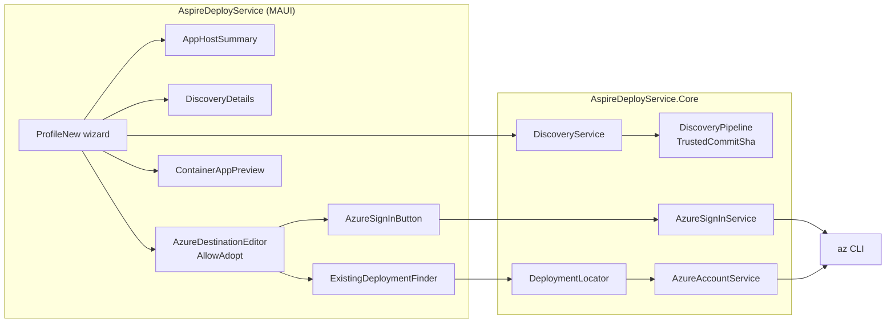
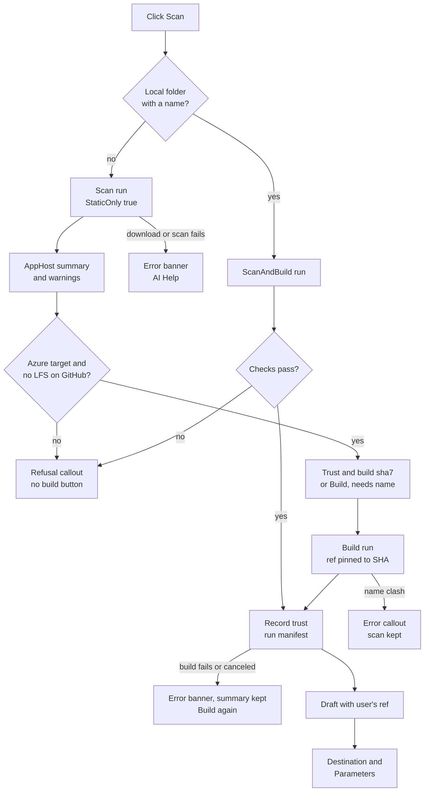
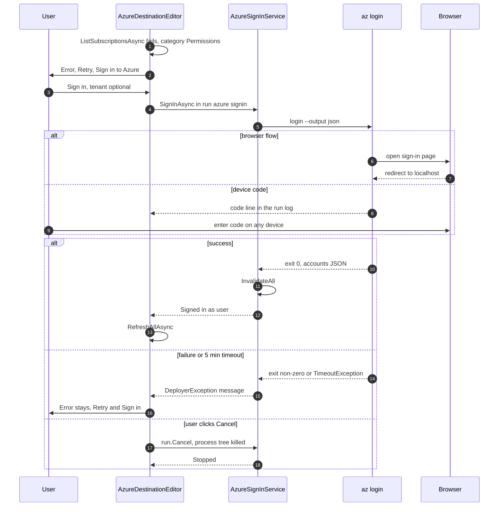
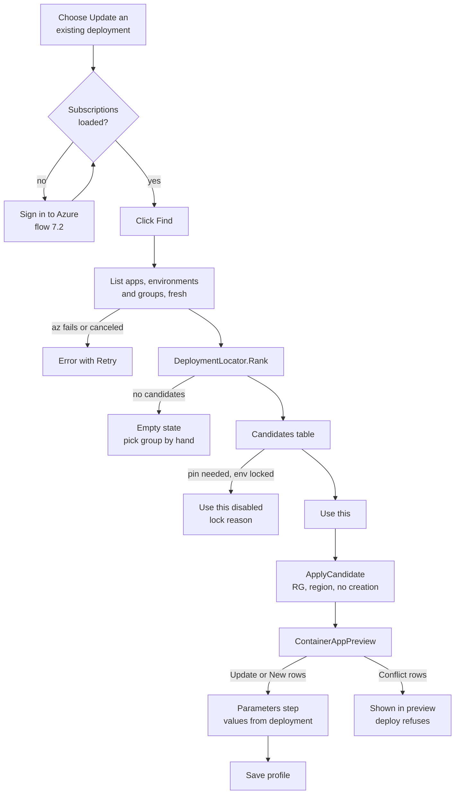
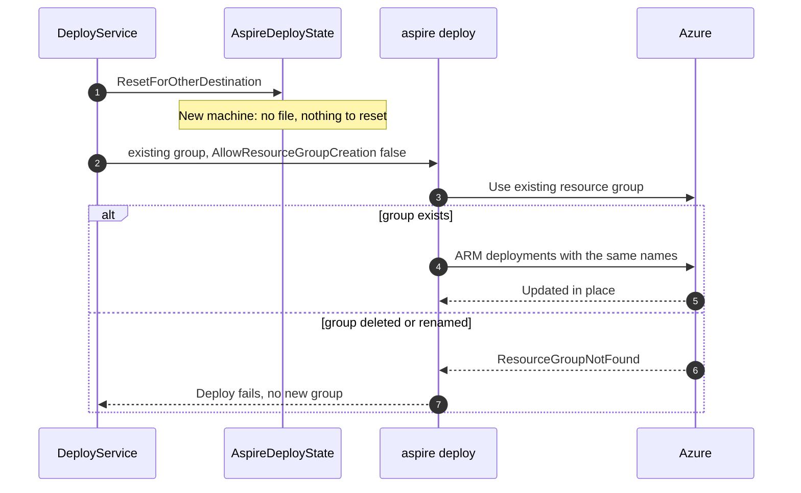

# AspireDeployService: Profile Wizard Scan and Adopt Plan

> **Estimate:** 11 to 13 working days (12 PRs, including the T0 spike).
> **Owner inputs needed before T0:** an Azure subscription with one existing `aspire deploy` deployment of an `aspire-starter` AppHost (any resource group), and permission to deploy into that resource group again (§11 T0).

> **Reference code:** `<bdw>` means a sibling checkout of the BlazorDataDeploymentWebsite repository at `../BlazorDataDeploymentWebsite/BlazorDataDeploymentWebsite/`, relative to this repository's root, as in [Azure-Resource-Pickers-Plan.md](Azure-Resource-Pickers-Plan.md). Links into `<bdw>` work only when that checkout exists. Code is **copied** from it (§4.1, D16); this repository never references `<bdw>` at build time.

All paths are relative to the repository root unless they start with `<bdw>/`. Line numbers are as of commit `c7eca29` (this repository) and the current `<bdw>` checkout.

---

## 1. Summary

| # | Feature | In one line |
|---|---|---|
| F1 | Scan first, then build | The **Discover** tab and page are removed. The New profile wizard always starts with a **static scan** (no build, no trust prompt) and shows an **AppHost summary**. A local folder with a profile name goes on to the build in the same run. A GitHub source stops after the scan, with a **Trust and build** button that names the commit. The build is pinned to that exact commit (D3). |
| F1b | AppHost details | What only the Discover page showed (Parameters table, Resources table, Copy JSON) moves into a collapsible **AppHost details** panel in the wizard (D4). |
| F2 | Sign in to Azure | A **Sign in to Azure** button runs `az login` (browser, with a device-code fallback and an optional tenant). It appears wherever the subscription list fails because you are not signed in: the wizard and the profile edit page (D6). |
| F2b | Update an existing deployment | The Destination card gets a segment, **New deployment / Update an existing deployment**. The second choice searches the chosen subscription for container apps named like the AppHost's compute resources, shows the matching resource groups as candidates, and **Use this** fills subscription, resource group, region and `AllowResourceGroupCreation = false`. Aspire's own naming then updates those resources in place (D8). |
| F2c | Values from the existing deployment | In update mode, generated secret parameters (for example a database password) are shown on the Parameters step with a warning, so the original value can be entered instead of Aspire generating a new one (D11). |

**Motivating example.** A developer deployed `<owner>/<repo>` last month with `aspire deploy` from another machine into `<rg>`. On a new machine they open **Profiles → New profile**, enter `<owner>/<repo>`, click **Scan**, check the AppHost summary, type a profile name, click **Trust and build**, choose **Update an existing deployment**, click **Sign in to Azure**, then **Find**. The wizard lists `<rg>` with "3 of 3 apps found". **Use this** fills the destination, the container apps preview shows every app as **Updates existing**, and the first deploy updates `<rg>` instead of creating `rg-<profile>`.

## 2. Goals and Non-goals

**Goals**
- The app never builds or runs GitHub code before the user has seen a static summary of that exact commit and agreed to it (F1).
- Everything the Discover page showed is still available, in the wizard (F1b).
- A user who is not signed in to `az` can sign in from the app, without a terminal (F2).
- A user can point a new profile at an existing deployment of the same AppHost, and the first deploy updates it in place (F2b).
- All new logic lives in `AspireDeployService.Core` and has unit tests. Razor stays thin.
- Profiles saved before this plan load and deploy unchanged. No settings schema change.

**Non-goals (v1)**
- A separate inspection page. A scan is a wizard step; it needs no profile name (D5), but its result is shown only in the wizard.
- Searching more than one subscription at a time (D9).
- Adopting a deployment made by `azd up` without an AppHost change. The wizard detects it and warns that the AppHost needs `WithAzdResourceNaming()` (D10); it does not change the AppHost.
- Recovering parameter values from Azure or from another machine's `~/.aspire/deployments` file (D11).
- An "Update an existing deployment" option on the profile edit page. The edit page has no discovery result, so it has no compute resource names to search for. It gets only the sign-in button (Q1).
- Storing Azure tokens or passwords in the app. `az` keeps its own token cache; the app never reads it.

## 3. Decisions

Decisions D1, D2, D6 and D8 were made with the repository owner for this plan: one plan; scan first, then build; launch `az login`; auto-search and keep Aspire's defaults.

| # | Decision | Rejected alternative | Why |
|---|---|---|---|
| D1 | **One plan for both features.** | One plan per feature. | Owner's choice. Both change the stages, run key and records of `ProfileNew.razor` ([ProfileNew.razor:10](../AspireDeployService/Components/Pages/ProfileNew.razor#L10), [:168](../AspireDeployService/Components/Pages/ProfileNew.razor#L168)); two plans would conflict on the same lines. |
| D2 | **Scan first, then build.** Every wizard run starts with `StaticOnly: true`. A profile can only be saved after the build, because the Parameters step needs the manifest. | (a) A "Static scan only" checkbox, like the Discover page ([Discover.razor:21-24](../AspireDeployService/Components/Pages/Discover.razor#L21)). (b) Saving a profile from a static scan. | Owner's choice. With (a), untrusted code is scanned safely only when the user remembers to turn the mode on. (b) would save a profile with no parameters, and the deploy would fail later on "These parameters have no value" ([DeployService.cs:132-139](../AspireDeployService.Core/Services/DeployService.cs#L132)). A static scan never reaches the trust check ([DiscoveryPipeline.cs:68-69](../AspireDeployService.Core/Services/DiscoveryPipeline.cs#L68)), so it is safe for any source. |
| D3 | **The build is pinned to the scanned commit.** For GitHub, the build run uses the scanned spec with `Ref = <scanned SHA>`, and passes `TrustedCommitSha = <scanned SHA>`. When the pipeline resolves that SHA (it always will for a pinned ref), it records trust and skips the modal. The draft keeps the user's own ref (for example `main`), so later deploys follow the branch as today. | (a) Re-resolve the branch and show the modal when it moved. (b) `AssumeTrusted: true`. | (a) would build a commit whose summary the user never saw: the build re-resolves the ref ([GitHubSource.cs:38-41](../AspireDeployService.Core/Sources/GitHubSource.cs#L38)) and downloads into the same `adhoc-…/src`, whose work key ignores the ref ([WorkKeys.cs:27-29](../AspireDeployService.Core/Infrastructure/WorkKeys.cs#L27)). The commits API accepts a SHA as the ref ([GitHubSource.cs:84](../AspireDeployService.Core/Sources/GitHubSource.cs#L84)), and the downloaded source is reused when its SHA marker matches ([GitHubSource.cs:45-49](../AspireDeployService.Core/Sources/GitHubSource.cs#L45)). (b) records no trust and checks nothing; `TrustedCommitSha` still compares SHAs, so if GitHub ever answered with another commit the modal would appear. |
| D4 | **The Discover page's report becomes two shared components**: `AppHostSummary` (path, kind, Aspire SDK, `global.json` SDK, source with SHA, declared targets) and `DiscoveryDetails` (Parameters and Resources tables, Copy JSON), moved from [Discover.razor:45-159](../AspireDeployService/Components/Pages/Discover.razor#L45). The summary shows after the scan. The details panel is collapsed by default and shows after the build. | Drop the tables. | They are the only place a user sees which parameters are secret or generated and which resources need a container runtime. Moving the markup keeps it exact. |
| D5 | **The profile name is needed to build, not to scan.** **Scan** needs only a source. For a local folder with a valid name, the scan and the build run in **one** run (so navigating away mid-scan cannot drop the build). Without a name, a local folder stops after the scan with a **Build** button, like GitHub. | Keep today's rule ([ProfileNew.razor:52](../AspireDeployService/Components/Pages/ProfileNew.razor#L52)). | Inspecting a repository should not need a decision about a profile name. The build needs the name for the overwrite check and the draft ([ProfileNew.razor:219](../AspireDeployService/Components/Pages/ProfileNew.razor#L219), [ProfileService.cs:151](../AspireDeployService.Core/Services/ProfileService.cs#L151)). |
| D6 | **Sign in launches `az login`.** A new `IAzureSignInService.SignInAsync(tenantId, useDeviceCode)` runs `az login [--tenant <tenant>] [--use-device-code] --output json` through `AzCli`, with a 5-minute timeout, in its own run with a visible log and a **Cancel** button. After it succeeds, every cached Azure list is dropped and the subscriptions reload. | Keep the "Run: az login" text with a copy button ([PrerequisiteChecker.cs:43-48](../AspireDeployService.Core/Prerequisites/PrerequisiteChecker.cs#L43)). | Owner's choice. `az login` opens the system browser itself and writes its own token cache; the app passes no secret and reads none. Device code is the fallback for machines where no browser opens; its code line reaches the run log through `ProcessRunner`'s redacted output. Whether a hidden process (`CreateNoWindow` at [ProcessRunner.cs:93](../AspireDeployService.Core/Processes/ProcessRunner.cs#L93), stdin closed at [:123](../AspireDeployService.Core/Processes/ProcessRunner.cs#L123)) can open the browser and finish without a subscription prompt is **(assumed; T0 proves it)**. R1 has the fallback. |
| D7 | **The wizard's build run no longer lists subscriptions.** Today it calls `ListSubscriptionsAsync` inside the discovery run ([ProfileNew.razor:228](../AspireDeployService/Components/Pages/ProfileNew.razor#L228)), so a signed-out user gets no form at all. `AzureDestinationEditor` already loads subscriptions and picks the default ([AzureDestinationEditor.razor:318-341](../AspireDeployService/Components/Shared/AzureDestinationEditor.razor#L318)), and shows the error with **Retry** ([:35-37](../AspireDeployService/Components/Shared/AzureDestinationEditor.razor#L35)). The sign-in button goes there. | Keep the call and add a sign-in step before Discover. | Discovery does not need Azure. Removing the call lets a signed-out user scan, build and fill parameters, and sign in only when they reach Destination. `WizardData.Subscriptions` is only used to preset the default subscription ([ProfileNew.razor:245-246](../AspireDeployService/Components/Pages/ProfileNew.razor#L245)), which the editor already does when `PickDefaultSubscription="true"` ([ProfileNew.razor:81](../AspireDeployService/Components/Pages/ProfileNew.razor#L81)). **Behaviour change:** today's preset takes the default subscription even when it is disabled, while the editor only takes a usable one ([AzureDestinationEditor.razor:326](../AspireDeployService/Components/Shared/AzureDestinationEditor.razor#L326)). A disabled default now leaves the field empty, which is better. |
| D8 | **Locate by app names, reuse by resource group.** `DeploymentLocator` lists every container app in the subscription. It keeps those whose name is the lowercased name of one of the AppHost's compute resources (the naming T0 confirmed, [ContainerAppPlanner.cs:33-34](../AspireDeployService.Core/Deploy/ContainerAppPlanner.cs#L33)), and groups them by resource group and environment. **Use this** sets subscription, tenant, resource group, region and `AllowResourceGroupCreation = false`, and leaves every resource section on **Let Aspire create**, except in the D10 cases. | (a) Always set the environment and registry to **Use existing** (overlay). (b) Manual resource group pick only. | Owner's choice. Aspire names the environment, registry, workspace and identities from the AppHost resource names plus `uniqueString(resourceGroup().id)`. So the same AppHost deployed into the same resource group gets the same names, and ARM updates them in place ([aspire.dev: Deployment state caching](https://aspire.dev/deployment/deployment-state-caching/); the naming is in the `AzureContainerAppsTests` snapshots of [microsoft/aspire](https://github.com/microsoft/aspire)). That a deploy with **no** local state file updates in place is **(assumed; T0 proves it)**. (a) needs the overlay and is refused for AppHosts that lock those sections ([AppHostOverlay.cs:93-98](../AspireDeployService.Core/Deploy/AppHostOverlay.cs#L93)), so it is used only where Aspire's defaults cannot work (D10). |
| D9 | **One subscription per search**: the one chosen in the editor. | Search every subscription. | One `az containerapp list` call per subscription takes seconds, and most users keep their apps in one subscription. Switching subscription and clicking **Find** again is one click. |
| D10 | **Each candidate gets an origin, a naming check, and a fix when the check fails.** Origin comes from **resource group** tags only: `azd-env-name` means **azd**, `aspire` = `true` means **aspire deploy** **(assumed tag; T0 records it)**, and anything else is **unknown**. Origin is shown for information; it never decides what **Use this** does. Naming check: the candidate's environment name starts with an AppHost environment resource name with its non-alphanumeric characters removed (for example `env` → `env<13 chars>`). When the check fails, or the group has apps in more than one environment, **Use this** also sets the environment section to **Use existing** with the candidate's environment. That is the same as picking it by hand ([Azure-Resource-Pickers-Plan.md](Azure-Resource-Pickers-Plan.md) D1). If the AppHost locks its environment (`EnvironmentLocked`, [DiscoveryRecords.cs:33](../AspireDeployService.Core/Discovery/DiscoveryRecords.cs#L33)), **Use this** is disabled for that candidate with the lock reason. Only an azd candidate that **fails** the naming check also shows "Add `.WithAzdResourceNaming()` to `AddAzureContainerAppEnvironment` in the AppHost." | (a) Warn only and keep **Let Aspire create**. (b) Detect azd by container app tags (`azd-service-name`). (c) Warn for every azd candidate. | With **Let Aspire create**, a second, Aspire-named environment in the same group would make every existing app a "cannot move to another environment" conflict ([ContainerAppPlanner.cs:50-54](../AspireDeployService.Core/Deploy/ContainerAppPlanner.cs#L50)), so the deploy would be refused, not silently duplicated. The preview also cannot pick an environment when the group has several ([AzureResourceProvisioner.cs:279-282](../AspireDeployService.Core/Azure/AzureResourceProvisioner.cs#L279)). Pinning the environment makes the candidate the user picked the one that is used. (b) fails on real azd deployments of Aspire 13 AppHosts: `<bdw>`'s fixture of a real `azd up` notes that "Aspire sets no azd-service-name tag" ([`<bdw>` InstallationDiscoveryTests.cs:86-88](../../BlazorDataDeploymentWebsite/BlazorDataDeploymentWebsite/BlazorDataDeploymentWebsite.Tests/Deployments/InstallationDiscoveryTests.cs#L86)), while azd's generated `main.bicep` does tag the resource group with `azd-env-name` ([`<bdw>` AzdResourceGroupScopeTests.cs:23-31](../../BlazorDataDeploymentWebsite/BlazorDataDeploymentWebsite/BlazorDataDeploymentWebsite.Tests/Worker/AzdResourceGroupScopeTests.cs#L23)). (c) is wrong for the same fixture: its registry is `envacr<token>` ([:89](../../BlazorDataDeploymentWebsite/BlazorDataDeploymentWebsite/BlazorDataDeploymentWebsite.Tests/Deployments/InstallationDiscoveryTests.cs#L89)), an Aspire-style name, so an azd deployment can pass the naming check and needs no AppHost change. |
| D11 | **Generated secret parameters are offered in update mode.** Parameters with `Generated && Secret` move from the "Not asked" line ([ProfileNew.razor:123-129](../AspireDeployService/Components/Pages/ProfileNew.razor#L123)) into a **Values from the existing deployment** list. Each is optional and carries the warning "Leave empty and Aspire generates a new value, which can break a database that already uses the old one." | (a) Ignore them. (b) Read them from Azure. | A new machine has no deploy-state file, so Aspire generates new values (the state file keeps parameter values, [aspire.dev: Deployment state caching](https://aspire.dev/deployment/deployment-state-caching/)). The app cannot read the original values from Azure. An empty field keeps today's behaviour: an absent key is fine for a parameter that is not `NeedsValue` ([DiscoveryRecords.cs:50](../AspireDeployService.Core/Discovery/DiscoveryRecords.cs#L50)). |
| D12 | **`/discover` is removed, not redirected.** The route falls to the existing NotFound page. The query prefill on `profiles/new` ([ProfileNew.razor:163-166](../AspireDeployService/Components/Pages/ProfileNew.razor#L163)) stays. | A redirect page. | This is a desktop app with no bookmarks, and only [Home.razor:41](../AspireDeployService/Components/Pages/Home.razor#L41) and [NavMenu.razor:16](../AspireDeployService/Components/Layout/NavMenu.razor#L16) link there. The prefill costs nothing and keeps links like "New profile from this source" possible. |
| D13 | **No new profile field for "adopted".** An adopted profile is an ordinary profile whose resource group already exists, with `AllowResourceGroupCreation = false`, and in the D10 cases an existing environment. | A `Destination.Adopted` flag. | Nothing in deploy would read it. `AllowResourceGroupCreation = false` already makes a mistyped or deleted group fail instead of creating a new deployment ([DeployEnvironment.cs:71](../AspireDeployService.Core/Deploy/DeployEnvironment.cs#L71)). The deploy confirmation already lists each app as "(update)" or "(new)" ([ContainerAppPlanner.cs:66-72](../AspireDeployService.Core/Deploy/ContainerAppPlanner.cs#L66)). |
| D14 | **The update/new segment lives inside `AzureDestinationEditor`**, behind a new `AllowAdopt` parameter (wizard only). | Keep the mode in the page. | Applying a candidate and switching back must reset the editor's private group state (`_newGroup`, recomputed only in `LoadForSubscriptionAsync` [AzureDestinationEditor.razor:381](../AspireDeployService/Components/Shared/AzureDestinationEditor.razor#L381), which returns early when nothing changed [:360-361](../AspireDeployService/Components/Shared/AzureDestinationEditor.razor#L360)). The page cannot reach that state. |
| D15 | **The sign-in button shows only for sign-in failures.** `AzureAccountService.ListSubscriptionsAsync` throws its two sign-in errors ("not signed in", "sees no subscriptions", [AzureAccountService.cs:79-86](../AspireDeployService.Core/Azure/AzureAccountService.cs#L79), [:317-318](../AspireDeployService.Core/Azure/AzureAccountService.cs#L317)) with `ErrorCategory.Permissions`. So does every other list call whose error `AzCli.Classify` marks `NotSignedIn` ([AzCli.cs:69-70](../AspireDeployService.Core/Azure/AzCli.cs#L69); `Require` at [AzureAccountService.cs:313-323](../AspireDeployService.Core/Azure/AzureAccountService.cs#L313) today throws those without a category). That covers an expired token or an MFA prompt (`AADSTS50076`, `AADSTS50020`, `AADSTS65001`) that appears only when regions or groups load. The editor keeps the category with the message and shows the button only for it. | Show it for every subscription error. | "az is not installed" ([AzCli.cs:38-41](../AspireDeployService.Core/Azure/AzCli.cs#L38)) cannot be fixed by signing in. `<bdw>` treats the same AADSTS family as "sign in again" rather than a hard error ([`<bdw>` AzureTokenProvider.cs:70-74](../../BlazorDataDeploymentWebsite/BlazorDataDeploymentWebsite/BlazorDataDeploymentWebsite.Web/Services/Azure/AzureTokenProvider.cs#L70)). `DeployerException` is sealed and already carries a `Category` ([Outcomes.cs:37-42](../AspireDeployService.Core/Outcomes/Outcomes.cs#L37)), so no new exception type is needed. |
| D16 | **Copy `<bdw>`'s installation-discovery grouping, not its query.** `DeploymentLocator.Rank` is adapted from `GroupCandidates` ([`<bdw>` InstallationDiscoveryService.cs:113-148](../../BlazorDataDeploymentWebsite/BlazorDataDeploymentWebsite/BlazorDataDeploymentWebsite.Web/Services/Deployments/InstallationDiscoveryService.cs#L113)): rows grouped by environment ID, a per-candidate `Warnings` list, and candidates without the key apps dropped. The ID helpers `NameFromId` and `ResourceGroupFromId` ([:298-305](../../BlazorDataDeploymentWebsite/BlazorDataDeploymentWebsite/BlazorDataDeploymentWebsite.Web/Services/Deployments/InstallationDiscoveryService.cs#L298)) are copied verbatim. The tests copy the shape of `InstallationDiscoveryTests` ([`<bdw>` InstallationDiscoveryTests.cs:14-37, 84-108, 128-144](../../BlazorDataDeploymentWebsite/BlazorDataDeploymentWebsite/BlazorDataDeploymentWebsite.Tests/Deployments/InstallationDiscoveryTests.cs#L14)), including an unrelated app in another environment that must be ignored. | Port its Resource Graph query (`AppsQuery`, [:67-76](../../BlazorDataDeploymentWebsite/BlazorDataDeploymentWebsite/BlazorDataDeploymentWebsite.Web/Services/Deployments/InstallationDiscoveryService.cs#L67)) and its ARM reads. | `<bdw>` reads Azure through the ARM SDK and Resource Graph with an Entra token; this app reads only through `az` ([Azure-Resource-Pickers-Plan.md](Azure-Resource-Pickers-Plan.md) D8), and `az graph query` needs an extension. The grouping is pure code and fits `az containerapp list` rows. `<bdw>` groups by role (`webapp`, `scheduler`, `agent`) and image; here the key is the AppHost's compute names and the group is (resource group, environment). |

## 4. Current State

| Area | Where | Today |
|---|---|---|
| Discover page | [Discover.razor](../AspireDeployService/Components/Pages/Discover.razor) | Route `/discover`. Source picker, "Static scan only (runs nothing)" switch ([:21-24](../AspireDeployService/Components/Pages/Discover.razor#L21)), AppHost card ([:45-72](../AspireDeployService/Components/Pages/Discover.razor#L45)), warnings with AI Help ([:74-81](../AspireDeployService/Components/Pages/Discover.razor#L74)), Parameters and Resources tables ([:83-145](../AspireDeployService/Components/Pages/Discover.razor#L83)), Copy JSON and "Create profile from this" ([:147-159](../AspireDeployService/Components/Pages/Discover.razor#L147), [:201-214](../AspireDeployService/Components/Pages/Discover.razor#L201)). Runs under keys `discover:<kind>:<location>` ([:188](../AspireDeployService/Components/Pages/Discover.razor#L188)). |
| Links to it | [NavMenu.razor:16](../AspireDeployService/Components/Layout/NavMenu.razor#L16), [Home.razor:21-42](../AspireDeployService/Components/Pages/Home.razor#L21) | A nav tab with a live dot for `discover:` runs. Home's "four steps" has step 2 "Discover an AppHost", with a pill from `Runs.Latest("discover:")` ([:36](../AspireDeployService/Components/Pages/Home.razor#L36)). |
| Wizard | [ProfileNew.razor](../AspireDeployService/Components/Pages/ProfileNew.razor) | One run under key `profile:new` ([:217](../AspireDeployService/Components/Pages/ProfileNew.razor#L217)), which does in order: overwrite check, full discovery with `StaticOnly: false` ([:221](../AspireDeployService/Components/Pages/ProfileNew.razor#L221)), Azure target check, LFS check, `ListSubscriptionsAsync` ([:228](../AspireDeployService/Components/Pages/ProfileNew.razor#L228)), draft. Stage is 1, 2 or 4 ([:10](../AspireDeployService/Components/Pages/ProfileNew.razor#L10)); the stepper logic is `StepClass` ([:186](../AspireDeployService/Components/Pages/ProfileNew.razor#L186)). `WizardInput` is the run tag ([:207](../AspireDeployService/Components/Pages/ProfileNew.razor#L207)) and `Attach` restores the inputs from it ([:200-205](../AspireDeployService/Components/Pages/ProfileNew.razor#L200)). |
| Discovery service | [DiscoveryService.cs:12](../AspireDeployService.Core/Services/DiscoveryService.cs#L12), [:34-37](../AspireDeployService.Core/Services/DiscoveryService.cs#L34) | `DiscoverRequest(Source, ProfileName, StaticOnly, AssumeTrusted = false)`. `StaticOnly` stops after the scan. It calls the pipeline with `assumeTrusted` and `ct` as the last two parameters. |
| Pipeline and trust | [DiscoveryPipeline.cs:45-93](../AspireDeployService.Core/Services/DiscoveryPipeline.cs#L45) | Materialize, clean leftovers, scan, then return if static ([:68-69](../AspireDeployService.Core/Services/DiscoveryPipeline.cs#L68)). For GitHub, ask "Run code from GitHub?" unless trusted ([:71-80](../AspireDeployService.Core/Services/DiscoveryPipeline.cs#L71)). Then ensure the CLI and run the manifest. [DeployService.cs:129-130](../AspireDeployService.Core/Services/DeployService.cs#L129) also calls `RunAsync` positionally. |
| Trust store | [TrustStore.cs](../AspireDeployService.Core/Infrastructure/TrustStore.cs) | `<WorkRoot>/trust.jsonl`, per repository and SHA. Local folders are always trusted ([:5-8](../AspireDeployService.Core/Infrastructure/TrustStore.cs#L5)). |
| GitHub source | [GitHubSource.cs:32-80](../AspireDeployService.Core/Sources/GitHubSource.cs#L32) | Resolves the ref through `/commits/<ref>` ([:82-94](../AspireDeployService.Core/Sources/GitHubSource.cs#L82)). Reuses `<WorkKey>/src` when its SHA marker matches ([:45-49](../AspireDeployService.Core/Sources/GitHubSource.cs#L45)). |
| Source records | [SourceRecords.cs:10](../AspireDeployService.Core/Sources/SourceRecords.cs#L10), [:19](../AspireDeployService.Core/Sources/SourceRecords.cs#L19) | `SourceSpec(Kind, Location, Ref, AppHostPath)`; the SHA is on `SourceIdentity.CommitSha`, which is `DiscoveryResult.Source`. |
| Work keys | [WorkKeys.cs:16-35](../AspireDeployService.Core/Infrastructure/WorkKeys.cs#L16) | A source without a profile uses `adhoc-<hash of repo or folder>`. The ref is not part of the key. |
| Run coordinator | [RunCoordinator.cs:38-94](../AspireDeployService/Services/RunCoordinator.cs#L38) | `TryGet(key)`, `Latest(prefix)`. `Start` returns the running run for the same key and ignores the new tag; a new run replaces a finished one under the same key. `Value` is set only when the run finishes ([:181-186](../AspireDeployService/Services/RunCoordinator.cs#L181)). |
| Dialogs | [DialogService.cs:26-35](../AspireDeployService/Services/DialogService.cs#L26) | Confirm only; the trust modal uses it. |
| Destination editor | [AzureDestinationEditor.razor](../AspireDeployService/Components/Shared/AzureDestinationEditor.razor) | Loads subscriptions ([:318-341](../AspireDeployService/Components/Shared/AzureDestinationEditor.razor#L318)), keeping only the message on failure, then regions and groups. A failed list shows the message and **Retry** ([:35-37](../AspireDeployService/Components/Shared/AzureDestinationEditor.razor#L35)). The "create the group again" switch shows only for an existing group ([:197-206](../AspireDeployService/Components/Shared/AzureDestinationEditor.razor#L197)). `PickGroup` copies the group's region only when the region is empty ([:409-415](../AspireDeployService/Components/Shared/AzureDestinationEditor.razor#L409)). |
| Azure reads | [AzureAccountService.cs](../AspireDeployService.Core/Azure/AzureAccountService.cs) | `AzureResourceGroup(Name, Location)` ([:24](../AspireDeployService.Core/Azure/AzureAccountService.cs#L24)) and `AzureContainerApp(Name, ResourceGroup, EnvironmentId)` ([:29](../AspireDeployService.Core/Azure/AzureAccountService.cs#L29)) hold no tags and no app region. `ListContainerAppsAsync(sub, null)` lists the whole subscription ([:119-134](../AspireDeployService.Core/Azure/AzureAccountService.cs#L119)). `Invalidate(sub)` drops one subscription's keys, not the `subscriptions` key ([:147-154](../AspireDeployService.Core/Azure/AzureAccountService.cs#L147)). The cache lasts 10 minutes ([:72](../AspireDeployService.Core/Azure/AzureAccountService.cs#L72)). |
| az helper | [AzCli.cs:25-48](../AspireDeployService.Core/Azure/AzCli.cs#L25) | `RunAsync(args, run, timeout, ct)`. Stdout is captured but not logged. It takes no environment overrides, catches only `Win32Exception`, and does not catch `ProcessRunner`'s `TimeoutException` ([ProcessRunner.cs:178](../AspireDeployService.Core/Processes/ProcessRunner.cs#L178)). |
| Sign-in check | [PrerequisiteChecker.cs:43-61](../AspireDeployService.Core/Prerequisites/PrerequisiteChecker.cs#L43) | `az account show`; the fix is the text "az login [--tenant X]". There is no launcher anywhere. |
| Preview | [AzureResourceProvisioner.cs:254-300](../AspireDeployService.Core/Azure/AzureResourceProvisioner.cs#L254), [ContainerAppPlanner.cs](../AspireDeployService.Core/Deploy/ContainerAppPlanner.cs), [ContainerAppPreview.razor](../AspireDeployService/Components/Shared/ContainerAppPreview.razor) | For a given resource group, marks each compute resource **New**, **Update** or **Conflict** by name. It never searches for a group. |
| Draft | [ProfileService.cs:149-182](../AspireDeployService.Core/Services/ProfileService.cs#L149) | Resource group `rg-<name>` ([:161](../AspireDeployService.Core/Services/ProfileService.cs#L161)). `ToAsk` = `NeedsValue`; `Optional` = the rest ([:178-181](../AspireDeployService.Core/Services/ProfileService.cs#L178)). |
| Deploy environment | [DeployEnvironment.cs:61-97](../AspireDeployService.Core/Deploy/DeployEnvironment.cs#L61) | Sets `Azure__SubscriptionId`, `Azure__Location`, `Azure__ResourceGroup`, `Azure__AllowResourceGroupCreation` (default `true`, [:71](../AspireDeployService.Core/Deploy/DeployEnvironment.cs#L71)) and `DOTNET_ENVIRONMENT`. |
| Deploy-state file | [AspireDeployState.cs:25](../AspireDeployService.Core/Deploy/AspireDeployState.cs#L25), [:37](../AspireDeployService.Core/Deploy/AspireDeployState.cs#L37) | One folder per AppHost path. `ResetForOtherDestination` clears the cached `Azure` section when the subscription, group or region changed. |
| Tests | [SourceAndToolTests.cs:178-243](../AspireDeployService.Tests/SourceAndToolTests.cs#L178), [Fakes.cs:11-29](../AspireDeployService.Tests/Support/Fakes.cs#L11), [AzureResourceProvisionerTests.cs:496](../AspireDeployService.Tests/Azure/AzureResourceProvisionerTests.cs#L496) | Trust and static-only service tests. `FakeProcessRunner` with `Ok`/`Fail`. `SpyAccount` implements `IAzureAccountService`. There are no Razor tests. |
| Docs | [README.md:170-196](../README.md#L170), [User-Guide.md:50](User-Guide.md#L50), [Guide.razor:50-59](../AspireDeployService/Components/Pages/Guide.razor#L50) | Checklist rows 2, 4, 17, 20 and 21 use the Discover page. The guide's "1. Create a profile" describes the wizard's Discover button. |

### 4.1 Reference code in `<bdw>`

`<bdw>`'s **Import installation** page finds an existing deployment by its container apps and turns it into wizard choices. That is the same problem as F2b. Its sign-in, by contrast, is an Entra and MSAL flow that this app replaces with `az login`.

**Copy or adapt**

| `<bdw>` file | What | Where it goes | Change when copying |
|---|---|---|---|
| [InstallationDiscoveryService.cs:113-148](../../BlazorDataDeploymentWebsite/BlazorDataDeploymentWebsite/BlazorDataDeploymentWebsite.Web/Services/Deployments/InstallationDiscoveryService.cs#L113) `GroupCandidates` | Groups app rows by environment ID, keeps groups with the key app, and collects a `Warnings` list | `DeploymentLocator.Rank` (§6.5, D16) | Group by (resource group, environment ID). "Key app" becomes "at least one compute name found". Add `Found`/`Missing`, origin and `PinEnvironment`. |
| [InstallationDiscoveryService.cs:298-305](../../BlazorDataDeploymentWebsite/BlazorDataDeploymentWebsite/BlazorDataDeploymentWebsite.Web/Services/Deployments/InstallationDiscoveryService.cs#L298) `NameFromId`, `ResourceGroupFromId` | Parse an ARM resource ID | `DeploymentLocator` (internal), for `EnvironmentName` and `EnvironmentResourceGroup` | Verbatim. |
| [InstallationDiscoveryTests.cs:14-37](../../BlazorDataDeploymentWebsite/BlazorDataDeploymentWebsite/BlazorDataDeploymentWebsite.Tests/Deployments/InstallationDiscoveryTests.cs#L14), [:84-108](../../BlazorDataDeploymentWebsite/BlazorDataDeploymentWebsite/BlazorDataDeploymentWebsite.Tests/Deployments/InstallationDiscoveryTests.cs#L84), [:128-144](../../BlazorDataDeploymentWebsite/BlazorDataDeploymentWebsite/BlazorDataDeploymentWebsite.Tests/Deployments/InstallationDiscoveryTests.cs#L128) | Rows built from anonymous objects, a real `azd up` shape with an unrelated app in another environment, and grouping and warning asserts | `DeploymentLocatorTests` (§10) | Build `AzureContainerApp` records instead of `JsonElement` rows. Keep the unrelated-app case. |
| [ImportInstallation.razor:40-131](../../BlazorDataDeploymentWebsite/BlazorDataDeploymentWebsite/BlazorDataDeploymentWebsite.Web/Components/Pages/Installations/ImportInstallation.razor#L40), [:165-210](../../BlazorDataDeploymentWebsite/BlazorDataDeploymentWebsite/BlazorDataDeploymentWebsite.Web/Components/Pages/Installations/ImportInstallation.razor#L165) | Find button with busy state, an empty state that names what was searched for, one row per candidate with warnings, a "pick by hand" fallback, and a read-error message | `ExistingDeploymentFinder` (§6.5) | Behaviour and wording only, rebuilt with `ads-*` markup (no Radzen, [AI-Help-Plan.md](AI-Help-Plan.md) D1), under a `RunCoordinator` run with Cancel and a log instead of a page-local `_searching` flag. |
| [WizardStepper.razor:60-64](../../BlazorDataDeploymentWebsite/BlazorDataDeploymentWebsite/BlazorDataDeploymentWebsite.Web/Components/Ui/WizardStepper.razor#L60) `StateOf` | Step state from `Current` and `MaxReached` (current, done, open, locked) and `aria-current` | `ProfileNew.razor` `StepClass` rewrite (§6.2) | The 5-line rule and `aria-current="step"` only; keep the existing `ads-stepper` markup. |
| [NewInstallation.razor.cs:183-197](../../BlazorDataDeploymentWebsite/BlazorDataDeploymentWebsite/BlazorDataDeploymentWebsite.Web/Components/Pages/Installations/NewInstallation.razor.cs#L183), [:353-379](../../BlazorDataDeploymentWebsite/BlazorDataDeploymentWebsite/BlazorDataDeploymentWebsite.Web/Components/Pages/Installations/NewInstallation.razor.cs#L353) | Changing the subscription clears every dependent choice; only the latest run publishes, together with the key it checked | §6.2 "any edit to the source clears the scan", §6.5 "candidates from another subscription are never shown" | Pattern only. `RunCoordinator` keys (`azure:locate:<sub>`) replace the run counter. |
| [AzureConnectPage.razor:113](../../BlazorDataDeploymentWebsite/BlazorDataDeploymentWebsite/BlazorDataDeploymentWebsite.Web/Components/Pages/Azure/AzureConnectPage.razor#L113), [:248](../../BlazorDataDeploymentWebsite/BlazorDataDeploymentWebsite/BlazorDataDeploymentWebsite.Web/Components/Pages/Azure/AzureConnectPage.razor#L248) | Tenant hint ("Microsoft Entra ID → Overview → Tenant ID") and a canceled sign-in message | `AzureSignInButton` tenant hint and canceled text (§6.3) | Text only. |
| [ArmErrors.cs:41-58](../../BlazorDataDeploymentWebsite/BlazorDataDeploymentWebsite/BlazorDataDeploymentWebsite.Web/Services/Azure/ArmErrors.cs#L41) `Describe` | Short user messages per failure (access denied, throttled, timed out, unreachable) that never include payloads | Finder error line (§6.5) | Keyed on `AzErrorKind` instead of SDK exception types. |

**Already copied earlier, not again:** `ErrorClassifier` with the AADSTS Permissions regex ([ErrorClassifier.cs:53](../AspireDeployService.Core/Errors/ErrorClassifier.cs#L53)), `ProcessRunner`, and `AzureSubscription.IsUsable` ([AzureAccountService.cs:13-18](../AspireDeployService.Core/Azure/AzureAccountService.cs#L13)).

**Not copied**

| `<bdw>` code | Why not |
|---|---|
| `AppsQuery`, `LookupResourcesAsync`, Resource Graph paging ([InstallationDiscoveryService.cs:67-76](../../BlazorDataDeploymentWebsite/BlazorDataDeploymentWebsite/BlazorDataDeploymentWebsite.Web/Services/Deployments/InstallationDiscoveryService.cs#L67)) | ARM SDK and Resource Graph; this app reads through `az` (D16). |
| `DiscoverAsync`'s per-candidate container app read and connection-string hints ([:78-110](../../BlazorDataDeploymentWebsite/BlazorDataDeploymentWebsite/BlazorDataDeploymentWebsite.Web/Services/Deployments/InstallationDiscoveryService.cs#L78)) | It finds a fixed app's SQL, storage and registry; Aspire names those itself here (D8). |
| Role and image matching (`azd-service-name`, `bdo-*` images) | Specific to `<bdw>`'s own AppHost; Aspire 13 sets no `azd-service-name` tag (D10). |
| `AzureTokenProvider`, `AzureConnectionService`, `TenantAccess`, `ArmClientFactory` | Entra OIDC and MSAL with stored connections; `az login` replaces all of it (D6). |
| `ToDraft` (every resource as **Use existing**) | D8 keeps **Let Aspire create** except in the D10 cases. |
| Release approval and the archive SHA-256 | Not commit pinning; D3 has no `<bdw>` equivalent. |

## 5. Design

### 5.1 Structure



### 5.2 New and changed components

| Component | Project | Responsibility |
|---|---|---|
| `Services/DiscoveryService` (`DiscoverRequest.TrustedCommitSha`) | Core | Passes the SHA to the pipeline (§6.1). |
| `Services/DiscoveryPipeline` | Core | Records trust without the modal when the resolved SHA equals `TrustedCommitSha` (D3). |
| `Azure/AzureSignInService` | Core | `az login` with tenant and device-code options; maps timeout; drops caches on success (§6.3). |
| `Azure/AzCli` | Core | `RunAsync` gains an optional environment dictionary. |
| `Azure/AzureAccountService` | Core | Parses resource group `tags` and container app `location`; adds `InvalidateAll()`; tags its sign-in errors `Permissions` (D15, §6.4). |
| `Azure/DeploymentLocator` | Core | Pure grouping and ranking of candidates, plus `FindAsync`, which reads the lists (§6.5). |
| `Components/Pages/ProfileNew.razor` | MAUI | New stages: Source → Scan result → Build → Destination and Parameters (§6.2). |
| `Components/Shared/AppHostSummary.razor` | MAUI | The AppHost card, moved from Discover (D4). |
| `Components/Shared/DiscoveryDetails.razor` | MAUI | Parameters and Resources tables and Copy JSON, moved from Discover (D4). |
| `Components/Shared/AzureSignInButton.razor` | MAUI | Button, optional tenant box, device-code checkbox, Cancel, and its own run and log (§6.3). |
| `Components/Shared/ExistingDeploymentFinder.razor` | MAUI | **Find** button, candidates table, **Use this**, and its own run and log (§6.5). |
| `Components/Shared/AzureDestinationEditor.razor` | MAUI | Sign-in button under a sign-in error; `AllowAdopt` segment; finder; `ApplyCandidate` (D14). |
| `Components/Pages/Discover.razor` | MAUI | Deleted. |
| `Components/Layout/NavMenu.razor`, `Components/Pages/Home.razor` | MAUI | Discover tab removed; Home has three steps. |

## 6. Contracts

### 6.1 Discovery request

```csharp
namespace AspireDeployService.Core.Services;

/// <param name="TrustedCommitSha">The commit the user agreed to on the scan result (D3). When the resolved SHA equals it,
/// trust is recorded without asking; otherwise the usual prompt names the resolved SHA. Ignored for local folders.</param>
public sealed record DiscoverRequest(SourceSpec Source, string? ProfileName, bool StaticOnly, bool AssumeTrusted = false,
    string? TrustedCommitSha = null);
```

`DiscoveryPipeline.RunAsync` gains `string? trustedCommitSha = null` as its **last** parameter, after `ct`, so the positional calls in [DiscoveryService.cs:34-37](../AspireDeployService.Core/Services/DiscoveryService.cs#L34) and [DeployService.cs:129-130](../AspireDeployService.Core/Services/DeployService.cs#L129) keep compiling. The trust block ([DiscoveryPipeline.cs:71-80](../AspireDeployService.Core/Services/DiscoveryPipeline.cs#L71)) becomes:

| Case | Behaviour |
|---|---|
| Local folder, or `assumeTrusted`, or the commit is already in `trust.jsonl` | As today: no prompt. |
| `trustedCommitSha` equals `identity.CommitSha` (ordinal, ignore case) | `trust.AddAsync(...)`; log "Trusted commit <sha7> from the scan result."; no prompt. |
| `trustedCommitSha` set but different (only if GitHub answers a pinned SHA with another commit) | Log "GitHub returned <new7> instead of the scanned <old7>."; then today's prompt. |
| Not set | Today's prompt. |

### 6.2 Wizard (ProfileNew.razor, private)

```csharp
private enum WizardStage { Scan, ScanAndBuild, Build }

// The run tag. Scan is set on Build runs so a new page instance can show the summary while the build runs or after it failed.
private sealed record WizardInput(string? Name, SourceKind Kind, string? Location, string? Ref, string? AppHost, bool Overwrite,
    WizardStage Stage, ScanData? Scan);

/// <param name="Spec">The spec as the user typed it (the branch, not the SHA); the draft and the build use it.</param>
private sealed record ScanData(SourceSpec Spec, DiscoveryResult Scan)
{
    public string? CommitSha => Scan.Source.CommitSha;   // SourceIdentity.CommitSha (SourceRecords.cs:19)
}

// Value of ScanAndBuild and Build runs. Subscriptions removed (D7); Scan kept for the summary.
private sealed record WizardData(string Name, ScanData Scan, DiscoveryResult Discovery, ProfileDraft Draft);
```

There is one run key, `profile:new`, for all three run kinds, so today's "a running wizard run wins over the query" rule ([ProfileNew.razor:192-196](../AspireDeployService/Components/Pages/ProfileNew.razor#L192)) still holds.

**Runs**

| Run (`Stage`) | Started by | Work, in order | Value |
|---|---|---|---|
| `Scan` | **Scan**, when the source is GitHub, or a local folder without a valid name | `DiscoverAsync(new(spec, null, StaticOnly: true))`. It never throws for "no Azure target" or LFS; those are shown from the value. | `ScanData` |
| `ScanAndBuild` | **Scan**, for a local folder with a valid name (D5) | The scan as above. If the Azure target and LFS checks pass, the build steps below run in the same run. Otherwise it returns the `ScanData` and the page shows the refusal. | `WizardData` or `ScanData` |
| `Build` | **Trust and build `<sha7>`** (GitHub) or **Build** (local, after a name is typed) | Overwrite check ([ProfileNew.razor:219-220](../AspireDeployService/Components/Pages/ProfileNew.razor#L219)). Then `DiscoverAsync(new(buildSpec, null, StaticOnly: false, TrustedCommitSha: scan.CommitSha))`, where `buildSpec = scan.Spec with { Ref = scan.CommitSha }` for GitHub and `scan.Spec` for a local folder (D3). Then the Azure target and LFS refusals as today ([:222-227](../AspireDeployService/Components/Pages/ProfileNew.razor#L222)), and `DraftFromDiscoveryAsync(name, scan.Spec, discovery, ct)`. No `ListSubscriptionsAsync` (D7). | `WizardData` |

**Page rules**
- The build always uses `ScanData.Spec`, never the current form fields.
- Any edit to the source (kind, location, ref, AppHost path) after a scan clears the page's scan result and hides **Build** / **Trust and build** until **Scan** is clicked again.
- Before starting a `Build` run the page calls `Profiles.GetAsync(name)`; on a clash without Overwrite it shows the error callout and keeps the scan result (the run's own check stays, for races).
- **Build** / **Trust and build** is disabled until the name is valid, with the hint "Enter a profile name to build."

**What a page instance shows, from the attached run** (`Attach` restores the inputs, and the `ScanData` from the tag or the value)

| Attached run | Shown | Buttons |
|---|---|---|
| none | Source card | **Scan** (needs a source only) |
| `Scan` or `ScanAndBuild` running | Source card, spinner | Cancel (OutcomeBanner) |
| `Scan` finished, value `ScanData` | `AppHostSummary`, warnings, refusal callouts | **Trust and build `<sha7>`** (GitHub) or **Build** (local); none if refused |
| `Scan` / `ScanAndBuild` failed | Error banner with AI Help | **Scan** |
| `Build` running | `AppHostSummary` from the tag's `ScanData`, spinner | Cancel |
| `Build` failed or declined | `AppHostSummary` from the tag, error banner | **Trust and build** / **Build** again |
| `Build` or `ScanAndBuild` finished, value `WizardData` | Summary, `DiscoveryDetails` (collapsed), Destination, Parameters | **Save profile** |
| Saved | As today | |

The stepper becomes **Source / Scan / Destination / Parameters**. `StepClass` ([ProfileNew.razor:186](../AspireDeployService/Components/Pages/ProfileNew.razor#L186)) is rewritten over a `stage` computed from the table above (1 = no result, 2 = `ScanData` only, 3 = `WizardData`, 4 = saved), using `<bdw>`'s `StateOf` rule (§4.1): a step before the current stage is done, the current one gets `is-active` and `aria-current="step"`, and later ones are plain.

### 6.3 Sign in (`IAzureSignInService`)

```csharp
namespace AspireDeployService.Core.Azure;

/// <param name="Account">The signed-in user or service name from az's output, for "Signed in as …"; null when unreadable.</param>
public sealed record AzureSignInResult(string? Account, int SubscriptionCount);

public interface IAzureSignInService
{
    /// Runs az login in its own RunContext (work key "<WorkRoot>/setup", like the list calls), so the caller's observer
    /// receives the log, including the device-code line. Throws DeployerException (MissingPrerequisite) when az is missing,
    /// login fails or times out. Cancellation kills the process tree (ProcessRunner) and surfaces as OperationCanceledException.
    Task<AzureSignInResult> SignInAsync(string? tenantId, bool useDeviceCode, IRunObserver observer, CancellationToken ct);
}
```

| Item | Value |
|---|---|
| Arguments | `login`, then `--tenant <tenantId>` when set (a GUID, or a domain matching `^[A-Za-z0-9.-]{1,253}$`, else `InvalidInput` and no process), `--use-device-code` when asked, `--output json`. |
| Environment | `AZURE_CORE_LOGIN_EXPERIENCE_V2=off`, so az does not wait for a subscription choice on a closed stdin **(assumed; T0)**. `ProcessRunner` does not strip it ([ProcessRunner.cs:70-82](../AspireDeployService.Core/Processes/ProcessRunner.cs#L70)). |
| Timeout | 5 minutes (`AzureSignInService.Timeout`), longer than `AzCli.DefaultTimeout`. `SignInAsync` catches `TimeoutException` from the runner ([ProcessRunner.cs:178](../AspireDeployService.Core/Processes/ProcessRunner.cs#L178)) and throws `DeployerException(MissingPrerequisite, "Sign-in timed out after 5 minutes. Try again, or tick Use a device code.", ErrorCategory.Timeout)`. |
| On success | Parse the JSON array for the first `user.name` and the count. Call `IAzureAccountService.InvalidateAll()`. |
| On failure | `DeployerException(MissingPrerequisite, "Sign-in did not finish: <az error line>", ErrorCategory.Permissions)`. |

`AzCli.RunAsync` gains `IReadOnlyDictionary<string, string?>? environment = null` as its last parameter, copied into `ProcessSpec.Environment` ([ProcessRunner.cs:14](../AspireDeployService.Core/Processes/ProcessRunner.cs#L14)).

**UI (`AzureSignInButton`)**
- Parameters: `IdPrefix`, `TenantHint` (prefills the tenant box with the profile's tenant), and `SignedIn` (an EventCallback; the editor responds with `RefreshAllAsync`).
- It starts `Runs.Start("azure:signin", "Azure sign-in", …)`. On creation it re-attaches with `Runs.TryGet("azure:signin")` ([RunCoordinator.cs:38](../AspireDeployService/Services/RunCoordinator.cs#L38)), so a second click or a revisit shows the same run.
- While running: a **Cancel** button bound to `run.Cancel()`, and a compact `LogViewer` bound to that run.
- When done: "Signed in as <account>", or the error.
- Controls: a "Tenant (optional)" input with the hint "For a guest directory or another organization. In the Azure portal: Microsoft Entra ID → Overview → Tenant ID." (wording from `<bdw>`, §4.1), and a "Use a device code" checkbox.
- Canceled: "Sign-in was canceled." (not an error callout).
- Shown in `AzureDestinationEditor` under the subscription field, next to **Retry**, only when the subscription error's category is `Permissions` (D15).

### 6.4 Azure reads (changes to `AzureAccountService`)

```csharp
// Optional last parameters keep every existing constructor call compiling.
public sealed record AzureResourceGroup(string Name, string Location, IReadOnlyDictionary<string, string>? Tags = null);
public sealed record AzureContainerApp(string Name, string ResourceGroup, string? EnvironmentId, string? Location = null);

// IAzureAccountService gains:
/// Drops every cached list, including subscriptions; called after a sign-in.
void InvalidateAll();
```

| Change | Detail **(field names assumed; T0 captures fixtures)** |
|---|---|
| `ParseResourceGroups` ([:237](../AspireDeployService.Core/Azure/AzureAccountService.cs#L237)) | Reads the `tags` object, string values only; null when absent or `null`. |
| `ParseContainerApps` ([:172](../AspireDeployService.Core/Azure/AzureAccountService.cs#L172)) | Reads `location`. |
| `ListSubscriptionsAsync` errors ([:84-85](../AspireDeployService.Core/Azure/AzureAccountService.cs#L84), [:317-318](../AspireDeployService.Core/Azure/AzureAccountService.cs#L317)) | The same messages, now with `ErrorCategory.Permissions` (D15). |
| `Require` ([:313-323](../AspireDeployService.Core/Azure/AzureAccountService.cs#L313)) | When `result.Kind == AzErrorKind.NotSignedIn`, throw with `ErrorCategory.Permissions` and append "Sign in to Azure again." (D15). Other kinds are unchanged. |
| `AzureDestinationEditor.LoadSubscriptionsAsync` ([:332-335](../AspireDeployService/Components/Shared/AzureDestinationEditor.razor#L332)) | Keeps `ex.Category` next to `_subsError`. |

Test doubles that implement `IAzureAccountService` gain `InvalidateAll()`: `SpyAccount` ([AzureResourceProvisionerTests.cs:496](../AspireDeployService.Tests/Azure/AzureResourceProvisionerTests.cs#L496)).

### 6.5 Locating a deployment (`DeploymentLocator`)

```csharp
namespace AspireDeployService.Core.Azure;

public enum DeploymentOrigin { AspireDeploy, Azd, Unknown }

/// <param name="EnvironmentId">null when the matched apps report no environment.</param>
/// <param name="EnvironmentResourceGroup">The environment's own group (it may differ from ResourceGroup).</param>
/// <param name="Location">The environment's region, else the first matched app's region, else the group's.</param>
/// <param name="Found">Lowercased compute names found in this group and environment.</param>
/// <param name="Missing">Compute names not found there (they will be created).</param>
/// <param name="PinEnvironment">D10: Use this also sets the environment to Use existing.</param>
/// <param name="Warnings">D10 warnings, ready for the UI.</param>
public sealed record DeploymentCandidate(
    string SubscriptionId, string ResourceGroup, string Location,
    string? EnvironmentId, string? EnvironmentName, string? EnvironmentResourceGroup,
    IReadOnlyList<string> Found, IReadOnlyList<string> Missing,
    DeploymentOrigin Origin, bool PinEnvironment, IReadOnlyList<string> Warnings);

public static class DeploymentLocator
{
    /// Pure. Groups apps by (ResourceGroup, EnvironmentId) and keeps groups with at least one found name,
    /// ordered by Found.Count descending, then resource group name. Returns at most 20 candidates.
    public static IReadOnlyList<DeploymentCandidate> Rank(
        string subscriptionId,
        IReadOnlyList<string> computeNames,                 // ContainerAppPlanner.IsCompute resources, lowercased
        IReadOnlyList<string> appHostEnvironmentNames,      // AppHostInfo.ContainerAppEnvironmentNames
        IReadOnlyList<AzureContainerApp> apps,
        IReadOnlyList<AzureContainerAppEnvironment> environments,
        IReadOnlyList<AzureResourceGroup> groups);

    /// Reads apps (subscription-wide), environments and groups with refresh: true, then calls Rank.
    public static Task<IReadOnlyList<DeploymentCandidate>> FindAsync(
        IAzureAccountService azure, string subscriptionId, DiscoveryResult discovery, IRunObserver observer, CancellationToken ct);
}
```

**Rules**

| Rule | Result |
|---|---|
| No compute resources in the discovery | `FindAsync` throws `InvalidInput`: "This AppHost has no compute resources to look for." |
| Group tag `azd-env-name` present | Origin `Azd`. Only when the naming check below also fails: warning "Created by azd with its own names. Add `.WithAzdResourceNaming()` to `AddAzureContainerAppEnvironment` in the AppHost, or the deploy will likely be refused." |
| Group tag `aspire` = `true` | Origin `AspireDeploy`. |
| `appHostEnvironmentNames` not empty and `EnvironmentName` does not start with any of them (non-alphanumerics removed, ignore case) | `PinEnvironment = true`; warning "This environment was not named by Aspire for this AppHost, so the profile will use it as an existing environment." |
| Apps of one group in more than one environment | One candidate per environment, each `PinEnvironment = true`, with the warning "This group has apps in several environments." |
| `EnvironmentId` null | `PinEnvironment = false`; warning "Could not read the apps' environment." |

**Sample** (an AppHost with `apiservice`, `webfrontend` and `worker`, and environment resource `env`):

```text
DeploymentCandidate(SubscriptionId: "<sub>", ResourceGroup: "<rg>", Location: "eastus2",
    EnvironmentId: "/subscriptions/<sub>/resourceGroups/<rg>/providers/Microsoft.App/managedEnvironments/env<token>",
    EnvironmentName: "env<token>", EnvironmentResourceGroup: "<rg>",
    Found: ["apiservice", "webfrontend", "worker"], Missing: [], Origin: AspireDeploy, PinEnvironment: false, Warnings: [])
DeploymentCandidate(SubscriptionId: "<sub>", ResourceGroup: "<other-rg>", Location: "westeurope",
    EnvironmentId: "/subscriptions/<sub>/resourceGroups/<other-rg>/providers/Microsoft.App/managedEnvironments/cae-<token>",
    EnvironmentName: "cae-<token>", EnvironmentResourceGroup: "<other-rg>",
    Found: ["apiservice"], Missing: ["webfrontend", "worker"], Origin: Azd, PinEnvironment: true,
    Warnings: ["Created by azd. …", "This environment was not named by Aspire …"])
```

**Editor changes (D14)**
- New parameters: `AllowAdopt` (bool, default false; the wizard passes true) and `AdoptModeChanged` (EventCallback<bool>, which the page uses for §6.6).
- `AllowAdopt` shows a segment at the top of the card: **New deployment** (default) | **Update an existing deployment**. The mode lives in the editor, not in the profile (D13).
- Switching to update shows `ExistingDeploymentFinder` above the subscription field.
- Switching back to new sets `ResourceGroup = rg-<ProfileName>`, `AllowResourceGroupCreation = null`, clears the three resource sections, and sets `_newGroup = true`.

**`ApplyCandidate(DeploymentCandidate c)`, in the editor**
1. Set `SubscriptionId`, then `TenantId` from the subscription list.
2. Set `ResourceGroup = c.ResourceGroup` and `Location = c.Location` (always, unlike `PickGroup`).
3. Set `AllowResourceGroupCreation = false`.
4. Clear `ContainerRegistry` and `AcrPullIdentity`.
5. Set `ContainerAppEnvironment`: null (Let Aspire create) when `!c.PinEnvironment`, otherwise `{ Mode = Existing, Name = c.EnvironmentName, ResourceGroup = c.EnvironmentResourceGroup }`.
6. Set `_newGroup = false` and `_loadedFor = null`, then `await LoadForSubscriptionAsync(refresh: true)`.
7. Raise `ResourcesChanged`, so `ContainerAppPreview` refreshes.

**Use this** is disabled with the lock reason when `c.PinEnvironment && Discovery.AppHost.EnvironmentLocked`.

**UI (`ExistingDeploymentFinder`)**
- Parameters: `Profile`, `Discovery`, `IdPrefix`, `Applied` (EventCallback<DeploymentCandidate>).
- A **Find** button, disabled without a valid subscription. It runs under key `azure:locate:<sub>` with its **own** compact `LogViewer` and a **Cancel** button.
- On creation and on each subscription change it re-attaches with `Runs.TryGet("azure:locate:<sub>")`. Candidates from another subscription are never shown.
- A table with the columns: Resource group | Region | Environment | Apps found (`Found.Count` of total, missing names in a tooltip) | Origin | Warnings | **Use this**.
- Empty state, which names what was searched for (as `<bdw>`'s import page does, [ImportInstallation.razor:64-68](../../BlazorDataDeploymentWebsite/BlazorDataDeploymentWebsite/BlazorDataDeploymentWebsite.Web/Components/Pages/Installations/ImportInstallation.razor#L64)): "No container apps named <names> were found in this subscription. Choose another subscription, or pick the resource group by hand below."
- az failure: one short line by `AzErrorKind` (after `<bdw>`'s `ArmErrors.Describe`, §4.1), with **Retry**. `Unauthorized`: "Your Azure account cannot read this subscription. You need at least Reader access." `NotSignedIn`: the sign-in button (D15). Anything else: the az error line.
- When a scan or build changes the discovery's compute names, the table is cleared.

### 6.6 Parameters in update mode (D11)

| Parameter set | New deployment | Update an existing deployment |
|---|---|---|
| `Draft.ToAsk` | As today. | As today. |
| `Draft.Optional` where `Generated && Secret` | Listed on the "Not asked" line. | Moved into **Values from the existing deployment**: one `SecretInput` each, optional, with the D11 warning. A typed value is saved to `profile.Parameters[name]`; an empty one saves nothing. |
| Other `Draft.Optional` | Listed. | Listed. |

There is no change to `ProfileDraft` ([ProfileService.cs:50-51](../AspireDeployService.Core/Services/ProfileService.cs#L50)). The page does the split from `DiscoveredParameter.Generated` and `.Secret`, driven by `AdoptModeChanged`.

### 6.7 Settings

There are no new keys. An adopted profile differs from today's profiles only in its values:

```json
{
  "AspireDeploy": {
    "Profiles": {
      "<profile>": {
        "Source": { "Kind": "GitHub", "Location": "<owner>/<repo>", "Ref": "main", "AppHostPath": "src/AppHost/AppHost.csproj" },
        "Destination": {
          "SubscriptionId": "<subscription-guid>",
          "TenantId": "<tenant-guid>",
          "Location": "eastus2",
          "ResourceGroup": "<rg>",
          "AllowResourceGroupCreation": false
        },
        "Environment": "Production"
      }
    }
  }
}
```

The saved `Ref` is the user's branch, never the pinned SHA (D3).

## 7. Flows

### 7.1 Scan, trust and build (F1)



### 7.2 Sign in (F2)



### 7.3 Find and use an existing deployment (F2b)



### 7.4 First deploy of an adopted profile



## 8. File-by-file Changes

| File | New/Modified | Change |
|---|---|---|
| `AspireDeployService.Core/Services/DiscoveryService.cs` | Modified | `DiscoverRequest.TrustedCommitSha`; pass it to the pipeline as the last argument. |
| `AspireDeployService.Core/Services/DiscoveryPipeline.cs` | Modified | Optional `trustedCommitSha` parameter after `ct`; the §6.1 table. |
| `AspireDeployService.Core/Azure/AzCli.cs` | Modified | Optional `environment` parameter on `RunAsync`. |
| `AspireDeployService.Core/Azure/AzureSignInService.cs` | New | `IAzureSignInService`, `AzureSignInResult`, `AzureSignInService` (§6.3). |
| `AspireDeployService.Core/Azure/AzureAccountService.cs` | Modified | `Tags` and `Location` fields and parsing; `InvalidateAll()`; `Permissions` category on sign-in errors. |
| `AspireDeployService.Core/Azure/DeploymentLocator.cs` | New | §6.5. `Rank` adapted from `<bdw>` `GroupCandidates`; `NameFromId` and `ResourceGroupFromId` copied (D16). The file header names the source, as the other copied files do ([ProcessRunner.cs:6-7](../AspireDeployService.Core/Processes/ProcessRunner.cs#L6)). |
| `AspireDeployService.Core/ServiceCollectionExtensions.cs` | Modified | Register `IAzureSignInService` next to the account service. |
| `AspireDeployService.Core/Deploy/SiblingOverlay.cs` | Modified | Doc comment: "each Discover" → "each scan" ([SiblingOverlay.cs:47-48](../AspireDeployService.Core/Deploy/SiblingOverlay.cs#L47)). |
| `AspireDeployService/Components/Pages/Discover.razor` | Deleted | D12. |
| `AspireDeployService/Components/Pages/ProfileNew.razor` | Modified | §6.2 runs, tag, stages and stepper; `AllowAdopt="true"` on the editor; §6.6 parameters; `AppHostSummary` and `DiscoveryDetails`. |
| `AspireDeployService/Components/Shared/AppHostSummary.razor` | New | Moved from Discover.razor:45-72, with `KindText` and `TargetText`. |
| `AspireDeployService/Components/Shared/DiscoveryDetails.razor` | New | Moved from Discover.razor:83-157, with `YesNo`, `ResourceIcon` and Copy JSON. |
| `AspireDeployService/Components/Shared/AzureSignInButton.razor` | New | §6.3 UI. |
| `AspireDeployService/Components/Shared/ExistingDeploymentFinder.razor` | New | §6.5 UI. |
| `AspireDeployService/Components/Shared/AzureDestinationEditor.razor` | Modified | Error category; sign-in button; `AllowAdopt`, `AdoptModeChanged`, segment, finder, `ApplyCandidate` (D14, D15). |
| `AspireDeployService/Components/Shared/SourcePicker.razor` | Modified | Comment "shared by Discover and New profile" → "used by New profile" ([SourcePicker.razor:1](../AspireDeployService/Components/Shared/SourcePicker.razor#L1)). |
| `AspireDeployService/Components/Shared/OutcomeBanner.razor` | Modified | Doc comment page list without "Discover" ([OutcomeBanner.razor:50](../AspireDeployService/Components/Shared/OutcomeBanner.razor#L50)). |
| `AspireDeployService/Components/Layout/NavMenu.razor` | Modified | Remove the Discover tab ([:16](../AspireDeployService/Components/Layout/NavMenu.razor#L16)). |
| `AspireDeployService/Components/Pages/Home.razor` | Modified | Three steps. Step 2 "Create a profile" uses `Runs.Latest("profile:new")`. Drop the `discover:` pill and link ([:21-42](../AspireDeployService/Components/Pages/Home.razor#L21)). |
| `AspireDeployService/Components/Pages/Guide.razor` | Modified | "1. Create a profile" covers Scan, Trust and build, Update an existing deployment and Sign in. "the next Discover" → "the next scan" ([:123](../AspireDeployService/Components/Pages/Guide.razor#L123)). |
| `docs/User-Guide.md` | Modified | Same content as the Guide page, plus Troubleshooting rows for a sign-in timeout and the azd warning. |
| `README.md` | Modified | Quick start wording; checklist rows 2, 4, 17, 20 and 21 rewritten; new rows from §10. |
| `AspireDeployService.Tests/SourceAndToolTests.cs` | Modified | Trusted-SHA tests (§10). |
| `AspireDeployService.Tests/Azure/AzureSignInServiceTests.cs` | New | §10. |
| `AspireDeployService.Tests/Azure/DeploymentLocatorTests.cs` | New | §10; test shapes adapted from `<bdw>` `InstallationDiscoveryTests` (D16). |
| `AspireDeployService.Tests/Azure/AzureAccountListTests.cs` | Modified | Tags, location and error-category tests. |
| `AspireDeployService.Tests/Azure/AzureResourceProvisionerTests.cs` | Modified | `SpyAccount.InvalidateAll()` ([:496](../AspireDeployService.Tests/Azure/AzureResourceProvisionerTests.cs#L496)). |
| `AspireDeployService.Tests/Fixtures/az/group-list-tags.json`, `containerapp-list-located.json`, `login.json` | New | Captured in T0, with values replaced by placeholders. |

## 9. Security and Privacy

| Concern | Handling |
|---|---|
| Running untrusted code | Every wizard run starts static. The only path to a GitHub build is a click that names a SHA, and the build is pinned to that SHA (D3). Local folders keep today's rule (always trusted). |
| Trust race | A moved branch cannot change what is built: the ref is the SHA. Later deploys follow the branch and ask for trust again for a new commit, as today ([DeployService.cs:129-130](../AspireDeployService.Core/Services/DeployService.cs#L129)). |
| Credentials | `az login` keeps its own token cache. The app passes no password or token and reads no token. It logs `az login` stdout only as the parsed account name and count (`LogStdOut = false`, [AzCli.cs:30-35](../AspireDeployService.Core/Azure/AzCli.cs#L30)). The device-code line is in the run log; it is single-use and short-lived **(assumed, standard device-code flow)**. |
| Tenant argument | Validated (§6.3) and passed as one argument, never through a shell. |
| Logged account name | "Signed in as <account>" is shown in the UI and the run log. The log already holds the account from `az account show` today ([PrerequisiteChecker.cs:50-52](../AspireDeployService.Core/Prerequisites/PrerequisiteChecker.cs#L50)). AI Help scrubbing is unchanged. |
| Secret parameter values | Values typed in **Values from the existing deployment** are stored like any other secret parameter (`SecretParameters`, [ProfileService.cs:163](../AspireDeployService.Core/Services/ProfileService.cs#L163)) and redacted from logs as today. |
| Accidental new deployment | `AllowResourceGroupCreation = false` on adopted profiles (D13); a pinned environment where Aspire's names would not match (D10). |
| Docs | The plan, guide and fixtures use placeholders (`<sub>`, `<rg>`, `<owner>/<repo>`). |

## 10. Test Plan

**Unit tests (Core, xUnit, `FakeProcessRunner`)**

| Test | Checks |
|---|---|
| `Static_scan_never_prompts_for_trust_on_github` | `StaticOnly: true` on a GitHub source: no `ConfirmAsync` call, no `trust.jsonl` write. |
| `Trusted_sha_from_scan_records_trust_without_prompt` | `TrustedCommitSha` equals the resolved SHA: no prompt, `trust.jsonl` has the entry, and the manifest runs. |
| `Different_sha_still_prompts` | The harness answers the pinned ref with another SHA: the prompt is asked and names it; declining gives code 7 and no manifest process. |
| `SignIn_builds_arguments` | Tenant and device code give `login --tenant <t> --use-device-code --output json`, and the environment has `AZURE_CORE_LOGIN_EXPERIENCE_V2=off`. |
| `SignIn_rejects_bad_tenant` | A tenant with a space or `;` gives `InvalidInput` and runs no process. |
| `SignIn_success_invalidates_all_lists` | After success, the next `ListSubscriptionsAsync` runs `az account list` again. |
| `SignIn_failure_message` | A non-zero exit gives the §6.3 message with `Permissions`. |
| `SignIn_timeout_message` | A fake runner that throws `TimeoutException` gives the §6.3 timeout message with `Timeout`. |
| `ListSubscriptions_sign_in_errors_are_permissions` | Both sign-in messages carry `ErrorCategory.Permissions`; "az is not installed" does not. |
| `ParseResourceGroups_reads_tags` / `ParseContainerApps_reads_location` | Fixture values are read; absent fields are null. |
| `Rank_groups_by_group_and_environment` | Three apps in two groups give two candidates, ordered by found count. |
| `Rank_marks_azd_and_aspire_origins` | Origin comes from resource group tags. An azd candidate whose environment passes the naming check has no `WithAzdResourceNaming` warning; one that fails it has the warning. |
| `Rank_ignores_an_unrelated_app_in_another_environment` | After `<bdw>`'s real `azd up` case ([InstallationDiscoveryTests.cs:84-108](../../BlazorDataDeploymentWebsite/BlazorDataDeploymentWebsite/BlazorDataDeploymentWebsite.Tests/Deployments/InstallationDiscoveryTests.cs#L84)): apps with no `azd-service-name` tag are still found by name, and an app in another group and environment with a non-matching name gives no candidate. |
| `NameFromId_and_ResourceGroupFromId` | Copied helpers: trailing slash, mixed-case `resourceGroups`, and a malformed ID gives null. |
| `NotSignedIn_list_errors_are_permissions` | A `group list` failing with an `AADSTS50076` line carries `ErrorCategory.Permissions` (D15). |
| `Rank_pins_environment_when_name_does_not_match` | `cae-…` against AppHost environment `env` gives `PinEnvironment = true`. |
| `Rank_pins_each_environment_of_a_mixed_group` | Two environments in one group give two pinned candidates. |
| `Rank_ignores_apps_not_in_the_apphost` | The name check is exact and lowercased; unrelated apps produce no candidate. |
| `Rank_caps_at_20` | 25 matching groups give 20 candidates. |
| `FindAsync_reads_fresh_lists` | Every list call passes `refresh: true`. |
| `FindAsync_without_compute_is_invalid_input` | Gives the message from §6.5. |

**Manual checks (README checklist; these replace rows 2, 4, 17, 20 and 21)**

| Check | Expected |
|---|---|
| New profile, this repository's folder, no name, **Scan** | The AppHost summary shows 13.6.3, a refusal callout says there is no Azure compute environment, and no build starts. |
| New profile, `aspire-starter` folder, name typed, **Scan** | One run scans and builds. The details panel lists parameters and resources, and Copy JSON copies. |
| New profile, public GitHub repo, **Scan** | No dialog. The summary shows the SHA, and **Trust and build** is disabled until a name is typed. |
| Push a commit to the branch between **Scan** and **Trust and build** | The log names the scanned SHA as the one built. The saved profile's `Ref` is the branch. |
| Navigate to Settings during each run kind, then come back | The page shows the row from the §6.2 table, including the summary during and after a failed build. |
| Change the location after a scan | The summary and build button disappear. |
| Fail a build (NU1605 downgrade), then **AI Help** on the banner | As old row 17. |
| Open AI Help, then start a deploy of a GitHub profile whose branch moved | The trust dialog takes focus over the panel (old row 20, now through Deploy). |
| AI Help on a scan warning | It opens with "New profile" as the page (old row 21). |
| `az logout`, open New profile, build, reach Destination | The subscription error shows with **Retry** and **Sign in to Azure**. Sign-in opens the browser, and the subscriptions load afterwards. |
| Sign in, then **Cancel** before finishing in the browser | The run stops, and no `az` process is left. |
| Sign in with **Use a device code** | The code line appears in the log, and signing in on another device completes it. |
| Uninstall or rename `az`, open New profile | The error shows with no sign-in button. |
| **(Azure)** On a second machine (or after deleting `~/.aspire/deployments`), adopt the starter deployment and deploy | The candidate shows all apps found and origin aspire deploy. The preview shows every app as **Updates existing**. The deploy succeeds, and the `az resource list -g <rg>` count is unchanged. |
| **(Azure)** Adopt, then delete the group in the portal, then deploy | The deploy fails with resource group not found, and no group is created. |
| Visit `/discover` | The NotFound page shows. Nav has no Discover tab, and Home shows three steps. |

## 11. Implementation Tasks

Each task is one PR.

- [ ] **T0 Spike (no product code).**
  - (a) Run `az login` and `az login --use-device-code` through `AzCli` from the running app with `AZURE_CORE_LOGIN_EXPERIENCE_V2=off`. Record whether the browser opens, whether az waits on stdin, and the exact stdout.
  - (b) Deploy `aspire-starter` with this app into `<rg>`. Delete `~/.aspire/deployments/<hash>`, then deploy again with `AllowResourceGroupCreation=false`. Record `az resource list -g <rg>` before and after.
  - (c) Capture `az group list` and `az containerapp list` fixtures. Record the exact `tags` keys on the group from (b), the `location` field name, and the environment name Aspire chose. Replace IDs and names with placeholders.
  - Record results in §15.
  - **Done when** §15 has the results and the fixtures are committed under `Fixtures/az/`. If (a) fails, switch D6 to R1's fallback before T6. If (b) shows new resources, stop and revisit D8 with the owner.
- [x] **T1 Pinned, trusted SHA in the pipeline.** §6.1 and its three unit tests. **Done when** the tests pass and the existing trust tests ([SourceAndToolTests.cs:205-243](../AspireDeployService.Tests/SourceAndToolTests.cs#L205)) still pass.
- [x] **T2 Extract `AppHostSummary` and `DiscoveryDetails`.** Move the markup out of Discover.razor and make Discover.razor use the two components (no visible change yet). **Done when** the Discover page looks the same as before in light and dark themes.
- [x] **T3 Wizard runs.** §6.2 records, the three run kinds, the tag restore, the page rules, and removing `ListSubscriptionsAsync` from the run (D7). Keep the current markup, adding only the build buttons. **Done when** the first six F1 manual checks pass.
- [x] **T4 Wizard UI.** Summary, details panel, refusal callouts, and the new stepper and `StepClass`. **Done when** each §6.2 table row renders as described, in light and dark themes.
- [x] **T5 Remove the Discover page.** Delete Discover.razor. Update NavMenu, Home (three steps), and the comments in SourcePicker, OutcomeBanner and SiblingOverlay. **Done when** the `/discover` check passes and `grep -rn "discover:"` in `AspireDeployService/` finds nothing.
- [x] **T6 Sign-in service.** The `AzCli` environment parameter, `AzureSignInService`, `InvalidateAll` (and `SpyAccount`), the `Permissions` category on the subscription errors and in `Require` (D15), DI registration, and the unit tests. **Done when** the seven sign-in and category tests pass.
- [x] **T7 Sign-in button.** `AzureSignInButton` in `AzureDestinationEditor`, used by both the wizard and the edit page. **Done when** the four sign-in manual checks pass on the wizard and on the profile edit page.
- [x] **T8 Tags, region and the locator.** §6.4 parsing and `DeploymentLocator`, adapting `<bdw>`'s `GroupCandidates` and copying its ID helpers and test shapes (§4.1, D16). **Done when** all the locator and parser tests pass, and the file headers name the `<bdw>` source.
- [x] **T9 Finder and ApplyCandidate.** The editor segment, `ExistingDeploymentFinder`, and `ApplyCandidate` (D14). **Done when**, with a test subscription that has two groups holding same-name apps, **Find** lists both, **Use this** fills the fields and the preview, switching back restores `rg-<name>`, and changing the subscription clears the table.
- [x] **T10 Update-mode parameters.** §6.6 through `AdoptModeChanged`. **Done when** a starter with a generated database password shows it in update mode and not in new mode, and a typed value is saved as a secret. Then run the two **(Azure)** adopt checks.
- [x] **T11 Docs.** The Guide page, `docs/User-Guide.md`, and the README quick start and checklist (§10). **Done when** both guides describe Scan, Trust and build, Sign in and Update an existing deployment, and no doc outside `docs/*-Plan.md` and `docs/stitch-ui-prompt.md` mentions the Discover page.

## 12. Risks and Mitigations

| # | Risk | Mitigation |
|---|---|---|
| R1 | `az login` from a hidden process with closed stdin does not open the browser, or waits for a subscription choice. | T0 checks this first. Fallback 1: make device code the default (its output is plain lines), with the button text "Sign in with a code". Fallback 2: open a visible terminal with `cmd /c az login`, and poll `az account show` every 3 s for 5 minutes. |
| R2 | A deploy with no state file creates a second environment or registry in the adopted group. | T0 (b) proves it before T8. Where names do not match, D10 pins the environment. If T0 shows a second registry, pin the registry the same way (`ContainerRegistry` Existing) and record that in D10. |
| R3 | Generated secrets get new values and break a database. | D11 offers the fields with a warning. The guide explains how to copy the values from `~/.aspire/deployments/<hash>/<env>.json` on the old machine. |
| R4 | Common app names (`apiservice`, `webfrontend`) match unrelated deployments. | Candidates show found and missing names, origin and environment, and the user picks. Nothing is applied without **Use this**, and the preview shows the result before saving. |
| R5 | Scan and build share `profile:new`, so the scan could be lost. | The build tag carries `ScanData` (§6.2), plus the manual re-navigation check. |
| R6 | The environment name check is wrong for AppHost environment names with dashes or capitals. | The check removes non-alphanumerics and ignores case. A false mismatch only pins the environment the user picked, which is still correct. |
| R7 | `az containerapp list` across a large subscription is slow. | It runs in a cancellable run with its own log, one call per **Find**. |
| R8 | Users relied on Discover for AppHosts without an Azure target. | The scan still shows the summary and warnings for them; only the build is refused. |
| R9 | A pinned GitHub SHA in the build makes `DiscoveryResult.Source.Display` show the SHA instead of the branch. | The summary is rendered from `ScanData` (branch and SHA); the build's display is only in the log. |

## 13. Acceptance Criteria

1. There is no Discover tab, page or `discover:` run key, and Home shows three steps.
2. On a GitHub source, nothing is built or run until the user clicks **Trust and build** for the shown SHA, and the build uses exactly that SHA.
3. The wizard shows every field the Discover page showed: summary, warnings, parameters, resources and Copy JSON.
4. Leaving and returning to the wizard during or after any run shows the state in the §6.2 table.
5. A signed-out user can scan, build and fill parameters, sign in from the Destination step without a terminal, and see the subscriptions load. Sign-in can be canceled.
6. **Update an existing deployment** lists the resource groups that hold this AppHost's container apps, with found and missing names, origin and warnings.
7. **Use this** fills subscription, tenant, resource group and region, sets `AllowResourceGroupCreation = false`, pins the environment in the D10 cases, and the preview shows **Updates existing** for the found apps.
8. The first deploy of an adopted profile on a machine with no deploy-state file updates the existing apps and creates no new resource group, environment or registry (T0 and the **(Azure)** check).
9. Generated secret parameters can be entered in update mode and are stored as secrets.
10. All new Core code has the §10 unit tests, and the whole test project passes.

## 14. Open Questions

| # | Question | Default if nobody answers |
|---|---|---|
| Q1 | Should the profile edit page also get **Update an existing deployment**? It would need a discovery run first to know the compute names. | No (non-goal); revisit after v1. |
| Q2 | Should the wizard offer to search all subscriptions? | No (D9). |
| Q3 | Should adopting an azd deployment insert `WithAzdResourceNaming()` through the overlay instead of only warning? | No; that changes AppHost behaviour beyond the destination. |
| Q4 | Should the sign-in button also appear on the Setup page's "Azure CLI sign-in" row? | Yes, if T7 makes it trivial; otherwise a follow-up. |
| Q5 | Should a local folder with a name also stop after the scan, for symmetry with GitHub? | No; local folders are always trusted today ([TrustStore.cs:5-8](../AspireDeployService.Core/Infrastructure/TrustStore.cs#L5)). |

## 15. T0 Results (recorded during implementation)

| Check | Result |
|---|---|
| `az login` from the app (browser) | _pending_ |
| `az login --use-device-code` from the app | _pending_ |
| Redeploy into an existing group with no state file | _pending_ |
| Resource group tags written by `aspire deploy` | _pending_ |
| `location` field name in `az containerapp list` | _pending_ |
| Environment name Aspire chose for `env` | _pending_ |
| Fixtures captured | _pending_. `group-list-tags.json`, `containerapp-list-located.json` and `login.json` are hand-written with placeholders in the shapes §6.4 assumes; replace them with captured output. |
