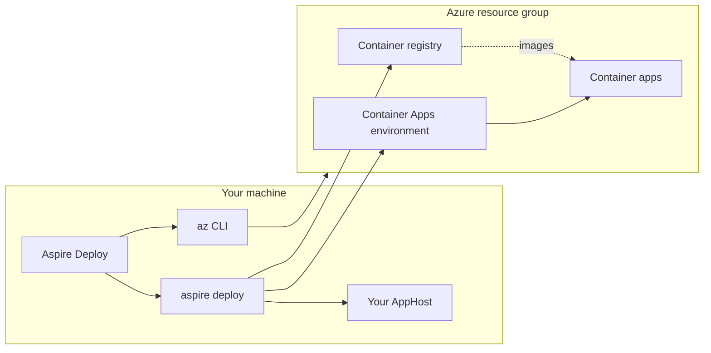
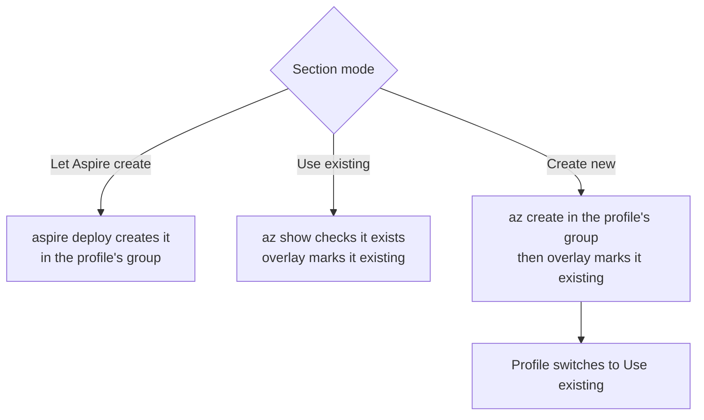
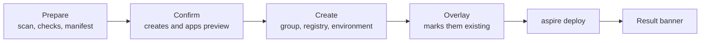

# Aspire Deploy user guide

Aspire Deploy deploys an Aspire 13.x solution to Azure Container Apps with `aspire deploy`, using your own `az login`. This guide has the same sections as the in-app **Guide** page. Names such as `<registry>`, `<environment>` and `<shared-rg>` are placeholders.

<a id="before"></a>
## Before you start

You need:

- **Azure CLI**, signed in: run `az login`. Lists of subscriptions, regions, resource groups, registries, environments, identities and workspaces are all read through it.
- **Docker Desktop or Podman**, running. Project resources are built into container images.
- **.NET 10 SDK**. It builds the AppHost you deploy. **Node.js** is needed only for TypeScript AppHosts.
- **Azure roles**:
  - Reading the lists: **Reader** on the subscription.
  - Creating a resource group, registry or environment: **Contributor** on the resource group, or on the subscription when the group is new.
  - Letting Aspire create the ACR pull identity: Aspire also creates an `AcrPull` role assignment on the registry, which needs **Owner**, **User Access Administrator** or **Role Based Access Control Administrator** on the registry's resource group. If you do not have that, use an existing pull identity (see [Choose Azure resources](#azure-resources)).
- A new registry and a Log Analytics workspace each have a monthly cost.

Open **Setup** and run the general checks first; each tool shows Pass, Warn or Fail with a fix.

<a id="how"></a>
## How it works

The app runs on your machine. It reads Azure with `az`, creates the resources you asked it to create with `az`, and then runs `aspire deploy` against your AppHost. Aspire builds the images, pushes them to the registry and creates or updates one container app per compute resource in the Container Apps environment.



<a id="profile"></a>
## 1. Create a profile

A profile says what to deploy and where. **Profiles → New profile** walks through four steps:

1. **Source**: a local folder (used in place) or a GitHub repository `<owner>/<repo>`. Click **Scan**; it needs only the source. The scan reads files only, builds and runs nothing, and shows the **AppHost summary**: path, kind, Aspire SDK, `global.json` SDK, the source with its commit, and the declared targets, plus any warnings. An AppHost without an Azure compute environment is refused here, before anything is built.
2. **Scan**: type a profile name, then click **Build** (local folder) or **Trust and build `<commit>`** (GitHub). The build runs `aspire do publish-manifest` on exactly the commit the summary shows, even if the branch moved since; the profile still follows the branch you typed. A local folder with a profile name is scanned and built in one click. **AppHost details** then lists the parameters and resources, with **Copy JSON**.
3. **Destination**: subscription, tenant, region and resource group, then the container registry, Container Apps environment and ACR pull identity (next section). The wizard shows which container apps will be **new** and which **update** an existing app. Choose **Update an existing deployment** to point the profile at a deployment that already exists (below).
4. **Parameters**: a value for each AppHost parameter that has no default. Tick **AppHost supplies it** when the AppHost's own configuration provides it.

If `az` is not signed in (or its sign-in expired), the subscription field shows the error with **Retry** and **Sign in to Azure**. That runs `az login` from the app: a browser opens, and the subscriptions load when you finish. Under **Options**, tick **Use a device code** where no browser can open (the code appears in the log), or type a tenant for a guest directory (Microsoft Entra ID → Overview → Tenant ID). **Cancel** stops the sign-in. The same button is on the profile page.

### Update an existing deployment

To take over an AppHost that was already deployed, for example with `aspire deploy` from another machine, choose **Update an existing deployment** on the Destination step, pick the subscription, and click **Find**. The app lists the resource groups that hold container apps named like the AppHost's compute resources:

| Column | Meaning |
|---|---|
| Apps found | How many of the AppHost's apps are there; hover for the missing ones, which the deploy creates. |
| Origin | From the resource group's tags: **aspire deploy**, **azd**, or **unknown**. For information only. |
| Warnings | When the environment was not named by Aspire for this AppHost, or the group has apps in several environments, the profile uses that environment as **Use existing**. An azd deployment whose names do not match also says to add `.WithAzdResourceNaming()` to `AddAzureContainerAppEnvironment` in the AppHost. |

**Use this** fills the subscription, tenant, resource group and region and turns off **Create the resource group again**, so a deleted or mistyped group fails instead of starting a new deployment. The registry and environment stay on **Let Aspire create**: Aspire names them from the AppHost and the resource group, so the first deploy updates them in place. The container apps preview then shows each found app as **Updates existing**. Switching back to **New deployment** restores `rg-<profile>`.

A new machine has none of the generated values of the old deployment (for example a database password), so Aspire would generate new ones. In update mode they are listed under **Values from the existing deployment**. Copy each one from `~/.aspire/deployments/<hash>/<environment>.json` on the machine that deployed it, or leave it empty to generate a new value.

Profiles are saved in `appsettings.Local.json` (see the README).


<a id="azure-resources"></a>
## 2. Choose Azure resources

The **Destination** card has a section for each resource. The resource group has **Use existing** and **Create new**. The registry and environment have three modes:

| Mode | In the profile | At deploy time |
|---|---|---|
| **Let Aspire create** | Nothing is stored (the default; every older profile is in this mode). | Aspire creates a registry, an environment and a Log Analytics workspace in the profile's resource group, exactly as before. |
| **Use existing** | Name and resource group of a resource picked from the list. Any resource group in the subscription. | The app checks the resource exists, then the deploy uses it as an existing resource. Nothing is created. |
| **Create new** | A name you type (a valid one is suggested). | The app creates it with `az` in the profile's resource group and region before `aspire deploy`, then deploys with it as existing. If it is already there it is used as is. |




**After a create, the profile switches to Use existing.** Right after the app creates a registry or environment (or finds a **Create new** name already there), the profile's section is saved as **Use existing** with that name and the profile's resource group. A later deploy therefore never re-creates a resource someone deleted on purpose; it stops with "not found" instead. Choose **Create new** again to create it again.

### Resource group

**Use existing** picks a group from the list. **Create new** takes a name; the group is created on the first deploy (by the app when a registry or environment is **Create new**, otherwise by Aspire). If the profile does not allow creating groups and the group is missing, the deploy stops before anything is created.

### Container registry

**Use existing** lists every registry in the subscription. **Create new** checks the name with `az acr check-name` as you type (registry names are unique across Azure) and lets you pick the SKU (**Basic**, **Standard** or **Premium**, default Basic).

### Container Apps environment

**Use existing** lists every environment in the subscription. Environments in another region than the profile are marked **Other region** and cannot be picked: container apps must be in their environment's region. **Create new** offers three log choices:

| Logs | What happens |
|---|---|
| `log-analytics` (default) | `az` creates a new Log Analytics workspace in the same group. |
| `existing-workspace` | Pick an existing workspace in any group. The environment is created with `--logs-destination azure-monitor` and a diagnostic setting `ads-logs` sends all logs to the workspace. The workspace's shared key is never read. Logs land in the **resource-specific tables** (for example `ContainerAppConsoleLogs` and `ContainerAppSystemLogs`), not in `ContainerAppConsoleLogs_CL`, so adjust existing queries. |
| `none` | No stored logs. |

Creating an environment can take 30 minutes or more (it took about 30 minutes in eastus2 when this was tested).

### ACR pull identity

Normally Aspire creates a user-assigned identity and gives it `AcrPull` on the registry, which needs role-assignment rights. If you do not have them, pick **Use existing**: an existing user-assigned identity that **already** has `AcrPull` on an existing registry. Then Aspire creates no identity and no role assignment. This section is available only when the registry is **Use existing**. Before the deploy, the app checks the identity's role assignments on the registry; if `AcrPull` is missing, ask an owner of the registry to run:

```bash
az role assignment create --assignee <principal-id> --role AcrPull --scope <registry-resource-id>
```

### Naming rules

| Resource | Rule | Unique across Azure |
|---|---|---|
| Resource group | 1 to 90 letters, digits, '-', '_', '.', '(' or ')', not ending with '.'. | No |
| Container registry | 5 to 50 lowercase letters or digits, unique across Azure. | Yes |
| Container Apps environment | 2 to 60 lowercase letters, digits or single dashes, starting with a letter and not ending with a dash. | No |
| Container app | 2 to 32 lowercase letters, digits or single dashes, starting with a letter and not ending with a dash. | No |

Container app names are not chosen in the app: each one is the AppHost resource name in lowercase.

### Why a section can be locked

A section is locked to **Let Aspire create** when the AppHost already chooses that resource itself, because two choices would fight:

- The environment is locked when the AppHost calls `PublishAsExisting` (or `RunAsExisting`/`AsExisting`) on its `AddAzureContainerAppEnvironment(...)`.
- The registry is locked when the AppHost calls `AddAzureContainerRegistry(...)` or `WithAzureContainerRegistry(...)`.
- The pull identity is locked when the AppHost calls `WithAcrPullIdentity(...)`.

Such an AppHost usually reads the names from parameters; fill them on the **Parameters** step. When the app cannot add the overlay to your AppHost (for example `Build()` is called in another file), add the lines yourself. C#:

```csharp
var envName = builder.AddParameter("existingEnvName");
var envGroup = builder.AddParameter("existingEnvResourceGroup");
var env = builder.AddAzureContainerAppEnvironment("env")
    .PublishAsExisting(envName, envGroup);

var acr = builder.AddAzureContainerRegistry("acr")
    .PublishAsExisting(builder.AddParameter("existingAcrName"), builder.AddParameter("existingAcrResourceGroup"));
env.WithAzureContainerRegistry(acr);
```

TypeScript:

```typescript
const env = await builder.addAzureContainerAppEnvironment("env");
await env.publishAsExisting(await builder.addParameter("existingEnvName"),
    { resourceGroup: await builder.addParameter("existingEnvResourceGroup") });
const acr = await builder.addAzureContainerRegistry("acr");
await acr.publishAsExisting(await builder.addParameter("existingAcrName"),
    { resourceGroup: await builder.addParameter("existingAcrResourceGroup") });
await env.withAzureContainerRegistry(acr);
```

<a id="apphost-kinds"></a>
## AppHost kinds

When a section is **Use existing** or **Create new**, the deploy runs your AppHost with a patched copy of its entry file that marks the chosen resources as existing. Your own files are never changed.

| AppHost | How the patched copy is used |
|---|---|
| Project (`.csproj`) | The copy and a generated `AspireDeployOverrides.g.cs` are written to the profile's work folder (`<work>/overlay`). A generated `ads.overlay.targets`, set through the `CustomAfterMicrosoftCommonTargets` environment variable of the `aspire deploy` process only, swaps them in for the AppHost project. A normal build afterwards compiles your own file again. |
| File-based C# (`apphost.cs`) | A temporary folder `.ads-deploy` is created **next to** your file, holding a patched copy with the same name (`.ads-deploy/apphost.cs`), for the length of the deploy, and removed afterwards. |
| TypeScript (`apphost.ts`, `apphost.mts`) | The same: `.ads-deploy/apphost.mts` (or `.ts`) next to your file. The Aspire CLI may also write its generated modules into that folder; they go with it. |

The copy's first line is `// ads-deploy-temp: written by Aspire Deploy during a deploy; safe to delete.` If the app was killed mid-deploy, the next deploy, the next scan and the next app start remove the `.ads-deploy` folder. A `.ads-deploy` folder whose AppHost copy lacks the marker line is never deleted; the deploy stops instead. While a deploy runs the folder shows in `git status`: do not commit it. Add `.ads-deploy/` to `.gitignore` if you like. The first overlay deploy of a file-based or TypeScript AppHost does not reuse Aspire's deploy cache of a plain deploy.

<a id="deploy"></a>
## 3. Deploy and watch




1. **Prepare**: the app scans the AppHost, checks the prerequisites and reads the manifest. With a registry, environment or pull identity chosen, it prepares the overlay and checks every chosen resource in Azure (read only).
2. **Confirm**: the confirmation lists the tenant, subscription, resource group, each resource as `existing`, `create` or `already there`, and each container app as **new**, **update**, **could not check** or **conflict**. A conflict stops the deploy here, before anything is created.
3. **Create**: after you click **Deploy**, the app creates what the confirmation said, logging before and after each create.
4. **aspire deploy** runs with the overlay. The log streams live; **Cancel** stops it.
5. The result banner shows success with the endpoints in the log, or the error with a fix.

**Dry run** lists the steps and the planned creates and creates nothing.

<a id="redeploy"></a>
## 4. Deploy again

Deploying again is safe. Resources created earlier are now **Use existing**, so nothing is created twice, and every container app shows **update**. "Update" means Aspire deploys a new revision of the app with the same name in the same environment. If you choose an existing environment that someone else uses, an app with the same name in the same resource group is updated too; the preview shows this before anything runs. When the AppHost's Aspire version changed since the last deploy, the confirmation says so.

Switching a section from **Let Aspire create** to **Use existing** later leaves the registry, environment and workspace Aspire created earlier in place (they keep costing money); turn on **Clear Aspire's deploy cache** for the next deploy.

<a id="remove"></a>
## 5. Remove a deployment

Delete the profile's resource group in Azure. That removes the container apps and everything the app or Aspire created there. The app itself never deletes anything in Azure, and deleting a profile never touches Azure.

Existing resources picked from **other** resource groups (registry, environment, pull identity, logs workspace) are not deleted with the profile's group. But if the profile's resource group is also the group of a resource you picked as **Use existing**, deleting the group deletes that resource too; the editor warns about this.

<a id="trouble"></a>
## Troubleshooting

| Message | Fix |
|---|---|
| Resource group `<rg>` does not exist and the profile does not allow creating it. | Allow creating the resource group on the profile page, or pick an existing group. |
| The registry name `<name>` is taken in Azure; choose another. | Registry names are unique across Azure. Pick another name. |
| The environment `<name>` is in `<region>`, but the profile deploys to `<location>`. Container apps must be in their environment's region. | Pick an environment in the profile's region, or change the profile's region. |
| Log Analytics workspace `<ws>` was not found in `<ws-rg>`. | Pick the workspace again from the list. |
| Identity `<id>` cannot pull from `<registry>`. Ask an owner to run: az role assignment create --assignee `<principal-id>` --role AcrPull --scope `<registry-id>` | Ask an owner of the registry to run the command shown, then deploy again. |
| `<kind>` `<name>` was not found in `<rg>`. Choose Create new to create it again, or pick another. | The resource was deleted or renamed. Choose **Create new**, or pick another one. |
| `<kind>` `<name>` is still being created in Azure. Try again in a few minutes. | A create is still running in Azure (for example after a cancelled deploy). Wait and deploy again. |
| `<kind>` `<name>` exists but its creation failed. Delete it in the Azure portal or choose another name. | Delete the failed resource in the portal, or choose another name. |
| The environment was created, but its logs could not be sent to `<ws>`: `<az error>`. Add a diagnostic setting in the portal. | Add a diagnostic setting on the environment that sends `allLogs` to the workspace. The profile has already switched to Use existing, so deploying again does not re-create the environment. |
| `<kind>` `<name>` was created by another run; deploy again. | Another deploy created the same name at the same time. Deploy again. |
| Sign-in timed out after 5 minutes. Try again, or tick Use a device code. | The browser sign-in did not finish. Sign in again, or open **Options** and tick **Use a device code**, then enter the code from the log at the address it names. |
| Sign-in did not finish: `<az error>` | Read the az error. For a guest directory or another organization, type the tenant under **Options**. |
| Created by azd with its own names. Add .WithAzdResourceNaming() to AddAzureContainerAppEnvironment in the AppHost, or the deploy will likely be refused. | The azd deployment's resources do not follow Aspire's names. Add `.WithAzdResourceNaming()` to the environment in the AppHost, scan and build again, then **Find** again. |
| Your Azure account cannot read this subscription. You need at least Reader access. | Ask an owner for Reader access on the subscription, or choose another subscription. |
| You are not allowed to create `<kind>` `<name>` in `<rg>`: `<az error>`. Creating needs Contributor on the resource group (or the subscription for a new group). | Ask for **Contributor** (see [Before you start](#before)), or choose **Use existing**. |
| You are not allowed to read `<what>` `<name>`: `<az error>`. Reading needs Reader on the subscription. | Ask for **Reader** on the subscription. |
| `<az error>` followed by "Run: az provider register --namespace Microsoft.App" | The subscription has not registered the Container Apps provider. Run the command once. |
| Could not create `<kind>` `<name>`: `<az error>` (followed by "Already created: … It is safe to deploy again.") | Fix the cause named in the `az` error. Resources already created are kept and the profile already uses them. |
| Could not read `<what>` `<name>`: `<az error>` | Check the `az` error in the log; run `az login` if the sign-in expired. |
| The AppHost already sets its own ACR pull identity. Set its parameters on the Parameters step instead. | The section is locked (see [Why a section can be locked](#azure-resources)). Set it back to Let Aspire create. |
| The AppHost already chooses its own environment. Set its parameters on the Parameters step instead. | As above. |
| The AppHost already chooses its own registry. Set its parameters on the Parameters step instead. | As above. |
| The AppHost already has a resource named ads-existing-registry. | Rename that resource in the AppHost. |
| The AppHost has no Container Apps environment named `<name>`. Choose which one on the profile page. | Choose one of the environments the AppHost declares. |
| The AppHost declares several Container Apps environments. Choose which one on the profile page. | Choose which AppHost environment the choice applies to. |
| A file named `<name>` already exists next to the AppHost and was not written by Aspire Deploy. Rename or delete it. | A `.ads-deploy` copy at that path was not written by this app. Rename or delete it. |
| Could not find the file that creates the AppHost builder. | Keep exactly one `.cs` file in the AppHost project that calls `DistributedApplication.CreateBuilder(`, or add the lines yourself. |
| Could not find where the AppHost calls Build(). See the guide for the lines to add yourself. | Add the lines from [Why a section can be locked](#azure-resources) to your AppHost and use its parameters. |
| Could not find `const <name> = await builder.addAzureContainerAppEnvironment(...)` in the AppHost. See the guide for the lines to add yourself. | Declare the environment as `const env = await builder.addAzureContainerAppEnvironment("env");`, or add the lines yourself. |
| The AppHost project (or a Directory.Build file) sets CustomAfterMicrosoftCommonTargets, so the overlay cannot be added. (`<file>`) | Remove that property from the named file, or add the lines yourself. |
| The registry, environment and pull identity choices apply to Azure Container Apps only, and this AppHost does not declare AddAzureContainerAppEnvironment. Set them back to Let Aspire create. | Set the sections back to Let Aspire create, or add a Container Apps environment to the AppHost. |
| These container apps cannot be deployed: (one line per app) | See the next three rows. |
| Aspire will shorten or reject this name. | Rename the AppHost resource to a valid container app name (see the naming rules). |
| `<app>` already runs in environment `<other>`. An app cannot move to another environment; delete it or use another resource group. | Delete the old app, or deploy to another resource group. |
| `<app>` in `<other-rg>` already uses this name in the shared environment. | Rename the AppHost resource, or use another environment. |
| Stopped while creating Azure resources. Azure may still be creating them; the next deploy checks their state. | Deploy again later. |
| Creating an Azure resource did not finish in time and was stopped. Azure may still be creating it; the next deploy checks its state. | Deploy again later. |
| The AppHost overlay was not applied, so Aspire may have created a new environment or registry in `<rg>`. See Troubleshooting. | Something in the build ignored the overlay. Check that nothing sets `CustomAfterMicrosoftCommonTargets`, look in `<rg>` for resources Aspire created, and delete them if unwanted. |
| The apps went to an earlier registry or environment, or a changed parameter seems ignored | Aspire reuses values from its deploy-state cache. The app clears its own overlay values before each deploy; for other parameters, turn on **Clear Aspire's deploy cache** and deploy again. |
| Another run is building this AppHost. Wait for it to finish. | Another profile is building the same AppHost. Wait and try again. |
| Deployment stopped. Resources may be partly created in `<rg>`; deploy again to converge. | Deploy again. |
| aspire deploy did not finish within `<n>` minutes and was stopped. Resources may be partly created in `<rg>`. | Deploy again, or raise `DeployTimeoutMinutes`. |
| aspire deploy failed (exit `<code>`). `<summary>` | Read the log; use **AI Help** on the banner. |
| These parameters have no value in profile `<name>`: `<names>`. Set them on the profile page, or tick "AppHost supplies it". | Fill the parameters on the profile page. |
| Parameters:`<name>`: names starting with adsExisting or adsOverlay are reserved by Aspire Deploy. | Rename the parameter; these names are used by the overlay. |
| A compile error naming `AspireDeployOverrides.g.cs` | The AppHost's Aspire version changed the APIs the overlay uses. Set the sections back to Let Aspire create and report it. |

<a id="verified"></a>
## Verified with

These results were recorded with Aspire CLI and SDK 13.6.2 and the `aspire-starter` and `aspire-ts-starter` templates:

- Setting `CustomAfterMicrosoftCommonTargets` on the `aspire` process to a targets file that swaps the AppHost's entry file works: `aspire publish` and `aspire deploy` emit `existing` resources for the environment and registry (`resource env 'Microsoft.App/managedEnvironments@…' existing`, `scope: resourceGroup(<group parameter>)`).
- A normal `dotnet build` afterwards recompiles without the overlay (the generated class is gone from the AppHost assembly).
- The AppHost's own standard output does **not** reach `aspire`'s output, so the proof that the overlay ran is a file: the overlay writes the run ID to the path in `Parameters__adsOverlayMarkerFile`, inside the work folder's `overlay` folder.
- `Aspire.Hosting.Azure.AppContainers` brings `AddAzureContainerRegistry` and `WithAzureContainerRegistry` transitively (through `Aspire.Hosting.Azure.ContainerRegistry`), so no extra package is needed.
- Type and namespace names: `Aspire.Hosting.Azure.AppContainers.AzureContainerAppEnvironmentResource`, `Aspire.Hosting.ExistingAzureResourceExtensions.PublishAsExisting`, `Aspire.Hosting.AzureContainerRegistryExtensions`, `Aspire.Hosting.Azure.AzureUserAssignedIdentityExtensions.AddAzureUserAssignedIdentity`, `Aspire.Hosting.AzureContainerAppExtensions.WithAcrPullIdentity`, and `IDistributedApplicationBuilder.CreateResourceBuilder(resource)` on an already-added resource.
- TypeScript API shapes (generated `.aspire/modules/aspire.mts`): `publishAsExisting(name, { resourceGroup })`, `addParameter(name)`, `addAzureContainerRegistry(name)`, `withAzureContainerRegistry(registry)`, `addAzureUserAssignedIdentity(name)`, `withAcrPullIdentity(identity)`.
- The Aspire CLI only recognizes a single-file AppHost named `apphost.cs`, `apphost.ts` or `apphost.mts`, so a renamed sibling such as `apphost.ads-deploy.cs` is not accepted. The patched copy therefore keeps the name and goes into a `.ads-deploy` sibling folder.
- `az` output shapes: `az acr show` has `provisioningState` at the top level; `az containerapp env show` has `properties.provisioningState`; `az acr check-name` returns `nameAvailable`, `reason` and `message`; a missing resource gives `ERROR: (ResourceNotFound)` and a missing group `ERROR: (ResourceGroupNotFound)`.
- `az containerapp env create --logs-destination log-analytics` without a workspace ID creates a Log Analytics workspace in the same resource group. Creating an environment took about 30 minutes in eastus2 (`provisioningState` stays `Waiting` most of that time), so the app allows 45 minutes for it.
- The TypeScript CLI runs the `.ads-deploy` copy as its own AppHost folder (it generates `.ads-deploy/.aspire/modules` and a `tsconfig.apphost.json` there), so the copy keeps its `./.aspire/modules/aspire.mjs` import and passes the original folder to `createBuilder({ projectDirectory })` so that paths such as `./api` still resolve. `process.env` reaches the TypeScript AppHost.
- File-based C#: the `#:sdk`/`#:package` lines work after a leading marker comment; relative `#:project` paths are rewritten to absolute paths in the copy.
- **Aspire's deploy-state cache wins over environment variables.** Aspire keeps parameter values per AppHost in `~/.aspire/deployments/<SHA-256 of the lowercased AppHost path>/<environment>.json`, plus a `.json.migration` snapshot (`CurrentState`, `ClaimedSections`) that it restores from. A cached `Parameters:adsExisting…` value is used even when `Parameters__adsExisting…` says otherwise, so a profile that switched to another registry or environment would silently deploy to the old one. Before every overlay deploy the app removes only the `Parameters:adsExisting*` and `Parameters:adsOverlay*` entries from both files; the log says "Cleared Aspire's cached values for …". The same cache applies to every other parameter of the AppHost, so if a changed profile parameter seems ignored, turn on **Clear Aspire's deploy cache** for the next deploy.
- End to end (project AppHost, `SampleAspireProject` in this repository): **Create new** registry and environment were created by the app, the profile switched both to **Use existing**, and the container apps ran in the new environment with images from the new registry; **Use existing** deployed into a pre-created shared registry and environment; a second deploy created nothing and marked every app **Update**; an app already running in another environment in the same group was refused with the Conflict message before anything changed.
